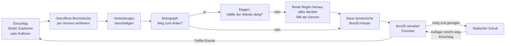

# Nebenan

**Polygonale Echtzeit-Zerstörung für [Box3D](https://github.com/erincatto/box3d), gebaut für Tempo.**
Wände brechen in echte konvexe Polygon-Bruchstücke, nicht in Voxel. Jedes Bruchstück ist eine Box3D-Hülle,
jedes lose Trümmerteil ein Box3D-Starrkörper. Häuser stürzen Etage für Etage ein: Fehlt einer Etage mehr als die
Hälfte ihrer Wände, fliegt der Rest heraus, und alles darüber kommt in einem Stück herunter. Kein Trümmerteil wird
gelöscht. Kein Staub, keine Schatten: Jede Millisekunde geht in die Zerstörung.

- Geschrieben in C17 nach dem Vorbild von Box3D: datenorientiert, Pools mit Generations-IDs, Arena für
  temporäre Daten, keine Abhängigkeiten außer Box3D
- Voronoi-Bruch, der sich auf den Einschlag konzentriert: kleine Splitter am Einschlagpunkt, große Platten
  weiter weg. Nur die getroffenen Bruchstücke werden verfeinert, der Rest der Wand bleibt ein großes Stück
- Ein Einschlag rechnet auf mehreren Threads, über das Task-System der Anwendung oder eingebaute Threads: Schaden
  an den getroffenen Stücken, Bruchpunkte, Voronoi-Zellen und Hüllen. Derweil weckt der aufrufende Thread den Schutt
  am Einschlag auf. Das Ergebnis hängt nicht von der Zahl der Threads ab
- Die Physik rechnet auf einem eigenen Thread, während das Programm zeichnet: `nbWorld_Advance` startet die Schritte,
  die ein Bild braucht. Wer danach die Welt anfasst, wartet automatisch auf den Schritt, und die Welt rechnet bitgleich
  wie ohne. `nbWorld_GetDrawPoses` gibt jedem Bild Lagen zwischen den letzten zwei Schritten, damit die Trümmer auch auf
  Monitoren mit mehr als 60 Hz flüssig fliegen
- Der Takt der Physik ist wählbar, 30, 60 oder 120 Schritte pro Sekunde (`stepRate`), jeder mit so vielen Teilschritten,
  dass es 240 pro Sekunde sind. 30 Hz kostet weniger, 120 Hz ist genauer, die Vorgabe sind 60 Hz
- Einsturz Etage für Etage, auf jeder Höhe und in jeder Reihenfolge: Jede Etage gibt nach, wenn ein eigener Anteil ihrer
  Wände zerstört ist, mit dem Standard zwischen 17 und 31 %, je Etage zufällig und für dasselbe Haus immer gleich, die
  oberste unter dem Dach bei 18 bis 25 %. Was von den Wänden bleibt, mit dem Standard alles, bleibt ohne Stoß stehen und
  zerbricht in seine Zellen, was nicht bleibt, fliegt mit Wucht heraus, alles einstellbar. Alles darüber kommt als ein
  Stück auf die losen Zellen herunter und kippt über das, was stehen blieb, bei Schaden auf einer Seite zur zerstörten
  hin, oder bleibt auf ihnen stehen, bis Treffer sie wegschießen. Die Räume oben bleiben ganz und geben wieder Deckung.
  Sonst stürzt an einem Haus nichts ein, keine Wand über einem Loch und keine Decke, nur was ganz abgetrennt ist, fällt
- Die Wände sind beim Laden in Zellen zerlegt, die auch um die Hausecken laufen, Fenster und Türen sind
  ausgeschnitten. Der Riss unter dem Teil, das herunterkommt, folgt den Zellen und ist überall polygonal
- Für Bauwerke ohne Decken gibt es wahlweise eine Lastprüfung nach dem Lastlöser der Referenz-Engine: Last und
  Schwerpunkt fließen über die Verbindungen zu den Ankern, Verbindungen brechen unter Druck und Biegung
- Kollisionsschaden: Kanonenkugeln und herabfallende Trümmer beschädigen, was sie treffen. Was ein Einsturz
  herunterbringt, beschädigt nichts
- Für ganze Städte gebaut, ohne etwas zu löschen: Trümmer, die zur Ruhe kommen und auf festem Grund liegen,
  werden zu statischem Schutt und kosten Box3D nichts mehr. Box3D bewegt nur eine begrenzte Zahl Trümmer
  gleichzeitig, verdeckte Flächen werden nicht gezeichnet
- Städte größer als der Speicher: Ein Haus, dem nichts passiert ist und an dem nichts liegt, kann aus dem Speicher
  gehen und kommt bitgleich wieder (`nbDestructible_CanUnload`). Ein beschädigtes Haus, an dem alles ruht, geht samt
  Schutt in einen Puffer und kommt daraus bitgleich wieder (`nbSaveDestructibles`, `nbLoadDestructibles`). Die Demo
  hält von 65 536 Häusern nur die um die Kamera und um alles, was sich bewegt
- Ein Regler für die Bruchstückgröße, der wichtigste Hebel für die Leistung, auch zur Laufzeit
- Deterministisch: gleiche Eingaben ergeben bitgleich das gleiche Bruchmuster, unter Windows, Linux und macOS,
  auf x64 und ARM
- PC-Demo für Windows (Direct3D 11), macOS (Metal) und Linux (OpenGL)

## Demo herunterladen

Jeder Push baut die Demo automatisch mit GitHub Actions.

1. Im Repository oben auf **Actions** klicken, links den Workflow **Build** wählen und den neuesten grünen
   Lauf öffnen.
2. Unten unter **Artifacts** `nebenan-demo-windows` herunterladen (dafür muss man bei GitHub angemeldet
   sein). Für Mac und Linux gibt es `nebenan-demo-macos` und `nebenan-demo-linux`.
3. ZIP entpacken und `nebenan_demo.exe` starten.

Das ist ein Release-Build. Die EXE ist nicht signiert. Wenn Windows SmartScreen warnt: **Weitere
Informationen**, dann **Trotzdem ausführen**. Sie braucht keine Installation und kein
Visual-C++-Redistributable. GitHub löscht Artefakte nach 90 Tagen. Mit **Run workflow** auf der Workflow-Seite
entsteht ein neuer Build.

Unter Linux und macOS gehen beim Entpacken die Ausführungsrechte verloren: `chmod +x nebenan_demo`.
Auf dem Mac zusätzlich `xattr -d com.apple.quarantine nebenan_demo` oder im Finder Rechtsklick,
**Öffnen**. Der Mac-Build läuft auf Apple Silicon.

## Selbst bauen

Voraussetzungen: CMake 3.22 oder neuer und ein C17/C++17-Compiler. Box3D und Dear ImGui liegen als Quellcode im
Ordner [`extern`](extern) bei und werden mitgebaut, der Build braucht also kein Internet.

**Windows** mit Visual Studio 2022 oder neuer (Workload „Desktopentwicklung mit C++"):

```bat
git clone https://github.com/holz231/nebenan.git
cd nebenan
build.bat
build\bin\Release\nebenan_demo.exe
```

`build.bat` in der „Developer Command Prompt" von Visual Studio ausführen, dort ist CMake schon im Pfad. Statt zu
klonen geht auch der ZIP-Download von GitHub: entpacken und im Ordner `build.bat` ausführen.
Danach liegt die Projektmappe `nebenan` im Ordner `build`. In Visual Studio öffnen, oben **Release** statt
Debug wählen, F5 startet die Demo.

**Immer Release zum Messen.** Ein Debug-Build ist 5- bis 20-mal langsamer: ohne Optimierung, ohne Inlining, mit
Laufzeitprüfungen bei jedem Array-Zugriff. Die Demo zeigt einen Debug-Build rot an.

**Linux** (Ubuntu/Debian):

```sh
sudo apt install build-essential cmake git libgl-dev libx11-dev libxi-dev libxcursor-dev
./build.sh
build/bin/nebenan_demo
```

**macOS** mit den Xcode Command Line Tools und CMake (`brew install cmake`):

```sh
./build.sh
build/bin/nebenan_demo
```

CMake-Optionen: `NEBENAN_DEMO`, `NEBENAN_TESTS`, `NEBENAN_BENCHMARK` (bei eigenständigem Bau alle an) und
`NEBENAN_WARNINGS_AS_ERRORS`.

## Steuerung

| Eingabe | Aktion |
| --- | --- |
| Linke Maustaste | schießen, gedrückt halten für Dauerfeuer |
| Rechte Maustaste halten | umsehen |
| W A S D | bewegen |
| Q / E | runter / hoch |
| Shift | schneller bewegen |
| Mausrad | vor und zurück |
| 1 / 2 / 3 | Gewehr / Granate / Kanone |
| R | Szene neu laden |
| P | Pause |
| C | lose Trümmer entfernen |
| V | VSync ein und aus |
| F1 | Menü ein- und ausblenden |

**FPS.** Oben rechts steht immer die echte Bildrate, gemessen über die letzten zwei Sekunden: Bilder pro Sekunde,
die mittlere Bildzeit und das 1 % Low, also die Rate der langsamsten 1 % der Bilder. Daran sieht man Ruckler. VSync
ist aus, die Demo zeichnet so viele Bilder, wie der PC schafft. Mit **V** oder `--vsync` bindet sie sich an die
Bildwiederholrate des Monitors. Unter Windows hält das System eine Flip-Swap-Chain sonst auch ohne VSync an der
Bildwiederholrate fest. Die Demo legt deshalb ihre Swap-Chain mit Tearing-Erlaubnis an, wie Microsoft es für
ungebremste Bildraten vorsieht. Im Fenster zeigt der Compositor trotzdem nur ganze Bilder. Kleben die FPS dennoch an
der Bildwiederholrate, sagt das Menü, woran es liegt. Unter macOS bleibt VSync immer an, dort sagt das Menü, wie
viele FPS die CPU schaffen würde. Die Physik rechnet unabhängig davon 60 Schritte pro Sekunde, oder so viele, wie
**Physiktakt** sagt.

**Leistungsregler im Menü**

- **Bruchstückgröße** (Standard ×2): der wichtigste. Größere Bruchstücke heißen weniger Teile pro Einschlag und
  damit weniger Körper, Kontakte und Dreiecke. ×2 halbiert ungefähr die Zeit bei Massenzerstörung. Gilt für die
  nächsten Einschläge.
- **Bewegte Trümmer** (Standard 1500): wie viele Trümmer Box3D höchstens gleichzeitig bewegt. Weniger macht den
  Physikschritt schneller.
- **Physik parallel zum Zeichnen** (Standard an): Nebenan rechnet die Physik eines Bilds auf einem eigenen Thread
  (`nbWorld_Step`), während der Hauptthread das Bild davor zeichnet. Ein Bild kostet dann so viel wie der längere der
  beiden Teile statt beide zusammen und zeigt die Welt einen Schritt später. Die Welt rechnet mit und ohne genau gleich,
  die Zahl der Threads passt sich beim nächsten Laden der Szene an. Hat der Hauptthread kaum etwas zu tun, etwa mit
  einer schnellen Grafikkarte, ist nacheinander schneller, siehe Der Schritt auf einem eigenen Thread.
- **Zwischen Schritten zeichnen** (Standard an): Jedes Bild zeigt die Trümmer zwischen den letzten zwei Schritten der
  Physik, siehe Zeichnen zwischen zwei Schritten. Aus zeigt jedes Bild den Stand nach dem letzten Schritt. **Zeitlupe**
  gibt der Physik ein Viertel der Zeit, dann kommen viermal so viele Bilder wie Schritte, und der Unterschied zeigt sich
  auf jedem Monitor.
- **Physiktakt** (Standard 60 Hz): 30, 60 oder 120 Schritte der Physik pro Sekunde, jeder mit so vielen Teilschritten,
  dass es 240 pro Sekunde sind, siehe Der Takt der Physik. 30 Hz kostet weniger, aber Kontakte und Treffer kommen bis zu
  einen Schritt später, 120 Hz ist genauer und kostet mehr. Mit „Zwischen Schritten zeichnen“ bewegt sich das Bild bei
  jedem Takt flüssig. Die beiden Messknöpfe rechnen mit dem eingestellten Takt, 1/60 s Physik pro Bild.

Daneben stellt **Etage gibt nach** ein, wie viel ihrer Wände zerstört sein muss, bis eine Etage nachgibt, und
**Stütze bleibt**, wie viel der übrigen Wände dann stehen bleibt, in Zellen zerbrochen. **Oberste gibt nach** und
**Oberste Stütze** gelten für die oberste Etage unter dem Dach. Mit **Zufall je Etage** (Standard an) gelten fest die
Bereiche der Bibliothek, aus denen jede Etage beim Laden des Hauses ihre Werte zieht, 17 bis 31 % und 100 %, für die
oberste 18 bis 25 % und 100 %. Die Regler zeigen sie dann nur und sind aus. Ohne sind die Regler an, und alle Etagen
nehmen ihre Werte, Standard 24 % und 100 %, für die oberste 22 % und 100 %. Änderungen gelten sofort, jede Etage behält
ihren Platz in den Bereichen. **Statik ohne Decken** schaltet die Lastprüfung für die Mauern ein (Standard aus).

Die Threads wählt die Bibliothek (`nbGetRecommendedWorkerCount`): einen pro Performance-Kern, höchstens 8. Box3D läuft
am schnellsten ohne Hyper-Threads und Effizienzkerne, und mehr Threads als Kerne bremsen. Mit paralleler Physik bleibt
dem Hauptthread ein Hardware-Thread frei, auf einem PC mit Hyper-Threads oder Effizienzkernen ändert das nichts. Einen
ganzen Kern freizulassen ist dort langsamer: Auf einem Ryzen 7 7800X3D ist ein Bild mit 8 Threads parallel 2,5 % und
nacheinander 1,7 % schneller als mit 7, gemessen mit „7 gegen 8 Threads messen“. Im Benchmark auf der Cloud-VM mit 4
Kernen ist ein Frame der Stadt mit Bruchstückgröße ×2 mit 4 Threads 1,8-mal so schnell wie mit 1 Thread, mit 8 Threads
10 % langsamer als mit 4.

**Messung.** Das Menü zeigt die Bildzeit und die CPU-Zeit pro Bild, aufgeteilt in Einschläge, Simulation und Grafik, als
Mittel und Spitze der letzten 300 Bilder, dazu Box3D-Schritt, Bruchstücke, Körper, Kontakte, Dreiecke, Draw Calls und
Upload. Mit paralleler Physik zählt es die Simulation für sich und beim Hauptthread, wie lange er am Ende eines Bilds
noch auf sie wartet. Es sagt auch, wer die FPS begrenzt: die CPU, die Simulation (der Hauptthread wartet lange auf sie),
die Grafikkarte (ein Bild dauert deutlich länger, als die CPU dafür braucht) oder VSync. „Messwerte kopieren“ legt alles
mit CPU, Grafikkarte und Auflösung in die Zwischenablage, zum Einfügen in einen Chat. „Parallel gegen nacheinander
messen“ lädt die Stadt und reißt sie Haus für Haus mit Granaten ab, Wand für Wand von oben nach unten, bis jedes Haus
unten ist. Er schießt mit Budget 5 000 und nur, solange weniger als 3 000 Trümmer fliegen, denn über dem Budget erstarrt
Schutt im Schub früher, als er zur Ruhe käme. Das macht er einmal kurz zum Aufwärmen, dann parallel, nacheinander,
nacheinander und parallel, mit 1/60 s Physik pro Bild, bei 60 Hz einem Schritt, und jeweils mit den passenden Threads.
Das Ergebnis mit Bildzeit, FPS und 1 % Low für beide und für jeden Lauf kommt ebenso in die Zwischenablage, danach lädt
die Szene von vorher neu. „7 gegen 8 Threads messen“ reißt die Stadt genauso ab, parallel und nacheinander jeweils mit
so vielen Threads, wie die Bibliothek nacheinander nimmt, und mit einem weniger, auf einem Ryzen 7 7800X3D 8 und 7, und
dieselben vier Läufe danach noch einmal rückwärts, damit eine Drift des PCs alle gleich trifft. Der Bericht sagt, was
ein Thread mehr oder weniger in jeder Art ändert und was die Wahl der Bibliothek bringt, parallel gegen nacheinander mit
den Threads, die sie für jede Art nimmt. „Skalierung messen“ reißt die Stadt genauso ab, nach dem Aufwärmen mit 1, 2, 4
und so weiter bis zur empfohlenen Zahl von Threads, alle mit der Physik nacheinander. Die Bibliothek misst dabei jede
Stufe von Box3D und Nebenan und rechnet aus, was mit mehr Threads auf einem Thread übrig bleibt. Die Tabelle dazu kommt
in die Zwischenablage, siehe `nbWorld_GetProfile`. Jeder Bericht nennt CPU und Grafikkarte, denn auf einer schwachen
Grafik begrenzt das Zeichnen die Bildzeit.

**Werkzeuge**

- **Gewehr**: kleiner Krater mit Radius 0,35 m. Splitter platzen an der Oberfläche heraus, bei Dauerfeuer
  entsteht ein Loch.
- **Granate**: Explosion mit Radius 1,3 m, reißt große Löcher und schleudert Bruchstücke radial weg.
- **Kanone**: eine echte Box3D-Kugel mit 45 m/s. Der Schaden entsteht allein aus der Aufprallenergie, die
  Kugel schlägt durch und nimmt Trümmer mit.

**Szenen**

- **Mauern**: Ziegelwände vor einer dicken Betonwand
- **Stresstest**: 16 Wände für viele Trümmer gleichzeitig
- **Stadt**: 20 Häuser aus verputzten Ziegelwänden mit Fenstern und Türen und Betondecken, jedes dritte mit drei
  Stockwerken. Die Wände laufen durch alle Stockwerke und sind in Zellen von etwa 1,2 m zerlegt, die auch um die
  Hausecken laufen, die Decken bleiben ganz
- **Große Stadt**: 65 536 solche Häuser auf 3,6 × 3,1 km, am Stück wären das rund 24 GB. Geladen sind nur die
  Häuser im **Laderadius** um die Kamera (Standard 100 m) und die in der Nähe von allem, was sich bewegt.
  Unberührte Häuser weiter weg gehen wieder, beschädigte gehen samt Schutt in den Speicher der Demo, sobald alles an
  ihnen ruht, und kommen von dort zurück. Das Menü zeigt, wie viele Häuser geladen und wie viele gespeichert sind, was
  das Streaming pro Bild kostet und wie viel Speicher Nebenan und Box3D belegen

**Aufrufoptionen**: `--scene 0..3` startet eine Szene, `--fragment-scale 3` setzt die Bruchstückgröße, `--vsync`
schaltet VSync ein, `--msaa 4` schaltet Kantenglättung ein (Standard aus), `--highdpi` rendert auf hochauflösenden
Bildschirmen in voller Auflösung (Standard aus, kostet Füllrate). `--serial-physics` schaltet die parallele Physik ab,
`--threads N` setzt die Zahl der Threads, `--step-rate 30` den Takt der Physik. `--compare` misst parallel gegen
nacheinander wie der Knopf im Menü, gibt das Ergebnis aus und beendet sich, `--compare-threads` ebenso wie „7 gegen 8
Threads messen“. `--demolition` reißt die Stadt ab wie dabei. `--script` feuert eine vorgegebene Schussfolge ab,
`--frames N` beendet nach N Bildern und meldet Bildzeiten, CPU-Zeiten, Uploads und Dreiecke pro Bild und einen Hash der
Lagen aller Bruchstücke, `--screenshot datei.ppm` speichert das letzte Bild (nur OpenGL).

Hinkt die Physik hinterher, lässt `nbWorld_Advance` die Zeit langsamer laufen, statt Schritte nachzuholen: Mehr als
1/60 s Physik im selben Bild kommt nur, solange der letzte Schritt weniger als 4 ms pro 1/60 s kostete, bei 60 Hz
also ein zweiter Schritt nur nach einem unter 4 ms. Sonst würde jedes langsame Bild das nächste noch langsamer
machen.

## So funktioniert es



**Konvexe Polyeder statt Voxel.** Jedes Bruchstück ist ein konvexes Polyeder aus Ecken und Flächen mit
Ebenen. Schneidet man es mit einer Ebene, entstehen zwei konvexe Polyeder mit exaktem Volumen. Die
Schnittflächen bekommen das Innenmaterial (zum Beispiel Ziegelbruch oder Beton), die Außenflächen behalten
ihr Material. Die gleichen Polygone dienen als Kollisionsform und als Render-Mesh, und jedes Bruchstück hält sie nur
einmal: Nebenan baut die Box3D-Hülle direkt in die Form des Bruchstücks, ihre Punkte und Ebenen sind seine Ecken und
Flächen, und Box3D benutzt sie dort, statt sie zu kopieren.

**Voronoi-Bruch mit Fokus.** Die Bruchpunkte werden um den Einschlag herum verteilt, mit einer Dichte, die
mit der Entfernung abnimmt. Dadurch entstehen am Einschlag Splitter in der Größe `fragmentSize` und weiter
außen große Platten. Ein Hash-Gitter hält die Punkte auf Abstand. Jede Voronoi-Zelle entsteht durch
Schneiden des Bruchstücks an den Mittelebenen zu den nächsten Nachbarpunkten, sortiert nach Abstand. Sobald
der nächste Punkt weiter als der doppelte Zellradius entfernt ist, kann keine weitere Ebene die Zelle mehr
schneiden, und die Suche endet. Die Zahl der Splitter richtet sich nach dem beschädigten Volumen und ist pro
Einschlag begrenzt.

**Hierarchische Verfeinerung.** Nur Bruchstücke, die die Schadenskugel berühren, werden zerteilt, und jedes
nur bis zur Tiefe `maxDepth`. Eine Wand mit einem Einschussloch besteht danach aus ein paar Dutzend Stücken
statt aus Tausenden.

**Mehrere Threads.** Ein Einschlag gibt alles, was nur rechnet, an die Worker. Trifft er 32 oder mehr Stücke, die er
zerteilen kann, schätzen sie zuerst, wie viel von jedem in der Schadenskugel liegt, jedes Stück mit einem eigenen
Zufallsstrom. Daraus verteilt der aufrufende Thread die Splitter auf die Stücke und gibt jedem Stück in fester
Reihenfolge den Zufallsstrom für seine Bruchpunkte. Dann ziehen die Worker die Bruchpunkte und berechnen die
Voronoi-Zellen samt Box3D-Hüllen, eine Zelle wartet nur auf die Punkte ihres Stücks. Kleine Einschläge rechnet der
aufrufende Thread allein, denn mit wenigen Zellen ist er fertig, bevor ein schlafender Worker anläuft. Ab wie vielen
Zellen und Stücken die Worker helfen, misst die Bibliothek selbst: sobald der aufrufende Thread allein dreimal so lange
bräuchte, wie ein Worker zum Anlaufen braucht, zwischen 8 und 32. Auf der VM, wo ein Worker erst nach rund 100 µs
anläuft, liegt diese Schwelle bei 24 bis 32: Bei vierfacher Bruchstückgröße hat eine Granate auf ein Haus 15 bis 30, und
die Worker zu wecken kostete dort mehr, als sie abnahmen. Jede Arbeit hängt nur von ihren Eingaben ab, die Worker holen
sich die nächste über einen atomaren Zähler und schreiben in eine eigene Arena. Währenddessen weckt der aufrufende
Thread den Schutt auf, den der Einschlag bewegt, denn Änderungen an der Box3D-Welt dürfen nur von einem Thread kommen.
Zuletzt werden Stücke und Verbindungen wieder in fester Reihenfolge eingebaut. Deshalb ist das Ergebnis mit einem, vier
oder acht Threads bitgleich. Wie Box3D nimmt Nebenan das Task-System der Anwendung (`enqueueTask` und `finishTask` mit
denselben Signaturen wie in Box3D) oder startet eigene Threads. Die Vorzerlegung beim Laden läuft genauso, und dort
messen die Worker auch die Flächen, mit denen sich die Bruchstücke berühren. Die Verbindungen daraus baut der aufrufende
Thread in fester Reihenfolge. Legt die Anwendung viele Zerstörbare auf einmal an, mit `nbCreateDestructibles`, berechnen
die Worker schon die Zellen des nächsten, während der aufrufende Thread eines in die Welt einbaut. So lädt eine Stadt
ein Drittel schneller, mit denselben Bruchstücken, Verbindungen und Ids wie einzeln angelegt. Mit `nbStartCreating`
bereiten die Worker Zerstörbare im Hintergrund vor, während der aufrufende Thread weitermacht, etwa mit dem
Box3D-Schritt, und `nbFinishCreating` baut sie später nur noch ein. Die eingebauten Threads nehmen dabei alles andere
zuerst, und wer auf einen Einschlag wartet, hilft nie bei einem Haus im Hintergrund. Sie holen sich ihre Aufgaben ohne
Sperre wie der Scheduler von Box3D, nur behält eine Aufgabe ihren Platz, bis sie abgeschlossen ist, auch über mehrere
Schritte. Wer auf eine Aufgabe wartet, hilft mit oder gibt den Kern kurz ab, statt zu schlafen. Mit `nbCreateTaskSystem`
teilen sich Box3D und Nebenan diese Threads, siehe Benutzung. Box3D selbst weckt seine Worker nur, wenn es genug zu tun
gibt: einen für je 250 wache Kontakte, darunter rechnet der aufrufende Thread den Schritt allein (eine Ergänzung, siehe
[`extern/README.md`](extern/README.md)). Ein paar Dutzend wache Trümmer rechnet er so schneller, als er die Worker
wecken und auf sie warten könnte, und unter Dauerbeschuss rechnen alle mit.

**Der Schritt auf einem eigenen Thread.** `nbWorld_Step` rechnet den Box3D-Schritt samt Update auf einem Thread von
Nebenan und kehrt sofort zurück, so zeichnet das Programm sein Bild, während die Physik rechnet. Ein Bild kostet dann so
viel wie der längere der beiden Teile statt beide zusammen. Das lohnt, wenn das Programm in der Zeit genug zu tun hat.
Die Threads des Schritts teilen sich die Kerne mit dem Thread, der zeichnet, und eine Stufe des Schritts wartet auf
ihren langsamsten Worker, so verliert der Schritt Zeit, solange das Programm rechnet. In der Demo auf einem Ryzen 7
7800X3D mit einer RTX 4070 SUPER zeichnet der Hauptthread ein Bild in 0,2 ms, und parallel ist ein Bild je nach Sitzung
2 bis 8 % langsamer als nacheinander. Auf der VM ist parallel mit 0,25 ms Arbeit auf dem Hauptthread gleichauf und mit
1 ms 20 % schneller. Ein Programm, das zwischen seinen Schritten kaum etwas tut, schaltet es mit `nbWorld_SetAsyncStep`
ab. Ruft der Thread, der den Schritt gestartet hat, danach irgendeine Funktion von Nebenan oder Box3D für die beiden
Welten auf, wartet sie zuerst auf den Schritt. Box3D prüft dazu bei jedem Zugriff auf eine Welt, ob ein anderer Thread
sie gerade rechnet (eine Ergänzung, siehe [`extern/README.md`](extern/README.md)). Der Schritt-Thread und die Worker
gehen ohne Warten durch. So bleibt die Reihenfolge aller Änderungen dieselbe wie ohne eigenen Thread, und die Welt
rechnet bitgleich, das Programm muss nichts dafür bauen. Mehrere Schritte in einem Bild warten nicht aufeinander, sie
folgen auf dem Thread hintereinander. `nbWorld_GetBodyEvents` gibt am Anfang des nächsten Bilds die letzte Lage jedes
Körpers, der sich seitdem bewegt hat und noch da ist, `nbWorld_GetDrawPoses` die Lagen zum Zeichnen, siehe Zeichnen
zwischen zwei Schritten. Mit `nbWorld_RunAfterStep` legt ein Programm eigene Arbeit an der Welt hinter den Schritt auf
denselben Thread, die Demo etwa das Streaming der großen Stadt.

**Stützgraph.** Zwei Bruchstücke sind verbunden, wenn sich ihre Flächen berühren. Jede Verbindung hält
`strength × Kontaktfläche` aus, zwischen zwei Materialien mit dem kleineren `strength`. Der Schaden eines
Einschlags fällt zum Rand hin ab. Reißen Verbindungen, sucht Nebenan ab der beschädigten Stelle nach dem
kürzesten Weg zu einem verankerten Stück (Best-First-Suche, dadurch nur lokale Arbeit). Teile ohne Weg zum
Anker werden zu dynamischen Körpern.

**Einsturz.** Häuser stürzen Etage für Etage ein, und sonst stürzt an ihnen nichts ein: keine Wand über einem Loch,
keine Decke, kein Pfeiler unter Last. Nur was ganz vom Boden abgeschnitten ist, fällt.

Beim Laden sucht Nebenan die Decken eines Hauses, die flachen Teile: höchstens ein Viertel so hoch entlang der lokalen
Y-Achse wie breit in beiden anderen Richtungen. Decken, die sich in der Höhe überschneiden, bilden eine Ebene. Eine
Etage ist der Raum unter einer Ebene, von der Ebene darunter oder dem Fuß des Hauses an, und merkt sich das Volumen der
Bruchstücke, deren Mitte in ihr liegt. Ändert sich ein Haus, prüft das nächste Update seine Etagen. Wie sie nachgeben,
sagt `storeyCollapse` mit zwei Bereichen: den Anteil ihrer Wände, den eine Etage verlieren kann, bevor sie nachgibt,
Standard 17 bis 31 %, und den Anteil der übrigen Wände, der dann stehen bleibt, mit dem Standard alles. Jede Etage zieht
beim Laden aus dem `seed` des Hauses, wo sie in jedem der Bereiche liegt, für dasselbe Haus immer gleich. So gibt jede
bei einem eigenen Wert nach und behält einen eigenen Rest. Die oberste Etage unter dem Dach nimmt die Bereiche aus
`topStoreyCollapse`, Standard 18 bis 25 % und der ganze Rest. Ein Spiel ändert beide zur Laufzeit mit
`nbWorld_SetStoreyCollapse`, jede Etage behält dabei ihren Platz in den Bereichen, und gleiche Enden geben allen Etagen
dieselben Werte. Ein Schaden von 0 schaltet den Einsturz ab. Hat eine Etage ihren Anteil verloren, gibt sie nach, auf
jeder Höhe, wie es Kapitel 17 der Roadmap des Spiels in [docs/Referenz](docs/Referenz) beschreibt:

- Von den Wänden, die ihr bleiben, bleibt ihr Anteil ohne Stoß stehen, in ganzen Zellen, so nah daran, wie ganze Zellen
  kommen. Liegt der Schaden vor allem auf einer Seite, die Mitte des Verlorenen also mehr als 35 % des Wegs zur
  Außenwand von der Mitte der Etage entfernt, sind es Zellen in der Mitte der Gegenseite, der stärksten, eine neben der
  anderen vom Boden bis zur Decke: ein Anker. Ist der Schaden ringsum verteilt, sind es Zellen, die der Zufall wählt,
  immer dieselben für dasselbe Haus. Was stehen bleibt, zerbricht in seine Zellen, gebrochen, aber nicht weggesprengt,
  wie es Kapitel 17.1 will: Nur die Zellen auf dem, was darunter steht, bleiben daran fest, die anderen stehen lose
  darauf, wo sie waren, bis der Teil darüber auf sie drückt. Vor `kollaps-4` blieb der Anker eine ganze Wand bis zur
  Decke, fest an dem, was darunter liegt. Bei Schaden ringsum hängen die Zellen meist an nichts mehr und fallen, nur
  Zellen am Boden der Etage bleiben als Stümpfe. Mit dem Standard bleibt alles stehen, was ihr blieb, und nichts fliegt
  heraus. Mit einem Rest von 0 fliegen alle Wände heraus, und der Teil darüber kommt fast gerade herunter.
- Was nicht stehen bleibt, mit dem Standard nichts, fliegt mit 6 m/s aus dem Haus, jedes Stück durch die Seite, an der
  es frei liegt, bei zwei freien Seiten weg von der Mitte des Hauses. Die Teile einer Zelle fliegen zusammen. Aller
  Schutt bis 1 m um sie herum wacht auf, auch der aus früheren Einstürzen, sonst verkeilten sich die Reste darin, und
  die Trümmer dort zählen für das Budget wie neue.
- Alles darüber kommt als ein Stück herunter und bleibt ganz, die Räume oben geben danach wieder Deckung. Eine Zelle
  gehört dorthin, wo ihre Mitte liegt, so folgt der Riss den Zellgrenzen und ist polygonal, auch an den Ecken.
- Es kippt über das, was stehen blieb, wie Schwerkraft und Kontakte es machen, nichts dreht es. Über einem Anker auf
  einer Seite neigt es sich zur zerstörten Seite, und die losen Zellen des Ankers geben unter ihm nach: Das Haus der
  Tests mit dem Erdgeschoss auf einer Hälfte zerstört kippt mit einem Zehntel Rest im Fallen bis 16° und liegt danach um
  8,5° geneigt auf dem, was vom Anker blieb, mit 30 % Rest um 7°, mit 50 bis 80 % wieder um 17 bis 18°, weil mehr lose
  Zellen unter ihm liegen. Mit dem ganzen Anker vor `kollaps-4` lag es mit einem Zehntel um 17° geneigt. Bei Schaden
  ringsum kommt es mit einem Zehntel Rest fast gerade herunter, mit 50 bis 80 % um 5 bis 6° geneigt. Mit 20 % Schaden
  und 30 % Rest landet es auf vielen losen Zellen und liegt danach um 26° geneigt. Mit dem Standard, bei dem alles
  stehen bleibt, sank der Teil darüber in 16 Häusern der Tests, Erdgeschoss und zweite Etage, auf einer Seite und
  ringsum zerstört, in 10 auf die losen Zellen und kippte dabei um bis zu 38°, in 6 blieb er auf ihnen stehen wie ein
  Haus, das auf seinen Trümmern sitzt. 32 Granaten auf die Reste brachten ihn in allen 16 herunter, und nichts blieb in
  der Luft hängen.
- Über der obersten Etage liegt nur noch die Decke, das Dach. Es hängt seitlich an den Wänden, nicht auf ihnen, und
  fiele flach am Anker vorbei. Seit `kollaps-2` kommen darum die Zellen des Ankers, an denen es hängt, mit ihm herunter
  und liegen auf dem Rest des Ankers auf, der wie weiter unten in seine Zellen zerbricht: Das Dach kippt über ihn wie
  die Stockwerke über einer Etage weiter unten, mit einem Zehntel Rest im Haus der Tests im Fallen um 15°, und liegt
  danach fast gerade, um 4° mit drei Stockwerken und um weniger als 2° mit zwei. Mit dem ganzen Anker vor `kollaps-4`
  lag es um 16° geneigt. Bei Schaden ringsum kommt es fast gerade herunter. Mit dem Standard, 18 bis 25 % und allem
  Rest, gibt die oberste Etage nach 12 bis 16 Granaten nach statt nach 35 bis 37, und das Dach blieb in 16 Häusern der
  Tests mit zwei und drei Stockwerken in 12 auf den losen Zellen stehen und sank in 4 um bis zu 13° geneigt ein. 32
  Granaten auf die Reste brachten es in allen auf die Etage darunter, und nichts blieb in der Luft hängen. Vor
  `kollaps-2` zerplatzte die oberste Etage, und das Dach fiel flach hinein.
- Die Etagen darunter bleiben stehen und tragen, was herunterkam. Gibt später eine von ihnen nach, kommt sie mit allem
  darauf herunter, auch wenn es dort schon als Schutt liegt: Aller Schutt über dem, was herunterkommt, wacht auf, bis
  zur Höhe des Hauses, und drückt wieder mit seinem Gewicht auf die Reste, wie das Haus über der Etage, die zuerst
  nachgab. Bis dahin wachte nur der Schutt um die Wände auf, die herausfliegen. Mit dem Standard fliegt nichts heraus,
  und was beim ersten Einsturz herunterkam und erstarrte, blieb oben stehen, bis der letzte Rest unter ihm weggeschossen
  war. Im Haus der Tests, mittlere Etage und dann Erdgeschoss mit dem Gewehr der Demo ringsum zerstört, blieb so in 3
  von 16 Fällen ein Teil auf 5,3 bis 6,2 m, jetzt liegt keins höher als 4,7 m. Was herunterkommt, erstarrt erst, wenn es
  mit den Zellen unter ihm ruht, siehe „Trümmer und Schutt“: Vorher erstarrte es, während es noch mit ein paar
  Zentimetern pro Sekunde einsank, und rückte eine Zelle unter ihm weg, wachte es auf und erstarrte nach drei Schritten
  wieder. Von vorn beschossen blieb der Teil über dem Erdgeschoss so oft auf erstarrtem Schutt stehen, bis der letzte
  Rest weggeschossen war.
- Was herunterkam, bleibt ein Haus, solange es nicht mehr als 45° kippt: Verliert eine seiner Etagen ihren Anteil der
  Wände, stürzt sie genauso ein, auch von unten nach oben. Eine Etage, die schon eingestürzt ist, gibt für Reste von
  weniger als einem Zehntel ihrer Wände nicht noch einmal nach und auch nicht für das, was beim Einsturz von ihr stehen
  blieb, und `nbStats` zählt jede Etage nur einmal. Sonst flögen bei einem größeren Rest die Zellen des Ankers, die ein
  Dach mitnahm, beim nächsten Treffer auf das Dach heraus, und es fiele noch einmal.
- Schneiden Einschläge das Haus über einer Etage ganz ab, bevor sie nachgibt, kommt der Teil darüber genauso herunter,
  und die Reste der Etage fliegen unter ihm heraus.

Was ein Einsturz herunterbringt, bricht nicht und beschädigt nichts, worauf es landet. Kollisionsschaden wäre das
Teuerste an einem Einsturz. Die Prüfung ist ein Durchlauf über die Bruchstücke eines Hauses und läuft nur, wenn es
sich geändert hat. Ein paar Granaten an einer Ecke bringen ein Haus der Demo nicht herunter, ein Ring um eine Etage
schon.

**Lastprüfung ohne Decken.** Für Bauwerke ohne Decken, etwa eine einzelne Mauer oder einen Klotz auf einer Wand, gibt
es wahlweise die Lastprüfung nach dem Lastlöser der Referenz-Engine (`src/structure/structural_loads.cpp` auf dem
Branch `Referenz`). Sie ist aus, `supportScale` 0, und Häuser prüft sie nie. Eingeschaltet prüft das nächste Update
ein Bauwerk ganz, wenn es sich ändert:

1. Eine Kürzeste-Wege-Suche von den verankerten Bruchstücken aus legt fest, wer wen trägt. Auf etwas Tieferem
   aufliegen ist billig, seitlich tragen kostet die Entfernung, beschädigte Verbindungen kosten mehr. Kleine
   Kontaktflächen kosten extra, und die Last einer Wand wölbt sich um ein Loch herum, statt dessen Splitter einzeln zu
   zerdrücken.
2. Die Last fließt von den entferntesten Bruchstücken nach innen, zusammen mit ihrem Schwerpunkt, verteilt nach
   Fläche, viermal so viel über Flächen, auf denen ein Stück aufliegt. Was die Auflage nicht umgreift, etwa ein
   Überhang, biegt die Verbindungen.
3. Eine Verbindung versagt, wenn Kraft durch Tragfähigkeit plus Biegung durch Biegetragfähigkeit über 1 steigt. Die
   Kraft trägt sie mit `strength` pro m², auf Druck ganz, seitlich zur Hälfte, die Biegung über das Widerstandsmoment
   ihrer Kontaktfläche. Beschädigte Verbindungen tragen im Verhältnis ihrer Restfestigkeit.
4. Alle überlasteten Verbindungen reißen zugleich. Was dadurch den Weg zum Anker verliert, fällt als ein Stück.
   Versagt eine unbeschädigte Verbindung unter dem Gewicht darauf, wird das kleinere ihrer beiden Stücke in sechs
   Splitter zerdrückt, die mit 4 m/s quer aus der Wand fliegen.

Die unbeschädigten Zellen eines vorzerlegten Teils tragen dabei zusammen als ein Block, wie das Teil vor der
Zerlegung. Gibt ein Block nach, kommt er mit allem, was an ihm hängt, in einem Stück herunter. Er reißt unter dem
untersten heilen Teil eines anderen Materials ab, das an ihm hängt, etwa einem Betonklotz, sonst über seinem Fuß, und
die Zellen darunter fliegen mit 6 m/s heraus.

Die Biegung braucht die zweiten Momente jeder Kontaktfläche. Nebenan rechnet und speichert sie nur für Bauwerke, die
die Lastprüfung prüft: Sie ist an, und das Bauwerk hat keine Decken. Sonst ist eine Verbindung 64 statt 88 Byte groß.
Wird die Prüfung erst zur Laufzeit eingeschaltet, misst Nebenan die Flächen dieser Bauwerke einmal an den Formen ihrer
Bruchstücke nach.

**Trümmer und Schutt.** Ruhe und Einschlafen folgen ebenfalls der Referenz-Engine (`rubble_rest.h` und
`BuildingScene::settle`). Nichts wird gelöscht.

- Ein Trümmer ist ruhig, wenn er `debrisRestTime` lang, voreingestellt 0,1 s, höchstens 1 cm von einer Lage abweicht,
  die Drehung als Weg seiner entferntesten Ecke gerechnet, und dabei höchstens viermal `debrisSleepThreshold` schnell
  ist. Die erlaubte Abweichung wächst mit der Ruhezeit, 0,1 m/s mal ihre Länge: Bei 0,2 s, dem früheren Wert, sind es
  2 cm. Oder wenn ihn der Löser auf der Stelle schaukelt, sein mittlerer Ort über Halbsekunden-Fenster aber dreimal in
  Folge auf 3 mm stehen bleibt.
- Zu statischem Schutt wird er nur, wenn er auf dem Boden, einem Bauwerk oder Schutt liegt, oder auf einem ruhigen
  Trümmer, der selbst so liegt. Haufen erstarren von unten nach oben, und nichts erstarrt auf etwas, das sich noch
  bewegt. Box3D schläfert nur ganze Inseln ein, diese Kette arbeitet pro Stück. Jedes Stück merkt sich, auf welchen
  Bruchstücken es erstarrt ist und an welcher Stelle.
- Schutt trägt nur, was nicht selbst ihn trägt. Solange ein Stockwerk zum Haus gehört, erstarrt Schutt auf seiner Decke
  und zwischen seinen Wänden. Bricht es ab und sackt ein paar Zentimeter, fängt dieser Schutt es auf, und beide halten
  sich gegenseitig in der Luft. Bevor ein großes Teil ab 0,1 m³ erstarrt, folgt Nebenan deshalb für jedes Stück Schutt,
  das es berührt, den gemerkten Auflagen bis zum Boden oder zu einem Bauwerk. Führt kein Weg dorthin, sondern nur zum
  Teil selbst, zu Bruchstücken, die zerbrochen oder mehr als 5 cm weggerückt sind, oder zu Schutt, der im Flug
  erstarrt ist, trägt das Stück nicht. Das Teil erstarrt nur, wenn sein Schwerpunkt über dem liegt, was es wirklich
  trägt, oder es dazwischen verkeilt ist. Sonst wacht der Schutt auf, der nur durch das Teil hält, zuerst der, auf dem
  es liegt, höchstens 32 pro Update, und das Teil kippt oder fällt. Das gilt auch, wenn kleine bewegte Stücke an seinen
  Seiten es im Gleichgewicht halten: Sonst schläferte Box3D das Teil ein, und beide hielten sich für immer in der Luft.
  Kleine Trümmer unter einem großen Teil tragen es nur, wenn sie selbst ohne das Teil liegen.
- Einschläge wecken den Schutt in ihrer Reichweite, den sie bewegen: Stücke, die der Stoß mit mindestens 1 m/s
  anschieben würde. Schwerer Schutt bleibt statisch und verliert nur die Stücke, die der Einschlag herausbricht.
  Sonst käme ein Haus, das ohne Anker auf seinen Stümpfen steht, bei jeder Granate mit Hunderten Kontakten wieder
  zu Leben. Brechen Stücke unterhalb seines Schwerpunkts heraus, kann ihm aber die Auflage fehlen: Dann wacht er
  doch auf und stellt fest, ob er noch getragen wird. Die Referenz weckt jeden getroffenen Körper, dort kostet das
  nichts, in Box3D der Wechsel eines statischen Körpers mit Hunderten Formen bis zu 1 ms.
- Trifft ein Körper, der kein Trümmer ist, Schutt, etwa eine Kugel, wird das getroffene Stück wach, und beide
  teilen sich den Impuls wie bei einem unelastischen Stoß, denn Box3D hat den Körper schon am statischen Schutt
  abprallen lassen. Trümmer, die auf Schutt fallen, lassen ihn in Ruhe: Stücke mitten im Haufen zu wecken gibt jedem
  Dutzende Kontakte und kostete in der Stadt mehr als alles andere.
- Bewegt sich ein Stück 5 cm von dort, wo es lag, wird der Schutt darauf wach, höchstens 32 pro Update: was höher liegt
  als sein Schwerpunkt und was auf ihm erstarrt ist. Teile, die aus einem Bauwerk, aus Schutt oder aus einem Teil
  brechen, das noch Schutt trägt, nehmen ihren Schutt genauso mit, den Schutt, aus dem sie kommen, nur, wenn er
  inzwischen auf ihnen erstarrt ist. Liegt mehr Schutt darauf, als eine Freigabe auf einmal weckt, 512 Stücke, holt das
  nächste Update den Rest. So bleibt kein Schutt in der Luft hängen.
- Wacht Schutt auf und bleibt 0,05 s lang langsamer als 5 cm/s, liegt er noch auf und erstarrt gleich wieder, statt
  die ganze Ruhezeit abzuwarten. Was seine Auflage verloren hat, ist nach einem Schritt freiem Fall schon schneller.
- Teile eines Gebäudes ruhen erst, wenn Box3D ihre Insel schlafen legt, wenn also auch alles ruht, was sie berühren,
  oder wenn sie auf der Stelle wackeln. Ein Teil, das auf die losen Zellen einer Etage sinkt und über sie kippt, ist oft
  langsamer als 5 cm/s und bleibt 0,1 s lang innerhalb von 1 cm. Erstarrt wöge es nichts, und die Zellen unter ihm gäben
  nie nach.
- Über `maxDebrisBodies` erstarren die langsamsten Trümmer und merken sich ebenso, woran sie liegen: zuerst, was auf dem
  Boden, einem Bauwerk oder Schutt liegt, erst wenn das nicht reicht, auch Trümmer, die langsamer als 1 m/s auf bewegten
  Stücken liegen. Diese Stücke wecken sie wieder, sobald sie sich 5 cm bewegen. Teile von Gebäuden kommen erst dran,
  wenn alle anderen Trümmer nicht reichen. Trümmer im Flug erstarren nie, auch keine, die nur eingeklemmt sind oder
  gleich etwas berühren, sie hingen in der Luft: Das Budget wartet, bis sie landen. Große Teile erstarren so nur, wenn
  sie wie oben im Gleichgewicht liegen, und nie allein auf Schutt, der nur durch sie hält. Ausgenommen sind Trümmer, die
  jünger als 0,25 s sind, und ebenso lange die Trümmer um eine Etage, die nachgibt, und der Schutt, den ein Hausteil
  oder ein solches frisches Stück beim Wegrücken freigibt oder ein großes Teil, das nicht erstarrt. Sonst erstarrten sie
  gleich wieder dort, wo die Etage oder das Teil sie hielt. Höchstens 256 erstarren so in einem Update, nach einer
  großen Explosion übernehmen die nächsten Updates den Rest, jedes mit einer neuen Rangliste.
- Ein Stück, in das ein größeres bewegtes Stück mehr als 2 cm tief eindringt, erstarrt nur zusammen mit diesem, das
  Budget lässt es ganz aus. Allein als statischer Körper drückte es das große Stück auf einmal hinaus und würfe es
  davon, etwa ein Stockwerk, das auf kleinen Trümmern liegt.
- Was unter `killDepth` fällt, hat die Welt verlassen und wird entfernt. Splitter unter `minFragmentVolume` werden gar
  nicht erst erzeugt.

**Box3D-Anbindung.** Jedes statische Bruchstück hat einen eigenen statischen Körper, denn das Entfernen
einer Form in Box3D kostet so viel, wie der Körper Kontakte hat. Jede lose Insel ist ein dynamischer
Verbundkörper mit einer Hülle pro Bruchstück. Verliert ein Körper mit vielen Kontakten viele Formen auf einmal, wenn
ein herabstürzendes Stockwerk in zwei Teile bricht, nimmt Nebenan ihn dafür kurz aus der Simulation: Das löst seine
Kontakte in einem Zug statt einmal pro Form, und Box3D findet sie im nächsten Schritt wieder. Die Hüllen baut Nebenan direkt aus der bekannten Topologie
des Polyeders, 4- bis 6-mal schneller als Quickhull (`b3CreateHull` bleibt der Fallback). Treffer-Events von
Box3D werden zu Kollisionsschaden: Energie aus reduzierter Masse und Aufprallgeschwindigkeit, Radius aus
der Kubikwurzel der Energie. Weil Box3D den Kontakt schon aufgelöst hat, bevor die Wand bricht, bekommt ein
durchschlagendes Geschoss einen Teil seiner Geschwindigkeit zurück (`collisionPassThrough`).

**Verdeckte Flächen.** In einem Bauwerk liegen die meisten Flächen der Bruchstücke innen, zwischen verklebten
Nachbarn. `nbChunk_GetVisibleFaces` sagt, welche Flächen man sehen kann: Eine Fläche, die die Verbindungen zu
den Nachbarn ganz bedecken, liegt innen. Verliert ein Bruchstück eine Verbindung, meldet es
`nbEvents::exposedChunks`, und der Renderer baut sein Mesh neu. In der zerschossenen Stadt halbiert das die
Dreiecke.

**Determinismus.** Zufallszahlen aus PCG32 mit festem Seed, jede Zufallszahl in einer eigenen Anweisung
(C legt die Reihenfolge innerhalb einer Argumentliste nicht fest, und Compiler machen es verschieden), eigene
Kubikwurzel, keine FMA-Kontraktion und sortierte Abfrageergebnisse. Zusammen mit dem deterministischen Box3D
ergeben die gleichen Einschläge bitgleich die gleichen Bruchstücke, egal ob mit MSVC, GCC oder Clang gebaut,
auf x64 oder ARM, mit einem oder mehreren Threads. Die CI prüft das auf allen Plattformen gegen denselben
Hash.

**Speicher.** Pools mit Freilisten und IDs mit Generationszähler wie in Box3D, sodass veraltete IDs erkannt
werden. Temporäre Daten eines Einschlags kommen aus einer Arena, die danach in einem Schritt zurückgesetzt
wird. Eigene Allokatoren lassen sich mit `nbSetAllocator` einhängen, `nbGetByteCount` zählt den Verbrauch.

**Demo-Renderer.** So wenig Arbeit pro Bild wie möglich:

- Alle Meshes liegen indiziert (16-Bit-Indizes, 20-Byte-Vertices) in Vertex-Seiten mit je 32 768 Vertices.
  Jeder Vertex verweist auf einen Transformations-Slot, alle Transformationen gehen einmal pro Bild in einen
  Storage-Buffer, und der Vertex-Shader holt sie sich selbst. Tausende Trümmer kosten so eine Handvoll Draw
  Calls.
- Eine volle Seite liegt in einem unveränderlichen Puffer im Grafikspeicher. Entfernte Bruchstücke bleiben darin
  liegen, versteckt über ihren freigegebenen Slot, bis ein Drittel der Seite tot ist. Dann ziehen die übrigen
  Meshes in die offene Seite um. Zerstörung kostet so kaum Uploads.
- Flache Beleuchtung im Vertex-Shader, der Pixel-Shader schreibt nur die Farbe. Keine Schatten, keine Texturen,
  keine Partikel, keine Kantenglättung und keine volle Retina-Auflösung, solange man sie nicht einschaltet.

## Benutzung

```c
#include "nebenan/nebenan.h"

// Box3D-Welt wie gewohnt
b3WorldDef physicsDef = b3DefaultWorldDef();
b3WorldId physics = b3CreateWorld( &physicsDef );

// Zerstörungswelt daneben, Voronoi-Zellen auf 4 Threads, doppelt so große Bruchstücke
nbWorldDef worldDef = nbDefaultWorldDef();
worldDef.physicsWorld = physics;
worldDef.workerCount = 4;
worldDef.fragmentScale = 2.0f;
nbWorldId world = nbCreateWorld( &worldDef );

// Ziegelwand: 6 m breit, 3 m hoch, 30 cm dick, unten am Boden verankert
nbDestructibleDef wallDef = nbDefaultDestructibleDef();
wallDef.position = b3ToPos( (b3Vec3){ 0.0f, 1.5f, 0.0f } );
wallDef.material.density = 1900.0f;
wallDef.material.strength = 6.0e5f;
wallDef.material.fragmentSize = 0.1f;
nbCreateBox( world, &wallDef, (b3Vec3){ 3.0f, 1.5f, 0.15f } );

// Schuss: Strahl von der Kamera, Einschlag am ersten getroffenen Bruchstück
nbImpactDef shot = { 0 };
shot.radius = 0.35f;
shot.damage = 1.2e5f;
shot.ejectSpeed = 9.0f;
nbImpactResult result;
nbWorld_CastImpact( world, b3ToPos( eye ), b3MulSV( 100.0f, aim ), &shot, &result );

// Granate: ohne Richtung fliegen die Splitter nach allen Seiten, und eine Box3D-Explosion stößt danach jeden Körper im
// Radius an, auch die, die nicht zu Nebenan gehören
nbImpactDef grenade = { 0 };
grenade.point = b3ToPos( target );
grenade.radius = 1.3f;
grenade.damage = 3.0e5f;
grenade.ejectSpeed = 12.0f;
grenade.explosionImpulse = 40.0f * grenade.ejectSpeed;
nbWorld_ApplyImpact( world, &grenade );

// Pro Frame: zuerst die Lagen der Körper, die sich bewegen, zwischen den letzten zwei Schritten
nbDrawPoses poses = nbWorld_GetDrawPoses( world, nbWorld_GetStepFraction( world ) );
for ( int i = 0; i < poses.count; ++i )
{
	// poses.poses[i].transform an die Meshes des Körpers poses.poses[i].bodyId
}

nbEvents events = nbWorld_GetEvents( world );
for ( int i = 0; i < events.createdCount; ++i )
{
	// Neues Bruchstück: konvexes Polyeder im lokalen Raum von nbChunk_GetBody(), dazu welche Flächen
	// man sieht
	nbGeometry geometry = nbChunk_GetGeometry( events.createdChunks[i] );
	bool visible[128];
	nbChunk_GetVisibleFaces( events.createdChunks[i], visible, 128 );
}
// events.destroyedChunks: Meshes entfernen
// events.movedChunks: Bruchstück hängt jetzt an einem anderen Körper
// events.exposedChunks: Mesh neu bauen, verdeckte Flächen können frei geworden sein

// Einschläge und alles andere, was die Welten ändert, dann die Schritte, die dieses Bild braucht, im Takt der Welt
nbWorld_Advance( world, frameTime );
// Zeichnen, die Schritte rechnen derweil auf dem Thread von Nebenan
```

`nbWorld_Advance` plant die Schritte mit `nbWorld_PlanSteps` und startet jeden mit `nbWorld_Step`. `nbWorld_Step`
ersetzt `b3World_Step` und `nbWorld_Update`, siehe Der Schritt auf einem eigenen Thread. Nach dem Schritt fasst das
Programm die Welten bis zum nächsten Frame nicht mehr an, sonst wartet dieser Aufruf auf den Schritt, und das Bild
verliert den Vorteil. Andere Threads lassen die Welten in der Zeit ganz in Ruhe. Mit `asyncStep` aus oder dem alten Weg,
`b3World_Step` und danach `nbWorld_Update`, rechnet alles auf dem aufrufenden Thread, mit derselben Welt.

`nbWorld_PlanSteps` sagt, wie viele Schritte ein Bild braucht, und hebt den Rest der Zeit für das nächste auf. Kommen
die Schritte nicht hinterher, wird die Simulation langsamer, statt mit immer mehr Schritten pro Bild jedes Bild weiter
zu bremsen: Ein Bild rechnet höchstens 1/30 s, mehr als 1/60 s nur, solange der letzte Schritt samt Update weniger als
4 ms pro 1/60 s kostete, und ein Bild zählt höchstens 0,1 s. Bei 60 Hz sind das zwei Schritte oder einer, bei 120 Hz
vier oder zwei, bei 30 Hz einer. Wer schon eine eigene Schleife mit festem Schritt hat, ruft nur `nbWorld_Step`, mit so
vielen Teilschritten, wie `nbGetSubStepCount` für seinen Takt sagt.

**Der Takt der Physik.** Wie viele Schritte die Physik pro Sekunde rechnet, stellt `stepRate` ein, 60 als Vorgabe, zur
Laufzeit `nbWorld_SetStepRate`. Jeder Schritt bekommt so viele Teilschritte, dass es 240 pro Sekunde sind: 8 bei 30 Hz,
4 bei 60 Hz, 2 bei 120 Hz. So löst der Löser bei jedem Takt gleich oft. Die Grenzen pro Update, etwa
`maxCollisionImpactsPerUpdate`, wie viel Schutt ein Update weckt und freigibt oder wie viele Stücke die Lastprüfung
zerdrückt, gelten für 1/60 s und wachsen und schrumpfen mit dem Schritt, so nimmt die Welt bei jedem Takt gleich viel
pro Sekunde. Paarsuche, Kollision und Update laufen einmal pro Schritt: 30 Hz kostet pro simulierter Sekunde weniger,
auf der VM 14 bis 29 %, aber Kontakte und Treffer kommen bis zu einen Schritt später, und schnelle Trümmer durchdringen
einander leichter. 120 Hz ist genauer und kostet 28 bis 44 % mehr. Die Zerstörung verläuft bei jedem Takt etwas anders,
aber bei jedem mit jeder Zahl von Threads bitgleich. Mit `nbWorld_GetDrawPoses` bewegen sich die Trümmer auch mit 30 Hz
flüssig.

**Zeichnen zwischen zwei Schritten.** Die Physik rechnet in festen Schritten, meist 60 pro Sekunde, gezeichnet wird oft
öfter, auf einem Monitor mit 144 Hz zwei- bis dreimal pro Schritt. Mit der Lage nach dem letzten Schritt bleiben die
Trümmer dann für zwei oder drei Bilder stehen und springen weiter, das ruckelt leicht. `nbWorld_GetDrawPoses` gibt jedem
Bild deshalb die Lagen der Körper zwischen ihren Lagen vor und nach dem letzten Schritt, so weit, wie
`nbWorld_GetStepFraction` sagt, also wie weit die Zeit, die `nbWorld_PlanSteps` übrig gelassen hat, in den nächsten
Schritt reicht. Der Schwerpunkt läuft dabei auf einer Geraden, auch wenn der Ursprung eines Körpers Meter daneben liegt
wie bei den Trümmern eines Hauses, und die Drehung nimmt den kürzeren Weg. Das Bild liegt so genau einen Schritt hinter
der Physik, bei 60 Hz 17 ms, ohne die Lagen dazwischen im Mittel einen halben. Die Liste hält jeden Körper, dessen Lage
zum Zeichnen sich seit dem letzten Aufruf geändert hat: die im letzten Schritt bewegten und einmal noch die, die seitdem
stehen geblieben sind, mit ihrer letzten Lage. Mit dem Anteil 1 sind es die Lagen nach dem letzten Schritt. Die Lage vor
dem Schritt und den Schwerpunkt liefert Box3D in jedem Bewegungsereignis mit (eine Ergänzung, siehe
[`extern/README.md`](extern/README.md)). Die Physik ändert sich dadurch nicht. So zeichnet ein Spiel auch mit 30
Schritten pro Sekunde flüssig, siehe Der Takt der Physik.

Gebäude entstehen aus mehreren konvexen Teilen mit `nbCreateDestructible`. Sich berührende Flächen
verschiedener Teile werden automatisch verbunden, `cellSize` zerlegt die Teile schon beim Laden. Ein Teil
kann mit `material` ein eigenes Material bekommen, sonst gilt das des Objekts:

```c
nbPieceDef slab = nbDefaultPieceDef();
slab.halfExtents = (b3Vec3){ 4.5f, 0.125f, 3.25f };
slab.transform.p = (b3Vec3){ 0.0f, 3.125f, 0.0f };
slab.material = &beton;   // Betondecke im Ziegelhaus, def.material ist der Ziegel
```

Bis zu `NB_MAX_MATERIALS` (8) verschiedene Materialien passen in ein Objekt. `nbChunk_GetMaterial` sagt, aus
welchem Material ein Bruchstück ist, und die Box3D-Formen tragen Dichte, Reibung und `userMaterialId` ihres
Materials. Flache Teile wie diese Decke teilen ein Haus in Etagen, siehe Einsturz.

Teile aus demselben Material mit derselben Zellgröße zerlegt Nebenan gemeinsam: Jedes Teil nimmt die Punkte der
anderen bis zwei Zellgrößen jenseits seines Randes mit, so laufen die Zellen über die Stöße zwischen den Teilen
hinweg, etwa um die Ecken eines Hauses, und Risse folgen nicht den Stößen. Die Teile einer Zelle auf beiden Seiten
eines Stoßes fliegen zusammen, damit die gerade Fläche dazwischen nicht zu sehen ist. Ein Teil aus einem anderen
Material, etwa ein Betonklotz auf einer Ziegelwand, behält seine eigenen Zellen.

Fenster und Türen schneidet `openings` aus einem Teil aus, als Quader im Rahmen des Teils. Mit Zellgröße zerlegt
Nebenan das Teil zuerst in Zellen und schneidet die Öffnungen dann aus den Zellen, so laufen die Zellen um die
Öffnungen herum, und Risse folgen nicht deren Kanten. Ohne Zellgröße wird das Teil selbst in konvexe Stücke um die
Öffnungen zerschnitten. `cellSize` am Teil ersetzt die des Objekts, ein negativer Wert lässt das Teil ganz, wie die
Decken der Demo (siehe `AddOpenings` und `PrepareHouse` in [demo/demo.cpp](demo/demo.cpp)):

```c
// Wand durch zwei Stockwerke mit einem Fenster, in Zellen von etwa 1,2 m zerlegt
nbOpening window = { .center = { -2.0f, -1.5f, 0.0f }, .halfExtents = { 0.8f, 0.65f, 0.3f } };
nbPieceDef wall = nbDefaultPieceDef();
wall.halfExtents = (b3Vec3){ 4.5f, 3.25f, 0.15f };
wall.transform.p = (b3Vec3){ 0.0f, 3.25f, 3.1f };
wall.openings = &window;
wall.openingCount = 1;
wall.cellSize = 1.2f;
```

Viele Objekte auf einmal, etwa eine Stadt, legt `nbCreateDestructibles` an. Das Ergebnis ist dasselbe wie mit
`nbCreateDestructible` für jedes Objekt der Reihe nach, aber mit Workern schneller, siehe Mehrere Threads. Die Teile
und alles, worauf sie zeigen, müssen bis zum Ende des Aufrufs leben:

```c
// defs[i] mit den pieceCounts[i] Teilen ab pieceLists[i], ids bekommt die Ids in derselben Reihenfolge
nbCreateDestructibles( world, defs, pieceLists, pieceCounts, houseCount, ids );
```

Eine Stadt, die nicht in den Speicher passt, hält nur die Häuser in der Nähe. Das übernimmt ein Stream
(`nbCreateStream`): Das Programm meldet die Bauplätze mit ihren Grenzen an und sagt in einem Rückruf, was auf einem
Platz steht, und einmal pro Bild bekommt der Stream die Kamera. Er lädt die Häuser im Laderadius, die nächsten zuerst,
und die bis 10 m um jeden Körper, der sich bewegt, bevor der sie erreichen kann, denn ein entladenes Haus hat keine
Kollision. Er lässt keines gehen, an dem in den letzten fünf Sekunden etwas in 20 m vorbeikam. Ein unberührtes Haus
geht, sobald nichts mehr daran liegt, und kommt aus seiner Definition bitgleich wieder. Ein beschädigtes geht samt
Schutt, sobald alles daran ruht, und kommt aus dem Gespeicherten bitgleich wieder. Die Worker bereiten die Häuser im
Hintergrund vor, und nach `nbWorld_Step` streamt der Stream auf dem Thread des Schritts, der Hauptthread zeichnet
weiter. Die Abstände zur Kamera zählen entlang des Bodens, quer zur Schwerkraft, so lädt eine Kamera hoch über der Stadt
dieselben Häuser wie eine auf der Straße (siehe `BuildCityScene` in [demo/demo.cpp](demo/demo.cpp)):

```c
// Was auf einem Platz steht, gefragt, wenn der Stream ihn lädt. Die Teile leben, bis er sie mit release zurückgibt.
static void PrepareHouse( int site, nbSiteDef* siteDef, void* context );
static void ReleaseHouse( int site, void* context );

nbStreamDef streamDef = nbDefaultStreamDef();   // 100 m Laderadius, zwei neue Häuser pro Bild
streamDef.prepareFcn = PrepareHouse;
streamDef.releaseFcn = ReleaseHouse;
streamDef.userContext = &city;
nbStreamId stream = nbCreateStream( world, &streamDef );
for ( int i = 0; i < houseCount; ++i )
{
	nbStream_AddSite( stream, houseBounds[i] );   // die Grenzen des Hauses, wie es gebaut wird
}
nbStream_LoadAround( stream, &camera, 1 );        // alles um den Start auf einmal

// Pro Frame, nach nbWorld_Step
nbStream_Update( stream, &camera, 1 );
```

Die beschädigten Häuser hält der Stream im Speicher. Mit `storeFcn` und `fetchFcn` gehen sie stattdessen etwa in eine
Datei, wie im Benchmark. Über jeden Bauplatz führt der Stream rund 230 Byte Buch, samt Suchbaum. Darunter liegen Bausteine, die es auch einzeln gibt. `nbDestructible_IsIntact` sagt, ob einem
Objekt seit dem Anlegen etwas passiert ist, und `nbDestructible_CanUnload`, ob es jetzt gehen kann: Es ist unberührt,
und im angegebenen Abstand liegen kein Trümmerteil und kein Schutt, und nichts dort bewegt sich oder lässt sich
bewegen. Mit derselben Definition neu angelegt, hat es dieselben Bruchstücke und Verbindungen, bitgleich, nur neue Ids:

```c
// Weit weg von der Kamera, und seit fünf Sekunden kam nichts vorbei
if ( nbDestructible_CanUnload( house->id, 2.0f ) )
{
	nbDestroyDestructible( house->id );   // es bleiben nur Definition und seed
	house->id = nb_nullDestructibleId;
}

// Wieder in Reichweite: dieselbe Definition, dasselbe Haus
nbCreateDestructibles( world, defs, pieceLists, pieceCounts, count, ids );
```

Damit das Laden den aufrufenden Thread kaum kostet, bereiten die Worker die Häuser im Hintergrund vor: Zellen, Formen
und Kontaktflächen hängen nur von der Definition ab. `nbFinishCreating` baut sie ein, mit denselben Ids, Bruchstücken
und Verbindungen, die `nbCreateDestructibles` an dieser Stelle ergäbe. Es wartet, falls die Worker noch nicht fertig
sind, und das Ergebnis hängt nur davon ab, wann es aufgerufen wird, nie vom Tempo der Threads. Definitionen und Teile
müssen bis dahin leben:

```c
// Nach dem Schritt auf dessen Thread: StartLoading ruft nbStartCreating auf und merkt sich city->creation
nbWorld_Step( world, 1.0f / 60.0f, 4 );
nbWorld_RunAfterStep( world, StartLoading, &city );
// … das Bild entsteht, Schritt und Worker rechnen derweil, und im nächsten Frame
nbFinishCreating( city.creation, ids );
```

Am besten startet das Laden nach dem Physikschritt, dann teilen sich die Worker die Kerne nicht mit den Threads von
Box3D. Mit `nbWorld_RunAfterStep` geschieht das auf dem Thread des Schritts, und der Hauptthread zeichnet weiter. Der
Stream macht es genauso.

Ein beschädigtes Haus kann samt Schutt gehen, sobald alles daran ruht. `nbCanSaveDestructibles` sagt, ob es jetzt
geht: Jedes Teil steht oder ist Schutt, die Lastprüfung ist gelaufen, im angegebenen Abstand liegt nichts, was sich
bewegt oder bewegen lässt, und kein Schutt liegt auf einem anderen Haus oder Schutt eines anderen Hauses auf ihm.
Liegt Schutt zweier Häuser aufeinander, gehen beide zusammen. `nbSaveDestructibles` schreibt die Häuser in einen
Puffer, und `nbLoadDestructibles` bringt sie zurück, mit denselben Bruchstücken, Verbindungen und Schuttkörpern,
bitgleich, nur mit neuen Ids. Der Puffer lädt nur in den Build, der ihn geschrieben hat, er ist kein Spielstand.
Auch ein gespeichertes Haus hat keine Kollision, und sein Schutt kann weiter reichen als das Haus. Der Stream merkt
sich deshalb die Grenzen samt Schutt und holt das Haus zurück, sobald sich etwas bis dahin nähert:

```c
// Beschädigt, weit weg von der Kamera, und seit fünf Sekunden kam nichts vorbei
if ( nbCanSaveDestructibles( &house->id, 1, 2.0f ) )
{
	house->size = nbSaveDestructibles( &house->id, 1, NULL, 0 );   // ohne Puffer nur die Größe
	house->saved = malloc( house->size );
	nbSaveDestructibles( &house->id, 1, house->saved, house->size );
	nbDestroyDestructible( house->id );
	house->id = nb_nullDestructibleId;
}

// Wieder in Reichweite: dasselbe Haus mit seinem Schutt
nbLoadDestructibles( world, house->saved, house->size, &house->id );
free( house->saved );
```

Box3D und Nebenan starten sonst je eigene Threads. Mit `nbCreateTaskSystem` teilen sie sich einen Pool, und dessen
Threads nehmen die Aufgaben eines Schritts oder Einschlags vor den Häusern im Hintergrund:

```c
int threads = nbGetRecommendedWorkerCount( true );   // einer pro Performance-Kern, einer bleibt fürs Zeichnen
nbTaskSystem* pool = nbCreateTaskSystem( threads - 1 );   // die Threads neben dem aufrufenden
b3WorldDef worldDef = b3DefaultWorldDef();
worldDef.workerCount = threads;
worldDef.enqueueTask = nbEnqueueTask;
worldDef.finishTask = nbFinishTask;
worldDef.userTaskContext = pool;
b3WorldId physics = b3CreateWorld( &worldDef );

nbWorldDef def = nbDefaultWorldDef();
def.physicsWorld = physics;
def.workerCount = threads;
def.taskSystem = pool;
nbWorldId world = nbCreateWorld( &def );
// … am Ende erst beide Welten löschen, dann den Pool mit nbDestroyTaskSystem
```

Gemessen ist das etwa so schnell wie zwei eigene Pools, mit halb so vielen Threads, siehe Leistung.

Wo die Zeit der Schritte hingeht, sagt `nbWorld_GetProfile`, pro Schritt seit dem Anlegen der Welt oder seit
`nbWorld_ResetProfile`: die Stufen des Box3D-Schritts samt der Teile, die auf dem aufrufenden Thread allein laufen, und
der Teile des Aufbaus des Lösers, der Überlauf des Constraint-Graphen mit den Kontakten, die Box3D an Knoten bündelt,
und wie viele dieser Bündel ein Thread nacheinander rechnet, die Teile des Updates, die Einschläge, Erstarren und
Auftauen, die Zellen der Brüche, der Anteil der größten Insel an der Arbeit des Lösers, wie oft ein Team aller Threads
die größten Pakete von Inseln rechnet, wo dessen Zeit hingeht und wie sich Arbeit und Warten auf seine Stufen und Farben
verteilen, wie lange ein schlafender Worker braucht, bis er anläuft, und ab wie viel Arbeit die Worker deshalb helfen.
Ist dieselbe Arbeit mit verschieden vielen Threads gemessen, rechnet die Bibliothek aus, was davon parallel läuft und
was mit mehr Threads bleibt:

```c
int counts[8];
int countCount = nbGetScalingWorkerCounts( counts, 8 );   // 1, 2, 4 … bis zur empfohlenen Zahl
nbProfile profiles[8];
for ( int i = 0; i < countCount; ++i )
{
	// dieselbe Szene mit counts[i] Threads für Box3D und Nebenan anlegen
	nbWorld_ResetProfile( world );
	// … in jedem Lauf dieselben Einschläge und Schritte …
	profiles[i] = nbWorld_GetProfile( world );
}

nbScaling scaling = nbFitScaling( profiles, countCount );   // T(n) = seriell + parallel / n für jede Stufe
float withEight = nbScaling_Project( &scaling, nb_profileTotal, 8 );
int length = nbFormatScalingReport( profiles, countCount, NULL, 0 );   // die Länge, wie bei snprintf
char* text = malloc( (size_t)length + 1 );
nbFormatScalingReport( profiles, countCount, text, length + 1 );   // alles als Tabellen für ein Log
```

Die komplette API steht in [include/nebenan/nebenan.h](include/nebenan/nebenan.h).

Einbinden in ein eigenes CMake-Projekt:

```cmake
include(FetchContent)
FetchContent_Declare(nebenan
	GIT_REPOSITORY https://github.com/holz231/nebenan.git
	GIT_TAG <commit>
)
FetchContent_MakeAvailable(nebenan)
target_link_libraries(mein_spiel PRIVATE nebenan::nebenan)
```

Gibt es das Ziel `box3d::box3d` schon, verwendet Nebenan dieses Box3D. Demo, Tests und Benchmark werden
beim Einbinden nicht gebaut.

## Parameter

| Material (`nbMaterial`) | Standard | Wirkung |
| --- | --- | --- |
| `density` | 2400 kg/m³ | Dichte. Beton 2400, Ziegel 1900, Holz 600 |
| `strength` | 1·10⁶ | Schaden pro m² Verbindungsfläche bis zum Bruch, und die Last in N pro m², die eine Verbindung auf Druck trägt (seitlich die Hälfte). Höher ist zäher |
| `fragmentSize` | 0,12 m | Kantenlänge der Splitter am Einschlag |
| `minFragmentVolume` | 2·10⁻⁶ m³ | Kleinere Splitter werden verworfen |
| `maxDepth` | 6 | Wie oft ein Bruchstück weiter zerteilt werden kann |
| `friction`, `restitution` | 0,7 / 0,05 | Reibung und Elastizität der Box3D-Formen |

| Welt (`nbWorldDef`) | Standard | Wirkung |
| --- | --- | --- |
| `fragmentScale` | 1 | Multipliziert die Bruchstückgröße aller Materialien. Der wichtigste Regler für die Leistung: doppelte Größe halbiert die Zeit bei Massenzerstörung. Zur Laufzeit mit `nbWorld_SetFragmentScale` |
| `storeyCollapse` | 0,17 bis 0,31 und 1 | Wie die Etagen eines Hauses nachgeben, in zwei Bereichen: `damageMin` bis `damageMax` ist der Anteil ihrer Wände, den eine Etage verlieren kann, bevor sie nachgibt, `residueMin` bis `residueMax` der Anteil der übrigen Wände, der dann ohne Stoß stehen bleibt, in seine Zellen zerbrochen: bei Schaden auf einer Seite als Anker auf der stärksten, über den alles darüber kippt, bei Schaden ringsum an zufälligen Stellen. Jede Etage zieht beim Laden aus dem `seed` des Hauses, wo sie in den Bereichen liegt. Der Rest fliegt heraus, und alles darüber kommt in einem Stück herunter und kippt über das, was blieb. Ein Schaden von 0 schaltet es ab. Zur Laufzeit mit `nbWorld_SetStoreyCollapse`, jede Etage behält ihren Platz in den Bereichen |
| `topStoreyCollapse` | 0,18 bis 0,25 und 1 | Dasselbe für die oberste Etage eines Hauses, die unter dem Dach. Zur Laufzeit mit `nbWorld_SetStoreyCollapse` |
| `supportScale` | 0 | Lastprüfung für Bauwerke ohne Decken, Tragfähigkeit der Verbindungen. Kleiner: sie geben früher nach, 0 schaltet sie ab. Häuser prüft sie nie. Zur Laufzeit mit `nbWorld_SetSupportScale` |
| `maxDebrisBodies` | 1500 | Obergrenze für bewegte Trümmerkörper, darüber erstarren die langsamsten zu Schutt. Gelöscht wird nichts. Zur Laufzeit mit `nbWorld_SetDebrisBudget` |
| `enableRubble` | an | Trümmer, die zur Ruhe kommen und auf festem Grund liegen, werden zu statischem Schutt |
| `debrisSleepThreshold` | 0,12 m/s | Viermal so schnell gilt ein Trümmer höchstens als ruhig. Box3D schläfert Inseln ein, die langsamer sind |
| `debrisRestTime` | 0,1 s | So lange muss ein Trümmer fast still liegen, bevor er als ruhig gilt und erstarren kann, höchstens 1 s. Unter Dauerfeuer wartet fast die Hälfte der bewegten Trümmer nur diese Zeit ab: Kürzer spart dort Box3D-Arbeit, kann aber ein kleines Stück anhalten, das beim Kippen nur kurz innehält. Zur Laufzeit mit `nbWorld_SetDebrisRestTime` |
| `debrisSweepDistance` | 0,2 m | Ab diesem Weg in einem Schritt, oder ab dem doppelten Radius der größten Kugel in seinem dünnsten Bruchstück, wenn der kleiner ist, verfolgt Box3D ein Trümmerteil über den ganzen Schritt gegen statische Formen, damit es nicht durch Wände fliegt. Kleiner halten als die dünnste Wand. 0 nimmt den Box3D-Standard |
| `killDepth` | −100 m | Trümmer darunter haben die Welt verlassen und werden entfernt |
| `collisionSpeedThreshold` | 4 m/s | Ab dieser Aufprallgeschwindigkeit entsteht Schaden |
| `collisionDamageScale` | 12 | Umrechnung von Aufprallenergie (J) in Schaden |
| `collisionRadiusScale` | 0,035 | Schadensradius pro Kubikwurzel der Energie |
| `maxCollisionImpactsPerUpdate` | 4 | Begrenzt die Kollisionseinschläge pro Update von 1/60 s, bei anderem Takt anteilig, siehe `stepRate` |
| `maxFragmentsPerImpact` | 160 | Begrenzt die Kosten großer Explosionen |
| `collisionPassThrough` | 0,6 | Anteil der Geschwindigkeit, den ein durchschlagendes Geschoss behält |
| `workerCount` | 1 | Threads für Einschläge: Schaden, Bruchpunkte, Voronoi-Zellen und Hüllen, der aufrufende Thread zählt mit |
| `enqueueTask`, `finishTask`, `userTaskContext` | leer | Task-System der Anwendung, sonst startet Nebenan eigene Threads |
| `asyncStep` | an | `nbWorld_Step` rechnet auf einem eigenen Thread, während das Programm zeichnet. Die Welt rechnet bitgleich wie ohne. Die Allokatoren müssen threadsicher sein, und die Worker eines Schritts lassen dem zeichnenden Thread am besten einen Hardware-Thread frei, wie `nbGetRecommendedWorkerCount` sie wählt. Lohnt, wenn das Programm in der Zeit genug zu tun hat, siehe Der Schritt auf einem eigenen Thread. Zur Laufzeit mit `nbWorld_SetAsyncStep` |
| `stepRate` | 60 | Schritte der Physik pro Sekunde für `nbWorld_Advance`, 10 bis 240. Jeder Schritt bekommt so viele Teilschritte, dass es 240 pro Sekunde sind (`nbGetSubStepCount`), und die Grenzen pro Update gelten für 1/60 s und wachsen und schrumpfen mit dem Schritt. Weniger kostet weniger, mehr ist genauer, siehe Der Takt der Physik. Zur Laufzeit mit `nbWorld_SetStepRate` |

| Stream (`nbStreamDef`) | Standard | Wirkung |
| --- | --- | --- |
| `loadRadius` | 100 m | Plätze, deren Mitte entlang des Bodens so nah an einer Kamera liegt, werden geladen, die nächsten zuerst. Zur Laufzeit mit `nbStream_SetLoadRadius` |
| `unloadMargin` | 20 m | Ein Platz geht erst jenseits von Laderadius plus diesem Rand, damit einer am Rand nicht kommt und geht |
| `activeLoadRadius` | 10 m | Ein Körper, der sich bewegt, lädt die Plätze, deren Grenzen so nah an ihm liegen, bevor er sie erreichen kann |
| `activeHoldRadius` | 20 m | und hält die Plätze in diesem Abstand fest |
| `holdTime` | 5 s | So lange darf sich nichts in `activeHoldRadius` bewegt haben, bevor ein Platz geht |
| `retryTime` | 0,5 s | Ein Platz, der noch nicht gehen konnte, wird nach dieser Zeit wieder gefragt |
| `margin` | 2 m | Nichts, was sich bewegt oder bewegen lässt, darf so nah an einem Platz liegen, der geht |
| `loadBudget`, `unloadBudget`, `saveBudget` | 2, 4, 1 | Neue Plätze pro Update, Plätze, die gehen, davon beschädigte samt Schutt |
| `loadDelay` | 1 | Updates vom Start im Hintergrund bis zum Einbauen. Eins passt für ein Spiel, mehr für Updates, die direkt aufeinander folgen |
| `prepareFcn`, `releaseFcn` | – | Was auf einem Platz steht, und die Rückgabe der Teile. `prepareFcn` ist Pflicht |
| `storeFcn`, `fetchFcn` | leer | Wohin beschädigte Plätze samt Schutt gehen, etwa in eine Datei. Ohne sie bleiben sie im Speicher |

Die Demo nimmt für Ziegel Dichte 1900, Festigkeit 6·10⁵ und Splitter 0,1 m, für Beton Dichte 2400,
Festigkeit 1,1·10⁶ und Splitter 0,13 m, beides mit Bruchstückgröße ×2.

## Leistung

Gemessen mit `nebenan_benchmark` auf einer Cloud-VM mit 4 Kernen (Intel Xeon), GCC 13, Release.
Ein normaler Spiele-PC ist schneller.

**Eine Stadt aus 16 Häusern unter Dauerbeschuss**, zwölf Granaten pro Sekunde, 20 Sekunden lang, pro Frame alles
zusammen (Einschläge, Box3D-Schritt, `nbWorld_Update`), jeweils der mittlere von drei Läufen:

| Stadt | Ø | 95 % der Frames | Box3D-Schritt Ø |
| --- | ---: | ---: | ---: |
| 1 Thread | 15,3 ms | 25,6 ms | 13,5 ms |
| 4 Threads | 7,8 ms | 14,5 ms | 6,2 ms |
| 1 Thread, `fragmentScale` 2 | 4,1 ms | 6,8 ms | 3,6 ms |
| 4 Threads, `fragmentScale` 2 | 2,7 ms | 4,4 ms | 2,3 ms |

Mit dem früheren spekulativen Abstand von 2 cm in Box3D (siehe [`extern/README.md`](extern/README.md)) waren es am
selben Tag 18,2, 9,0, 4,6 und 3,0 ms im Mittel, mit der früheren Ruhezeit von 0,2 s statt 0,1 s (`debrisRestTime`) bei
einer Messung davor 19,2, 9,2, 5,1 und 3,3 ms.

Die 240 Granaten verteilen sich auf die Wände beider Etagen aller Häuser. Bis `kollaps-3` verlor dabei keine Etage 40 %
ihrer Wände, und nichts stürzte ein, die Zeiten oben sind ohne Einstürze gemessen. Ohne Einstürze überhaupt, damals mit
`storeyCollapseDamage` 0, waren es fast dieselben Zeiten. `nbWorld_Update` kostete dabei mit 4 Threads im Mittel 1,7 ms,
mit doppelter Bruchstückgröße 0,4 ms, und enthält den Schaden durch Aufprall. Seit es den Schutt nicht mehr in jedem
Update einzeln durchgeht, braucht es 26 und 22 % weniger Zeit, am selben Tag auf der inzwischen langsameren VM gemessen
2,65 statt 3,59 ms und 0,69 statt 0,88 ms.

Seit `kollaps-4` gibt eine Etage mit dem Standard bei 17 bis 31 % ihrer Wände nach, die oberste bei 18 bis 25 %, und
alle übrigen Wände bleiben stehen. Unter demselben Beschuss stürzen 6 Etagen ein, mit `fragmentScale` 2 sind es 3.
Gepaart gegen `kollaps-3`, beide als Release gebaut, je drei Läufe im Wechsel, der Median: Ein Frame kostet mit 1, 2 und
4 Threads 10, 13 und 15 % mehr, mit `fragmentScale` 2 12, 6 und 14 %. 99 % der Frames brauchen bis zu 30, 21 und 16 ms
statt 24, 15 und 12 ms, mit `fragmentScale` 2 bis zu 7, 6 und 4 ms statt 6, 4 und 3 ms. Mit den ersten Standardwerten
von `kollaps-4`, 19 bis 20 % und 5 bis 30 % Rest, die oberste bei 40 % und einem Zehntel, stürzten 7 und 4 Etagen ein,
und ein Frame kostete 27 bis 28 und 15 bis 23 % mehr. Teuer ist die Arbeit der Einstürze selbst, was fällt und sich
bewegt, bis es als Schutt liegt.

Gab eine Etage schon nach, wenn ihr 10 % ihrer Wände fehlten, stürzten unter demselben Beschuss 20 bis 21 Etagen ein,
gemessen vor `kollaps-1`, als noch alle übrigen Wände herausflogen, auch in Teilen, die schon heruntergekommen sind. Die
Stadt braucht dann mit 4 Threads 1,4-mal so lange wie ohne Einstürze und mit `fragmentScale` 2 1,7-mal, mit 1 Thread
1,2- und 1,8-mal, jeweils zur selben Zeit gemessen. Teuer ist, was dann fliegt und fällt, bis es als Schutt liegt. Die
Prüfung der Etagen selbst kostet kaum etwas, und was herunterkommt, bricht nicht und bricht nichts. Mit der Lastprüfung
davor, die jedes Haus unter Last einstürzen ließ, brauchte die Stadt unter dem Beschuss oben 1,4- bis 1,8-mal so lange
wie heute ohne Einstürze.

Die Zeit ist zum größten Teil der Box3D-Schritt, und den bestimmen vier Dinge:

- **Bruchstückgröße.** Mit doppelt so großen Bruchstücken liegen am Ende 23 700 statt 78 100 Bruchstücke herum,
  und Box3D rechnet 6500 statt 17 000 Kontakte. Die Zahl der Splitter eines Einschlags fällt mit dem Quadrat
  der Größe.
- **Bewegte Trümmer.** Box3D bewegt höchstens `maxDebrisBodies` (1500) Trümmer gleichzeitig. Was zur Ruhe kommt,
  liegt als Schutt und kostet nichts mehr, am Ende der Stadt 34 100 Körper.
- **Ruhezeit.** Unter Dauerfeuer liegt fast die Hälfte der bewegten Trümmer schon still und wartet nur
  `debrisRestTime` ab, bevor sie erstarren darf. 0,1 statt 0,2 s macht die Stadt mit doppelter Bruchstückgröße 9 bis
  12 % schneller, mit einfacher 3 %.
- **Durchschlagschutz.** Damit nichts durch eine Wand fliegt, verfolgt Box3D schnelle Körper über den ganzen Schritt
  gegen statische Formen und rechnet ihre Kontakte jedes Mal neu. Von sich aus hält es dafür fast jeden fliegenden
  Splitter für schnell: schon ab dem halben Radius der größten Kugel, die in ihn passt, pro Schritt. Nebenan lässt
  Trümmer erst ab dem doppelten Radius verfolgen, spätestens ab 20 cm pro Schritt (`debrisSweepDistance`). Damit
  braucht der Box3D-Schritt in der Stadt mit 4 Threads 6 bis 9 % weniger Zeit, mit 1 Thread 13 %, mit doppelt so
  großen Bruchstücken 3 bis 5 und 9 %. Würfel von 6 bis 50 cm, mit 6 bis 50 m/s auf eine 12 oder 20 cm dicke Wand
  geschossen, prallen dabei alle ab.

**Große Szenen.** Mit vierfacher Bruchstückgröße kostet ein Frame unter Dauerbeschuss gleich viel, ob die Stadt aus 16
oder aus 1 024 Häusern besteht, 0,3 bis 0,7 ms auf der VM je nach ihrer Tagesform. Box3D rechnet nur, was sich bewegt,
und Nebenan geht im Update nie über die ganze Welt. Mit der Größe wachsen Ladezeit und Speicher: 1 024 Häuser mit
246 000 Bruchstücken brauchen 375 MB und laden auf der VM in 0,65 s, mit `nbCreateDestructibles` alle auf einmal,
einzeln in rund 1 s, an ihren langsamen Tagen in mehreren Sekunden. Große Arrays wachsen an Ort und Stelle, in Nebenan
wie in Box3D: Jedes reserviert sich Adressraum und bekommt beim Wachsen dort Speicherseiten dazu, statt umzuziehen.
Früher wurde ein volles Array in ein doppelt so großes kopiert, und das hielt ein einzelnes Update über 100 ms auf.
Die Hüllen der Bruchstücke gehen nicht durch Box3Ds Hüllen-Tabelle, die beim Wachsen alle Hüllen neu einordnen müsste,
und Box3D hält auch keine Kopie: Nebenan baut jede Hülle direkt in die Form ihres Bruchstücks, und die Box3D-Form
benutzt sie dort (`b3ShapeDef::externalHull`). Das spart 12 % Speicher pro Bruchstück. Die Bruchstücke eines Hauses
oder Einschlags und der Schutt, der erstarrt oder auftaut, gehen gesammelt in Box3Ds Suchbäume, als ein Teilbaum mit
einer Suche statt einer pro Stück (`b3World_BeginShapeBatch`, siehe [`extern/README.md`](extern/README.md)). Alle
stehenden Bruchstücke eines Hauses hängen an einem gemeinsamen statischen Box3D-Körper statt jedes an einem eigenen,
dafür führt Box3D die Kontakte jeder Form in einer eigenen Liste (`B3_HAS_SHAPE_CONTACT_LISTS`). Der gemeinsame Körper
lädt große Städte fast doppelt so schnell und spart 16 % Speicher, und mit beidem kostet ein Einschlag in jeder
Stadtgröße gleich viel.
Mehr dazu in [`docs/Optimierungen.md`](docs/Optimierungen.md).

**Ein Block unter Trommelfeuer.** Der Benchmark beschießt außerdem 64 Häuser mit vierfacher Bruchstückgröße mit vier
Granaten in jedem Schritt, 4 800 in 20 Sekunden. Dabei stürzen 10 Etagen ein, und am Ende liegen 45 300 Bruchstücke
herum, 17 500 davon als Schutt. Der Median aus drei Läufen auf der VM:

| Block unter Trommelfeuer | 4 Threads | 1 Thread |
| --- | ---: | ---: |
| Frame Ø | 5,3 ms | 8,4 ms |
| 95 % der Frames | 8,7 ms | 13,3 ms |
| 99 % der Frames | 11,0 ms | 15,5 ms |
| Frames über 16,7 ms, von 1 200 | 0 | 6 |
| Box3D-Schritt Ø | 3,6 ms | 6,8 ms |
| `nbWorld_Update` Ø | 1,2 ms | 1,1 ms |
| Einschläge Ø | 0,5 ms | 0,5 ms |

Mit dem früheren spekulativen Abstand von 2 cm waren es am selben Tag 6,0 und 9,3 ms im Mittel und 13,8 und 18,5 ms bei
99 % der Frames, mit 12 eingestürzten Etagen, mit der früheren Ruhezeit von 0,2 s bei einer Messung davor 6,0 und
10,0 ms mit 9. Welche Etagen einstürzen, hängt an der Lage jedes Trümmers, und die Einstürze machen die teuersten Frames.

Seit `kollaps-1` gibt eine Etage nach, wenn 40 % ihrer Wände zerstört sind, vorher erst bei der Hälfte, und unter dem
Trommelfeuer stürzen 15 statt 12 Etagen ein. Gepaart gegen `physik-45`, je drei Läufe im Wechsel, der Median: Ein
Schritt kostet mit 1 und 2 Threads 3,2 und 6,6 % mehr, mit 4 Threads 1,4 % weniger, das Update 5,8 und 12,8 % mehr und
2,7 % weniger. Mehr kosten vor allem die Zustandswechsel und das Ablegen der Trümmer, denn jeder Einsturz taut den
Schutt um die Etage auf und wirft ihre Wände heraus. Gibt eine Etage wie vorher erst bei der Hälfte nach, stürzen
dieselben 12 Etagen ein, und ein Schritt kostet 1,1 bis 2,4 % mehr. Das ist Rauschen: In denselben Läufen lagen die
Städte mit einfacher und doppelter Bruchstückgröße, in denen nichts einstürzt und beide Stände gleich rechnen, bis zu
7 % auseinander. Was von einer Etage stehen bleibt und wie der Teil darüber kippt, kostet also nichts, teurer ist nur,
dass mehr einstürzt.

Seit `kollaps-4` gibt sie mit dem Standard bei 17 bis 31 % nach, die oberste bei 18 bis 25 %, und unter dem Trommelfeuer
stürzen 114 statt 15 Etagen ein. Gepaart gegen `kollaps-3` wie oben kostet ein Frame mit 1, 2 und 4 Threads 52, 58 und
55 % mehr, ein Schritt 41, 42 und 37 %, und das Update braucht 1,7 bis 1,9 statt 0,7 bis 0,8 ms. Darin kostet es 0,7
statt 0,2 ms pro Schritt, den Schutt über das Budget hinaus erstarren zu lassen, die Zustandswechsel in Box3D kosten 0,8
bis 0,9 statt 0,3 ms und die Prüfung, was zur Ruhe kommt, 0,5 bis 0,7 statt 0,3 ms. Mit den ersten Standardwerten
stürzten 68 Etagen ein, und ein Frame kostete 114 bis 127 % mehr: Heute geben mehr Etagen nach, aber was stehen bleibt,
fliegt nicht heraus. Wer weniger Einstürze will, stellt die Etagen höher ein.

Seitdem bleibt nichts mehr in der Luft hängen: Über dem Budget erstarren keine Trümmer im Flug, und Schutt auf Teilen,
die abbrechen oder wegrücken, kommt mit, siehe „Nichts bleibt in der Luft hängen“. Gepaart gegen den Stand davor kostet
ein Frame unter dem Trommelfeuer mit 1, 2 und 4 Threads 4, 11 und 13 % mehr, in der Stadt bei ×1 3 bis 7 %, bei ×2
nichts Messbares. Vor allem rechnet das Budget öfter, weil fliegende Trümmer erst landen müssen, bei ×4 1,4 statt 1,1 ms
pro Schritt. Auch ein Hausteil hängt nicht mehr auf Schutt, der nur durch es hält, siehe „Kein Hausteil auf seinem
eigenen Schutt“. Das Update kostet damit in keiner Szene mehr, ein Frame liegt bei ×2 und ×4 im Rauschen und kostet bei
×1 mit 1 und 2 Threads im Mittel 4 % mehr. Gibt nach einer Etage auch die darunter nach, kommt jetzt alles darüber mit
herunter, und Teile von Gebäuden erstarren erst, wenn sie mit den Zellen unter ihnen ruhen, siehe „Schutt über einer
Etage, die nachgibt, wacht auf“ und „Hausteile ruhen erst, wenn ihre Insel schläft“. Direkt gepaart gegen den Stand
davor kostet ein Frame bei ×1 mit 1, 2 und 4 Threads +5, +4 und −5 %, bei ×2 nichts Messbares und unter dem
Trommelfeuer bei ×4 8, 8 und 5 % mehr, weil dort mehr Teile wach bleiben. Ganz zerstört mit ×2 und Budget 5 000, eine
Granate pro Schritt, bis alle 32 Etagen der Stadt eingestürzt sind, kostet ein Frame mit 4 Threads 7 % mehr, vor allem
im Budget, siehe „Was die Einstürze die Stadt kosten“. Gegen `kollaps-3` kostet ein Frame bei ×1 18 bis 26 % mehr, bei
×2 13 bis 15 % und bei ×4 86 bis 101 %, weil viel mehr Etagen einstürzen.

Seit `kollaps-5` prüfen die Worker für das Budget vorab, welche Trümmer erstarren dürfen, und der aufrufende Thread
nimmt ihre Prüfung, solange nichts erstarrt ist, was sie gelesen hat. In der Kontakt-Schleife von Box3D holen die Worker
ihre Manifolds aus einem eigenen Vorrat statt einzeln unter einer Sperre. Ein Spiel bekommt beides mit mehr als einem
Worker in `nbWorld_Update` und `nbWorld_Step`, ohne eigenen Aufruf, und an den Ergebnissen ändert sich kein Bit, siehe
„Das Budget schaut auf den Workern voraus“ und „Manifolds der Worker in der Kontakt-Schleife“ in
[docs/Optimierungen.md](docs/Optimierungen.md). Gepaart gegen `kollaps-4`, je vier Läufe im Wechsel, kostet ein Frame
unter dem Trommelfeuer bei ×4 mit 2 und 4 Threads 5 und 7 % weniger, das Update 11 und 14 % und der Box3D-Schritt 3 und
5 %. Mit 4 Threads brauchen dort nur noch 60 statt 102 der 1 200 Frames länger als 16,7 ms. Ganz zerstört mit ×2 und
Budget 5 000, eine Granate pro Schritt, kostet ein Frame mit 4 Threads 19,8 statt 22,2 ms, 11 % weniger, und das Update
4,6 statt 6,5 ms. Bei ×1 und ×2 bleibt ein Frame im Rauschen, mit einem Thread ändert sich nichts.

Seit `kollaps-7` rechnen mehrere Threads die Bündel an den Knoten großer Inseln zugleich: Box3D verteilt sie auf acht
Gruppen, die sich keinen bewegten Partner teilen, und ein Knoten in mehreren Gruppen rechnet in jeder gegen eine eigene
Kopie, siehe „Überlauf an Knoten auf mehreren Threads“ in [docs/Optimierungen.md](docs/Optimierungen.md). Vorher
rechnete sie der aufrufende Thread allein, während die Worker warteten, beim Abriss auf dem Ryzen mit 8 Threads 0,43 ms
pro Schritt. Ein Spiel bekommt das mit mehr als einem Worker in `nbWorld_Step`, ohne eigenen Aufruf. Beim Abriss in der
Demo auf der VM kostet der Überlauf auf dem aufrufenden Thread damit mit 2 und 4 Threads 19 und 42 % weniger und die
Bedingungen des Lösers 9 und 11 %, in der Stadt des Benchmarks bei ×1 ein Frame 3 bis 6 %, bei ×2 und ×4 bleibt es im
Rauschen. Auf dem Ryzen 7 7800X3D rechnet der aufrufende Thread beim Abriss mit 8 Threads am Überlauf 0,16 statt 0,43 ms
pro Schritt, die Bedingungen kosten 19 % weniger, und ein Bild dauert 2,80 statt 2,96 ms, obwohl der Abriss weiter ist,
siehe „Skalierung auf dem Ryzen mit `kollaps-7`“. Mit einem Thread kostet der Überlauf dort, wo sich Knoten teilen, bis
zu 30 % mehr pro Kontakt, in der Stadt bei ×1 auf der VM 0,04 ms pro Schritt. Die Ergebnisse ändern sich, bleiben aber
mit jeder Zahl von Threads gleich. Schwere Teile liegen auf Trümmern so hoch wie vorher und kommen öfter zur Ruhe, und
der Abriss in der Demo kommt in 4 000 Bildern bis zum sechsten statt zum vierten Haus.

Seit `kollaps-8` zählt Box3D in jedem achten Schritt mit Team, wie sich Arbeit und Warten auf dessen Stufen verteilen:
pro Farbe und für Aufbau, Integration, Knoten und Speichern, wie lange die Stufen offen sind, wie viel davon die Threads
an ihren Blöcken und an den übrigen Paketen rechnen und wie lange sie warten, und was der aufrufende Thread zwischen den
Stufen allein rechnet, siehe „Stufen des Teams“ in [`extern/README.md`](extern/README.md). `nbWorld_GetProfile` gibt das
in `nbProfile::teamStages` weiter, ohne eigenen Aufruf, und der Bericht von „Skalierung messen“ zeigt es als Tabelle für
die meisten Threads. Beim Abriss in der Demo auf der VM bei ×2 mit 4 Threads rechnen die Threads in den offenen Stufen
65 bis 66 % ihrer Zeit an Blöcken und 18 bis 19 % an den übrigen Paketen und warten 15 bis 16 %, vor allem nach ihrem
letzten Block. Was die Tabelle mit 8 Threads auf dem Ryzen zeigt, entscheidet, wie es im Löser weitergeht, siehe
[docs/Roadmap.md](docs/Roadmap.md). Die Ergebnisse bleiben bitgleich, und ein Schritt kostet gepaart gegen `kollaps-7`
gleich viel.

Seit `kollaps-9` rechnet das Team nicht nur das größte Paket von Inseln, sondern auch jedes weitere, das mehr als das
Doppelte des Anteils eines Threads hält, siehe „Große Pakete im Team“ in [`extern/README.md`](extern/README.md). Vorher
rechnete ein Thread ein solches Paket allein, und das Team wartete am Ende auf ihn, auf dem Ryzen 7 7800X3D mit 8
Threads ein Viertel seiner Zeit. Mit 8 Threads nimmt das Team beim Abriss in der Demo nach den Inseln auf der VM in rund
40 % seiner Schritte ein zweites Paket mit, mit 4 Threads nie, denn darunter rechnet ein Thread allein das Paket
schneller, als das Team es mitrechnen könnte. `nbWorld_GetProfile` zählt in `nbProfile::teamJoinStepCount`, wie oft
weitere Pakete dazukommen, ohne eigenen Aufruf. Die Ergebnisse bleiben bitgleich, und auf der VM mit 4 Threads kostet
ein Schritt gepaart gegen `kollaps-8` gleich viel. Auf dem Ryzen 7 7800X3D kosten die Bedingungen mit 8 Threads damit
19 % weniger und ein Bild 6 %, 2,62 statt 2,78 ms, siehe „Skalierung auf dem Ryzen mit `kollaps-9`“ in
[docs/Optimierungen.md](docs/Optimierungen.md).

Seit `kollaps-10` baut der aufrufende Thread die Knoten des Überlaufs, während zwei Worker die Körper und Kontakte in
ihre Pakete eintragen und die Kontakte der Farben ordnen, siehe „Der Aufbau des Lösers neben den Knoten“ in
[`extern/README.md`](extern/README.md). Vorher rechnete er den ganzen Aufbau des Lösers allein. Das geschieht ohne
eigenen Aufruf, sobald der Überlauf so viele Kontakte hat, dass die Knoten die Arbeit der Worker überdecken.
`nbWorld_GetProfile` zeigt die Teile des Aufbaus unter `nb_profileSolverSetup`. Auf der VM kostet der Aufbau beim Abriss
in der Demo bei ×2 mit 2 und 4 Threads gepaart gegen `kollaps-9` rund ein Drittel weniger, im Benchmark in den Städten
mit vielen Knoten 8 bis 13 %. Die Ergebnisse bleiben bitgleich. Auf dem Ryzen 7 7800X3D kostet der Aufbau mit 8 Threads
0,098 statt 0,127 ms, ein Schritt im Rahmen der Schwankungen gleich viel, siehe „Skalierung auf dem Ryzen mit
`kollaps-10`“ in [docs/Optimierungen.md](docs/Optimierungen.md).

Die teuersten Frames folgen auf einen Einsturz: Der Schutt um die Reste der Etage taut auf, und Box3D legt im nächsten
Schritt Tausende neuer Kontakte an. Das ist echte Arbeit, das meiste davon fällt danach wirklich, siehe
[`docs/Optimierungen.md`](docs/Optimierungen.md).

Seit `physik-5` wartet Box3D seltener auf den Speicher: Die Box jeder Hülle liegt in ihrer Form, einen Kontakt, den
Box3D nach einem knappen Fehlschlag seines Zwischenspeichers schon gebaut hat, baut es nicht noch einmal, und die
Kontakt-Schleife holt die Daten der nächsten Kontakte voraus, siehe [`extern/README.md`](extern/README.md). An den
Ergebnissen ändert das kein Bit. Unter Trommelfeuer bei vierfacher, doppelter und einfacher Bruchstückgröße, gepaart
über zwölf Folgen von Granaten und neu gegen alt im Wechsel, kostet ein Frame mit 4 Threads 1,5, 3,4 und 3,3 % weniger,
mit einem 3,2, 0 und 3,7 %. Die Tabellen oben sind von davor, am Tag dieser Messung war die VM 30 bis 65 % langsamer.
Seit `physik-6` testet Box3D zwei Stücke nicht mehr, die eine Fläche beweisbar noch auseinanderhält, und holt die Formen
und Hüllen der Kontakte voraus, die es testet. Gepaart gegen `physik-5` kostet die Kollision damit mit 4 Threads 9 bis
18 % weniger und ein Frame bis zu 5,9 %, mit einem Thread die Kollision 14 bis 25 % und ein Frame 6,6 bis 11,6 %. Auch
das ändert kein Bit. Seit `physik-7` holen Box3D und Nebenan an drei weiteren Stellen voraus, an denen sie auf den
Speicher warteten: die Kontakte für den Löser, die Kinder in den Bäumen der Paarsuche und die Trümmerteile samt ihren
Körpern, wenn Nebenan in jedem Update nachsieht, welche zur Ruhe kommen. Gepaart gegen `physik-6` kostet ein Frame damit
mit 4 Threads 2,8 bis 4,8 % weniger und mit einem 2,2 bis 4,4 %, wieder ohne ein Bit zu ändern.
Seit `physik-8` wartet auch der Abschluss der Körper nach dem Löser weniger auf den Speicher, und mit mehreren Threads
nimmt der Löser die Kontakte jeder Farbe nach Körpern geordnet: Ein Kern rechnet so in jeder Farbe vor allem die Körper,
die er auch integriert, und ihr Zustand bleibt in seinem Cache. Gepaart gegen `physik-7` kostet ein Frame damit mit 4
Threads 0,3 bis 4,5 % weniger und mit einem zwischen 3,2 % weniger und 1,0 % mehr, auch das ohne ein Bit zu ändern.
Dazu warten Box3Ds Worker während eines Schritts auf die nächste Aufgabe, statt zwischen den Abschnitten zu schlafen und
jedes Mal über den Kernel geweckt zu werden: Mit 4 Threads kostet ein Frame im Benchmark damit noch einmal 2,0 bis 5,3 %
weniger.
Seit `physik-9` erstarrt Schutt billiger: Box3D geht nach dem Einfügen in den statischen Baum nur so weit nach oben, wie
sich etwas ändert, und sperrt den Allokator der Manifolds nur, solange die Kontakt-Schleife auf mehreren Threads läuft.
Dazu sucht die Etagenprüfung die stehenden Teile eines Hauses vom Ende seiner Liste her. Gepaart gegen `physik-8` kostet
das Update damit 3,2 bis 8,9 % weniger und ein Frame 0,8 bis 3,5 %, ohne ein Bit zu ändern.
Seit `physik-11` rechnet der Löser mit mehreren Threads ganze Inseln am Stück: Zwei Inseln teilen sich keinen
beweglichen Körper, also nimmt sich jeder Thread ganze Pakete von Inseln und rechnet sie vom Vorbereiten bis zum
Zurückschreiben der Stöße ohne eine einzige Sperre, siehe [`extern/README.md`](extern/README.md). Gepaart gegen
`physik-9` kostet ein Frame mit 4 Threads damit bei vierfacher, doppelter und einfacher Bruchstückgröße 10,8, 17,7 und
11,0 % weniger, die Bedingungen des Lösers 38,5, 47,9 und 41,9 %, und im Benchmark werden die teuersten Frames kürzer.
Die Ergebnisse bleiben bitgleich, und mit einem Thread rechnet der Löser wie bisher. Belegen andere Programme alle
Kerne, kostet ein Frame dagegen mehr als vorher, siehe [`docs/Optimierungen.md`](docs/Optimierungen.md).
Seit `physik-12` summiert die Etagenprüfung nur noch, wenn eine Etage in die Nähe ihrer Grenze kommt: Jedes Gebäude
führt mit, was von jeder Etage in seinen stehenden Teilen übrig ist, und die Entscheidungen bleiben dieselben. Unter
Trommelfeuer kostet das Update damit im Benchmark mit 4 Threads 11,6 % weniger und mit einem 12,5 %, ein Frame 3,5 und
4,0 %. Belegen andere Programme die Kerne, rechnet der Löser jetzt eine Weile wieder mit Sperren, sobald seine Threads
immer wieder lange auf die letzten Pakete warten: Mit vier Schleifen, die alle Kerne belegen, kostet ein Frame damit
9,1 % weniger als bei `physik-11`, ohne Last ändert sich nichts.
Seit `physik-14` überspringt Box3Ds Durchschlag-Schutz statische Hüllen, die ein schnelles Bruchstück beweisbar nicht
erreicht, und die Ergebnisse bleiben bitgleich. Bei einfacher Bruchstückgröße fällt so fast die Hälfte dieser Tests weg:
Im Benchmark kostet der Löser samt CCD dort mit 4 Threads 3,8 % und mit einem 11,3 % weniger, ein Frame mit einem Thread
4,4 %.
Seit `physik-15` rechnet der Löser auf Prozessoren mit AVX2 die Kontakte in acht statt vier Spuren, so wie das aktuelle
Box3D, und wählt die Breite zur Laufzeit. Die Ergebnisse bleiben bitgleich, auch zwischen Prozessoren mit und ohne AVX2.
Gepaart gegen `physik-14` kosten die Bedingungen des Lösers mit 4 Threads 13 bis 20 % weniger und mit einem 21 bis 23 %,
ein Frame mit 4 Threads 3,3 bis 4,2 % und mit einem 1,7 bis 4,8 %.
Seit `physik-16` rechnet die Demo die Physik eines Bilds auf einem eigenen Thread, während sie das Bild davor zeichnet,
und die Welt rechnet genau wie vorher. Ohne die Zeichenaufrufe gemessen, also wie mit einer schnellen Grafikkarte,
kostet ein Bild auf der VM damit 13 bis 17 % weniger. Auf einem Ryzen 7 7800X3D kostet ein Bild beim Abriss der Stadt
Haus für Haus bei vierfacher Bruchstückgröße 5,8 % weniger, gemessen mit „Parallel gegen nacheinander messen“. Das lief
noch auf der Grafik im Prozessor. Auf der RTX 4070 SUPER zeichnet die Demo ein Bild in 0,2 ms, und mit `kollaps-5` ist
parallel bei ×2 je nach Sitzung 2,4 bis 7,6 % langsamer, siehe Der Schritt auf einem eigenen Thread.
Seit `physik-17` steckt das in der Bibliothek: `nbWorld_Step` rechnet Schritt und Update auf einem Thread von Nebenan,
und jedes Programm bekommt es ohne eigenen Thread, siehe Der Schritt auf einem eigenen Thread. Die Demo nutzt nur
noch diesen Weg.

**Eine Stadt größer als der Speicher.** Im Benchmark fliegt eine Kamera mit 30 m/s 900 m weit durch eine Stadt aus
65 536 Häusern auf 3,6 × 3,1 km und 300 m zurück, Bruchstückgröße ×4. Am Stück bräuchte sie 24 GB. Geladen sind die
Häuser bis 120 m um die Kamera, höchstens zwei neue pro Frame, und die bis 10 m um alles, was sich bewegt. Die Worker
bereiten sie nach dem Physikschritt im Hintergrund vor, und vier Frames später kommen sie in die Welt: Der Benchmark
rechnet seine Frames ohne Pause hintereinander, ein Spiel mit 16 ms pro Frame braucht nur einen. Ein Haus ab 140 m
geht, wenn sich fünf Sekunden lang nichts in 20 m bewegt hat: ein unberührtes, wenn `nbDestructible_CanUnload` es
erlaubt, ein beschädigtes, wenn `nbCanSaveDestructibles` es erlaubt. Das geht samt Schutt in eine Datei, höchstens
eines pro Frame, und kommt von dort zurück, sobald die Kamera oder etwas, das sich bewegt, ihm nahekommt. Alle fünf
Frames fällt eine Granate auf ein Haus bis 60 m um die Kamera. Der Median aus sechs Läufen auf der VM mit `physik-18`.
Die VM rechnete an diesem Tag langsamer als bei den Zahlen weiter unten, `physik-17` brauchte auf ihr 1,25 ms pro Frame
mit 4 Threads und 2,99 ms mit einem:

| Stadt im Vorbeiflug | 4 Threads | 1 Thread |
| --- | ---: | ---: |
| Frame Ø | 1,2 ms | 3,2 ms |
| davon Streaming Ø | 0,8 ms | 2,7 ms |
| Streaming, 95 % der Frames | 2,7 ms | 8,5 ms |
| Häuser gleichzeitig geladen | höchstens 427 | höchstens 427 |
| Speicher von Nebenan und Box3D | höchstens 206 MB | höchstens 206 MB |

Unterwegs kommen 1 676 Häuser dazu, und 1 350 unberührte gehen wieder. 241 beschädigte gehen samt Schutt in die
Datei, 311 KB jedes, und 54 davon kommen auf dem Rückweg wieder. Jede Granate trifft ein geladenes Haus. Physik,
Update und Einschläge kosten so viel wie in den Städten oben, die ganz im Speicher liegen. Ohne das Auslagern blieben
die beschädigten Häuser geladen, mit bis zu 603 Häusern und 278 MB zugleich, und ein Frame kostete im Wechsel
gemessen 0,93 statt 1,01 ms mit 4 Threads und 1,96 statt 2,12 ms mit einem. Ein Haus zu speichern kostet den
aufrufenden Thread rund 0,4 ms: 0,18 ms der Puffer, 0,12 ms die Datei und 0,13 ms der Abbau. Eines zurückzuholen
kostet 0,3 bis 0,35 ms, und die Fragen, ob ein beschädigtes Haus gehen kann, kosten 0,02 ms pro Frame. Der Rest ist
der Box3D-Schritt, 0,03 bis 0,04 ms, weil die Trümmer anders fallen: Körper und Formen landen auf anderen Plätzen,
Box3D rechnet sie in anderer Reihenfolge, und auf diesem Flug sind dadurch 18 % mehr Kontakte wach. Über 18
Granatenfolgen sind es im Mittel gleich viele, 203 mit und 201 ohne Auslagern.

Seit Box3D seine Worker nur bei genug Arbeit weckt, rechnet auf diesem Flug der aufrufende Thread den Schritt allein:
Im Mittel sind keine 200 Kontakte wach. Der Box3D-Schritt braucht so 0,27 statt 0,45 ms, 95 % der Schritte bis 0,62
statt 1,73 ms, und ein Frame 0,90 statt 0,97 ms, je drei Läufe im Wechsel. Das Streaming steigt dabei auf 0,54 ms, weil
der Benchmark seine Frames ohne Pause rechnet: Kürzere Frames lassen den Workern weniger Zeit für die Häuser im
Hintergrund, und das Einbauen wartet öfter auf sie. Im 60-Hz-Takt bleibt es bei 0,44 ms, der Schritt braucht dort
0,46 statt 0,51 ms und ein Frame 1,06 statt 1,13 ms. Unter Dauerbeschuss weckt Box3D wie zuvor alle Worker, die Städte
oben und die Einschläge unten kosten gleich viel. Teilen sich Box3D und Nebenan einen Pool aus `nbCreateTaskSystem`,
kostet der Flug 0,91 statt 0,87 ms pro Frame, die Städte unter Beschuss 9,16 statt 8,97 ms und 3,08 statt 3,18 ms im
Box3D-Schritt, nur das Gewehr 1,19 statt 1,02 ms, je drei Läufe. Mit dem früheren Scheduler mit Sperre waren es unter
Last 14 bis 28 % mehr.

Mit 4 Threads kostet das Laden im Hintergrund den aufrufenden Thread 40 % weniger als mit `nbCreateDestructibles`, im
Wechsel gemessen 0,47 statt 0,78 ms Streaming und 0,93 statt 1,25 ms pro Frame. Mit einem Thread gibt es keinen
Hintergrund, das Laden läuft beim Start. Die Formen eines Hauses, das die Worker vorbereiten, liegen in einem Block, so
gibt das Entladen einen Block frei statt rund 240 Formen, die die Worker angelegt haben: im Wechsel gemessen 0,43 statt
0,47 ms Streaming mit 4 Threads. Box3D nimmt eine Form aus seinem statischen Suchbaum nur noch bis zum ersten Knoten
heraus, der sich nicht mehr ändert, mit demselben Baum wie zuvor. Auf dem aufrufenden Thread bleiben das Einbauen und
das Entladen, mit einem Thread rund 0,11 und 0,09 ms pro Frame.

Seit `physik-18` lädt und entlädt ein Stream der Bibliothek die Stadt, mit denselben Regeln wie zuvor die eigene Kopie
des Benchmarks. Gepaart gegen `physik-17` über sechs Granatenfolgen mit je zwei Läufen kostet ein Frame mit 4 Threads
3,9 % weniger und 95 % der Frames 12,4 % weniger, mit einem Thread 1,8 % und 0,2 % mehr. Die Worker haben ein Frame
mehr Zeit: Der Stream baut ein Haus nach dem vierten Schritt seit dem Start ein, die Kopie baute es vor diesem Schritt
ein. So kostet das Einbauen samt Warten mit 4 Threads 0,49 statt 0,61 ms pro Frame. Die Auswahl der
nächsten Häuser kostet 0,016 statt 0,020 ms, das Markieren um bewegte Körper 0,046 statt 0,027 ms: Jeder Körper fragt
den Suchbaum des Streams statt das Raster der Kopie, rund 1,3 statt 0,9 µs, und auf diesem Flug bewegen sich 35 statt
30 Körper pro Frame. Die Buchführung über die Bauplätze zählt jetzt zum Speicher der Bibliothek, 234 Byte pro Platz
samt Suchbaum, 15 MB für die 65 536 Häuser. Die Kopie führte ihre Liste selbst und zählte sie nicht mit. Die Trümmer
fallen etwas anders, weil der Stream die Welt in anderer Reihenfolge ändert: 26 statt 8 Häuser laden für bewegte
Körper, über die sechs Granatenfolgen im Mittel 4,7 statt 1,3, bei fünf davon 0 bis 2.

Seit `physik-19` ordnet der Stream die bewegten Körper in Zellen so groß wie der Halteradius, und jede Zelle durchsucht
den Baum der Bauplätze einmal für alle ihre Körper, mit denselben Ergebnissen wie zuvor. Gepaart gegen `physik-18`
kostet das Markieren 0,76 statt 1,11 µs pro Körper mit 4 Threads und 0,96 statt 1,30 µs mit einem, weniger als das
Raster der alten Kopie. Ein Frame der Stadt kostet so mit 4 Threads 1,3 % weniger über sechs Granatenfolgen.

Seit `physik-21` misst die Bibliothek selbst, wo die Zeit der Schritte hingeht und wie sie mit den Threads skaliert,
siehe `nbWorld_GetProfile`, und die Demo hat dafür den Knopf „Skalierung messen“. Auf der VM mit 1, 2 und 4 Threads
gemessen und auf 8 hochgerechnet, bleiben bei ×1 71 % von 7,9 ms pro Schritt samt Update und Einschlägen auf einem
Thread, bei ×2 83 % von 2,9 ms und bei ×4 80 % von 5,5 ms. Was davon auf dem Ryzen bleibt, entscheidet über die nächsten
Schritte, siehe [docs/Roadmap.md](docs/Roadmap.md). Das Profil kostet nichts Messbares: Gepaart gegen `physik-20` über
drei Runden im Wechsel liegt ein Frame der Städte mit 4 Threads zwischen 5,8 % darunter und 7,1 % darüber, mit einem
zwischen 4,7 % darunter und 3,7 % darüber, ohne Richtung, und ein Schritt des Gewehrs mit einem Thread kostet über acht
Läufe im Wechsel 1,006 statt 1,003 ms. Die Endstände sind dieselben.

Seit `physik-22` löst Box3D die Kontakte von Knoten, großen abgebrochenen Teilen mit Hunderten Trümmern daran, in
Bündeln gegen Kopien des Knotens, statt sie auf dem aufrufenden Thread einzeln nacheinander zu rechnen, während die
Worker warten, siehe „Knoten im Überlauf mit geteilter Masse“ in [docs/Optimierungen.md](docs/Optimierungen.md). Beim
Abriss in der Demo kosten die Bedingungen des Lösers auf der VM mit 4 Threads bei ×4 41 % und bei ×2 37 % weniger, ein
Schritt samt Update 16 und 15 %, mit einem Thread die Bedingungen 33 und 19 % und ein Schritt 13 und 3 %. Auf dem
Ryzen 7 7800X3D kosten die Bedingungen mit 8 Threads 53 und 51 % weniger und ein Schritt 26 und 19 %, siehe „Skalierung
auf dem Ryzen mit `physik-22`“. Die Ergebnisse ändern sich, bleiben aber mit jeder Zahl von Threads gleich, und eine
schwere Platte auf vielen kleinen Würfeln liegt genauso wie vorher.

Seit `physik-24` rechnet ein Team aller Threads das größte Paket von Inseln, sobald es deutlich mehr Arbeit hat als ein
Thread im Mittel bekommt: Farbe für Farbe in den Stufen des Lösers, und wer keine neue Stufe findet, rechnet eines der
übrigen Pakete ganz, siehe „Ein Team für das größte Paket“ in [`extern/README.md`](extern/README.md). Vorher rechnete
ein Thread dieses Paket allein, beim Abriss auf dem Ryzen mit 8 Threads mindestens ein Drittel der Arbeit. Beim Abriss
in der Demo auf der VM mit 4 Threads kosten die Bedingungen des Lösers damit bei ×4 15 % weniger und ein Schritt samt
Update 7 %, bei ×2 die Bedingungen 4 %. Auf dem Ryzen 7 7800X3D kosten die Bedingungen mit 8 Threads bei ×4 16 % weniger
und ein Schritt 4 %, bei ×2 bleibt es gleich, siehe „Skalierung auf dem Ryzen mit `physik-24`“. Die Ergebnisse bleiben
bitgleich, und mit einem Thread ändert sich nichts.

Seit `physik-25` prüfen die Worker im Update, welche bewegten Trümmer zur Ruhe kommen und was sie trägt, sobald sich
mindestens 512 Stücke bewegen, siehe „Prüfungen des Updates auf den Workern, zweiter Versuch“ in
[docs/Optimierungen.md](docs/Optimierungen.md). Der aufrufende Thread setzt ihre Antworten in der Reihenfolge der
Trümmer zusammen und lässt erstarren wie vorher. Ein Spiel bekommt das mit mehr als einem Worker in `nbWorld_Update` und
`nbWorld_Step`, ohne eigenen Aufruf. Beim Abriss in der Demo auf der VM mit 4 Threads kostet die Ruhe-Prüfung damit bei
×4 21 % und bei ×2 25 % weniger, das Update 14 und 17 %. Auf dem Ryzen 7 7800X3D kostet sie mit 8 Threads 43 und 42 %
weniger, das Update 32 und 28 %, siehe „Skalierung auf dem Ryzen mit `physik-25`“. Die Ergebnisse bleiben bitgleich, und
`nbWorld_GetProfile` zählt, wie viel davon die Worker übernehmen und wie schnell sie anlaufen.

Seit `physik-26` misst Box3D in jedem achten Schritt, in dem ein Team das größte Paket rechnet, wohin dessen Zeit geht:
was der aufrufende Thread allein am Überlauf des Pakets rechnet und wie lange er am Ende der Stufen auf die anderen
wartet, und wie lange jeder Worker auf eine neue Stufe wartet und die übrigen Pakete rechnet, siehe „Zeiten des Teams“
in [`extern/README.md`](extern/README.md). `nbWorld_GetProfile` gibt das weiter, und der Bericht von „Skalierung messen“
zeigt es als Tabelle. Beim Abriss auf der VM mit 4 Threads rechnet der aufrufende Thread ein Fünftel bis ein Sechstel
der Zeit des Teams allein am Überlauf, und jeder Worker wartet ein Drittel davon. Außerdem helfen die Worker bei Brüchen
und bei den Prüfungen des Updates ab einer Menge, die die Bibliothek danach wählt, wie schnell ihre Worker zuletzt
anliefen, siehe „Schwellen fürs Wecken auf dem Ryzen“ in [docs/Optimierungen.md](docs/Optimierungen.md). Ein Spiel
bekommt beides ohne eigenen Aufruf. Auf der VM, wo ein Worker erst nach rund 100 µs anläuft, ändern sich die Schwellen
kaum, und ein Schritt kostet gepaart gegen `physik-25` gleich viel. Die Ergebnisse bleiben bitgleich. Mit 8 Threads auf
dem Ryzen 7 7800X3D helfen die Worker bei einem Bruch schon ab 8 Zellen und Stücken, ein Schritt kostet bei ×4 aber
ebenfalls gleich viel, siehe „Skalierung auf dem Ryzen mit `physik-26`“.

Seit `physik-28` gibt `nbWorld_GetDrawPoses` jedem Bild die Lagen der Körper zwischen den letzten zwei Schritten, siehe
Zeichnen zwischen zwei Schritten. Die Demo zeichnet damit, und im Menü zeigen „Zwischen Schritten zeichnen“ und
„Zeitlupe“ den Unterschied. Ein Aufruf kostet beim Abriss auf der VM bei ×4 mit rund 1 700 fliegenden Trümmern 0,16 ms
pro Bild, bei ×2 mit rund 3 000 0,30 ms, die Bewegungsereignisse für dieselben Körper 0,06 und 0,12 ms. Die Physik
rechnet unverändert.

Seit `physik-29` rechnen die Kontakt-Kerne des Lösers die Normalen wie upstream Box3D seit
[#189](https://github.com/erincatto/box3d/pull/189): pro Punkt eines Kontakts weniger Kreuzprodukte, und den linearen
Teil der Impulse einmal pro Kontakt, siehe „Normalimpulse wie upstream #189“ in [`extern/README.md`](extern/README.md).
Im Benchmark kosten die Bedingungen des Lösers auf der VM damit 1 bis 8,5 % weniger, meist 3 bis 4 %, beim Abriss in der
Demo bei ×4 1,9 bis 4,9 %. Die Ergebnisse ändern sich, bleiben aber mit jeder Zahl von Threads und auf jeder Plattform
gleich.

Seit `physik-30` sucht der Test zweier Hüllen die Trennachse wie upstream Box3D seit
[#173](https://github.com/erincatto/box3d/pull/173) und [#177](https://github.com/erincatto/box3d/pull/177), siehe
„Trennachsen-Suche wie upstream #173 und #177“ in [`extern/README.md`](extern/README.md). Auf denselben Hüllenpaaren
braucht die Suche 5,1 % weniger Takte, mit einem Thread 0,5 bis 0,7 % eines Schritts, und sie erkennt getrennte Hüllen,
die die alte übersah. Anders als upstream behält der Fork die volle zweite Suche, wenn der Schnitt der Flächen keinen
Punkt ergibt, damit Hüllen, die sich überlappen, auch dann einen Kontakt bekommen, und das Format der Hüllen bleibt. Die
Ergebnisse ändern sich, bleiben aber mit jeder Zahl von Threads und auf jeder Plattform gleich.

Seit `physik-31` enthält der Fork auch die Fehlerbehebungen von upstream Box3D aus
[#187](https://github.com/erincatto/box3d/pull/187), siehe „Fehlerbehebungen wie upstream #187“ in
[`extern/README.md`](extern/README.md): Kugeln bekommen mit Kugeln und Kapseln vorausschauende Kontakte, bevor sie sich
berühren. Nebenans Trümmer rechnen bitgleich weiter, ein Spiel mit Kugeln, etwa für Geschosse, bekommt die
Fehlerbehebungen mit. Was upstream sonst bis #191 geändert hat, betrifft Netze, Compounds, Recording und Mover, die
Nebenan nicht nutzt.

Seit `physik-32` kollidiert eine Welt mit acht Spuren konvexe Formen mit einer zweiten Fassung des Tests zweier Hüllen,
übersetzt für AVX2, siehe „Kollision mit AVX2“ in [`extern/README.md`](extern/README.md). Der Test braucht damit auf
denselben Hüllenpaaren 3,4 bis 3,9 % weniger Takte, mit einem Thread gut 1 % eines Schritts. Die Ergebnisse bleiben
bitgleich, auf Prozessoren ohne AVX2 rechnet Box3D wie vorher.

Seit `physik-33` überspringt die Kollision mehr Tests zweier Hüllen, die eine Fläche auseinanderhält, siehe „Getrennte
Hüllen ohne neuen Test“ in [`extern/README.md`](extern/README.md). Der Kontakt merkt sich dafür die Ebene der Fläche und
die Grenzen der anderen Hülle, und die Schranke zählt nur die Bewegung entlang der Normalen. In den drei Städten des
Benchmarks kommen 31 % weniger Kontakte in den Test, die zweite Schleife der Kollision braucht 6,7 % weniger Takte. Ein
Kontakt ist dafür 248 statt 232 Byte groß. Die Ergebnisse bleiben bitgleich. Gepaart gegen `physik-32` kostet die
Kollision bei ×1 rund 5 % weniger.

Seit `physik-34` holt die Kollision die Hüllen jedes Kontakts ganz voraus, bis 2 KB je Hülle, siehe „Zweistufige
Kontakt-Schleife“ in [`extern/README.md`](extern/README.md). Vorher wartete der Test zweier Hüllen auf ihre Ebenen,
Ecken und Kanten. Gepaart gegen `physik-33` kostet die Kollision bei ×1 8 bis 13 % weniger und bei ×4 14 bis 17 %, ein
Frame bei ×1 3 bis 6 % und bei ×4 7 bis 10 %. Die Ergebnisse bleiben bitgleich.

Seit `physik-35` holen zwei Schleifen von Box3D, die allein auf dem aufrufenden Thread laufen, voraus, was sie lesen:
das Anlegen neuer Kontakte und das Abarbeiten der Kontakte, die zu berühren beginnen oder aufhören, siehe „Neue Kontakte
und Zustandswechsel vorausladen“ in [`extern/README.md`](extern/README.md). Gepaart gegen `physik-34` kostet das Anlegen
bei ×1 28 bis 36 % weniger und das Abarbeiten 17 bis 20 %, zusammen 0,20 bis 0,23 ms pro Schritt. Mit vielen Threads
liegt genau dieser Teil auf dem kritischen Pfad. Die Ergebnisse bleiben bitgleich.

Seit `physik-36` holt Box3D beim Löschen von Kontakten voraus, was es anfasst, und Nebenan sucht den Schutt, den ein
wegrückendes Stück oder ein Einschlag freigibt, nur noch im Baum der statischen Körper, siehe „Abbau der Kontakte
vorausladen“ und „Abfrage nur der statischen Formen“ in [`extern/README.md`](extern/README.md). Gepaart gegen
`physik-35` kostet das Lösen von Schutt bei ×1 30 bis 32 % weniger, die Zustandswechsel der Kontakte bis 10 % und die
Typwechsel 3 bis 7 %, zusammen 0,06 bis 0,12 ms pro Schritt auf dem aufrufenden Thread. Ein Spiel muss dafür nichts
aufrufen. Die Ergebnisse bleiben bitgleich. Auf einem Ryzen 7 7800X3D kostet beim Abriss der Stadt mit `physik-33` bis
`physik-36` zusammen die Kollision 4 bis 7 % weniger, die Zustandswechsel 7 bis 18 % und das Lösen von Schutt 23 bis 33
%, ein Schritt mit 1 bis 4 Threads 2 bis 4 % und mit 8 Threads bis 2 %, siehe „Skalierung auf dem Ryzen mit `physik-36`“
in [docs/Optimierungen.md](docs/Optimierungen.md).

Seit `physik-38` sucht Box3D die neuen Paare in einer parallelen Schleife statt in zwei, siehe „Paarsuche in einem
Durchgang“ in [`extern/README.md`](extern/README.md). Mit vielen Threads warteten die, die mit ihrem Teil der ersten
Schleife fertig waren, an ihrem Ende, und die zweite weckte die Worker noch einmal. Gepaart gegen `physik-36` kostet die
Paarsuche auf der VM mit 4 Threads bei ×2 7 bis 10 % weniger, mit einem Thread gleich viel. Die Ergebnisse bleiben
bitgleich.

Seit `physik-39` sucht der Test zweier Hüllen nur noch voll ein zweites Mal, solange keine Fläche die Hüllen trennt,
siehe „Zweite Suche nur bei Überlappung“ in [`extern/README.md`](extern/README.md). Trennte schon eine Fläche, fand die
zweite Suche nur Kontakte, die eine Überlappung von 3 cm bis 1,2 m behaupteten, wo die Hüllen 1 bis 4 mm auseinander
lagen oder sich in einem Punkt berührten, und die Stücke wegstießen. Die Ergebnisse ändern sich nur nach einem solchen
Kontakt, mit einem Thread spart es bei ×1 0,65 % eines Schritts.

Seit `physik-41` holen die Schleifen, in denen Box3D Kontakte anlegt, abbaut und ihren Zustand wechselt, zum Schreiben
voraus, was sie schreiben, siehe „Vorausladen zum Schreiben“ in [`extern/README.md`](extern/README.md). Diese Zeilen
hatten meist kurz vorher andere Threads gelesen, und das Schreiben wartete, bis deren Kopien ungültig waren. Mit 4
Threads kostet das Anlegen neuer Kontakte damit 13 bis 15 % weniger, bitgleich, mit einem Thread ändert sich kaum etwas.

Seit `physik-43` sortiert Box3D die neuen Paare ab 64 mit einem Radix-Sort, siehe „Paare mit einem Radix-Sort
sortieren“ in [`extern/README.md`](extern/README.md). Die Reihenfolge bleibt dieselbe, das Sortieren braucht bei ×1 rund
60 % weniger Takte, und das Anlegen der Kontakte kostet dort 15 % weniger.

Seit `physik-44` wählt ein Spiel den Takt der Physik, siehe Der Takt der Physik und „Physik mit 30 Hz und 8
Teilschritten“ in [docs/Optimierungen.md](docs/Optimierungen.md). Was eine simulierte Sekunde der Städte unter Beschuss
auf der VM mit 4 Threads kostet, Box3D-Schritt, Update und Einschläge zusammen, mit den Granaten bei jedem Takt zu
denselben Zeiten (`nebenan_benchmark rates`):

| Stadt | 30 Hz | 60 Hz | 120 Hz |
| --- | ---: | ---: | ---: |
| 16 Häuser, ×1, eine Granate alle 1/12 s | 306 ms | 357 ms | 482 ms |
| 16 Häuser, ×2, eine Granate alle 1/12 s | 88 ms | 114 ms | 165 ms |
| 64 Häuser, ×4, vier Granaten alle 1/60 s | 184 ms | 259 ms | 333 ms |

30 Hz spart 14 bis 29 %, nicht die Hälfte: Der Löser rechnet mit 240 Teilschritten pro Sekunde bei jedem Takt gleich
oft, und das Update hat bei ×1 mehr zu tun, denn es bleiben 6 % mehr Bruchstücke und 14 % mehr Schutt liegen. 120 Hz
kostet 28 bis 44 % mehr, dort bleiben 1 % weniger Bruchstücke und 8 % weniger Schutt. Bei 60 Hz rechnet alles bitgleich
wie vorher.

Ganze Einschläge (Bruch, Stützgraph, neue Box3D-Körper) und der Box3D-Schritt danach bei 60 Hz mit
4 Substeps, jeweils mit 1 und 4 Threads, der Median aus sechs Läufen:

| Szenario | Einschlag Ø, 1 / 4 Threads | Box3D-Schritt Ø, 1 / 4 Threads | Am Ende |
| --- | ---: | ---: | --- |
| Gewehr, 200 Treffer | 0,29 / 0,26 ms | 1,0 / 1,0 ms | 3542 Bruchstücke, 926 Körper |
| 20 Explosionen | 2,9 / 1,8 ms | 5,0 / 2,8 ms | 6871 Bruchstücke, 3088 Körper |
| Gebäude, 18 Treffer | 2,0 / 1,3 ms | 3,8 / 2,0 ms | 5015 Bruchstücke, 2411 Körper |

Das Gebäude hat Wände und Decken aus einem Material, und seine Zellen laufen über die Stöße. Jede Zelle über einem
Stoß besteht aus einem Teil auf jeder Seite, so sind es beim Laden 908 statt 549 Bruchstücke.

Voronoi-Kern, Platte 4 × 2 × 0,3 m mit Punkten um den Einschlag, 1 Thread, der Median aus drei Läufen. Die Zellen
rechnen ohne Biegemomente, wie ohne Lastprüfung:

| Zellen | Voronoi | Hüllen direkt | Hüllen mit Quickhull |
| ---: | ---: | ---: | ---: |
| 16 | 0,06 ms | 0,02 ms | 0,08 ms |
| 64 | 0,44 ms | 0,09 ms | 0,40 ms |
| 128 | 1,2 ms | 0,20 ms | 0,99 ms |
| 256 | 3,1 ms | 0,43 ms | 2,2 ms |

Grafik der Demo, die ersten acht Sekunden der Stadt im Skript (480 Bilder, Bruchstückgröße ×2): 12 Draw Calls,
höchstens 213 000 Dreiecke, im Mittel 0,5 MB und höchstens 1,7 MB Upload pro Bild, 0,1 ms CPU für Uploads.

**Wenn es trotzdem ruckelt**, der Reihe nach:

1. Release-Build? Debug ist 5- bis 20-mal langsamer.
2. „Messwerte kopieren“ im Menü: Ist Simulation groß, Bruchstückgröße erhöhen (×3 macht die Zerstörung grob, aber noch
   schneller), bewegte Trümmer senken oder „Etage gibt nach“ erhöhen, dann stürzt weniger ein. Ist Grafik groß oder
   wartet das Bild auf die Grafikkarte, ohne `--msaa` und `--highdpi` starten.
3. Welche Grafik zeichnet? Ihr Name steht im Menü über „Messwerte kopieren“. Unter Windows nimmt die Demo die
   Grafikkarte mit der höchsten Leistung, auch wenn der Monitor an der Grafik im Prozessor hängt. Windows zeigt die
   Bilder dann dort an, direkt an der Karte geht es schneller.

Welche Optimierungen noch vorgemerkt sind, welche schon umgesetzt und welche mit Grund verworfen, steht mit den
Messungen in [docs/Optimierungen.md](docs/Optimierungen.md).

## Tests und Benchmark

```sh
build/bin/nebenan_test            # 65 Tests: Geometrie, Voronoi, Hüllen, Öffnungen, Stöße, Stützgraph, Etagen, Lastprüfung, Schutt, Ruhe, Durchschlagen, Threads, Knoten, große Blöcke, Suchbaum, Kontaktlisten, Streaming, Stream, Laden im Hintergrund, Speichern und Zurückholen, gemeinsamer Thread-Pool, Ruhe-Prüfung auf den Workern, Schritt auf eigenem Thread, Schritte pro Bild, Takt der Physik, Wahl der Threads, Profil und Skalierung, Determinismus …
build/bin/nebenan_benchmark 4     # Zahl = Threads für Bruch und Physik, 0 = so viele, wie ein Spiel nähme
build/bin/nebenan_benchmark scaling   # die Städte unter Beschuss mit 1, 2, 4 … Threads und die Tabelle der Skalierung
build/bin/nebenan_benchmark rates     # die Städte unter Beschuss mit 30, 60 und 120 Hz, was eine simulierte Sekunde kostet
```

Unter Windows liegen die Programme in `build\bin\Release\`. Die CI baut und testet unter Windows, Linux und
macOS und läuft zusätzlich mit AddressSanitizer, UndefinedBehaviorSanitizer und ThreadSanitizer.

## Projektstruktur

```
include/nebenan/    öffentliche API (C17)
src/
  core.c            Speicher (große Arrays wachsen an Ort und Stelle), Zufallszahlen
  poly.c            konvexe Polyeder: Schneiden, Masse, Kontaktflächen
  fracture.c        Voronoi-Bruch und Punktverteilung
  hull_builder.c    Box3D-Hüllen direkt aus der Polyeder-Topologie
  world.c           Welt, Bruchstücke, Verbindungen, Stützgraph, Etagen, Lastprüfung, Trümmer, Ruhe und Schutt, Events
  destructible.c    zerstörbare Objekte und Vorzerlegung
  impact.c          Einschläge und Auswurf der Splitter
  stream.c          Städte größer als der Speicher: Laden und Entladen um Kamera und bewegte Körper
  system.c          Kerne und die passende Zahl von Threads
  scheduler.c       eingebaute Threads, wenn die Anwendung kein Task-System mitbringt, und der Thread des Schritts
test/               Tests
benchmark/          Leistungsmessung
demo/               PC-Demo mit sokol und Dear ImGui
  shaders/          GLSL-Quelle und die mit sokol-shdc erzeugten Shader (HLSL, Metal, GLSL)
docs/               vorgemerkte und verworfene Optimierungen, die Roadmap der Physik
  Referenz/         die Roadmap des Spiels als Referenz
extern/             Box3D (mit sokol, ergänzt für große Szenen) und Dear ImGui, siehe extern/README.md
.github/workflows/  CI für Windows, Linux und macOS
```

Nach Änderungen an `demo/shaders/scene.glsl` die Shader neu erzeugen, im Ordner `demo/shaders`:
`sokol-shdc --input scene.glsl --output generated/scene.glsl.h --slang hlsl5:metal_macos:glsl430`.

## Grenzen

- Der Einsturz ist ein Spielmodell, kein Tragwerksnachweis. Eine Etage gibt nach dem Volumen ihrer Wände nach, nicht
  nach der Last darauf, und Trümmer, die auf einem Haus liegen, zählen nicht mit. Ein Haus ohne flache Decken hat
  keine Etagen und stürzt nie ein, es verliert nur, was ganz abgetrennt ist.
- Ein Objekt sollte ein Haus sein. Die Etagen gelten für das ganze Objekt, und was in einer Etage liegt, die
  nachgibt, fliegt mit heraus, auch ein anderes Bauwerk im selben Objekt.
- Was von einer Etage nicht stehen bleibt, mit dem Standard nichts, fliegt auf einmal heraus. Gibt eine Etage schon bei
  wenig Schaden nach, ein Schaden nahe 0, fliegt beinahe eine ganze Etage heraus, und ihre Zellen können sich unter dem
  Teil darüber verkeilen, der dann auf ihnen liegen bleibt. Was stehen bleibt, sind ganze Zellen, bei groben Zellen auch
  mehr als ihr Anteil. Mit dem ganzen Anker vor `kollaps-4` verkeilten sich ab etwa 0,6 lose Reste zwischen dem Teil
  darüber und den Wänden und erstarrten dort, von der Seite gehalten statt von unten. Seit der Rest in Zellen zerbricht,
  hing im Haus der Tests auch mit 0,5 bis 0,8 nichts mehr in der Luft, auf einer Seite und ringsum. Decken klappen noch
  nicht als Rampe herunter, Kapitel 17.4 der Roadmap des Spiels ist offen.
- Große Szenen brauchen Speicher: rund 0,37 MB pro Haus aus 240 Bruchstücken, vier Fünftel davon in Nebenan, vor allem
  die Formen der Bruchstücke samt ihren Hüllen. Objekte mit gleichen Teilen und gleichem `seed` haben gleiche Hüllen,
  auch die speichert jede Form einzeln. Mit eigenen Speicherfunktionen (`nbSetAllocator`, `b3SetAllocator`) und in
  32-Bit-Programmen wachsen große Arrays wie früher durch Umkopieren. Mit einem eigenen Box3D ebenso, und die Hüllen
  gehen dort durch Box3Ds Hüllen-Tabelle, die beim Wachsen ein Update aufhalten kann, auf der VM ab 30 ms bei 256
  Häusern und ab 0,4 s bei 1 024 Häusern.
- Ein beschädigtes Haus geht erst, wenn alles daran ruht und in seiner Nähe nichts liegt, was sich bewegt oder bewegen
  lässt. Wo ständig etwas fällt, bleibt es samt Schutt im Speicher, und liegt Schutt zweier Häuser aufeinander, gehen
  sie nur zusammen. Der Puffer aus `nbSaveDestructibles` lädt nur in den Build, der ihn geschrieben hat, für einen
  Spielstand taugt er nicht. Ein entladenes oder gespeichertes Haus hat keine Kollision: Die Anwendung muss es wieder
  laden, bevor etwas es erreichen kann, siehe Benutzung.
- Schutt ist für Box3D statisch. Trümmer, die auf Schutt fallen, wecken ihn nicht, nur Einschläge, die ihn bewegen,
  fremde Körper, eine wegrutschende Auflage und große Teile, die ohne ihn nicht im Gleichgewicht lägen. Kinematische
  Körper stoßen Schutt nicht an, Box3D lässt kinematische und statische Körper nicht kollidieren.
- Das Budget begrenzt, was liegt, nicht, was fliegt: Nach einem großen Einschlag bewegen sich mehr Trümmer als
  `maxDebrisBodies`, bis sie gelandet sind, und so lange kostet der Schritt von Box3D mehr.
- Einstürze kosten: Was fällt und fliegt, bewegt sich, bis es als Schutt liegt. Gab jede Etage schon bei 10 % Schaden
  nach, brauchte die Stadt unter Dauerbeschuss 1,2- bis 1,8-mal so lange wie ohne Einstürze, siehe Leistung.
- Was die Box3D-Welt ändert, bleibt auf dem aufrufenden Thread, Box3D erlaubt das nur von einem Thread aus: Schutt
  aufwecken, Körper und Formen anlegen. Dort bleiben auch der Einbau der Stücke und die Suche nach losen Teilen. Das
  Aufwecken läuft gleichzeitig mit den Voronoi-Zellen, sobald die Worker helfen, je nachdem, wie schnell sie anlaufen,
  ab 8 bis 32 Zellen und Stücken. Der Rest kommt danach, bei großen Explosionen ist das der größere Teil.
- Ein Trümmerteil, das in einem Schritt weniger zurücklegt als den doppelten Radius seiner Innenkugel oder
  `debrisSweepDistance`, verfolgt Box3D nicht gegen Wände. Es dringt ein Stück ein und wird zurückgeschoben. Durch
  eine Wand, die dünner ist als dieser Weg, kann ein großes Teil aber durchschlagen. Dann den Wert senken, 0 nimmt
  den vorsichtigeren Box3D-Standard.
- Nur konvexe Teile, aus denen sich Quader ausschneiden lassen. Andere konkave Formen müssen als mehrere konvexe
  Teile angegeben werden.
- Render- und Physikgeometrie sind dieselben flachen Polygone.
- Box3D ist noch jung (0.x) und kann seine API ändern. Deshalb liegt ein fester Stand bei.

## Lizenzen

Nebenan steht unter der MIT-Lizenz (SPDX-Kennung in jeder Quelldatei). Verwendet werden:

- [Box3D](https://github.com/erincatto/box3d) von Erin Catto, MIT-Lizenz
- [sokol](https://github.com/floooh/sokol) von Andre Weissflog, zlib-Lizenz (kommt mit Box3D)
- [Dear ImGui](https://github.com/ocornut/imgui) von Omar Cornut, MIT-Lizenz

Die Lizenztexte liegen in `extern` neben dem Quellcode der Bibliotheken und dem Demo-Download im Ordner
`lizenzen` bei.
