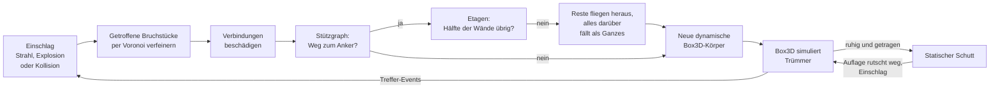

# Nebenan

**Polygonale Echtzeit-Zerstörung für [Box3D](https://github.com/erincatto/box3d), gebaut für Tempo.**
Wände brechen in echte konvexe Polygon-Bruchstücke, nicht in Voxel. Jedes Bruchstück ist eine Box3D-Hülle,
jedes lose Trümmerteil ein Box3D-Starrkörper. Häuser stürzen Etage für Etage ein: Fehlt einer Etage mehr als die
Hälfte ihrer Wände, fliegt der Rest heraus, und alles darüber kommt in einem Stück herunter. Kein Trümmerteil wird
gelöscht. Kein Staub, keine Schatten: Jede Millisekunde geht in die Zerstörung.

- Geschrieben in C17 nach dem Vorbild von Box3D: datenorientiert, Pools mit Generations-IDs, Arena für
  temporäre Daten, keine Abhängigkeiten außer Box3D
- Voronoi-Bruch, der sich auf den Einschlag konzentriert: kleine Splitter am Einschlagpunkt, große Platten
  weiter weg. Nur die getroffenen Bruchstücke werden verfeinert, der Rest der Wand bleibt ein großes Stück
- Ein Einschlag rechnet auf mehreren Threads, über das Task-System der Anwendung oder eingebaute Threads: Schaden
  an den getroffenen Stücken, Bruchpunkte, Voronoi-Zellen und Hüllen. Derweil weckt der aufrufende Thread den Schutt
  am Einschlag auf. Das Ergebnis hängt nicht von der Zahl der Threads ab
- Die Physik rechnet auf einem eigenen Thread, während das Programm zeichnet: `nbWorld_Advance` startet die Schritte,
  die ein Bild braucht. Wer danach die Welt anfasst, wartet automatisch auf den Schritt, und die Welt rechnet bitgleich
  wie ohne. `nbWorld_GetDrawPoses` gibt jedem Bild Lagen zwischen den letzten zwei Schritten, damit die Trümmer auch auf
  Monitoren mit mehr als 60 Hz flüssig fliegen
- Der Takt der Physik ist wählbar, 30, 60 oder 120 Schritte pro Sekunde (`stepRate`), jeder mit so vielen Teilschritten,
  dass es 240 pro Sekunde sind. 30 Hz kostet weniger, 120 Hz ist genauer, die Vorgabe sind 60 Hz
- Einsturz Etage für Etage, auf jeder Höhe und in jeder Reihenfolge: Jede Etage gibt nach, wenn ein eigener Anteil ihrer
  Wände zerstört ist, mit dem Standard zwischen 17 und 31 %, je Etage zufällig und für dasselbe Haus immer gleich, die
  oberste unter dem Dach bei 18 bis 25 %. Was von den Wänden bleibt, mit dem Standard alles, bleibt ohne Stoß stehen und
  zerbricht in seine Zellen, was nicht bleibt, fliegt mit Wucht heraus, alles einstellbar. Alles darüber kommt als ein
  Stück auf die losen Zellen herunter und kippt über das, was stehen blieb, bei Schaden auf einer Seite zur zerstörten
  hin, oder bleibt auf ihnen stehen, bis Treffer sie wegschießen. Die Räume oben bleiben ganz und geben wieder Deckung.
  Sonst stürzt an einem Haus nichts ein, keine Wand über einem Loch und keine Decke, nur was ganz abgetrennt ist, fällt
- Die Wände sind beim Laden in Zellen zerlegt, die auch um die Hausecken laufen, Fenster und Türen sind
  ausgeschnitten. Der Riss unter dem Teil, das herunterkommt, folgt den Zellen und ist überall polygonal
- Mauern und andere Bauwerke ohne Decken prüft eine Lastprüfung nach dem Lastlöser der Referenz-Engine: Last und
  Schwerpunkt fließen über die Verbindungen zu den Ankern, Verbindungen brechen unter Druck und Biegung. Eine Mauer,
  der man den Fuß wegschießt, gibt nach und kommt herunter, und ihre großen Teile brechen, wo sie hart aufschlagen
- Kollisionsschaden: Kanonenkugeln und herabfallende Trümmer beschädigen, was sie treffen. Was ein Einsturz
  herunterbringt, beschädigt nichts. Ein Ragdoll, der gegen eine Wand fliegt, bricht nach seiner Energie und dem
  Material durch oder prallt ab, mit einem Einschlag pro Teil der Wand und Schritt. Jeder Aufprall meldet sich als
  Ereignis, mit dem, was er traf und was brach
- Figuren nach dem Vorbild von Overgrowth: Eine Figur steht animiert, ihre Knochen sind kinematische Box3D-Körper, die
  ihrem Clip folgen, ihre Füße auf dem Boden unter ihnen, auch an Hängen und auf Schutt. Einen Treffer, den sie über
  ihren Füßen nicht abfangen kann, fängt sie mit Schritten ab, der Standfuß bleibt dabei stehen. Ein harter Treffer,
  eine Explosion oder schwere Trümmer machen ihre Knochen dynamisch, mit den Geschwindigkeiten, die sie hatten, und dem
  Treffer genau einmal, und sie fängt sich mit echten Schritten wie auf dem Branch `ragdoll-11`: Ihre Gelenke behalten
  ihre Kraft, ein begrenztes Drehmoment hält ihr Becken aufrecht, wo ein Schritt zu kurz kommt, schwingen ihre Arme in
  Fallrichtung aus und drehen den Körper zurück, und ruhig auf den Füßen steht sie wieder animiert. Wo auch das nicht
  reicht, eine Last auf ihr liegt oder der Boden wegbricht, fällt sie als aktiver Ragdoll. Ihre Gelenke ziehen mit
  begrenzter Kraft zu einer Haltung, sie fängt sich mit den Armen ab oder rollt sich ein. Liegt sie still, steht sie mit
  einem Clip vom Bauch oder vom Rücken wieder auf, sobald sie Boden, Platz und nichts auf sich hat, und fehlt ihr nur
  der Platz, rückt sie dorthin, wo sie ihn hat. Auf Wunsch ziehen ihre Gelenke mit genäherten Muskeln, die sich mit
  Verzögerung spannen und schnell gedreht schwächer ziehen. Kämpfer nahe beieinander machen ihre Bewegung selbst: Der
  Clip gibt nur die Haltung, Gelenke und Antriebe bewegen ihre dynamischen Knochen, ein Schlag trifft Deckung oder
  Körper, und wer aus dem Gleichgewicht kommt, lässt los und fängt sich. Die Knochen und Clips eines Menschen baut die
  Bibliothek selbst
- Für ganze Städte gebaut, ohne etwas zu löschen: Trümmer, die zur Ruhe kommen und auf festem Grund liegen,
  werden zu statischem Schutt und kosten Box3D nichts mehr. Box3D bewegt nur eine begrenzte Zahl Trümmer
  gleichzeitig, verdeckte Flächen werden nicht gezeichnet
- Städte größer als der Speicher: Ein Haus, dem nichts passiert ist und an dem nichts liegt, kann aus dem Speicher
  gehen und kommt bitgleich wieder (`nbDestructible_CanUnload`). Ein beschädigtes Haus, an dem alles ruht, geht samt
  Schutt in einen Puffer und kommt daraus bitgleich wieder (`nbSaveDestructibles`, `nbLoadDestructibles`). Die Demo
  hält von 65 536 Häusern nur die um die Kamera und um alles, was sich bewegt
- Ein Regler für die Bruchstückgröße, der wichtigste Hebel für die Leistung, auch zur Laufzeit
- Deterministisch: gleiche Eingaben ergeben bitgleich das gleiche Bruchmuster, unter Windows, Linux und macOS,
  auf x64 und ARM
- PC-Demo für Windows (Direct3D 11), macOS (Metal) und Linux (OpenGL)

## Demo herunterladen

Jeder Push baut die Demo automatisch mit GitHub Actions.

1. Im Repository oben auf **Actions** klicken, links den Workflow **Build** wählen und den neuesten grünen
   Lauf öffnen.
2. Unten unter **Artifacts** `nebenan-demo-windows` herunterladen (dafür muss man bei GitHub angemeldet
   sein). Für Mac und Linux gibt es `nebenan-demo-macos` und `nebenan-demo-linux`, für Windows mit Zonen für den
   Profiler Tracy `nebenan-demo-windows-tracy`, siehe „Mit Tracy messen“.
3. ZIP entpacken und `nebenan_demo.exe` starten.

Das ist ein Release-Build. Die EXE ist nicht signiert. Wenn Windows SmartScreen warnt: **Weitere
Informationen**, dann **Trotzdem ausführen**. Sie braucht keine Installation und kein
Visual-C++-Redistributable. GitHub löscht Artefakte nach 90 Tagen. Mit **Run workflow** auf der Workflow-Seite
entsteht ein neuer Build.

Unter Linux und macOS gehen beim Entpacken die Ausführungsrechte verloren: `chmod +x nebenan_demo`.
Auf dem Mac zusätzlich `xattr -d com.apple.quarantine nebenan_demo` oder im Finder Rechtsklick,
**Öffnen**. Der Mac-Build läuft auf Apple Silicon.

## Selbst bauen

Voraussetzungen: CMake 3.22 oder neuer und ein C17/C++17-Compiler. Box3D und Dear ImGui liegen als Quellcode im Ordner
[`extern`](extern) bei und werden mitgebaut, der Build braucht also kein Internet, außer mit `NEBENAN_PROFILE`.

**Windows** mit Visual Studio 2022 oder neuer (Workload „Desktopentwicklung mit C++"):

```bat
git clone https://github.com/holz231/nebenan.git
cd nebenan
build.bat
build\bin\Release\nebenan_demo.exe
```

`build.bat` in der „Developer Command Prompt" von Visual Studio ausführen, dort ist CMake schon im Pfad.
`build.bat tracy` baut die Demo mit Zonen für den Profiler Tracy nach `build-tracy`, mit `Tracy-Aufnahme.bat` daneben,
siehe „Mit Tracy messen“. Statt zu klonen geht auch der ZIP-Download von GitHub: entpacken und im Ordner `build.bat`
ausführen. Danach liegt die Projektmappe `nebenan` im Ordner `build`. In Visual Studio öffnen, oben **Release** statt
Debug wählen, F5 startet die Demo.

**Immer Release zum Messen.** Ein Debug-Build ist 5- bis 20-mal langsamer: ohne Optimierung, ohne Inlining, mit
Laufzeitprüfungen bei jedem Array-Zugriff. Die Demo zeigt einen Debug-Build rot an.

**Linux** (Ubuntu/Debian):

```sh
sudo apt install build-essential cmake git libgl-dev libx11-dev libxi-dev libxcursor-dev
./build.sh
build/bin/nebenan_demo
```

**macOS** mit den Xcode Command Line Tools und CMake (`brew install cmake`):

```sh
./build.sh
build/bin/nebenan_demo
```

CMake-Optionen: `NEBENAN_DEMO`, `NEBENAN_TESTS`, `NEBENAN_BENCHMARK` (bei eigenständigem Bau alle an),
`NEBENAN_WARNINGS_AS_ERRORS` und `NEBENAN_PROFILE` für Zonen des Profilers Tracy, siehe „Mit Tracy messen“.

## Steuerung

| Eingabe | Aktion |
| --- | --- |
| Linke Maustaste | schießen, gedrückt halten für Dauerfeuer, mit dem Stock die Hände vorschieben, solange man sie hält |
| Rechte Maustaste | Umsehen ein und aus: Die Maus dreht den Blick, und der Stock schwingt mit |
| Esc | Umsehen aus |
| W A S D | bewegen |
| Q / E | runter / hoch |
| Shift | schneller bewegen |
| Mausrad | vor und zurück, mit dem Stock die Hände vor und zurück |
| 1 / 2 / 3 / 4 | Gewehr / Granate / Kanone / Stock, mit dem Stock ist das Umsehen gleich an |
| R | Szene neu laden |
| P | Pause |
| C | lose Trümmer entfernen |
| V | VSync ein und aus |
| F1 | Menü ein- und ausblenden |

**Stock.** Mit **4** hält die Demo einen Stock, um die Figuren von Hand zu drücken und zu schlagen. Man hält ihn wie
einen Stab mit beiden Händen rechts unter dem Auge, ein Drittel seiner Länge vom hinteren Ende: Dieses Drittel reicht am
Kopf vorbei nach hinten, zwei Drittel zeigen nach vorn auf die Mitte des Blicks. Er geht mit dem Blick wie eine Waffe in
einem Spiel: Wer sich langsam dreht, drückt mit ihm, wer sich schnell dreht, schlägt. Einen animierten Hieb gibt es
nicht, jeder Schwung kommt aus der Maus. Die **4** schaltet dazu das Umsehen ein, keine Taste muss gehalten werden. Die
rechte Taste schaltet das Umsehen aus und wieder ein, aus ist der Mauszeiger für das Menü frei. Die linke Taste schiebt
die Hände, solange man sie hält, mit 2 m/s bis 0,6 m weiter vor, das Mausrad rückt sie vor und zurück. Im Menü stehen
die Kraft der Hände, mit der seine Federn den Stock halten und vorschieben (Standard 600 N), mit ihr mal 0,4 m drehen
sie ihn, dazu seine Masse (1,5 kg), Länge (2 m) und Dicke und wie weit die Hände vor dem Auge sind.

Die Demo baut ihn nur aus einem Körper von Box3D und einem Motorgelenk mit Kraftgrenze, wie ein Spiel eine Waffe in der
Hand. Straff am Blick hängt er durch drei Dinge: Das Gelenk läuft den Händen um die Hälfte des Wegs voraus, den seine
Dämpfung einen bewegten Stock zurückhält, die Federn sind kritisch gedämpft, 30 Hz an den Händen und 20 Hz in der
Drehung, und gezeichnet wird er an den Händen von jetzt, um so weit daneben, wie ihn die letzten Schritte neben ihren
Händen ließen, denn beim parallelen Rechnen liegen diese Schritte ein Bild zurück. Um seine Länge bekommt er ein Viertel
seiner Trägheit quer dazu, sonst kreiste er nach einem harten Schwung, der eine Figur verlor, endlos um die Hände.
Gemessen ohne Figur: Dreht sich der Blick mit 4 rad/s, liegt der Stock 0,9° neben ihm, bei einem Ruck um 1,5 rad in
0,15 s bis 6°, und hält der Blick an, schwingt er 1,5° darüber hinaus. Der Stock von `active-ragdoll-32`, am Ende in
einer Hand gehalten, lag dabei 14°, 47° und 44° daneben.

Was er mit einer Figur tut, kommt allein aus der Physik und der Bibliothek: Ein Schlag trifft eine stehende Figur wie
Schutt, und ein langsames Drücken lässt sie sich fangen, siehe Drücken. Wie hart er trifft, hängt so am Tempo des
Schwungs. Gemessen mit 1,5 kg und 600 N, den Blick um 1,6 rad quer über eine Figur gedreht: In 2 s drückt der Stock sie
mit 0,9 m/s zur Seite, und sie fängt sich mit Schritten. In 0,67 s, 0,27 s, 0,13 s und 0,07 s trifft die Spitze mit 2,7,
6,7, 21 und 30 m/s, in den ersten 50 ms gehen 13, 16, 24 und 30 N s in die Figur, und sie zuckt um 1°, 3,5°, 11° und
14°. Bei 0,13 s bleibt der Stock bis 13° hinter dem Blick, bei 0,07 s bis 58°, so schnell kommen 600 N nicht mit. Bleibt
der Blick hinter der Figur stehen, hier 0,75 rad, schieben die Hände den Stock mit gut 200 N weiter gegen sie, bis er
abrutscht oder sie fällt, nach 0,67 s und 0,07 s fiel sie. Ein Stock von 5 kg trifft bei 0,07 s mit 5,7 m/s, mit 1 500 N
in den Händen mit 12 m/s und 49 N s, und beide werfen sie um.

**Figuren wie Gliederpuppen.** Die Demo zeichnet jede Figur wie eine Gliederpuppe, jeden Körperteil in seiner eigenen
Farbe und Form: den Kopf als Ei auf einem kräftigen Hals, den Rumpf wie in der Vorlage aus runden Ringen wie gestapelte
Reifen, ohne flache Seiten, einen für jeden Knochen des Rumpfs: oben die Brust in ihren zwei Teilen, der obere der
breiteste Teil des Rumpfs und vor dem Bauch, darunter Rippen und Bauch, zur Taille schmaler, und das Becken als größter,
so breit, wie die Oberschenkel reichen, deren Enden in ihm verschwinden. Arme und Beine sind runde Röhren, vom Körper
weg ein wenig dünner, die Arme hängen an Kugeln um die Schultergelenke an den oberen Ecken der Brust, die Hände sind
flach wie Fäustlinge und die Füße wie Schuhe. Gezeichnet sind die Glieder 1,05- bis 1,3-mal so dick wie ihre Kapseln in
der Physik, die Formen der Physik bleiben, wie sie sind. Ohne **Teile farbig** im Menü ist jede Figur ganz in einer
Farbe, wie die Gliederpuppen eines Spiels. Damit die runden Teile rund aussehen, verläuft die Farbe über jedes Dreieck,
siehe Demo-Renderer. Wie lang die Glieder sind und wie die Figur steht, kommt aus der Bibliothek, siehe In den Knien.

**Figuren als Menschen.** Seit `active-ragdoll-113` zeichnet die Demo die Figuren auf Wunsch als Menschen, mit **Als
Mensch** im Menü oder `--human`. Die Gliederpuppe bleibt, wie sie war, und ist der Stand beim Start. Als Mensch ist
jeder Körperteil eine glatte Form aus Querschnitten entlang seines Knochens, geformt wie der Teil eines Menschen: der
Rumpf durchgehend von den Hüften über die Taille zur Brust, die zum Hals hin abfällt, ein Oberschenkel oben dick und am
Knie schmal, ein Schienbein mit der Wade hinten, ein Oberarm mit der Schulter obenauf, ein Unterarm bis zum flachen
Handgelenk, die Hand flach mit dem Daumen vorn, der Fuß ein Schuh, und der Kopf mit Kiefer, Augen, Nase, Ohren und
Haaren. Die Figur trägt Kleidung: ein Hemd in ihrer Farbe über Rumpf und Oberarmen, Hose und Schuhe, Haut an Kopf, Hals,
Unterarmen und Händen. Die Maße kommen aus den Knochen der Bibliothek, die seit `active-ragdoll-113` die eines Menschen
sind, und das Netz liegt meist unter anderthalb und nirgends mehr als rund 2 cm neben der Form, die kollidiert. Die
Gliederpuppe ist kräftiger gezeichnet als ihre Körper, mit den schmaleren Knochen von `active-ragdoll-113` am Rumpf bis
rund 3 cm und am Kopf knapp 4 cm je Seite. Die Formen der Physik sind für beide dieselben, wie die Bibliothek sie baut,
ein Spiel bringt sein eigenes Netz mit.

**FPS.** Oben rechts steht immer die echte Bildrate, gemessen über die letzten zwei Sekunden: Bilder pro Sekunde,
die mittlere Bildzeit und das 1 % Low, also die Rate der langsamsten 1 % der Bilder. Daran sieht man Ruckler. VSync
ist aus, die Demo zeichnet so viele Bilder, wie der PC schafft. Mit **V** oder `--vsync` bindet sie sich an die
Bildwiederholrate des Monitors. Unter Windows hält das System eine Flip-Swap-Chain sonst auch ohne VSync an der
Bildwiederholrate fest. Die Demo legt deshalb ihre Swap-Chain mit Tearing-Erlaubnis an, wie Microsoft es für
ungebremste Bildraten vorsieht. Im Fenster zeigt der Compositor trotzdem nur ganze Bilder. Kleben die FPS dennoch an
der Bildwiederholrate, sagt das Menü, woran es liegt. Unter macOS bleibt VSync immer an, dort sagt das Menü, wie
viele FPS die CPU schaffen würde. Die Physik rechnet unabhängig davon 60 Schritte pro Sekunde, oder so viele, wie
**Physiktakt** sagt.

**Leistungsregler im Menü**

- **Bruchstückgröße** (Standard ×2): der wichtigste. Größere Bruchstücke heißen weniger Teile pro Einschlag und
  damit weniger Körper, Kontakte und Dreiecke. ×2 halbiert ungefähr die Zeit bei Massenzerstörung. Gilt für die
  nächsten Einschläge.
- **Bewegte Trümmer** (Standard 1500): wie viele Trümmer Box3D höchstens gleichzeitig bewegt. Weniger macht den
  Physikschritt schneller.
- **Physik parallel zum Zeichnen** (Standard an): Nebenan rechnet die Physik eines Bilds auf einem eigenen Thread
  (`nbWorld_Step`), während der Hauptthread das Bild davor zeichnet. Ein Bild kostet dann so viel wie der längere der
  beiden Teile statt beide zusammen und zeigt die Welt einen Schritt später. Die Welt rechnet mit und ohne genau gleich,
  die Zahl der Threads passt sich beim nächsten Laden der Szene an. Hat der Hauptthread kaum etwas zu tun, etwa mit
  einer schnellen Grafikkarte, ist nacheinander schneller, siehe Der Schritt auf einem eigenen Thread.
- **Zwischen Schritten zeichnen** (Standard an): Jedes Bild zeigt die Trümmer zwischen den letzten zwei Schritten der
  Physik, siehe Zeichnen zwischen zwei Schritten. Aus zeigt jedes Bild den Stand nach dem letzten Schritt. **Zeitlupe**
  gibt der Physik ein Viertel der Zeit, dann kommen viermal so viele Bilder wie Schritte, und der Unterschied zeigt sich
  auf jedem Monitor.
- **Physiktakt** (Standard 60 Hz): 30, 60 oder 120 Schritte der Physik pro Sekunde, jeder mit so vielen Teilschritten,
  dass es 240 pro Sekunde sind, siehe Der Takt der Physik. 30 Hz kostet weniger, aber Kontakte und Treffer kommen bis zu
  einen Schritt später, 120 Hz ist genauer und kostet mehr. Mit „Zwischen Schritten zeichnen“ bewegt sich das Bild bei
  jedem Takt flüssig. Die beiden Messknöpfe rechnen mit dem eingestellten Takt, 1/60 s Physik pro Bild.

Daneben stellt **Etage gibt nach** ein, wie viel ihrer Wände zerstört sein muss, bis eine Etage nachgibt, und
**Stütze bleibt**, wie viel der übrigen Wände dann stehen bleibt, in Zellen zerbrochen. **Oberste gibt nach** und
**Oberste Stütze** gelten für die oberste Etage unter dem Dach. Mit **Zufall je Etage** (Standard an) gelten fest die
Bereiche der Bibliothek, aus denen jede Etage beim Laden des Hauses ihre Werte zieht, 17 bis 31 % und 100 %, für die
oberste 18 bis 25 % und 100 %. Die Regler zeigen sie dann nur und sind aus. Ohne sind die Regler an, und alle Etagen
nehmen ihre Werte, Standard 24 % und 100 %, für die oberste 22 % und 100 %. Änderungen gelten sofort, jede Etage behält
ihren Platz in den Bereichen. **Statik ohne Decken** stellt die Lastprüfung für die Mauern ein (Standard 1, 0 schaltet
sie ab).

Die Threads wählt die Bibliothek (`nbGetRecommendedWorkerCount`): einen pro Performance-Kern, höchstens 8. Box3D läuft
am schnellsten ohne Hyper-Threads und Effizienzkerne, und mehr Threads als Kerne bremsen. Mit paralleler Physik bleibt
dem Hauptthread ein Hardware-Thread frei, auf einem PC mit Hyper-Threads oder Effizienzkernen ändert das nichts. Einen
ganzen Kern freizulassen ist dort langsamer: Auf einem Ryzen 7 7800X3D ist ein Bild mit 8 Threads parallel 2,5 % und
nacheinander 1,7 % schneller als mit 7, gemessen mit „7 gegen 8 Threads messen“. Im Benchmark auf der Cloud-VM mit 4
Kernen ist ein Frame der Stadt mit Bruchstückgröße ×2 mit 4 Threads 1,8-mal so schnell wie mit 1 Thread, mit 8 Threads
10 % langsamer als mit 4.

**Messung.** Das Menü zeigt die Bildzeit und die CPU-Zeit pro Bild, aufgeteilt in Einschläge, Simulation und Grafik, als
Mittel und Spitze der letzten 300 Bilder, dazu Box3D-Schritt, Bruchstücke, Körper, Kontakte, Dreiecke, Draw Calls und
Upload. Mit paralleler Physik zählt es die Simulation für sich und beim Hauptthread, wie lange er am Ende eines Bilds
noch auf sie wartet. Es sagt auch, wer die FPS begrenzt: die CPU, die Simulation (der Hauptthread wartet lange auf sie),
die Grafikkarte (ein Bild dauert deutlich länger, als die CPU dafür braucht) oder VSync. „Messwerte kopieren“ legt alles
mit CPU, Grafikkarte und Auflösung in die Zwischenablage, zum Einfügen in einen Chat. „Parallel gegen nacheinander
messen“ lädt die Stadt und reißt sie Haus für Haus mit Granaten ab, Wand für Wand von oben nach unten, bis jedes Haus
unten ist. Er schießt mit Budget 5 000 und nur, solange weniger als 3 000 Trümmer fliegen, denn über dem Budget erstarrt
Schutt im Schub früher, als er zur Ruhe käme. Das macht er einmal kurz zum Aufwärmen, dann parallel, nacheinander,
nacheinander und parallel, mit 1/60 s Physik pro Bild, bei 60 Hz einem Schritt, und jeweils mit den passenden Threads.
Das Ergebnis mit Bildzeit, FPS und 1 % Low für beide und für jeden Lauf kommt ebenso in die Zwischenablage, danach lädt
die Szene von vorher neu. „7 gegen 8 Threads messen“ reißt die Stadt genauso ab, parallel und nacheinander jeweils mit
so vielen Threads, wie die Bibliothek nacheinander nimmt, und mit einem weniger, auf einem Ryzen 7 7800X3D 8 und 7, und
dieselben vier Läufe danach noch einmal rückwärts, damit eine Drift des PCs alle gleich trifft. Der Bericht sagt, was
ein Thread mehr oder weniger in jeder Art ändert und was die Wahl der Bibliothek bringt, parallel gegen nacheinander mit
den Threads, die sie für jede Art nimmt. „Skalierung messen“ reißt die Stadt genauso ab, nach dem Aufwärmen mit 1, 2, 4
und so weiter bis zur empfohlenen Zahl von Threads, alle mit der Physik nacheinander. Die Bibliothek misst dabei jede
Stufe von Box3D und Nebenan und rechnet aus, was mit mehr Threads auf einem Thread übrig bleibt. Die Tabelle dazu kommt
in die Zwischenablage, siehe `nbWorld_GetProfile`. Aus der Stadt mit Figuren reißen diese drei Messungen die Stadt mit
Figuren ab. „Mit und ohne F8 messen“ lädt immer die Stadt mit Figuren und beschießt sie Haus für Haus wie beim Abriss,
Wand für Wand von oben nach unten, aber nach festem Plan mit zwölf Granaten pro Sekunde, 40 s lang, nach dem Aufwärmen
mit F8, ohne, ohne und mit, die Physik parallel zum Zeichnen und mit den Threads, die die Bibliothek dafür nimmt. Ohne
F8 rechnet Box3D die Gelenke wacher Ragdolls wie bis `active-ragdoll-1`, Farbe für Farbe, siehe Gelenke und Pakete. Mit
und ohne F8 endet die Stadt verschieden, weil ihre großen Schutthaufen ohne F8 keine Gebiete nehmen, solange ein Ragdoll
wach ist, die Läufe jeder Art enden gleich. Darum schießt dieser Knopf nach festem Plan statt wie der Abriss nur,
solange wenige Trümmer fliegen: Die kommen mit und ohne F8 verschieden schnell zur Ruhe, und eine Art bekäme mehr
Granaten als die andere. Der Bericht nennt für beide Arten Bildzeit, Simulation, Box3D-Schritt und Löser pro Schritt und
in wie vielen Schritten der Löser ganze Inseln pro Thread und Gebiete nahm und Ragdolls wach waren, dazu jeden Lauf mit
seinen Granaten. Jeder Bericht nennt CPU und Grafikkarte, denn auf einer schwachen Grafik begrenzt das Zeichnen die
Bildzeit.

**Werkzeuge**

- **Gewehr**: kleiner Krater mit Radius 0,35 m. Splitter platzen an der Oberfläche heraus, bei Dauerfeuer
  entsteht ein Loch.
- **Granate**: Explosion mit Radius 1,3 m, reißt große Löcher und schleudert Bruchstücke radial weg.
- **Kanone**: eine echte Box3D-Kugel mit 45 m/s. Der Schaden entsteht allein aus der Aufprallenergie, die
  Kugel schlägt durch und nimmt Trümmer mit.
- **Stock**: ein Stock, um Figuren von Hand zu drücken und zu schlagen, siehe Stock.

**Szenen**

- **Mauern**: Ziegelwände vor einer dicken Betonwand
- **Stresstest**: 16 Wände für viele Trümmer gleichzeitig
- **Stadt**: 20 Häuser aus verputzten Ziegelwänden mit Fenstern und Türen und Betondecken, jedes dritte mit drei
  Stockwerken. Die Wände laufen durch alle Stockwerke und sind in Zellen von etwa 1,2 m zerlegt, die auch um die
  Hausecken laufen, die Decken bleiben ganz
- **Große Stadt**: 65 536 solche Häuser auf 3,6 × 3,1 km, am Stück wären das rund 24 GB. Geladen sind nur die
  Häuser im **Laderadius** um die Kamera (Standard 100 m) und die in der Nähe von allem, was sich bewegt.
  Unberührte Häuser weiter weg gehen wieder, beschädigte gehen samt Schutt in den Speicher der Demo, sobald alles an
  ihnen ruht, und kommen von dort zurück. Das Menü zeigt, wie viele Häuser geladen und wie viele gespeichert sind, was
  das Streaming pro Bild kostet und wie viel Speicher Nebenan und Box3D belegen
- **Figuren**: acht Figuren, fünf vor einer Ziegelmauer, zwei auf einem Betonblock und eine auf der Mauer. Hinter den
  mittleren drei steht eine Wand aus Brettern von 3 cm. Das Gewehr lässt sie zurückzucken und nachtreten, sich mit
  Schritten fangen oder umfallen, Granate und Kanone treffen sie mit ihrer eigenen Wucht, und wer den Block oder die
  Mauer unter ihnen wegschießt, nimmt ihnen den Boden. Mit dem Stock lassen sie sich drücken und schlagen. Das Menü
  zählt, wie viele stehen, sich fangen, liegen und aufstehen, wie viele Schritte sie gemacht und wie oft sie sich
  gefangen haben, wie oft ein Drücken sie sich fangen ließ, wie oft Figuren auf Wände prallten und durchbrachen und was
  der letzte Aufprall tat.
  **Gewehr auf Figuren** stellt den Stoß eines Gewehrtreffers ein (Standard 60 N s, ab 50 N s werden die Knochen einer
  Figur dynamisch, und sie fängt sich oder fällt, um 1 000 N s fliegt sie durch die Bretter), **Brusttreffer** und
  **Seitenstoß** treffen jede Figur mit diesem Stoß oben auf die Brust, von vorn oder von rechts, **Kopftreffer** ins
  Gesicht von vorn und **Armtreffer** von hinten auf den rechten Unterarm, mit etwa 20 N s, um Kopf und Arm einzeln
  schwingen zu sehen, siehe Treffer je Körperpartie, **Alle umwerfen** wirft alle auf einmal um, **Zustand** schreibt
  über jede Figur, was sie tut und worauf sie wartet, gelb, solange sie sich fängt, **Zielhaltung** zeichnet als
  Linien die Haltung, zu der sie ihre Knochen bringen will, und **Muskeln** lädt die Szene neu, und ihre Figuren ziehen
  mit Muskeln, siehe Muskeln
- **Stadt mit Figuren**: die Stadt mit zwei Figuren an jedem Haus, 40 auf den Straßen, je eine gut 1 m vor einer
  Stirnwand und vor einer Längswand wie im Benchmark. Granaten, Trümmer und einstürzende Stockwerke werfen sie um und
  begraben sie. Das Menü zählt sie wie in „Figuren“
- **Kampf**: zwei Paare von Kämpfern mit `engageRadius` 2 m, die ihre Bewegung selbst machen, siehe Kämpfer machen die
  Bewegung selbst. In jedem Paar schlägt einer alle zwei Sekunden geradeaus, im einen hält der andere die Deckung, im
  anderen steht er offen. **Zustand** schreibt „folgt dem Clip“ über jede, das Menü zählt außerdem, wie viele folgen
  und wie oft eine losließ. Mit dem Stock lassen sie sich drücken und schlagen
- **Spielfigur**: eine Figur der Bibliothek, die man selbst steuert, auf einem Parcours: eine Rampe von 20° und eine
  Treppe aus zehn Stufen von 15 cm zu einer Plattform von 1,5 m, ein Hang von 60°, an dem sie stehen bleibt, ein Block
  von 30 cm, auf den sie steigt, einer von 60 cm, der sie aufhält, eine Ziegelwand und drei Figuren, in die man laufen
  kann. **W A S D** gehen relativ zum Blick, mit **Shift** rennt sie, **Q / E** und die Maus mit der rechten Taste
  drehen die Kamera, die ihr von hinten folgt. Mit gehaltener **Strg**-Taste oder dem Haken **Blick zur Kamera** schaut
  sie, wohin die Kamera schaut, und geht seitwärts, schräg und rückwärts, wohin die Tasten sie schicken. Die Tasten
  geben nur die Geschwindigkeit, die sie will, gehen, rennen,
  steigen und fallen tut sie in der Bibliothek, siehe Gesteuerte Figur. Gewehr, Granate und Kanone treffen sie wie jede
  Figur. **Gang nach Clips** lässt sie nach Clips ihres Gangs gehen und rennen, dem Gang der Bibliothek, aufgezeichnet
  mit `nbMakeHumanoidGaitClip`, **Arme im Clip vorn** dreht in diesen Clips die Oberarme 60° nach vorn, so sieht man
  sie den Clips folgen, siehe Gehen und Rennen nach Clips

**Aufrufoptionen**: `--scene 0..7` startet eine Szene, `--fragment-scale 3` setzt die Bruchstückgröße, `--vsync`
schaltet VSync ein, `--msaa 4` schaltet Kantenglättung ein (Standard aus), `--highdpi` rendert auf hochauflösenden
Bildschirmen in voller Auflösung (Standard aus, kostet Füllrate). `--serial-physics` schaltet die parallele Physik ab,
`--threads N` setzt die Zahl der Threads, `--step-rate 30` den Takt der Physik. `--compare` misst parallel gegen
nacheinander wie der Knopf im Menü, gibt das Ergebnis aus und beendet sich, `--compare-threads` ebenso wie „7 gegen 8
Threads messen“, `--scaling` wie „Skalierung messen“ und `--compare-joints` wie „Mit und ohne F8 messen“. Diese
Messungen reißen die Stadt selbst ab, Lauf für Lauf, auch mit `--demolition`, mit `--scene 5` die Stadt mit Figuren,
`--compare-joints` beschießt sie. Ohne sie reißt `--demolition` die Stadt ab wie dabei. `--script` feuert eine
vorgegebene Schussfolge ab, `--stick` dreht in der Szene mit Figuren ohne Menü den Blick nach einem Skript, und der
Stock schwingt mit, langsam gegen einen Kopf und schnell über eine Brust, `--walk` lässt die Spielfigur ohne Menü den
Parcours gehen, die Treppe hinauf, über die Plattform rennen und von ihrer Kante springen, `--walk-side` dasselbe von
der Seite gesehen, `--human` zeichnet die Figuren als Menschen, `--look 180 2.5` zeigt die Spielfigur stehend ohne Menü
aus einem Winkel um sie und einer Entfernung in Metern, 0 von hinten und 180 von vorn, für Bilder, `--faces-camera`
setzt den Haken „Blick zur Kamera“, mit `--walk-side` geht sie den Parcours dann seitwärts, `--gait-clips` und
`--clip-arms` schalten „Gang nach Clips“ und „Arme im Clip vorn“ ein, `--frames N` beendet nach N Bildern und meldet
Bildzeiten, CPU-Zeiten, Uploads und Dreiecke pro Bild und einen Hash der Lagen aller Bruchstücke und der Knochen der
Figuren, `--screenshot datei.ppm` speichert das letzte Bild (nur OpenGL).

Hinkt die Physik hinterher, lässt `nbWorld_Advance` die Zeit langsamer laufen, statt Schritte nachzuholen: Mehr als
1/60 s Physik im selben Bild kommt nur, solange der letzte Schritt weniger als 4 ms pro 1/60 s kostete, bei 60 Hz
also ein zweiter Schritt nur nach einem unter 4 ms. Sonst würde jedes langsame Bild das nächste noch langsamer
machen.

## So funktioniert es



**Konvexe Polyeder statt Voxel.** Jedes Bruchstück ist ein konvexes Polyeder aus Ecken und Flächen mit
Ebenen. Schneidet man es mit einer Ebene, entstehen zwei konvexe Polyeder mit exaktem Volumen. Die
Schnittflächen bekommen das Innenmaterial (zum Beispiel Ziegelbruch oder Beton), die Außenflächen behalten
ihr Material. Die gleichen Polygone dienen als Kollisionsform und als Render-Mesh, und jedes Bruchstück hält sie nur
einmal: Nebenan baut die Box3D-Hülle direkt in die Form des Bruchstücks, ihre Punkte und Ebenen sind seine Ecken und
Flächen, und Box3D benutzt sie dort, statt sie zu kopieren.

**Voronoi-Bruch mit Fokus.** Die Bruchpunkte werden um den Einschlag herum verteilt, mit einer Dichte, die
mit der Entfernung abnimmt. Dadurch entstehen am Einschlag Splitter in der Größe `fragmentSize` und weiter
außen große Platten. Ein Hash-Gitter hält die Punkte auf Abstand. Jede Voronoi-Zelle entsteht durch
Schneiden des Bruchstücks an den Mittelebenen zu den nächsten Nachbarpunkten, sortiert nach Abstand. Sobald
der nächste Punkt weiter als der doppelte Zellradius entfernt ist, kann keine weitere Ebene die Zelle mehr
schneiden, und die Suche endet. Die Zahl der Splitter richtet sich nach dem beschädigten Volumen und ist pro
Einschlag begrenzt.

**Hierarchische Verfeinerung.** Nur Bruchstücke, die die Schadenskugel berühren, werden zerteilt, und jedes
nur bis zur Tiefe `maxDepth`. Eine Wand mit einem Einschussloch besteht danach aus ein paar Dutzend Stücken
statt aus Tausenden.

**Mehrere Threads.** Ein Einschlag gibt alles, was nur rechnet, an die Worker. Trifft er 32 oder mehr Stücke, die er
zerteilen kann, schätzen sie zuerst, wie viel von jedem in der Schadenskugel liegt, jedes Stück mit einem eigenen
Zufallsstrom. Daraus verteilt der aufrufende Thread die Splitter auf die Stücke und gibt jedem Stück in fester
Reihenfolge den Zufallsstrom für seine Bruchpunkte. Dann ziehen die Worker die Bruchpunkte und berechnen die
Voronoi-Zellen samt Box3D-Hüllen, eine Zelle wartet nur auf die Punkte ihres Stücks. Kleine Einschläge rechnet der
aufrufende Thread allein, denn mit wenigen Zellen ist er fertig, bevor ein schlafender Worker anläuft. Ab wie vielen
Zellen und Stücken die Worker helfen, misst die Bibliothek selbst: sobald der aufrufende Thread allein dreimal so lange
bräuchte, wie ein Worker zum Anlaufen braucht, zwischen 8 und 32. Auf der VM, wo ein Worker erst nach rund 100 µs
anläuft, liegt diese Schwelle bei 24 bis 32: Bei vierfacher Bruchstückgröße hat eine Granate auf ein Haus 15 bis 30, und
die Worker zu wecken kostete dort mehr, als sie abnahmen. Jede Arbeit hängt nur von ihren Eingaben ab, die Worker holen
sich die nächste über einen atomaren Zähler und schreiben in eine eigene Arena. Währenddessen weckt der aufrufende
Thread den Schutt auf, den der Einschlag bewegt, denn Änderungen an der Box3D-Welt dürfen nur von einem Thread kommen.
Zuletzt werden Stücke und Verbindungen wieder in fester Reihenfolge eingebaut. Deshalb ist das Ergebnis mit einem, vier
oder acht Threads bitgleich. Wie Box3D nimmt Nebenan das Task-System der Anwendung (`enqueueTask` und `finishTask` mit
denselben Signaturen wie in Box3D) oder startet eigene Threads. Die Vorzerlegung beim Laden läuft genauso, und dort
messen die Worker auch die Flächen, mit denen sich die Bruchstücke berühren. Die Verbindungen daraus baut der aufrufende
Thread in fester Reihenfolge. Legt die Anwendung viele Zerstörbare auf einmal an, mit `nbCreateDestructibles`, berechnen
die Worker schon die Zellen des nächsten, während der aufrufende Thread eines in die Welt einbaut. So lädt eine Stadt
ein Drittel schneller, mit denselben Bruchstücken, Verbindungen und Ids wie einzeln angelegt. Mit `nbStartCreating`
bereiten die Worker Zerstörbare im Hintergrund vor, während der aufrufende Thread weitermacht, etwa mit dem
Box3D-Schritt, und `nbFinishCreating` baut sie später nur noch ein. Die eingebauten Threads nehmen dabei alles andere
zuerst, und wer auf einen Einschlag wartet, hilft nie bei einem Haus im Hintergrund. Sie holen sich ihre Aufgaben ohne
Sperre wie der Scheduler von Box3D, nur behält eine Aufgabe ihren Platz, bis sie abgeschlossen ist, auch über mehrere
Schritte. Wer auf eine Aufgabe wartet, hilft mit oder gibt den Kern kurz ab, statt zu schlafen. Mit `nbCreateTaskSystem`
teilen sich Box3D und Nebenan diese Threads, siehe Benutzung. Box3D selbst weckt seine Worker nur, wenn es genug zu tun
gibt: einen für je 250 wache Kontakte, darunter rechnet der aufrufende Thread den Schritt allein (eine Ergänzung, siehe
[`extern/README.md`](extern/README.md)). Ein paar Dutzend wache Trümmer rechnet er so schneller, als er die Worker
wecken und auf sie warten könnte, und unter Dauerbeschuss rechnen alle mit.

**Der Schritt auf einem eigenen Thread.** `nbWorld_Step` rechnet den Box3D-Schritt samt Update auf einem Thread von
Nebenan und kehrt sofort zurück, so zeichnet das Programm sein Bild, während die Physik rechnet. Ein Bild kostet dann so
viel wie der längere der beiden Teile statt beide zusammen. Das lohnt, wenn das Programm in der Zeit genug zu tun hat.
Die Threads des Schritts teilen sich die Kerne mit dem Thread, der zeichnet, und eine Stufe des Schritts wartet auf
ihren langsamsten Worker, so verliert der Schritt Zeit, solange das Programm rechnet. In der Demo auf einem Ryzen 7
7800X3D mit einer RTX 4070 SUPER zeichnet der Hauptthread ein Bild in 0,2 ms, und parallel ist ein Bild je nach Sitzung
2 bis 8 % langsamer als nacheinander. Auf der VM ist parallel mit 0,25 ms Arbeit auf dem Hauptthread gleichauf und mit
1 ms 20 % schneller. Ein Programm, das zwischen seinen Schritten kaum etwas tut, schaltet es mit `nbWorld_SetAsyncStep`
ab. Ruft der Thread, der den Schritt gestartet hat, danach irgendeine Funktion von Nebenan oder Box3D für die beiden
Welten auf, wartet sie zuerst auf den Schritt. Box3D prüft dazu bei jedem Zugriff auf eine Welt, ob ein anderer Thread
sie gerade rechnet (eine Ergänzung, siehe [`extern/README.md`](extern/README.md)). Der Schritt-Thread und die Worker
gehen ohne Warten durch. So bleibt die Reihenfolge aller Änderungen dieselbe wie ohne eigenen Thread, und die Welt
rechnet bitgleich, das Programm muss nichts dafür bauen. Mehrere Schritte in einem Bild warten nicht aufeinander, sie
folgen auf dem Thread hintereinander. `nbWorld_GetBodyEvents` gibt am Anfang des nächsten Bilds die letzte Lage jedes
Körpers, der sich seitdem bewegt hat und noch da ist, `nbWorld_GetDrawPoses` die Lagen zum Zeichnen, siehe Zeichnen
zwischen zwei Schritten. Mit `nbWorld_RunAfterStep` legt ein Programm eigene Arbeit an der Welt hinter den Schritt auf
denselben Thread, die Demo etwa das Streaming der großen Stadt.

**Stützgraph.** Zwei Bruchstücke sind verbunden, wenn sich ihre Flächen berühren. Jede Verbindung hält
`strength × Kontaktfläche` aus, zwischen zwei Materialien mit dem kleineren `strength`. Der Schaden eines
Einschlags fällt zum Rand hin ab. Reißen Verbindungen, sucht Nebenan ab der beschädigten Stelle nach dem
kürzesten Weg zu einem verankerten Stück (Best-First-Suche, dadurch nur lokale Arbeit). Teile ohne Weg zum
Anker werden zu dynamischen Körpern.

**Einsturz.** Häuser stürzen Etage für Etage ein, und sonst stürzt an ihnen nichts ein: keine Wand über einem Loch,
keine Decke, kein Pfeiler unter Last. Nur was ganz vom Boden abgeschnitten ist, fällt.

Beim Laden sucht Nebenan die Decken eines Hauses, die flachen Teile: höchstens ein Viertel so hoch entlang der lokalen
Y-Achse wie breit in beiden anderen Richtungen. Decken, die sich in der Höhe überschneiden, bilden eine Ebene. Eine
Etage ist der Raum unter einer Ebene, von der Ebene darunter oder dem Fuß des Hauses an, und merkt sich das Volumen der
Bruchstücke, deren Mitte in ihr liegt. Ändert sich ein Haus, prüft das nächste Update seine Etagen. Wie sie nachgeben,
sagt `storeyCollapse` mit zwei Bereichen: den Anteil ihrer Wände, den eine Etage verlieren kann, bevor sie nachgibt,
Standard 17 bis 31 %, und den Anteil der übrigen Wände, der dann stehen bleibt, mit dem Standard alles. Jede Etage zieht
beim Laden aus dem `seed` des Hauses, wo sie in jedem der Bereiche liegt, für dasselbe Haus immer gleich. So gibt jede
bei einem eigenen Wert nach und behält einen eigenen Rest. Die oberste Etage unter dem Dach nimmt die Bereiche aus
`topStoreyCollapse`, Standard 18 bis 25 % und der ganze Rest. Ein Spiel ändert beide zur Laufzeit mit
`nbWorld_SetStoreyCollapse`, jede Etage behält dabei ihren Platz in den Bereichen, und gleiche Enden geben allen Etagen
dieselben Werte. Ein Schaden von 0 schaltet den Einsturz ab. Hat eine Etage ihren Anteil verloren, gibt sie nach, auf
jeder Höhe, wie es Kapitel 17 der Roadmap des Spiels in [docs/Referenz](docs/Referenz) beschreibt:

- Von den Wänden, die ihr bleiben, bleibt ihr Anteil ohne Stoß stehen, in ganzen Zellen, so nah daran, wie ganze Zellen
  kommen. Liegt der Schaden vor allem auf einer Seite, die Mitte des Verlorenen also mehr als 35 % des Wegs zur
  Außenwand von der Mitte der Etage entfernt, sind es Zellen in der Mitte der Gegenseite, der stärksten, eine neben der
  anderen vom Boden bis zur Decke: ein Anker. Ist der Schaden ringsum verteilt, sind es Zellen, die der Zufall wählt,
  immer dieselben für dasselbe Haus. Was stehen bleibt, zerbricht in seine Zellen, gebrochen, aber nicht weggesprengt,
  wie es Kapitel 17.1 will: Nur die Zellen auf dem, was darunter steht, bleiben daran fest, die anderen stehen lose
  darauf, wo sie waren, bis der Teil darüber auf sie drückt. Vor `kollaps-4` blieb der Anker eine ganze Wand bis zur
  Decke, fest an dem, was darunter liegt. Bei Schaden ringsum hängen die Zellen meist an nichts mehr und fallen, nur
  Zellen am Boden der Etage bleiben als Stümpfe. Mit dem Standard bleibt alles stehen, was ihr blieb, und nichts fliegt
  heraus. Mit einem Rest von 0 fliegen alle Wände heraus, und der Teil darüber kommt fast gerade herunter.
- Was nicht stehen bleibt, mit dem Standard nichts, fliegt mit 6 m/s aus dem Haus, jedes Stück durch die Seite, an der
  es frei liegt, bei zwei freien Seiten weg von der Mitte des Hauses. Die Teile einer Zelle fliegen zusammen. Aller
  Schutt bis 1 m um sie herum wacht auf, auch der aus früheren Einstürzen, sonst verkeilten sich die Reste darin, und
  die Trümmer dort zählen für das Budget wie neue.
- Alles darüber kommt als ein Stück herunter und bleibt ganz, die Räume oben geben danach wieder Deckung. Eine Zelle
  gehört dorthin, wo ihre Mitte liegt, so folgt der Riss den Zellgrenzen und ist polygonal, auch an den Ecken.
- Es kippt über das, was stehen blieb, wie Schwerkraft und Kontakte es machen, nichts dreht es. Über einem Anker auf
  einer Seite neigt es sich zur zerstörten Seite, und die losen Zellen des Ankers geben unter ihm nach: Das Haus der
  Tests mit dem Erdgeschoss auf einer Hälfte zerstört kippt mit einem Zehntel Rest im Fallen bis 16° und liegt danach um
  8,5° geneigt auf dem, was vom Anker blieb, mit 30 % Rest um 7°, mit 50 bis 80 % wieder um 17 bis 18°, weil mehr lose
  Zellen unter ihm liegen. Mit dem ganzen Anker vor `kollaps-4` lag es mit einem Zehntel um 17° geneigt. Bei Schaden
  ringsum kommt es mit einem Zehntel Rest fast gerade herunter, mit 50 bis 80 % um 5 bis 6° geneigt. Mit 20 % Schaden
  und 30 % Rest landet es auf vielen losen Zellen und liegt danach um 26° geneigt. Mit dem Standard, bei dem alles
  stehen bleibt, sank der Teil darüber in 16 Häusern der Tests, Erdgeschoss und zweite Etage, auf einer Seite und
  ringsum zerstört, in 10 auf die losen Zellen und kippte dabei um bis zu 38°, in 6 blieb er auf ihnen stehen wie ein
  Haus, das auf seinen Trümmern sitzt. 32 Granaten auf die Reste brachten ihn in allen 16 herunter, und nichts blieb in
  der Luft hängen.
- Über der obersten Etage liegt nur noch die Decke, das Dach. Es hängt seitlich an den Wänden, nicht auf ihnen, und
  fiele flach am Anker vorbei. Seit `kollaps-2` kommen darum die Zellen des Ankers, an denen es hängt, mit ihm herunter
  und liegen auf dem Rest des Ankers auf, der wie weiter unten in seine Zellen zerbricht: Das Dach kippt über ihn wie
  die Stockwerke über einer Etage weiter unten, mit einem Zehntel Rest im Haus der Tests im Fallen um 15°, und liegt
  danach fast gerade, um 4° mit drei Stockwerken und um weniger als 2° mit zwei. Mit dem ganzen Anker vor `kollaps-4`
  lag es um 16° geneigt. Bei Schaden ringsum kommt es fast gerade herunter. Mit dem Standard, 18 bis 25 % und allem
  Rest, gibt die oberste Etage nach 12 bis 16 Granaten nach statt nach 35 bis 37, und das Dach blieb in 16 Häusern der
  Tests mit zwei und drei Stockwerken in 12 auf den losen Zellen stehen und sank in 4 um bis zu 13° geneigt ein. 32
  Granaten auf die Reste brachten es in allen auf die Etage darunter, und nichts blieb in der Luft hängen. Vor
  `kollaps-2` zerplatzte die oberste Etage, und das Dach fiel flach hinein.
- Die Etagen darunter bleiben stehen und tragen, was herunterkam. Gibt später eine von ihnen nach, kommt sie mit allem
  darauf herunter, auch wenn es dort schon als Schutt liegt: Aller Schutt über dem, was herunterkommt, wacht auf, bis
  zur Höhe des Hauses, und drückt wieder mit seinem Gewicht auf die Reste, wie das Haus über der Etage, die zuerst
  nachgab. Bis dahin wachte nur der Schutt um die Wände auf, die herausfliegen. Mit dem Standard fliegt nichts heraus,
  und was beim ersten Einsturz herunterkam und erstarrte, blieb oben stehen, bis der letzte Rest unter ihm weggeschossen
  war. Im Haus der Tests, mittlere Etage und dann Erdgeschoss mit dem Gewehr der Demo ringsum zerstört, blieb so in 3
  von 16 Fällen ein Teil auf 5,3 bis 6,2 m, jetzt liegt keins höher als 4,7 m. Was herunterkommt, erstarrt erst, wenn es
  mit den Zellen unter ihm ruht, siehe „Trümmer und Schutt“: Vorher erstarrte es, während es noch mit ein paar
  Zentimetern pro Sekunde einsank, und rückte eine Zelle unter ihm weg, wachte es auf und erstarrte nach drei Schritten
  wieder. Von vorn beschossen blieb der Teil über dem Erdgeschoss so oft auf erstarrtem Schutt stehen, bis der letzte
  Rest weggeschossen war.
- Was herunterkam, bleibt ein Haus, solange es nicht mehr als 45° kippt: Verliert eine seiner Etagen ihren Anteil der
  Wände, stürzt sie genauso ein, auch von unten nach oben. Eine Etage, die schon eingestürzt ist, gibt für Reste von
  weniger als einem Zehntel ihrer Wände nicht noch einmal nach und auch nicht für das, was beim Einsturz von ihr stehen
  blieb, und `nbStats` zählt jede Etage nur einmal. Sonst flögen bei einem größeren Rest die Zellen des Ankers, die ein
  Dach mitnahm, beim nächsten Treffer auf das Dach heraus, und es fiele noch einmal.
- Schneiden Einschläge das Haus über einer Etage ganz ab, bevor sie nachgibt, kommt der Teil darüber genauso herunter,
  und die Reste der Etage fliegen unter ihm heraus.

Was ein Einsturz herunterbringt, bricht nicht und beschädigt nichts, worauf es landet. Kollisionsschaden wäre das
Teuerste an einem Einsturz. Die Prüfung ist ein Durchlauf über die Bruchstücke eines Hauses und läuft nur, wenn es
sich geändert hat. Ein paar Granaten an einer Ecke bringen ein Haus der Demo nicht herunter, ein Ring um eine Etage
schon.

**Lastprüfung ohne Decken.** Bauwerke ohne Decken, etwa eine einzelne Mauer oder einen Klotz auf einer Wand, prüft die
Lastprüfung nach dem Lastlöser der Referenz-Engine (`src/structure/structural_loads.cpp` auf dem Branch `Referenz`).
Sie ist an, `supportScale` 1, 0 schaltet sie ab, und Häuser prüft sie nie. Das nächste Update prüft ein Bauwerk ganz,
wenn es sich ändert:

1. Eine Kürzeste-Wege-Suche von den verankerten Bruchstücken aus legt fest, wer wen trägt. Auf etwas Tieferem
   aufliegen ist billig, seitlich tragen kostet die Entfernung, beschädigte Verbindungen kosten mehr. Kleine
   Kontaktflächen kosten extra, und die Last einer Wand wölbt sich um ein Loch herum, statt dessen Splitter einzeln zu
   zerdrücken.
2. Die Last fließt von den entferntesten Bruchstücken nach innen, zusammen mit ihrem Schwerpunkt, verteilt nach
   Fläche, viermal so viel über Flächen, auf denen ein Stück aufliegt. Was die Auflage nicht umgreift, etwa ein
   Überhang, biegt die Verbindungen.
3. Eine Verbindung versagt, wenn Kraft durch Tragfähigkeit plus Biegung durch Biegetragfähigkeit über 1 steigt. Die
   Kraft trägt sie mit `strength` pro m², auf Druck ganz, seitlich zur Hälfte, die Biegung über das Widerstandsmoment
   ihrer Kontaktfläche. Beschädigte Verbindungen tragen im Verhältnis ihrer Restfestigkeit.
4. Alle überlasteten Verbindungen reißen zugleich. Was dadurch den Weg zum Anker verliert, fällt als ein Stück.
   Versagt eine unbeschädigte Verbindung unter dem Gewicht darauf, wird das kleinere ihrer beiden Stücke in sechs
   Splitter zerdrückt, die mit 4 m/s quer aus der Wand fliegen.
5. Gibt das Bauwerk nach, kommt der Schutt bis einen Meter neben und unter der Stelle, an der es bricht, wieder in
   Bewegung, wie um die Reste einer Etage, die nachgibt. Sonst blieben die nächsten Schüsse an den Stücken hängen, die
   frühere Schüsse in die Löcher geschlagen haben und die dort erstarrt sind, und die Teile, die abbrechen, stünden auf
   ihnen. Der Schutt am Rest des Bauwerks bleibt, wie er ist.

Die unbeschädigten Zellen eines vorzerlegten Teils tragen dabei zusammen als ein Block, wie das Teil vor der
Zerlegung. Gibt ein Block nach, kommt er mit allem, was an ihm hängt, in einem Stück herunter. Er reißt unter dem
untersten heilen Teil eines anderen Materials ab, das an ihm hängt, etwa einem Betonklotz, sonst über seinem Fuß, und
die Zellen darunter fliegen mit 6 m/s heraus.

**Mauern zerbrechen beim Aufprall.** Ein Teil eines Bauwerks ohne Decken, das mindestens 0,5 m³ hält und mit
mindestens 7 m/s aufschlägt, bricht quer über die Mitte seiner längsten Seite in zwei Hälften, die seine Bewegung
behalten, eine Stufe pro Update, wie die vorbereiteten Körper der Referenz-Engine (`nbSplitLandings`). Gegen einen
bewegten Körper braucht es dafür mehr Wucht, im Verhältnis der Massen. Das gilt auch ohne Lastprüfung. Was von einem
Haus herunterkommt, bricht nicht, ebenso wenig ein bewegliches Zerstörbares. `nbStats::landingSplitCount` zählt die
Brüche. So zerfielen Mauern auf dem Branch `house-buckling-(incomplete)-+-wall-collapse`, Stand 27. September 2026,
wo dieselbe Lastprüfung auch die Häuser einknicken ließ. Beim Abriss in der Demo enden die Häuser damit bitgleich wie
vorher. Landet ein großes Stück aufrecht auf dem Schutt an seinem Fuß, bleibt es darauf stehen, etwas seltener als auf
dem alten Branch, siehe „Mauern geben nach wie auf dem alten Branch“ in
[`docs/Optimierungen.md`](docs/Optimierungen.md).

Die Biegung braucht die zweiten Momente jeder Kontaktfläche. Nebenan rechnet und speichert sie nur für Bauwerke, die
die Lastprüfung prüft: Sie ist an, und das Bauwerk hat keine Decken. Sonst ist eine Verbindung 64 statt 88 Byte groß.
Ob ein Bauwerk Decken hat, sieht Nebenan schon an seinen Teilen, bevor es sie zerlegt, Häuser laden darum so schnell
und brauchen so viel Speicher wie ohne Prüfung. Liegt unter den Decken eines Bauwerks kein Bruchstück, hat es keine
Etage, und Nebenan misst seine Flächen gleich nach dem Laden nach. Wird die Prüfung erst zur Laufzeit wieder
eingeschaltet, misst Nebenan die Flächen dieser Bauwerke einmal an den Formen ihrer Bruchstücke nach.

**Trümmer und Schutt.** Ruhe und Einschlafen folgen ebenfalls der Referenz-Engine (`rubble_rest.h` und
`BuildingScene::settle`). Nichts wird gelöscht.

- Ein Trümmer ist ruhig, wenn er `debrisRestTime` lang, voreingestellt 0,1 s, höchstens 1 cm von einer Lage abweicht,
  die Drehung als Weg seiner entferntesten Ecke gerechnet, und dabei höchstens viermal `debrisSleepThreshold` schnell
  ist. Die erlaubte Abweichung wächst mit der Ruhezeit, 0,1 m/s mal ihre Länge: Bei 0,2 s, dem früheren Wert, sind es
  2 cm. Oder wenn ihn der Löser auf der Stelle schaukelt, sein mittlerer Ort über Halbsekunden-Fenster aber dreimal in
  Folge auf 3 mm stehen bleibt.
- Zu statischem Schutt wird er nur, wenn er auf dem Boden, einem Bauwerk oder Schutt liegt, oder auf einem ruhigen
  Trümmer, der selbst so liegt. Haufen erstarren von unten nach oben, und nichts erstarrt auf etwas, das sich noch
  bewegt. Box3D schläfert nur ganze Inseln ein, diese Kette arbeitet pro Stück. Jedes Stück merkt sich, auf welchen
  Bruchstücken es erstarrt ist und an welcher Stelle.
- Schutt trägt nur, was nicht selbst ihn trägt. Solange ein Stockwerk zum Haus gehört, erstarrt Schutt auf seiner Decke
  und zwischen seinen Wänden. Bricht es ab und sackt ein paar Zentimeter, fängt dieser Schutt es auf, und beide halten
  sich gegenseitig in der Luft. Bevor ein großes Teil ab 0,1 m³ erstarrt, folgt Nebenan deshalb für jedes Stück Schutt,
  das es berührt, den gemerkten Auflagen bis zum Boden oder zu einem Bauwerk. Führt kein Weg dorthin, sondern nur zum
  Teil selbst, zu Bruchstücken, die zerbrochen oder mehr als 5 cm weggerückt sind, oder zu Schutt, der im Flug
  erstarrt ist, trägt das Stück nicht. Das Teil erstarrt nur, wenn es auf etwas liegt, das es wirklich trägt, und sein
  Schwerpunkt über dem liegt, was es trägt oder an seinen Seiten hält. Nur dazwischen verkeilt, bleibt es beweglich und
  schläft in Box3D, statt zu erstarren. Sonst wacht der Schutt auf, der nur durch das Teil hält, zuerst der, auf dem es
  liegt, höchstens 32 pro Update, und das Teil kippt oder fällt. Das gilt auch, wenn kleine bewegte Stücke an seinen
  Seiten es im Gleichgewicht halten: Sonst schläferte Box3D das Teil ein, und beide hielten sich für immer in der Luft.
  Kleine Trümmer unter einem großen Teil tragen es nur, wenn sie selbst ohne das Teil liegen. Braucht das Teil für sein
  Gleichgewicht Schutt, den es nur an der Seite berührt, merkt es sich den mit seinen Auflagen, und rückt dieser weg,
  wacht das Teil auf, siehe unten.
- Einschläge wecken den Schutt in ihrer Reichweite, den sie bewegen: Stücke, die der Stoß mit mindestens 1 m/s
  anschieben würde. Schwerer Schutt bleibt statisch und verliert nur die Stücke, die der Einschlag herausbricht.
  Sonst käme ein Haus, das ohne Anker auf seinen Stümpfen steht, bei jeder Granate mit Hunderten Kontakten wieder
  zu Leben. Brechen Stücke unterhalb seines Schwerpunkts heraus, kann ihm aber die Auflage fehlen: Dann wacht er
  doch auf und stellt fest, ob er noch getragen wird. Die Referenz weckt jeden getroffenen Körper, dort kostet das
  nichts, in Box3D der Wechsel eines statischen Körpers mit Hunderten Formen bis zu 1 ms.
- Trifft ein Körper, der kein Trümmer ist, Schutt, etwa eine Kugel, wird das getroffene Stück wach, und beide
  teilen sich den Impuls wie bei einem unelastischen Stoß, denn Box3D hat den Körper schon am statischen Schutt
  abprallen lassen. Trümmer, die auf Schutt fallen, lassen ihn in Ruhe: Stücke mitten im Haufen zu wecken gibt jedem
  Dutzende Kontakte und kostete in der Stadt mehr als alles andere.
- Bewegt sich ein Stück 5 cm von dort, wo es lag, wird der Schutt darauf wach, höchstens 32 pro Update: was höher liegt
  als sein Schwerpunkt, was auf ihm erstarrt ist und große Stücke, die es an ihrer Seite für ihr Gleichgewicht
  brauchten. Ein Stück merkt sich bis zu vier Bruchstücke, darunter solche Stützen. Teile, die aus einem Bauwerk, aus
  Schutt oder aus einem Teil brechen, das noch Schutt trägt, nehmen ihren Schutt genauso mit, den Schutt, aus dem sie
  kommen, nur, wenn er inzwischen auf ihnen erstarrt ist. Liegt mehr Schutt darauf, als eine Freigabe auf einmal weckt,
  512 Stücke, holt das nächste Update den Rest. So bleibt kein Schutt in der Luft hängen. Ein großes Teil eines Gebäudes
  wacht so nur auf, wenn es auf dem Stück erstarrt ist oder es an seiner Seite brauchte, die bewegten Stücke unter ihm
  halten es dann für sein Gleichgewicht. Ein kleines Stück, das unter seiner Kante entlangrutscht, weckte sonst alle
  5 cm ein Teil von über tausend Formen, das sich einen Millimeter bewegte und gleich wieder erstarrte.
- Wacht Schutt auf und bleibt 0,05 s lang langsamer als 5 cm/s, liegt er noch auf und erstarrt gleich wieder, statt
  die ganze Ruhezeit abzuwarten. Was seine Auflage verloren hat, ist nach einem Schritt freiem Fall schon schneller.
- Teile eines Gebäudes ruhen erst, wenn Box3D ihre Insel schlafen legt, wenn also auch alles ruht, was sie berühren,
  oder wenn sie auf der Stelle wackeln. Ein Teil, das auf die losen Zellen einer Etage sinkt und über sie kippt, ist oft
  langsamer als 5 cm/s und bleibt 0,1 s lang innerhalb von 1 cm. Erstarrt wöge es nichts, und die Zellen unter ihm gäben
  nie nach.
- Über `maxDebrisBodies` erstarren die langsamsten Trümmer und merken sich ebenso, woran sie liegen: zuerst, was auf dem
  Boden, einem Bauwerk oder Schutt liegt, erst wenn das nicht reicht, auch Trümmer, die langsamer als 1 m/s auf bewegten
  Stücken liegen. Diese Stücke wecken sie wieder, sobald sie sich 5 cm bewegen. Teile von Gebäuden kommen erst dran,
  wenn alle anderen Trümmer nicht reichen. Trümmer im Flug erstarren nie, auch keine, die nur eingeklemmt sind oder
  gleich etwas berühren, sie hingen in der Luft: Das Budget wartet, bis sie landen. Große Teile erstarren so nur, wenn
  sie wie oben im Gleichgewicht über dem liegen, was ohne sie hält, nie allein auf Schutt, der nur durch sie hält, und
  nur langsamer als 0,25 m/s. Bewegte Stücke, die ein großes Teil nur an der Seite halten, wecken es nicht, wenn sie
  weggleiten, und ein großes Teil, das noch rutscht oder kippt, hinge dort, wo es erstarrte. Ausgenommen sind Trümmer,
  die jünger als 0,25 s sind, und ebenso lange die Trümmer um eine Etage, die nachgibt, und der Schutt, den ein
  Hausteil oder ein solches frisches Stück beim Wegrücken freigibt oder ein großes Teil, das nicht erstarrt. Sonst
  erstarrten sie gleich wieder dort, wo die Etage oder das Teil sie hielt. Höchstens 256 erstarren so in einem Update,
  nach einer großen Explosion übernehmen die nächsten Updates den Rest, jedes mit einer neuen Rangliste. Das Budget
  wählt sie alle in der Welt, wie sie vor dem ersten Erstarren war, und lässt sie erst danach erstarren.
- Ein Stück, in das ein größeres bewegtes Stück mehr als 2 cm tief eindringt, erstarrt nur zusammen mit diesem, das
  Budget lässt es ganz aus. Allein als statischer Körper drückte es das große Stück auf einmal hinaus und würfe es
  davon, etwa ein Stockwerk, das auf kleinen Trümmern liegt.
- Was unter `killDepth` fällt, hat die Welt verlassen und wird entfernt. Splitter unter `minFragmentVolume` werden gar
  nicht erst erzeugt.

**Figuren.** Eine Figur ist ein Satz Knochen, jeder ein Box3D-Körper mit einer Form, Kapsel, Quader oder abgerundeter
Quader, verbunden durch Gelenke: Kugelgelenke mit einer Grenze in jede Richtung und einer Drehgrenze, Scharniere an
Knien und Ellbogen (`nbRigDef`, `nbBoneDef`), siehe Gelenke wie beim Menschen. `nbMakeHumanoidBones` legt einen Menschen
aus 19 Knochen an, wie eine Gliederpuppe. Eine Figur ist zu jeder Zeit in genau einem Zustand, wie es Kapitel 28.1 der
Roadmap des Spiels verlangt: Sie steht animiert, liegt als Ragdoll oder steht auf. Stehend sind ihre Knochen
kinematisch, und das Update nach jedem Schritt gibt jedem Knochen mit `b3Body_SetTargetTransform` die Geschwindigkeit,
mit der er im nächsten Schritt die nächste Haltung seines Clips erreicht. Nichts wird teleportiert, Trümmer prallen an
der Figur ab, und Box3D löst keines ihrer Gelenke, denn zwischen kinematischen Körpern liegen sie in der statischen
Menge. Ein schwacher Treffer lässt den Rumpf zurückzucken, eine kritisch gedämpfte Feder um das Becken, die die
Bibliothek exakt löst, 0,008 rad pro N s bis höchstens 0,5 rad. Um die Achse die Wirbelsäule hinauf dreht er den
Oberkörper des Menschen der Bibliothek 2,5-mal so weit und federt so viel schneller zurück, siehe Drehung um die
Längsachse.

**Treffer je Körperpartie.** Hals, Kopf und Arme eines Menschen der Bibliothek schwingen bei einem leichten Treffer
einzeln, nach Kapitel 26.4 und 26.5 der Roadmap des Spiels: Jeder dieser Knochen hat eine eigene gedämpfte Feder um
sein Gelenk (`nbBoneDef::flinch`, `flinchHertz`, `flinchDamping`). Trifft ein Stoß einen von ihnen, drehen sich er und
die Knochen über ihm bis zu Hals oder Schulter so schnell, wie der Stoß alles, was jeder trägt, als einen Körper um sein
festgehaltenes Gelenk drehen würde, mal `flinch`. Der Rumpf dreht sich nur mit dem Stoß, den das oberste Gelenk
weitergibt, also mit dem, was die Kette nicht selbst aufnimmt. Ein Gesichtstreffer von 20 N s reißt den Kopf so 0,40 rad
gegen die Brust zurück, und der Rumpf dreht sich 0,12 statt 0,16 rad. Ein Treffer von 20 N s von hinten auf den rechten
Unterarm schwingt diesen Arm 0,34 rad und die Hand 24 cm nach vorn, den linken Arm kaum, und den Rumpf 0,09 rad. Was
einen hängenden Arm gegen den Körper drückt, nimmt der Körper: Von außen auf den Unterarm dreht ein Treffer den Rumpf wie
bisher, und der Arm schwingt nicht ins Becken. Trifft ein Stoß den Rumpf, schwingen die Glieder mit Federn hinterher.
Der Kopf behält dabei seine Drehung, ein Brusttreffer von 30 N s lässt ihn 0,14 rad gegen die Brust nachschwingen. Die
Arme hängen als Pendel an der Schulter, ihr Schwerpunkt bleibt zurück, und sie rutschen nicht in den Körper, wenn er
sich neigt. Die Federn löst die Bibliothek exakt und auf jeder Plattform bitgleich, mit Sinus und Kosinus von Box3D.
Die Beine haben keine Federn, die Füße bleiben stehen. Ein Spiel ruft dafür nichts auf, eigene Rigs geben ihren
Knochen Federn in `nbBoneDef`, ohne sie zuckt nur der Rumpf wie bisher.

**Ausgleichsschritt.** Ein Treffer unter `knockdownImpulse` gibt dem Körper eines Menschen der Bibliothek eine
Geschwindigkeit über dem Boden, den Impuls durch seine Masse, nach Kapitel 26.14 und 28.3 der Roadmap des Spiels. Wie
ein Pendel so lang wie seine Standhöhe käme er über dem Capture Point zur Ruhe, die Geschwindigkeit durch die Frequenz
des Pendels vor seinem Schwerpunkt. Liegt dieser Punkt innerhalb der Sohlen, um den Schwerpunkt auf 60 % verkleinert
(`nbFigureDef::stepZone`), bleibt die Figur stehen und zuckt nur. Sonst geht ihr Körper dorthin und wird dabei
gleichmäßig langsamer, und ihre Füße treten nach, einer nach dem anderen, zuerst der zur Seite des Stoßes, jeder 0,3 s
in der Luft. Der Fuß, der steht, bleibt stehen, wo er steht, und rutscht nicht. Eine Zwei-Knochen-IK setzt die Beine,
und das Becken geht so weit hinunter, wie die Beine es brauchen. Beim Menschen der Bibliothek liegt der Schwerpunkt 5 cm
vor den Knöcheln, 10 cm vor den Fersen und 18 cm hinter den Zehen, darum tritt er nach hinten ab 15 N s, zur Seite ab
26 N s und nach vorn ab 23 N s, siehe In den Knien. Ohne Boden am Ziel eines Schritts, mit etwas Festem im Weg oder für
einen Stoß, der den Körper weiter als `stepReach` (45 cm) trüge, fängt sie sich stattdessen mit dynamischen Knochen,
siehe Abfangen nach einem harten Treffer. Entschieden wird nur, wenn ein Stoß kommt und wenn ein Fuß aufsetzt, so
flattert nichts. Während eines Schritts gehen die Beine vor dem Clip, `nbFigure_Move` beendet ihn.
`nbFigureInfo::stepping` sagt, ob eine Figur gerade tritt, `stepCount` und `nbFigureStats::stepCount` zählen die
Schritte. Ein Spiel ruft dafür nichts auf, mit `stepReach = 0` zuckt eine Figur nur.

**Abfangen nach einem harten Treffer.** Ein Treffer ab `knockdownImpulse` (Standard 50 N s), eine Explosion, die stark
genug ist, Trümmer, die die Figur mit so viel Impuls treffen, oder ein Stoß, den die Schritte des Ausgleichs nicht
abfangen, machen die Knochen eines Menschen der Bibliothek dynamisch, mit den Geschwindigkeiten, die sie hatten, im
Zustand `nb_figureBalancing`, nach Kapitel 26.13 bis 26.15 und 28.3 der Roadmap des Spiels und der Balance des Branches
`ragdoll-11`. Der Treffer verteilt sich wie beim aktiven Ragdoll auf die Knochen. Die Gelenke ziehen mit voller Kraft zu
der Haltung des Clips, 800 N m pro rad bis 150 N m, die Arme mit 60 % davon, so schwingen sie mit dem Körper, und ein
Gelenk von Box3D gegen einen statischen Anker der Welt hält das Becken aufrecht, mit höchstens 125 N m
(`nbFigureMotors::uprightTorque`), mit `uprightAgainstWorld = false` gegen die Oberschenkel der Beine, die sie tragen,
so stark, wie die Hüfte kann, und nicht stärker, als ihr Fuß auf dem Boden hält, und gegen das Kippen des Beckens
gebremst, siehe Balance aus eigener Kraft, Mit eigener Kraft fangen, Nicht stärker, als der Fuß hält, und Die Hüfte
bremst das Kippen. In jedem Update misst die Figur ihren Schwerpunkt, seine Geschwindigkeit und ihre Drehung um ihn,
welche Füße auf Boden stehen, auch einer, dessen Sohle bis 3 cm darüber schwebt, mit der Stütze gegen die Welt bis 6 cm,
wohin die Füße zeigen, die Fläche ihrer Sohlen und den Capture Point, den Schwerpunkt um seine Geschwindigkeit und ihre
Drehung durch die Frequenz eines Pendels seiner Höhe weiter. Sie richtet sich nach ihren Füßen, nicht nach dem Becken,
siehe Füße statt Becken: Im Stand halten die Beine ihre Füße, wo und wie sie stehen, schieben das Becken über die Mitte
der Sohlen und drehen es über die Füße zurück, und die Beine am Boden tragen den Körper über ihnen, siehe Die Beine
tragen den Körper. Das Becken dreht dabei zum vorderen Fuß, im Schritt mit dem Schwungbein, und die Wirbelsäule dreht
den Oberkörper dagegen, siehe Drehung im Körper. Liegt der Capture Point zwei Updates lang mehr als 3 cm außerhalb, mit
eigener Kraft ein Update lang mehr als 10 cm, tritt ein Fuß dorthin, wo der Capture Point bei seiner Landung sein wird,
5 cm darüber hinaus, gedreht wie der Standfuß, in Reichweite der Hüfte, höchstens 60 cm weit, bis `active-ragdoll-113`
55 cm, auf Boden, der trägt und höchstens 25 cm höher oder tiefer liegt, mit Platz für den Fuß und freiem Weg dorthin,
0,3 s lang und 14 cm hoch, bis `active-ragdoll-113` 12 cm, mit eigener Kraft mit dem Tempo, das der Fuß schon hat, und
mit angezogenen Zehen, siehe Der Fuß schwingt mit seinem Tempo und Die Hüfte bremst das Kippen. Die ersten 60 % des
Schritts folgt sein Ziel dem Capture Point. Kommt der Schritt zu kurz, schwingen die Arme aus, siehe unten. Fängt sie
auch der fünfte Schritt in Folge nicht, mit eigener Kraft der zehnte, kann kein Fuß treten, ließe der beste Schritt den
Capture Point bei der Landung mehr als 1,5 m draußen, siehe Taumeln vor dem Sturz, neigt sie sich mehr als 0,6 rad,
sinkt ihr Schwerpunkt unter drei Viertel seiner Höhe im Stand, berührt 0,3 s kein Fuß den Boden oder kommt sie 8 s lang
nicht zur Ruhe, ohne dass etwas sie drückt, fällt sie als aktiver Ragdoll, ohne das Gelenk am Becken, siehe Nicht ewig
fangen. Steht sie nach einem langen Ausfallschritt 0,3 s auf einem Fuß, während der andere in der Luft hängt, tritt sie
mit ihm, sonst stünde sie nie ruhig. Eine Last von oben wirft sie ab einem Viertel von `crushForce` um, wie beim
Aufstehen. Ruhig auf beiden Füßen, die Knochen im Mittel nach ihrer Masse langsamer als 0,15 m/s, den Capture Point
zwischen den Füßen oder höchstens 3 cm daneben, wo sie noch nicht tritt, und das Becken aufrecht, steht sie nach einer
halben Sekunde wieder animiert, wo sie steht, ihr Clip blendet in 0,25 s ein, und ihre Füße treten mit den Schritten des
Ausgleichs unter ihren Körper zurück. Auf die obere Brust getroffen fängt sich der Mensch der Bibliothek so von vorn bis
118 N s, von hinten bis 130 N s und von beiden Seiten bis 85 N s und bei 91 N s, auf 3 N s genau abgetastet, und steht
nach 1,3 bis 3,2 s wieder animiert, siehe In den Knien, Balance für den Körper der Vorlage und Die Beine tragen den
Körper. Auf 10 N s genau abgetastet waren es zuletzt 110, 120 und 80 N s, auf `active-ragdoll-23` von hinten 140 N s,
bis `active-ragdoll-22` 70, 100 und 60 N s. Darüber fällt er nach höchstens zwei Schritten. Darunter endete bis
`active-ragdoll-33` ab und zu ein Treffer in langem Stolpern: In der Szene der Tests fielen von 168 Treffern mit 40 bis
80 N s auf `active-ragdoll-28` fünf und auf `active-ragdoll-33` vier, alle von der Seite quer über die Vorderseite der
Brust, wo sie den Rumpf am weitesten um seine Längsachse drehen, siehe Drehung um die Längsachse. Auf
`active-ragdoll-27` fiel einer, auf `active-ragdoll-26` keiner und davor zwei. Seit `active-ragdoll-34` fällt keiner,
siehe Füße statt Becken. Der längste Fang dauert 3,7 s, auf `active-ragdoll-35` 3,1 s, auf `active-ragdoll-34` 3,2 s,
auf `active-ragdoll-33` 4,0 s, auf `active-ragdoll-26` fing die Figur 80 N s von vorn rechts erst nach 17 Schritten und
7,8 s. Eine Figur, die sich fängt, kostet im Update rund 4,4 statt 2 µs, und Box3D rechnet ihre dynamischen Knochen mit
einem Thread in rund 0,06 statt 0,006 ms pro Schritt. `nbFigureInfo::catchCount` und `nbFigureStats::catchCount` zählen,
wie oft eine Figur sich fing, `nbFigureStats::balancingCount`, wie viele es gerade tun. Ein Spiel ruft dafür nichts auf.
Andere Rigs als der Mensch der Bibliothek fallen gleich, bei ihnen kennt die Bibliothek die Beine nicht.

**Füße statt Becken.** Seit `active-ragdoll-28` dreht ein Treffer quer über die Vorderseite der Brust den Rumpf um seine
Längsachse, und bis `active-ragdoll-33` drehte sich die ganze Figur auf ihren Füßen mit: Die Balance nahm ihre Richtung
aus dem Becken, und die Beine drehten die Füße hinterher. Jetzt richtet sie sich nach den Füßen, F59 der Roadmap. Jeder
Fuß zeigt dorthin, wohin die Figur auf ihm stünde. Die Figur zeigt, wohin ihr Standfuß zeigt, solange der andere
schwingt, sonst, wohin ihre Füße zusammen zeigen, und nur ohne Fuß auf dem Boden nach ihrem Becken. Ein Schritt landet
gedreht wie der Standfuß und hält seinen Abstand zur Seite von ihm, ein Fuß, der steht, bleibt gedreht, wie er steht,
das Knie beugt sich über seinen Fuß, und die Beine drehen das Becken über die Füße zurück. Nach 168 leichten Treffern
von 40 bis 80 N s aus acht Richtungen sind die Füße im Mittel um 7,9 statt 13,3° gedreht, wenn die Figur wieder steht,
höchstens um 36 statt 67°, nach 62 N s von rechts um 16 statt 25°.

Beim Nachverfolgen der Stürze zeigte sich der eigentliche Grund: Nach einem langen ersten Schritt steht die Figur oft
über einen Meter breit, und der hintere Fuß trägt nichts. Er schwebt 0 bis 2,5 cm über dem Boden und verliert dabei
immer wieder seine Kontakte. Die Balance zählte ihn dann als in der Luft, die Stütze schrumpfte auf den vorderen Fuß,
der Capture Point lag weit außerhalb, und der hintere Fuß trat nach außen, statt zu stehen. Die Figur schaukelte
zwischen ihren Füßen hin und her und fiel nach drei bis sieben Schritten. Jetzt steht ein Fuß, der nicht schwingt, auch,
wenn seine Sohle bis 3 cm über dem Boden schwebt, gemessen mit einem Strahl nach unten: Er setzt auf, sobald der Körper
über ihn kommt. Von den 168 leichten Treffern der Tests fällt so keiner mehr statt vier. An 4 464 Treffern auf Brust und
Bauch fallen von 50 bis 89 N s 14 statt 42, und die Figur fängt sich mit 1,24 statt 2,38 Schritten in 1,62 statt 2,00 s.
Von 90 bis 139 N s fallen 798 statt 799, mit 2,18 statt 3,34 Schritten in 1,95 statt 2,36 s. Auf die obere Brust fängt
sie sich in Schritten von 3 N s abgetastet von rechts bis 91 statt 55 N s und von vorn bis 112 statt 106 N s, von hinten
und links wie vorher bis 121 und 88 N s. Von 1 280 Treffern auf Arme, Beine und Kopf fallen 362 statt 358. Mit 1, 2 oder
5 cm statt 3 cm fallen fast gleich viele, mit weniger macht die Figur mehr Schritte. Die Balance nach den Füßen allein,
ohne diese Regel, ließ von 50 bis 89 N s 62 statt 42 fallen, die Regel allein 23. Gepaart gegen `active-ragdoll-33`,
sechs Paare mit 4 Threads und vier mit einem, kostet ein Bild in der Stadt 5 % und 2 % weniger. Die Szenen mit Figuren
liegen zwischen 0,72 und 1,31 des Vorgängers, bei Paaren zwischen 0,5 und 2,4, im Rauschen der VM, umgeworfen werden
dort gleich viele. Ein Spiel ruft dafür nichts auf. Seit `active-ragdoll-81` steht ein solcher Fuß mit der Stütze gegen
die Welt bis 6 cm, siehe Der hintere Fuß mit der Stütze.

Schnellere Schritte nach einem härteren Stoß, F60, halfen dagegen nicht. Die Balance probierte für jeden Schritt 0,3,
0,25 und 0,2 s und nahm einen schnelleren, wenn er den Capture Point bei der Landung um mehr als 1 cm näher an die
Stütze brachte. Das Schwungbein folgt seinem Ziel aber etwa 0,1 s zu spät: Ein Schritt von 0,2 s nach hinten nach 64 N s
brachte den Fuß 15 statt 57 cm weit, bevor er als gelandet galt. Von den leichten Treffern fielen so 22 statt keinem,
von 50 bis 89 N s 299 statt 14. Mit einer Landung, die auf den Fuß wartet, fielen noch mehr, mit einer Grenze von
1,5 m/s für das Tempo des Fußes wählte die Balance die schnellen Schritte kaum noch, und von 90 bis 139 N s fielen 33
mehr. Siehe „Schrittzeit nach dem Stoß“ in [Optimierungen.md](docs/Optimierungen.md).

**In den Knien.** Der Mensch der Bibliothek steht wie die Gliederpuppe der Vorlage, bereit: ein wenig in den Knien, das
Becken 0,96 m über den Sohlen, die Füße flach unter den Hüften, 18 cm auseinander, bis `active-ragdoll-112` 26 cm, und 4
cm hinter dem Becken, die Brust steht vor, der Oberarm hängt aus der Schulter 0,1 rad nach hinten und ein wenig ab, der
Unterarm ist 0,5 rad nach vorn gebeugt, und mit dem Atem neigen sich Brust und Kopf ein wenig. Seit `active-ragdoll-114`
steht er aufrecht, das Becken auf 0,978 m und die Knie 6 statt 24° gebeugt, und in die Knie geht er erst mit dem
Losgehen, siehe „Aufrechter Stand“ in [Optimierungen.md](docs/Optimierungen.md). So bauen ihn der Clip `nb_clipIdle` mit
der IK der Beine und das Ende des Aufstehens. Auch der Körper folgt seit `active-ragdoll-36` der Vorlage,
`nbMakeHumanoidBones`: Oberarm, Unterarm und Hand sind 37, 27 und 17 cm lang statt 28, 24 und 16, seit
`active-ragdoll-44` etwas kürzer, 35, 26 und 17 cm, siehe Etwas kürzere Arme, die Schultern drehen 2,5 cm außerhalb der
Brust auf 1,45 m, die Hüften liegen 26 statt 20 cm auseinander, das Becken ist 40 cm breit, und die Brust steht 4 cm vor
Rippen und Bauch. Die Massen bleiben. Seit `active-ragdoll-113` hat er die Maße des Menschen, siehe „Körper nach den
Maßen des Menschen“ in [Optimierungen.md](docs/Optimierungen.md): Oberarm, Unterarm und Hand sind 30, 27,5 und 19,5 cm
lang, die Schultern drehen 2 cm neben der Brust auf 1,43 m, die Hüftgelenke liegen 18 cm auseinander, das Becken ist 33
cm breit, und der Kopf ist eine abgerundete Kiste. `nbMakeHumanoidBones` gibt die Standhöhe von 0,96 m zurück, auf ihr
stehen die Clips ohne Bewegung der Wurzel, und aus ihr läuft der Gang. Der Clip `nb_clipIdle` bewegt seit
`active-ragdoll-114` die Wurzel und steht 1,8 cm darüber. Ein eigener Clip mit geraden Beinen steht trotzdem auf dem
Boden, die Füße heben die Wurzel um die 2 cm, siehe Füße auf dem Boden. Der Schwerpunkt liegt so 6 cm vor den Knöcheln,
12,5 cm vor den Fersen und 14,5 cm hinter den Zehen, bei 46 % der Sohle, siehe Füße nach den Maßen des Menschen. Auf
`active-ragdoll-35` standen die Füße je 2 cm außerhalb der Hüften, die Beine wie ein A, und die Arme hingen etwas vor
dem Körper, siehe „Stand in den Knien“ in [Optimierungen.md](docs/Optimierungen.md).

Der neue Körper fängt Treffer auf den Rumpf schlechter und Treffer auf die Glieder besser als der von
`active-ragdoll-35`: An den 4 464 Treffern auf Brust und Bauch fallen von 50 bis 89 N s 15 statt 11, die Figur fängt
sich mit 1,35 statt 1,23 Schritten in 1,58 statt 1,63 s, von 90 bis 139 N s fallen 885 statt 676, mit 2,38 statt 2,39
Schritten in 2,02 statt 2,06 s. Von 1 280 Treffern auf Arme, Beine und Kopf fallen 272 statt 326, von den 168 leichten
Treffern weiter keiner. Auf die obere Brust fängt sie sich in Schritten von 3 N s abgetastet von vorn bis 118 statt
115 N s, nur bei 100 fällt sie, von den Seiten bis 88 statt 94 und von hinten bis 103 statt 127 N s. Kein Teil des
Körpers erklärt das allein, die Arme der Vorlage, die Hüften, die Brust, die Haltung der Arme und der Stand kosten jeder
etwas. Gerade Oberarme oder die Arme von `active-ragdoll-35` fingen besser, sähen aber nicht aus wie die Vorlage, und
Knie und Zehen nach außen gedreht wie bei der Puppe ließen von 50 bis 89 N s 65 statt 26 fallen. Seit
`active-ragdoll-38` ist die Balance auf den neuen Körper abgestimmt, F68 der Roadmap, siehe Balance für den Körper der
Vorlage und „Körper wie die Vorlage“ und „Haltung wie die Vorlage“ in [Optimierungen.md](docs/Optimierungen.md). Der
längere Arm schlug beim Rudern um seine eigene Achse, eine Armatur der Schulter beruhigt ihn wieder, siehe Rudernde
Arme. Gepaart gegen `active-ragdoll-35`, sechs Paare mit 4 Threads und vier mit einem, kostet ein Bild in der Stadt mit
Figuren 9 bis 10 % mehr, mit bis zu 90 176 statt 62 657 Kontakten, und die Szene mit 50 Figuren hinter brechender
Deckung das 1,33-fache, weil dort mehr Trümmer in Bewegung kommen. Mit 10 Figuren kostet ein Schritt 0,81 des
Vorgängers, am Ende stehen alle. Szenen ohne Figuren rechnen dasselbe. Ein Spiel ruft dafür nichts auf.

**Rumpf aus vier Stücken.** Seit `active-ragdoll-37` hat der Mensch der Bibliothek über dem Becken vier Stücke statt
drei, eins für jeden Ring der Vorlage: Bauch, Rippen, die untere und die obere Brust, `nb_humanoidLowerChest` und
`nb_humanoidChest`. Die beiden Teile der Brust wiegen 5 und 7 kg, zusammen so viel wie die Brust aus einem Stück, mit
dem Schwerpunkt, wo er war, und der obere trägt Arme und Hals. Hals, Kopf, Arme und Beine rücken in `nbHumanoidBone` um
eins nach hinten, `nb_humanoidBoneCount` ist 19: Ein Spiel, das die Namen nutzt, übersetzt nur neu. Die vier Gelenke der
Wirbelsäule sind je viermal so steif wie die anderen, so hält der Rumpf so steif wie vorher, und sie beugen ihn wie bei
einem Menschen vor allem im Bauch und drehen ihn vor allem in der Brust: Bauch und Rippen beugen 50 der 75° nach vorn
und 22 der 30° zurück, die beiden Teile der Brust drehen 25 der 40°. Nach diesen Bereichen teilen sich die Gelenke auch
das Zucken eines leichten Treffers, wie die Drehung um die Längsachse: Nach 20 N s von hinten beugt sich die Wirbelsäule
um 9,2°, davon 6,4 in Bauch und Rippen. Auf `active-ragdoll-36` beugte sich jedes der drei Gelenke um 3°.

Die beiden Teile der Brust sind ein Brustkorb, den Rippen und Brustbein zusammenhalten. Ein Treffer schiebt sie
zusammen, sie nehmen ihren Anteil gemeinsam nach ihren Massen, siehe Treffer entlang des Skeletts. Jeder an seinem
eigenen Schwerpunkt fuhr der obere Teil, auf der Höhe eines Treffers auf das Brustbein, um ein Drittel schneller los als
die Brust aus einem Stück, der Rumpf kippte über dem Becken, und an den 4 464 Treffern auf Brust und Bauch fiel die
Figur von 50 bis 89 N s 42-mal statt 15-mal. Als ein Brustkorb fallen 19, von 90 bis 139 N s 910 statt 885 und von 1 280
Treffern auf Arme, Beine und Kopf 290 statt 272, von den 168 leichten Treffern keiner. Steifer, weicher oder weiter
begrenzt änderte die Wirbelsäule daran nichts. Auf den Körper der Vorlage stimmt `active-ragdoll-38` die Balance ab,
siehe Balance für den Körper der Vorlage. In eine Wand aus Brettern von 5 cm geworfen, bricht die Figur in 13 von 32
Bruchmustern durch statt in 11, und in 4 bleibt sie über der unteren Kante des Lochs liegen, den Rumpf auf der einen
Seite, die Beine auf der anderen, ohne Boden unter dem Becken, und wartet dort für immer. Das tat `active-ragdoll-36` in
4 von 64 weiteren Mustern auch, die Wirbelsäule aus vier Stücken legt sich nur öfter über eine Kante. Eine Figur, die so
liegt, soll herunterrutschen, F69 der Roadmap. Die Demo zeichnet jedes Stück als einen Ring, so sieht die Figur aus wie
vorher. Siehe „Rumpf aus vier Stücken“ und „Brustkorb als Ganzes“ in [Optimierungen.md](docs/Optimierungen.md). Gepaart
gegen `active-ragdoll-36`, sechs Paare mit 4 Threads und vier mit einem, rechnen die Szenen ohne Figuren dasselbe. Mit
50 Figuren hinter brechender Deckung kostet ein Schritt 0,96 und 0,91 des Vorgängers, die 20 Ragdolls auf der Platte
0,98 und 1,01, mit einer Figur 1,06 und 1,08 und mit 10 Figuren 1,04 und 1,20, ein Knochen mehr je Figur, bei großer
Streuung zwischen den Paaren. In der Stadt mit Figuren kostet ein Bild 0,88 und 0,92 des Vorgängers: Dort stürzen fünf
statt sechs Etagen ein, mit höchstens 52 424 statt 90 176 Kontakten, und am Ende stehen 29 statt 26 Figuren. Ein Spiel
ruft dafür nichts auf.

**Balance für den Körper der Vorlage.** Seit `active-ragdoll-38` fängt der Mensch der Bibliothek Treffer wieder so gut
wie vor dem Körper der Vorlage, F68 der Roadmap. Er verlor vor allem Treffer von hinten, und fast alle Stürze kamen
daher, dass sein Schwerpunkt unter drei Viertel seiner Höhe im Stand sank. Diese Höhe rechnete die Bibliothek aus den
Drehpunkten der Knochen in der Ruhehaltung, 1,02 m statt der 0,94 m, auf denen sein Schwerpunkt im Stand liegt, denn
Box3D gibt den kinematischen Knochen einer stehenden Figur keinen Schwerpunkt. Jetzt kommt sie aus der ersten Haltung
des Clips `nb_clipIdle`. Ein Schritt hebt den Fuß 12 statt 8 cm: Wer in den Knien steht, die Füße hinter dem Becken,
sinkt bei einem langen Schritt schneller, und der Fuß setzte früh und kurz auf. Und fällt die Figur nach vorn, schwingen
die Arme, die wie bei der Vorlage nach hinten hängen, bis an die Grenze ihrer Schulter statt 0,3 rad davor, 0,6 statt
0,3 rad. An den 4 464 Treffern auf Brust und Bauch fallen von 50 bis 89 N s 2 statt 19 und von 90 bis 139 N s 665 statt
910, von 1 280 Treffern auf Arme, Beine und Kopf 214 statt 290, auf `active-ragdoll-35` 11, 676 und 326, und von den 168
leichten Treffern weiter keiner. Nach leichten Treffern stehen die Füße im Mittel um 5,2° gedreht, höchstens um 28°.
Siehe „Balance für den Körper der Vorlage“ in [Optimierungen.md](docs/Optimierungen.md). Gepaart gegen
`active-ragdoll-37`, sechs Paare mit 4 Threads und vier mit einem, rechnen die Szenen ohne Figuren dasselbe, und die
Szene mit einer Figur endet bitgleich. Mit 10 Figuren kostet ein Schritt 0,79 und 0,77 des Vorgängers, mit 50 Figuren
hinter brechender Deckung 0,89 und 0,88 und die 20 Ragdolls auf der Platte 0,96 und 0,97. In der Stadt mit Figuren
kostet ein Bild 0,91 und 0,95 des Vorgängers: Dort stürzen vier statt fünf Etagen ein, mit höchstens 29 436 statt 52 424
Kontakten, und am Ende stehen 26 statt 29 Figuren. Ein Spiel ruft dafür nichts auf.

**Balance aus eigener Kraft.** Seit `active-ragdoll-39` geht die Balance den ersten Schritt dahin, sich aus eigener
Kraft zu fangen, Stufe 1 von F61 der Roadmap. Ohne das Gelenk gegen die Welt fiel der Mensch der Bibliothek schon nach
114 von 168 leichten Treffern, mit ihm nach keinem: Ein Treffer hoch auf der Brust dreht den Körper, 60 N s von vorn mit
25 N m s um seinen Schwerpunkt, und das Gelenk nimmt diese Drehung von außen heraus. Aus eigener Kraft kann das nur der
Boden, und er schiebt dabei den Schwerpunkt in Richtung der Drehung. Darum zählt die Drehung jetzt im Capture Point mit,
für jede Figur, wie eine Geschwindigkeit des Schwerpunkts: der Drehimpuls um ihn, kreuz oben, durch Masse und Höhe, nach
60 N s von vorn 0,35 m/s zu seinen 0,81 m/s. An den 4 464 Treffern auf Brust und Bauch fallen von 50 bis 89 N s weiter 2
und von 90 bis 139 N s 628 statt 665, mit 2,0 statt 2,3 Schritten in 1,86 statt 1,99 s, von 1 280 Treffern auf Arme,
Beine und Kopf 175 statt 214 und von den 168 leichten Treffern weiter keiner. Von vorn auf die Brust fängt ein Schritt
statt drei von 58 bis 70 N s, und die Arme rudern schon ab 60 statt 76 N s. Die Grenze fürs Aufgeben steigt dafür von
1,1 auf 1,2 m. Mit `nbFigureMotors::uprightAgainstWorld = false` hält das Gelenk das Becken gegen die Oberschenkel der
Beine, die die Figur tragen, wie bei SIMBICON die Hüfte des Standbeins den Oberkörper, und das Bein stemmt sich gegen
den Boden. Dann fallen von den leichten Treffern 87, vor dem neuen Capture Point 110, die meisten durch Sinken und
Kippen, mit dem Gelenk gegen die Welt keiner, darum bleibt es Standard, bis die eigene Balance gleich gut fängt. Siehe
„Balance aus eigener Kraft, Stufe 1“ in [Optimierungen.md](docs/Optimierungen.md). Gepaart gegen `active-ragdoll-38`,
sechs Paare mit 4 Threads und vier mit einem, rechnen die Szenen ohne Figuren dasselbe, und die Szene mit einer Figur
und die 20 Ragdolls auf der Platte enden bitgleich. Mit 10 Figuren kostet ein Schritt, während die Deckung bricht, das
3,7- und 4,4-fache: Eine Figur liegt am Ende über der Kante ihrer Mauer und wartet auf Boden unter dem Becken, siehe F69
der Roadmap. Mit 50 Figuren kostet derselbe Abschnitt 0,72 und 0,94 des Vorgängers, und alle 50 stehen am Ende. In der
Stadt mit Figuren kostet ein Bild das 1,19- und 1,26-fache, dort stürzen sechs statt vier Etagen ein, mit höchstens
83 876 statt 29 436 Kontakten, und am Ende stehen 29 statt 26 Figuren. Für den Capture Point ruft ein Spiel nichts auf,
die Stütze durch die Beine wählt es mit `motors.uprightAgainstWorld = false`.

**Die Beine tragen den Körper.** Seit `active-ragdoll-40` tragen die Beine am Boden den Körper über ihnen, Stufe 2 von
F61 der Roadmap. Vorher zogen ihre Gelenke nur zur Haltung der IK, und ihre weichen Federn ließen ein Bein einsacken,
bevor es den Körper trug: Ein Knie hält die 200 N m eines gebeugten Beins erst 0,25 rad neben seinem Ziel. Jetzt schiebt
ein Bein mit Boden unter dem Fuß den Körper darüber zu dessen Schwerpunkt, so stark, wie es sein Gewicht trägt, nach den
virtuellen Kräften von Coros 2010. Der Schub setzt dort an, wo der Boden den Fuß drückt: unter dem Schwerpunkt, solange
der über der Sohle liegt, sonst an ihrem Rand, so hält das Sprunggelenk nie mehr, als die Sohle trägt. Hüfte, Knie und
Knöchel ziehen dafür um so viel weiter, wie ihre Federn brauchen, und keins stärker als seine Muskeln. Beim Schritt
trägt das Standbein alles, auf zwei Füßen teilen sie sich den Körper. Mit der Stütze durch die Beine fallen von den 168
leichten Treffern 43 statt 87, an den 4 464 Treffern auf Brust und Bauch von 50 bis 89 N s 683 statt 1 204 und von 90
bis 139 N s 1 550 statt 1 801 und von 1 280 Treffern auf Arme, Beine und Kopf 571 statt 818. Mit dem Gelenk gegen die
Welt, dem Standard, fallen weiter keine leichten Treffer, 3 statt 2, 577 statt 628 und 171 statt 175, und nach 60 N s
von vorn steht ihr Schwerpunkt danach 4 statt 9 cm unter seiner Höhe im Stand, nach vier statt einem Schritt. Siehe
„Balance aus eigener Kraft, Stufe 2“ und „Beine tragen den Körper“ in [Optimierungen.md](docs/Optimierungen.md). Gepaart
gegen `active-ragdoll-39` rechnen die Szenen ohne Figuren dasselbe, und die 20 Ragdolls auf der Platte enden bitgleich.
Mit 10 Figuren stehen am Ende alle, und ein Schritt, während die Deckung bricht, kostet das 0,30- und 0,28-fache, mit 50
Figuren liegt jetzt dort eine über der Kante ihrer Mauer, siehe F69 der Roadmap, und derselbe Abschnitt kostet das 1,35-
und 1,24-fache. In der Stadt mit Figuren stürzen fünf statt sechs Etagen ein, ein Bild kostet 0,92 und 0,86 des
Vorgängers, und am Ende stehen 30 statt 29 Figuren. Ein Spiel ruft dafür nichts auf.

**Der Oberkörper nimmt die Drehung auf.** Seit `active-ragdoll-41` beugt die Wirbelsäule einer Figur, die sich fängt,
den Oberkörper mit der Neigung des Beckens weiter, Stufe 3 von F61 der Roadmap, nach der Hüftstrategie von Horak und
Nashner 1986: Wer stärker gestoßen wird, als die Knöchel halten, beugt sich und dreht den Oberkörper mit dem Sturz
weiter, und Beine und Becken drehen sich dafür zurück. Die Beugung ist das Doppelte der Neigung, höchstens 0,5 rad,
verteilt auf die vier Gelenke der Wirbelsäule, und richtet sich das Becken auf, streckt sich der Oberkörper mit. Mit der
Stütze durch die Beine fallen von den 168 leichten Treffern 17 statt 43, an den 4 464 Treffern auf Brust und Bauch von
50 bis 89 N s 385 statt 683 und von 90 bis 139 N s 1 456 statt 1 550 und von 1 280 Treffern auf Arme, Beine und Kopf 465
statt 571. Mit dem Gelenk gegen die Welt, dem Standard, fallen weiter keine leichten Treffer, keiner statt 3, 385 statt
577 und 133 statt 171. Auf die obere Brust fängt sich die Figur von den Seiten bis 103 und 109 N s statt bis 85 und
schräg bis 112 bis 118 statt 100 bis 103 N s. Einen Treffer nimmt sie dabei sichtbar mit dem Oberkörper auf: Bei 50 N s
neigt sich die Brust bis 0,40 statt 0,23 rad, und der Kopf bleibt bis 90 N s mindestens 1,36 statt 1,26 m hoch. Den
Oberkörper gegen die Neigung aufrecht zu halten ließ fast doppelt so viele fallen. Siehe „Balance aus eigener Kraft,
Stufe 3“ und „Oberkörper nimmt die Drehung auf“ in [Optimierungen.md](docs/Optimierungen.md). Gepaart gegen
`active-ragdoll-40` rechnen die Szenen ohne Figuren dasselbe, und die 20 Ragdolls auf der Platte enden bitgleich. Mit 50
Figuren stehen am Ende alle, auf `active-ragdoll-40` lag eine über der Kante ihrer Mauer, und ein Schritt, während die
Deckung bricht, kostet das 0,85- und 0,90-fache. In der Stadt mit Figuren fangen sich 10 statt 4 Figuren, sechs statt
fünf Etagen stürzen ein, und ein Bild kostet mit vier und mit einem Thread das 1,06-fache. Ein Spiel ruft dafür nichts
auf.

**Die Stütze hält, was ihre Zahl sagt.** Seit `active-ragdoll-42` wendet das Parallelgelenk von Box3D, das das Becken
einer Figur aufrecht hält, gegen die Welt oder gegen die Oberschenkel, höchstens das Drehmoment an, das seine Grenze
sagt, F70 der Roadmap. Vorher hielt es die Hälfte: Seine Achsen sind die halbe Ableitung der Drehung, und die Grenze
galt ihrem Impuls. So wirkten die 250 N m von `nbFigureMotors::uprightTorque` als 125. Jetzt ist die Grenze in Box3D
doppelt so hoch und der Standard 125 N m, und alles rechnet bitgleich wie vorher: alle Tests, die 5 912 gemessenen
Treffer mit beiden Stützen und ohne Stütze und jede Szene des Benchmarks. Ein Spiel, das `uprightTorque` selbst gesetzt
hat, bekommt jetzt die doppelte Stütze und halbiert seinen Wert, wenn sie bleiben soll, wie sie war. Wirklich 250 N m
fangen mit der Stütze gegen die Welt mehr: Von den Treffern von 90 bis 139 N s fallen 252 statt 385 und an den Gliedern
80 statt 133. Mit der Stütze durch die Beine fallen aber von den leichten Treffern 29 statt 17. Kugelgelenk, Scharnier
und Motorgelenk, die die Bibliothek sonst mit Grenzen nutzt, halten ihre Grenzen genau. Siehe „Die Stütze hält, was ihre
Zahl sagt“ in [Optimierungen.md](docs/Optimierungen.md). Ein Spiel ruft dafür nichts auf.

**Nicht ewig fangen.** Mit dem neuen Stand zeigten sich zwei Lücken der Balance, die jede Haltung treffen können. Nach
97 N s von vorn rechts auf die Brust stand eine Figur ganz still, ihr Capture Point aber 2,8 cm neben den Sohlen,
gehalten vom Gelenk am Becken: zu wenig für einen Schritt, der erst ab 3 cm kommt, und zu viel, um ruhig zu sein. So
stand sie, bis die Messung nach 10 s abbrach. Jetzt ist sie bis 3 cm daneben ruhig. Im Benchmark steckte der Fuß einer
Figur unter einem Brocken der Mauer, und sie trat mit dem anderen alle 0,7 s, solange der Brocken lag: Jeder Schritt
fing sie, dann drehte sich der freie Fuß unter dem verdrehten Körper weg und verlor den Boden, und sie trat wieder.
Jetzt fällt eine Figur, die 8 s lang nicht zur Ruhe kommt, ohne dass etwas sie drückt, und steht auf, sobald sie Platz
dazu hat. Von den 5 744 gemessenen Treffern ändert das nur den einen von 97 N s, von 90 bis 139 N s fallen so 676 statt
677, der längste Fang dauert 6,3 s. Ein Spiel ruft dafür nichts auf.

**Kämpfer machen die Bewegung selbst.** Seit `active-ragdoll-43` folgt eine stehende Figur mit
`nbFigureDef::engageRadius` ihrem Clip mit dynamischen Knochen, solange das Becken einer anderen Figur näher ist, F64
Stufe 2 der Roadmap. Der Clip gibt nur die Haltung vor, die Bewegung machen Gelenke und Antriebe. Jedes Gelenk zieht mit
voller Kraft zur Haltung des Clips und dreht mit ihm: Dafür hat Box3D eine Zielgeschwindigkeit der Gelenkfedern
bekommen, `b3SphericalJoint_SetTargetVelocity` und `b3RevoluteJoint_SetTargetSpeed`, die Feder dämpft dann gegen diese
Geschwindigkeit statt gegen den Stillstand, und bei null rechnet das Gelenk bitgleich wie vorher. Dazu zieht ein
Motorgelenk von einem statischen Anker der Welt jeden Knochen mit seiner Geschwindigkeit im Clip und holt ihn in 0,1 s
zu seiner Lage zurück, mit höchstens der Kraft, mit der der Clip ihn beschleunigt, und seinem Gewicht mal
`nbFigureMotors::followStrength` (Standard 1) mehr. Becken und Beine halten so auch ihre Drehung. Im Idle bleibt jeder
Knochen 2,6 mm am Clip, die Faust eines Schlags, der in 0,12 s ausfährt, 4,1 cm. Ein Schlag trifft die Deckung oder den
Körper: Durch eine kinematische Figur ginge die Faust 65 cm weit, in eine folgende geht sie 58 cm und drückt sie 8 cm
zurück, so mit den Armen von 81 cm bis `active-ragdoll-43`, siehe Etwas kürzere Arme. Der Kontakt zählt mit seinem
Impuls als Treffer, nach den Regeln jeder stehenden Figur, sie zuckt, tritt nach oder fängt sich. Wird ihr Becken 20 cm
oder 0,5 rad aus dem Clip gedrückt, bleibt ein Knochen eine halbe Sekunde 25 cm daneben oder drücken andere Figuren sie
mit mehr als ihrem halben Gewicht waagerecht, lässt sie los und fängt sich mit ihrer Balance, danach folgt sie wieder.
Läuft eine Figur mit 1 m/s in eine andere, lassen beide los, und keine fällt. Sonst ist, was andere Figuren auf einen
Kämpfer drücken, kein Drücken nach `pushForce` und keine Last, außer ein Ragdoll liegt auf ihm. Eine Sekunde nachdem die
letzte Figur gegangen und sie wieder auf ihrem Clip ist, steht sie kinematisch, und ein Sprung mit `nbFigure_Move` um
mehr als 1 m macht sie sofort kinematisch. `nbFigureInfo::following` sagt, ob sie folgt, `nbFigureInfo::letGoCount`, wie
oft sie losließ, `nbFigureStats::followingCount` und `letGoCount` zählen für die Welt. Eine folgende Figur kostet auf
der Cloud-VM mit einem Thread rund 0,065 ms pro Schritt statt 0,005 ms kinematisch, neun Zehntel davon im Löser von
Box3D, 100 Kämpfer in 50 Paaren 6,8 ms mit einem Thread und 3,4 ms mit vier. Wer allein steht, bleibt kinematisch und
kostet nichts dazu. Ohne `engageRadius` rechnet alles bitgleich wie vorher: Gepaart gegen `active-ragdoll-42` enden alle
Szenen des Benchmarks mit denselben Prüfsummen, mit einem und mit vier Threads, die Stadt mit Figuren kostet 0,98 und
0,97 der Zeit davor, und Valgrind zählt für 50 Figuren, die stehen, zucken und fallen, 0,03 % mehr Instruktionen. Wie
viel 50 Kämpfer kosten, misst der Benchmark, siehe Kämpfer unter Leistung. Siehe „Kämpfer machen die Bewegung selbst“ in
[Optimierungen.md](docs/Optimierungen.md). Ein Spiel setzt `engageRadius`, zum Beispiel 2 m, und spielt seine Clips mit
`nbFigure_PlayClip`.

**Etwas kürzere Arme.** Seit `active-ragdoll-44` sind Oberarm und Unterarm des Menschen der Bibliothek auf Wunsch des
Nutzers ein wenig kürzer, 35 und 26 statt 37 und 27 cm, die Hand bleibt 17 cm, zusammen 78 statt 81 cm, die Massen
bleiben. Die hängende Hand endet so 3 cm höher. Mit der Stütze gegen die Welt, dem Standard, fängt eine Figur fast genau
wie vorher: Von den 5 912 gemessenen Treffern fallen von den leichten und von 50 bis 89 N s weiter keine, von 90 bis 139
N s weiter 385 und an den Gliedern 135 statt 133. Mit der Stütze durch die Beine fallen von den leichten Treffern 25
statt 17, der kürzere Arm hilft beim Rudern etwas weniger, siehe F61 der Roadmap. Ein Kämpfer reicht mit dem geraden
Schlag des Tests 62 statt 65 cm weit, und wen die Faust trifft, der zuckt, statt zwei Schritte zurückzutreten: Ihr Stoß
lag knapp über der Schwelle für einen Schritt und liegt jetzt knapp darunter. In der Szene „Kampf“ stehen die Paare 3 cm
näher. Gepaart gegen `active-ragdoll-43`, vier Läufe im Wechsel mit vier Threads und zwei mit einem, rechnen alle Szenen
ohne Figuren dasselbe, und die mit Figuren enden mit einem und mit vier Threads gleich. Bei 10 Figuren hinter brechender
Deckung liegt am Ende eine unter Trümmern der Mauer und wartet, bis sie frei ist, bei 50 steht die letzte 15 s später
wieder. In der Stadt mit Figuren stürzen 4 statt 6 Etagen ein, und ein Bild kostet dort das 0,83- und 0,86-fache. Ein
Spiel ruft dafür nichts auf, `nbMakeHumanoidBones` baut die Arme so.

**Sohlen, die greifen.** Seit `active-ragdoll-45` haben die Füße des Menschen der Bibliothek die Reibung einer
Gummisohle, 0,9 statt der 0,6 des Rigs, ein Baustein von Stufe 4 von F61 der Roadmap. Gummi haftet auf trockenem Beton
mit etwa 1 und gleitet mit etwa 0,8, Box3D kennt für beides eine Zahl. Zwei Formen, die sich berühren, reiben mit der
Wurzel aus dem Produkt ihrer Reibungen, auf einem Boden mit 0,6 greift die Sohle so mit 0,73 statt 0,6. Jeder Knochen
kann dafür eine eigene Reibung haben, `nbBoneDef::friction`, null nimmt die des Rigs. Dazu lässt die Stütze durch die
Beine nach, solange der Fuß eines Beins über den Boden rutscht, ab 0,3 m/s, und ab 0,8 m/s ist sie weg. Sie richtet das
Becken gegen den Oberschenkel auf, und wo der Boden den Fuß nicht hält, schiebt der Oberschenkel ihn unter dem Körper
weg: Nach 74 N s von vorn links rutschte der Standfuß so in einer Zehntelsekunde 36 cm nach vorn, und die Figur fiel
nach hinten. Wem der Fuß wegrutscht, der nimmt die Kraft aus der Hüfte. Mit der Stütze durch die Beine fallen von den
168 leichten Treffern 9 statt 25, an den 4 464 Treffern auf Brust und Bauch von 50 bis 89 N s 240 statt 389 und von 90
bis 139 N s 1 453 statt 1 449 und von 1 280 Treffern auf Arme, Beine und Kopf 405 statt 479. Die Sohlen allein brachten
13, 298, 1 472 und 436, die nachlassende Hüfte allein 14, 324, 1 450 und 460. Am meisten gewinnen Treffer von der Seite,
von 50 bis 89 N s fallen von links 26 statt 52 und von rechts 18 statt 52. Auf die obere Brust, in Schritten von 2 N s
abgetastet, hält die Stütze durch die Beine die Figur von vorn bei jedem Treffer bis 64 statt bis 50 N s, von hinten bis
92 statt 80, von rechts bis 84 statt 68 und von links bis 84 außer bei 72 statt bis 72 N s. Mit der Stütze gegen die
Welt, dem Standard, für die die nachlassende Hüfte nicht gilt, fallen weiter keine leichten Treffer und keine von 50 bis
89 N s, von 90 bis 139 N s 362 statt 385 und an den Gliedern 122 statt 135. Auf die obere Brust fängt sie sich von
beiden Seiten jetzt jeden Treffer bis 110 N s, wo sie bei 110 von rechts und bei 102 und 110 von links nach zwei
Schritten fiel, und von vorn bis 120 statt 118 N s. Ohne Stütze fallen 17 statt 24, 364 statt 432, 1 574 statt 1 550 und
451 statt 500. Siehe „Sohlen, die greifen“ und „Die Hüfte lässt nach, wenn der Fuß rutscht“ in
[Optimierungen.md](docs/Optimierungen.md). Gepaart gegen `active-ragdoll-44`, vier Läufe im Wechsel mit vier Threads und
zwei mit einem, rechnen alle Szenen ohne Figuren dasselbe, und die mit Figuren enden mit einem und mit vier Threads
gleich. Bei 10 Figuren hinter brechender Deckung stehen am Ende alle 10 statt 9, dafür kostet ein Schritt, während die
Deckung bricht, das 1,6- und 2,6-fache, denn eine Figur mehr fällt dort und steht wieder auf. Bei 50 liegt am Ende eine
über der Kante ihrer Mauer und wartet auf Boden unter dem Becken, siehe F69 der Roadmap, auf `active-ragdoll-44` stand
die letzte 15 s später wieder. In der Stadt mit Figuren stürzen 6 statt 4 Etagen ein, und ein Bild kostet dort das 1,14-
und 1,13-fache. Ein Spiel ruft dafür nichts auf, `nbMakeHumanoidBones` gibt den Füßen ihre Reibung, ein eigenes Rig
setzt `nbBoneDef::friction`.

**Füße nach den Maßen des Menschen.** Seit `active-ragdoll-104` ist der Fuß des Menschen der Bibliothek 27 cm lang, 15 %
seiner Größe, und 10 cm breit, die Ferse liegt 6,5 cm hinter dem Knöchel und die Zehen 20,5 cm vor ihm, wie beim
Menschen. Vorher war er 26 cm lang und 9 cm breit, die Ferse 4 cm hinter dem Knöchel. An 214 272 Treffern auf Becken,
Bauch, Rippen, untere Brust, Brust, Kopf, linken Oberarm, linken Oberschenkel und linkes Schienbein, aus 32 Richtungen
mit 20 bis 140 N s, bei 60, 40, 30, 25 und 20 Hz mit jeder Stütze, fallen 33 596 statt 35 606, bei jedem Takt weniger,
und von den leichten Treffern bis 60 N s 184 statt 251. Die längere Ferse hält einen Stoß nach hinten länger: Von vorn
rudern die Arme erst ab 66 statt 62 N s, und eine Figur, die beim Folgen angestoßen wird, fängt sich über ihre Fersen,
statt zurückzutreten. Mit eigener Kraft bei 30 Hz fängt sie Treffer auf die obere Brust von der Seite bis 90 und 92
statt 94 N s, von vorn dafür jeden bis 106 statt 100 N s. Das ist eine empfindliche Kante, an der Seite ist der neue Fuß
nicht schwächer: Von 1 092 Treffern von der Seite auf Rippen, untere Brust und Brust mit 40 bis 140 N s fielen auf
`active-ragdoll-105` bei 30 Hz mit ihm 304 und mit dem alten Fuß 305, siehe „Die Seite bei 30 Hz mit dem menschlichen
Fuß“. Damit der Gang zum Fuß passt, sieht ein Fuß vor seiner Sohle nach, ob dort eine Treppe beginnt, und rollt
rückwärts auch gehend über die Ferse voraus, siehe Gesteuerte Figur. Siehe „Der Fuß nach den Maßen des Menschen mit
seinem Gang“ in [Optimierungen.md](docs/Optimierungen.md). Gepaart gegen `active-ragdoll-103`, sechs Läufe im Wechsel
mit vier Threads, rechnen alle Szenen ohne Figuren dasselbe, im Median mit dem 0,99- bis 1,02-fachen der Bildzeit, und
jede Szene endet in jedem Lauf gleich. In der Stadt mit Figuren stürzen 4 statt 6 Etagen ein, und ein Bild kostet dort
das 0,92-fache. Mit 50 Figuren hinter brechender Deckung kostet das Update, während sie bricht, das 2,0-fache: Die
Figuren treffen die Reste der Mauern 52-mal statt 2-mal und brechen 636 statt 14 Verbindungen, und die Prüfung der
Mauern danach kostet je Update 0,094 statt 0,008 ms. Am Ende steht dort eine Figur noch auf. Ein Spiel ruft dafür nichts
auf, `nbMakeHumanoidBones` baut den Fuß so, ein eigenes Rig gibt seinem Fuß eigene Maße.

**Taumeln vor dem Sturz.** Seit `active-ragdoll-47` taumelt ein Mensch der Bibliothek nach einem starken Treffer einen
Schritt oder zwei und fällt dann, statt sofort umzufallen, wie es die Roadmap des Spiels in 26.4 verlangt: Nach einem
mittleren Treffer fängt ein Schritt die Figur, nach einem starken stolpert sie und geht dann kontrolliert in den Ragdoll
über, erst nach einem extremen fällt sie sofort. Auch 28.3 und 30.5 wollen erst Schrittversuche und dann Stolpern oder
Sturz. Bis `active-ragdoll-46` gab die Balance auf, sobald der beste erste Schritt den Capture Point nach ihrer
Vorhersage mehr als 1,2 m draußen ließe, und die Figur fiel gleich nach dem Treffer. Diese Vorhersage ist beim ersten
Schritt aber rund doppelt so lang wie der Weg, siehe F62 der Roadmap. Jetzt gibt sie erst bei 1,5 m auf. Auf die obere
Brust, in Schritten von 5 N s abgetastet, fängt sich die Figur mit der Stütze gegen die Welt, dem Standard, von vorn bis
130 statt 120 N s, taumelt bei 135 und fällt sofort ab 140, von hinten fängt sie sich bis 135 statt 130, taumelt bei 140
bis 150 und fällt sofort ab 155, und von den Seiten fängt sie sich wie bisher bis 110, taumelt bei 115 bis 125 einen
Schritt und fällt sofort ab 130 N s. Von den 2 064 Treffern auf Brust und Bauch von 90 bis 139 N s fallen 340 statt 362,
die 22 fängt sie mit 3 bis 6 Schritten, und keinen fängt sie nicht mehr. Von den übrigen 340 fallen 324 nach einem
Schritt, im Median 0,3 s nach dem Treffer, und 16 sofort, bisher fielen 278 sofort. An Armen, Beinen und Kopf fallen 115
statt 122 von 1 280, die leichten Treffer und die von 50 bis 89 N s fängt sie wie vorher alle. Mit der Stütze durch die
Beine und ohne Stütze fallen genauso viele wie vorher. Der Abfang-Test prüft, dass sie nach 112 N s von rechts erst
taumelt und nach 150 N s von vorn sofort fällt. Siehe „Taumeln vor dem Sturz“ in
[Optimierungen.md](docs/Optimierungen.md). Gepaart gegen `active-ragdoll-46`, vier Läufe im Wechsel mit vier Threads und
zwei mit einem, rechnen alle Szenen ohne Figuren, eine Figur allein und die Kämpfer dasselbe, und die übrigen enden mit
einem und mit vier Threads gleich. Wo der Benchmark alle Figuren mit 120 N s umstößt, fallen weiter alle, bei 10 Figuren
nach zusammen 2 Schritten und bei 50 nach 15, und danach laufen die Szenen anders. Bei 50 Figuren stehen am Ende alle
50, auf `active-ragdoll-46` lag eine über der Kante ihrer Mauer, siehe F69 der Roadmap. Bei 10 Figuren fallen, während
die Deckung bricht, 4 statt 5, und ein Schritt kostet dort das 0,36- und 0,20-fache, weil die Inseln aus Figuren und
Trümmern kleiner bleiben, kein Gewinn der Runde, beim Aufstehen das 1,27- und 1,35-fache, weil dort noch eine Figur als
Ragdoll liegt. In der Stadt mit Figuren stürzen weiter 6 Etagen ein, 26 statt 27 Figuren fallen, und ein Bild kostet das
1,02- und 1,00-fache. Ein Spiel ruft dafür nichts auf.

**Mit eigener Kraft fangen.** Seit `active-ragdoll-49` fängt sich ein Mensch der Bibliothek mit der Stütze durch die
Beine, `uprightAgainstWorld = false`, viel besser, mit dem, was ein Mensch dafür hat. Die Stütze durch ein Bein ist die
Hüfte des Standbeins und hält so stark, wie das Gelenk der Hüfte kann, 300 statt 125 N m. Solange sich die Figur ohne
die Stütze gegen die Welt fängt, stemmt sie ihre Knie mit 375 statt 225 N m, so viel, wie die Muskeln am Knie eines
kräftigen Mannes beim Bremsen halten, sie tritt schon ein Update nach einem deutlichen Stoß, wenn der Capture Point mehr
als 10 cm draußen liegt, und sie darf bis zu zehn Schritte in Folge machen statt fünf. Nachgemessen, warum sie vorher
fiel: Von den 240 Stürzen nach 50 bis 89 N s auf Brust und Bauch kippten 129 im Treten in die Richtung des Stoßes, der
Schwerpunkt wurde auf dem Standbein schneller statt langsamer, und jeder Schritt kam zu kurz. Ein größerer Kippwinkel
oder ein tieferer Schwerpunkt vor dem Sturz ändern nichts, die Stürze sind echt, und schnellere oder längere Schritte
fangen weniger. Mit eigener Kraft fallen jetzt von den 168 leichten Treffern keiner statt 9, von den 1 920 auf Brust und
Bauch von 50 bis 89 N s 50 statt 240, von den 2 064 von 90 bis 139 N s 1 063 statt 1 453 und von den 1 280 auf Arme,
Beine und Kopf 265 statt 405, und von 5 264 Ergebnissen kippen 80 statt 120, wenn der Treffpunkt 1 mm wandert. Ohne die
Kraft der Hüfte fielen von 50 bis 89 N s 74, ohne die gestemmten Knie 144, ohne den frühen Schritt 110 und mit fünf
Schritten 85. Auf die obere Brust, in Schritten von 5 N s abgetastet, fängt sie sich von vorn bis 110 N s, von hinten
bis 105, von links bis 95 und von rechts bis 80 und noch einmal bei 90 und 95, darüber taumelt sie bis 135, 150 und
125 N s und fällt, bisher fiel sie ab 66, 94, 72 und 86 N s. Ohne Stütze, `uprightTorque` null, gelten dieselben Regeln,
dort fallen 12, 184, 1 471 und 365 statt 17, 364, 1 574 und 451. Mit der Stütze gegen die Welt, dem Standard, endet
jeder Treffer bitgleich wie vorher: Die gestemmten Knie und die Regeln der Schritte gelten nur ohne sie. Für alle hätte
das stärkere Knie auch den fallenden Ragdoll steifer gemacht. Siehe „Mit eigener Kraft fangen“ in
[Optimierungen.md](docs/Optimierungen.md). Gepaart gegen `active-ragdoll-48`, zwei Läufe im Wechsel mit vier Threads und
einer mit einem, rechnen alle Szenen des Benchmarks dasselbe, ihre Figuren stehen mit der Stütze gegen die Welt, und ein
Bild der Stadt mit Figuren kostet das 0,98- und 1,06-fache, bei gleicher Arbeit. Ein Spiel ruft dafür nichts auf,
`uprightAgainstWorld = false` wählt die eigene Kraft wie bisher.

**Der Fuß schwingt mit seinem Tempo.** Seit `active-ragdoll-50` schwingt ein Mensch der Bibliothek, der sich mit eigener
Kraft fängt, jeden Fuß mit dem Tempo weiter, das der Fuß beim Beginn des Schritts entlang seines Wegs schon hat, auf
einer kubischen Kurve bis zur Ruhe am Ziel. Bisher begann jeder Schritt aus der Ruhe. Nachgemessen an den Stürzen nach
Stößen von hinten: Der hintere Fuß rollt beim Abheben schon mit 2,5 m/s nach vorn ab, der sanfte Beginn bremste ihn auf
0,6 m/s, und das Schwungbein, dessen Federn gegen den Stillstand dämpfen, hing danach bis zur Landung 30 bis 40 cm
hinter seinem Ziel. Der Fuß setzte zu kurz auf, und im nächsten Schritt lag der Schwerpunkt weit vor dem Standfuß.
Höchstens das Dreifache des Wegs durch die Zeit des Schritts nimmt die Kurve mit, so viel, wie eine solche Kurve trägt,
ohne über das Ziel hinauszuschießen, und nie rückwärts. Mit eigener Kraft fallen jetzt von den 168 leichten Treffern
weiter keiner, von den 1 920 auf Brust und Bauch von 50 bis 89 N s 34 statt 50, von den 2 064 von 90 bis 139 N s 1 030
statt 1 063 und von den 1 280 auf Arme, Beine und Kopf 260 statt 265, und von 5 264 Ergebnissen kippen 75 statt 80, wenn
der Treffpunkt 1 mm wandert. Ohne Stütze, `uprightTorque` null, fallen 8, 150, 1 438 und 356 statt 12, 184, 1 471 und
365. Auf die obere Brust fängt sie sich bis zu denselben Stößen wie vorher, gewonnen hat sie an anderen Stellen und aus
anderen Richtungen. Von den 34 Stürzen, die bleiben, rutscht bei 32 der Standfuß mit 1 bis 5 m/s nach hinten weg, bei
gefangenen Treffern meist unter 1 m/s: Das Bein, das gerade aufgesetzt hat, richtet das Becken auf und streckt sich, und
steht der Fuß hinter dem Körper, stößt es ihn dabei zurück. Ein Standbein, das das Becken langsamer hebt, nur so hoch,
wie es reicht, oder nur halb aufrichtet, eines, das nachgibt, sobald sein Fuß rutscht, ein weniger gedämpftes
Schwungbein, ein Fuß, der sich erst nahe am Ziel senkt, und weitere oder höhere Schritte fingen alle weniger, siehe „Der
Fuß schwingt mit seinem Tempo“ und die Zeilen danach in [Optimierungen.md](docs/Optimierungen.md). Mit der Stütze gegen
die Welt, dem Standard, endet jeder Treffer bitgleich wie vorher, dort fiele mit dem neuen Schwung fast genau dasselbe.
Gepaart gegen `active-ragdoll-49`, zwei Läufe im Wechsel mit vier Threads und einer mit einem, rechnen alle Szenen des
Benchmarks dasselbe, ihre Figuren stehen mit der Stütze gegen die Welt, und ein Bild der Stadt mit Figuren kostet das
0,99-, 0,98- und 0,96-fache, bei gleicher Arbeit. Ein Spiel ruft dafür nichts auf.

**Nicht stärker, als der Fuß hält.** Seit `active-ragdoll-51` zieht die Stütze durch ein Bein bei einem Menschen der
Bibliothek, der sich mit eigener Kraft fängt, nicht stärker, als sein Fuß auf dem Boden hält: höchstens mit der Last der
Kontakte des Fußes mal ihrer Reibung, über die Länge des Beins, denn mit etwa diesem Drehmoment durch die Länge des
Beins schiebt die Hüfte den Fuß über den Boden. Bisher zog sie, so stark die Hüfte kann. Nachgemessen an den Kräften
unter dem Standfuß nach Stößen von hinten: Mit der vollen Kraft der Hüfte schob die Stütze den Fuß so stark über den
Boden, wie die Reibung hielt, mit 73 % der Last, die er trug, wo das Pendel des Körpers 13 bis 25 % verlangte, und der
Fuß kroch nach hinten, während der Körper weiterlief. Ein Fuß, der gerade aufsetzt, trägt noch nichts, und die Stütze
durch sein Bein wartet jetzt, bis er trägt. Die Last liest die Bibliothek aus den Kontakten des Fußes mit allem außer
der Figur selbst, gemittelt über den letzten Schritt der Welt, und die Reibung so, wie Box3D sie für jeden Kontakt
mischt, siehe Reibung eines Kontakts in [extern/README.md](extern/README.md). Mit eigener Kraft fallen jetzt von den 168
leichten Treffern weiter keiner, von den 1 920 auf Brust und Bauch von 50 bis 89 N s 28 statt 34, von den 2 064 von 90
bis 139 N s 1 000 statt 1 030 und von den 1 280 auf Arme, Beine und Kopf 257 statt 260. Von den 28 Stürzen sinken 8
statt 17, 13 kippen statt 11, und 4 statt 2 kommen 8 s lang nicht zur Ruhe. Zusammen über vier Lagen des Treffpunkts,
wie er ist und um 1, −1 und 2 mm verschoben, fallen von 50 bis 89 N s 119 statt 122, von 90 bis 139 N s 3 999 statt
4 108 und an den Gliedern 1 020 statt 1 045: Sicher gewonnen hat sie bei den harten Treffern und an den Gliedern, bei
den mittleren liegt der Unterschied im Zufall. Wandert der Treffpunkt 1 mm, kippen 84 statt 75 von 5 264 Ergebnissen,
wandert er −1 und 2 mm, 68 und 88 statt 75 und 81, im Mittel 80 statt 77, weniger, als die Verschiebungen untereinander
streuen. Auf die obere Brust fängt sie sich von vorn, von hinten und von rechts bis zu denselben Stößen wie vorher, von
links fällt sie schon bei 90 N s statt erst ab 100 und fängt sich bei 95 noch einmal. Ohne Stütze, `uprightTorque` null,
und mit der Stütze gegen die Welt, dem Standard, endet jeder Treffer bitgleich wie vorher. Mit der Hälfte der Reibung
oder nur mit dem Rest, den das Tragen des Körpers übrig lässt, fing sie weniger, und ein Standbein, das das Becken nach
und nach statt sofort aufrichtet, auch, siehe „Nicht stärker, als der Fuß hält“ und die Zeilen danach in
[Optimierungen.md](docs/Optimierungen.md). Gepaart gegen `active-ragdoll-50`, zwei Läufe im Wechsel mit vier Threads und
einer mit einem, rechnen alle Szenen des Benchmarks dasselbe, ihre Figuren stehen mit der Stütze gegen die Welt, und ein
Bild der Stadt mit Figuren kostet das 0,99-, 1,03- und 0,96-fache, bei gleicher Arbeit. Ein Spiel ruft dafür nichts auf.

**Die Hüfte bremst das Kippen.** Seit `active-ragdoll-52` bremst die Stütze durch ein Bein bei einem Menschen der
Bibliothek, der sich mit eigener Kraft fängt, auch das Kippen seines Beckens, auf Anregung des Nutzers, und sein
schwingender Fuß zieht die Zehen an. Das Gelenk der Stütze dämpft nur, wie schnell sich das Becken gegen den
Oberschenkel dreht. Kippt die Figur über ihren Standfuß, kippt der Oberschenkel mit, und die Dämpfung hatte nichts zu
bremsen. Jetzt wirkt ein Drehmoment gegen das Kippen des Beckens in der Welt, mit der Dämpfung der Stütze,
`uprightDampingRatio`, wie bei der Stütze gegen die Welt, auf das Becken und zurück auf den Oberschenkel wie ein Muskel
der Hüfte, innerhalb der Grenze der Stütze aus Hüfte und Reibung. Nachgemessen an den Stürzen nach Stößen von hinten:
Das Schwungbein folgt seinem Ziel spät, und der Fuß, dessen Ziel sich an den Knochen darüber hält, wie die IK sie will,
kippte in der zweiten Hälfte des Schritts um 0,2 bis 0,4 rad mit den Zehen nach unten. Die Zehen trafen zur Hälfte des
Schritts den Boden, der Fuß landete 25 bis 50 cm vor dem Ziel, und das nächste Standbein schob ihn beim Strecken nach
hinten weg. Jetzt zieht der Fuß in der Mitte des Schritts die Zehen um 0,15 rad an, so weit wie ein Mensch im Schwung,
und landet flach. Mit eigener Kraft fallen von den 168 leichten Treffern weiter keiner und zusammen über vier Lagen des
Treffpunkts, wie er ist und um 1, −1 und 2 mm verschoben, von den 4 × 1 920 auf Brust und Bauch von 50 bis 89 N s 73
statt 119, von den 4 × 2 064 von 90 bis 139 N s 3 919 statt 3 999 und von den 4 × 1 280 auf Arme, Beine und Kopf 1 036
statt 1 020, in der Mitte und bei den harten Treffern in jeder der vier Lagen weniger. Wie der Treffpunkt liegt, fallen
23 statt 28, 976 statt 1 000 und 259 statt 257, und von den 23 kippen 4 statt 13. Etwas mehr hängt vom Zufall ab:
Wandert der Treffpunkt 1, −1 und 2 mm, kippen 81, 87 und 104 statt 84, 68 und 88 von 5 264 Ergebnissen, und in den vier
Lagen enden 66 statt 34 Treffer, weil die Figur sich fängt, aber 8 s lang nicht zur Ruhe kommt. Auf die obere Brust
fängt sie sich von vorn bis 110 N s und von hinten bis 105 wie vorher, von rechts und links jetzt bis 95 ohne Lücke,
bisher fiel sie von rechts schon bei 85 und von links bei 90. Ohne Stütze, `uprightTorque` null, ziehen die Füße ihre
Zehen ebenso an, gebremst wird ohne Stütze nichts: Dort fallen 11 statt 8, 134 statt 150, 1 377 statt 1 438 und 347
statt 356. Mit der Stütze gegen die Welt, dem Standard, endet jeder Treffer bitgleich wie vorher. Die Zehen allein
fingen von allen 4 × 5 264 Treffern 5 102 nicht, die Bremse allein 5 104, beide zusammen 5 028 statt 5 138. Dreimal so
stark gebremst fielen 5 003, aber 1 071 an den Gliedern, zehnmal so stark fiel ein leichter Treffer. Weiter angezogene
Zehen, Zehen, die erst spät oder bis zur Landung angezogen sind, ein Fuß, der flach gegen das Schienbein gehalten wird,
wie es gerade steht, ein höherer Fuß und ein Knie, das nur beim Nachgeben gestemmt ist, fingen weniger. Ein Druckpunkt
unter den Sohlen, der mit dem Capture Point wandert, auch eine Anregung des Nutzers, fing nicht mehr. Siehe „Die Hüfte
bremst das Kippen“ und die Zeilen danach in [Optimierungen.md](docs/Optimierungen.md). Gepaart gegen
`active-ragdoll-51`, zwei Läufe im Wechsel mit vier Threads und einer mit einem, rechnen alle Szenen des Benchmarks
dasselbe, ihre Figuren stehen mit der Stütze gegen die Welt, und ein Bild der Stadt mit Figuren kostet das 0,92-, 1,02-
und 1,02-fache, bei gleicher Arbeit. Ein Spiel ruft dafür nichts auf.

**Drehung im Körper.** Seit `active-ragdoll-53` drehen Becken und Oberkörper eines Menschen der Bibliothek, der sich
fängt, gegeneinander, F79 der Roadmap, auf Wunsch des Nutzers. Bis dahin drehte sich der Körper als ein Block: Die
Balance hielt das Becken in der Richtung der Füße, siehe Füße statt Becken, und die Wirbelsäule beugte sich nur nach
vorn und zur Seite. Jetzt dreht das Becken zum vorderen Fuß, um ein Viertel des Winkels, um den die Linie zwischen den
Knöcheln aus der Querrichtung der Figur gedreht ist, höchstens um 0,25 rad. Während ein Fuß schwingt, läuft diese Linie
zu dem Punkt seines Bogens, an dem die Balance ihn gerade will: Das Becken dreht mit dem Schwungbein. Die Wirbelsäule
dreht den Oberkörper um das 2,5-fache dieser Drehung gegen das Becken zurück, verteilt auf ihre Gelenke wie die Drehung
aus einem Treffer, siehe Drehung um die Längsachse, in der Welt also anderthalbmal so weit in die Gegenrichtung. So
bleibt die Drehung des ganzen Körpers um die Senkrechte, wie sie war: Becken und Schwungbein haben um die Hüfte des
Standbeins das 1,6-fache der Drehträgheit des Oberkörpers um seine Wirbelsäule, 1,31 gegen 0,81 kg m². Steht die Figur,
klingt die Drehung in 0,3 s ab. Gemessen an 192 Treffern je Stütze, auf die Mitte der oberen Brust, vor die rechte
Schulter und auf den Bauch, aus acht Richtungen mit 30 bis 100 N s: Nach den Treffern, bei denen die Figur tritt, drehen
Schultern und Hüften im Schritt im Mittel bis 24° gegeneinander statt 3°, mit eigener Kraft bis 29 statt 5°, höchstens
42 und 47° statt 11 und 18°. Steht die Figur wieder, sind Brust und Becken wie vorher im Mittel um 3° gegeneinander
gedreht, ohne das Abklingen blieben es 13 bis 16°. Der Standfuß dreht sich auf dem Boden etwa so weit wie vorher, im
Mittel um 9 statt 10°, mit eigener Kraft um 18 statt 19°. Über vier Lagen des Treffpunkts, wie er ist und um 1, −1 und 2
mm verschoben, fallen mit der Stütze gegen die Welt, dem Standard, von den 168 leichten Treffern weiter keiner, von den
4 × 1 920 auf Brust und Bauch von 50 bis 89 N s einer statt keinem, von den 4 × 2 064 von 90 bis 139 N s 1 060 statt 1
350 und von den 4 × 1 280 auf Arme, Beine und Kopf 442 statt 464. Mit eigener Kraft fallen keiner, 126 statt 73, 3 505
statt 3 919 und 942 statt 1 036, von allen 4 × 5 264 Treffern 4 573 statt 5 028: Die harten Treffer und die an den
Gliedern fängt die Figur öfter, die mittleren seltener. Ohne Stütze, `uprightTorque` null, fallen 4 statt 11, 417 statt
542, 4 363 statt 5 500 und 1 193 statt 1 415. Auf die obere Brust fängt sie sich mit eigener Kraft von hinten bis 110
statt 105 N s, von vorn bis 95 und von 105 bis 115, wo sie bisher bis 110 fing, und von rechts und links bis 90 statt
95. Mit der Stütze gegen die Welt fängt sie sich von vorn bis 134 N s statt 130 und von den Seiten bis 104 und bei 110
und 112, bisher bis 110, in Schritten von 2 und 4 N s abgetastet. Der Abfang-Test gibt jetzt 114 statt 112 N s von
rechts, wo die Figur zwei Schritte taumelt und fällt. Der Oberkörper einmal oder zweimal so weit zurückgedreht wie das
Becken fing weniger, dreimal so weit fing etwas mehr und ließ einen leichten Treffer fallen. Ein weiter gedrehtes
Becken, Arme, die gegen die Beine schwingen, nur ein Oberkörper, der gegen den Schritt dreht, und Füße, die sich mit dem
Körper drehen, ließen einen bis drei leichte Treffer fallen. Siehe „Drehung im Körper“ und die Zeilen danach in
[Optimierungen.md](docs/Optimierungen.md). Gepaart gegen `active-ragdoll-52`, zwei Läufe im Wechsel mit vier Threads und
einer mit einem, rechnen alle Szenen ohne Figuren, die Kämpfer und die Ragdolls im Schutt dasselbe wie vorher, und die
Szenen mit getroffenen Figuren enden anders, mit einem und mit vier Threads gleich. Von den 50 Figuren hinter ihren
Mauern stehen am Ende 48 statt 50: Eine steht gerade auf, und auf einer liegt ein Stück ihrer Mauer von 22 kg, unter dem
sie wartet, auch eine Minute später noch. In der Stadt mit Figuren fangen sich 8 statt 5, und am Ende stehen 27 wie
vorher, 4 statt 2 liegen und 1 statt 3 stehen auf. Wo die Figuren dasselbe tun, kostet ihr Update so viel wie vorher,
und ein Bild der Stadt mit Figuren kostet das 0,91-, 0,97- und 0,99-fache, bei anderer Arbeit, mit 5 statt 6
eingestürzten Stockwerken. Ein Spiel ruft dafür nichts auf.

**Mittlere Treffer mit der Drehung.** Seit `active-ragdoll-54` dreht die Wirbelsäule den Oberkörper um das Dreifache der
Drehung des Beckens zurück statt um das 2,5-fache, auf Wunsch des Nutzers. Mit der Drehung fielen mit eigener Kraft von
den mittleren Treffern, 50 bis 89 N s, 126 statt 73, die meisten im dritten Schritt, in dem der Standfuß öfter rutschte.
Das 2,5-fache hält den Drehimpuls des Körpers um die Senkrechte, gemessen, aber das Dreifache fängt mehr: Über vier
Lagen des Treffpunkts fallen mit eigener Kraft von den leichten Treffern weiter keiner, von den mittleren 104 statt 126,
von den harten 3 416 statt 3 505 und an den Gliedern 941 statt 942. Mit der Stütze gegen die Welt, dem Standard, fallen
1 486 statt 1 503 der 4 × 5 264 Treffer, ohne Stütze 5 767 statt 5 973, mit einem leichten Treffer mehr. Schultern und
Hüften drehen im Schritt im Mittel bis 28 statt 24° gegeneinander, mit eigener Kraft bis 33 statt 29°. Die 73 mittleren
von `active-ragdoll-52` erreicht das nicht. Mehr als das Dreifache, eine Drehung um die Achse der Wirbelsäule statt um
die Senkrechte und ein Schwungbein ohne die Drehung des Beckens fingen weniger. Siehe „Mehr Gegendrehung für die
mittleren Treffer“ und die Zeilen danach in [Optimierungen.md](docs/Optimierungen.md). Gepaart gegen `active-ragdoll-53`
rechnen die Szenen ohne getroffene Figuren dasselbe, hinter ihren Mauern stehen am Ende alle 50 Figuren statt 48, in der
Stadt mit Figuren 28 statt 27, und ein Bild der Stadt mit Figuren kostet das 1,00- bis 1,03-fache, bei anderer Arbeit.
Ein Spiel ruft dafür nichts auf.

**Der Standfuß in späteren Schritten.** Seit `active-ragdoll-55` dreht das Becken, während ein Fuß schwingt, glatt über
die Zeit des Schritts, von der Drehung, mit der der Schwungfuß losgeht, zu der an seinem Ziel, auf Wunsch des Nutzers.
Bisher folgte die Drehung der Linie zum schwingenden Knöchel und kehrte in der Mitte späterer Schritte in einem Zwölftel
einer Sekunde um, gerade wenn das Standbein den Körper nach dem Aufsetzen hochgefedert hatte und der Standfuß kaum noch
trug. Die Hüfte des Standbeins trat ihn dann weg, mit eigener Kraft rutschte er im dritten Schritt bei 40 statt 25 % der
Schritte mehr als 5 cm, ab dem vierten bei 55 statt 44 %. Über vier Lagen des Treffpunkts fallen mit eigener Kraft von
den leichten Treffern weiter keiner, von den mittleren, 50 bis 89 N s, 72 statt 104, so wenige wie vor der Drehung im
Körper, von den harten 3 333 statt 3 416 und an den Gliedern 948 statt 941. Ohne Stütze fallen 5 611 statt 5 767 der 4 ×
5 264 Treffer und kein leichter mehr, mit der Stütze gegen die Welt, dem Standard, 1 532 statt 1 486, 43 harte mehr. Ab
dem vierten Schritt rutscht der Standfuß mit eigener Kraft wieder so selten wie vor der Drehung, bei 45 % der Schritte,
im dritten im Mittel 5,0 statt 6,0 cm, aber weiter bei 41 % mehr als 5 cm. Schultern und Hüften drehen sich im Schritt
wie vorher gegeneinander. Ein Spiel ruft dafür nichts Neues auf. Siehe „Drehung über die Zeit des Schritts“ und die
Zeilen danach in [Optimierungen.md](docs/Optimierungen.md). Gepaart gegen `active-ragdoll-54` rechnen die Szenen ohne
getroffene Figuren dasselbe, hinter ihren Mauern liegen am Ende 2 der 10 Figuren statt keiner, in der Stadt mit Figuren
stehen am Ende 29 statt 28, und ein Bild der Stadt mit Figuren kostet das 0,92- bis 0,97-fache, bei anderer Arbeit und
im Rauschen der VM.

**Der Standfuß im dritten Schritt.** Seit `active-ragdoll-56` nimmt das Becken bei einem Schritt nur seinen Anteil an
der Drehung, auf Wunsch des Nutzers: die ganze, wenn der Schwungfuß nach vorn oder zur Seite geht, keine bei einem
Schritt gerade zurück und dazwischen eins plus den Kosinus des Winkels zwischen seinem Weg und vorn. Der Anteil geht
glatt über die Zeit jedes Schritts von dem, den das Becken hatte, zu dem des Schritts und bleibt, solange die Figur
steht. Der Oberkörper dreht wie bisher um die ganze Drehung zurück. Mit eigener Kraft rutschte der Standfuß im dritten
Schritt weiter bei 41 statt 25 % der Schritte mehr als 5 cm, vor allem bei Schritten rückwärts und zur Seite weg, in der
Mitte des Schritts, wo die Gegendrehung am schnellsten umkehrt und das Hochfedern nach dem Aufsetzen den Standfuß
entlastet. Bei Schritten rückwärts glitt seine Sohle dort in 48 statt 27 % der Updates schneller als 0,3 m/s, bei
gleicher Last. Ganz ohne Drehung bei Schritten rückwärts rutscht er wie vor der Drehung im Körper, aber es fallen mehr,
denn die Gegendrehung des Oberkörpers fängt harte Treffer. Über vier Lagen des Treffpunkts fallen mit eigener Kraft von
den 4 × 5 264 Treffern 4 156 statt 4 353, mit der Stütze gegen die Welt, dem Standard, 1 502 statt 1 532 und ohne
Stütze 5 446 statt 5 611, von den leichten keiner, mit eigener Kraft von den mittleren, 50 bis 89 N s, aber 81 statt 72.
Im dritten Schritt rutscht der Standfuß mit eigener Kraft bei 34 statt 41 % der Schritte mehr als 5 cm, zur Seite weg
bei 31 statt 47 %, rückwärts aber weiter bei der Hälfte, und im zweiten Schritt bei 48 statt 43 %. Schultern und Hüften
drehen sich im Schritt wie vorher gegeneinander. Ein Spiel ruft dafür nichts Neues auf. Siehe „Das Becken mit seinem
Anteil an der Drehung“ und die Zeilen danach in [Optimierungen.md](docs/Optimierungen.md). Gepaart gegen
`active-ragdoll-55` rechnen die Szenen ohne Figuren, die einzelne Figur hinter ihrer Mauer, die Kämpfer und die Ragdolls
im Schutt dasselbe, hinter ihren Mauern stehen am Ende wie vorher 8 der 10 und alle 50 Figuren, in der Stadt mit Figuren
wie vorher 29, und nur eine liegt statt drei. Ein Bild der Stadt mit Figuren kostet das 1,00- bis 1,02-fache, mit einem
Thread das 0,96-fache, bei anderer Arbeit und im Rauschen der VM.

**Der Standfuß bei Schritten rückwärts.** Seit `active-ragdoll-57` dreht der Oberkörper bei einem Schritt gerade zurück,
bei dem das Becken nicht mitdreht, nur noch um 0,85 der Drehung zurück, bei den anderen Schritten mehr, nach dem Anteil,
den das Becken nimmt, und die Sohlen greifen mit 1,1 statt 0,9, auf einem Boden mit 0,6 also mit 0,81 statt 0,73. In
Runde 56 drehte bei Schritten rückwärts nur der Oberkörper, und gegen seine Gegendrehung hielt nur der Standfuß: In der
Mitte des dritten Schritts rückwärts, wo das Hochfedern nach dem Aufsetzen die Sohle entlastet, musste der Boden ihn im
Mittel mit 33 statt 24 N m um die Hochachse halten, in Runde 52, flach auf allen vier Ecken der Sohle, und er war in 47
statt 28 % der Updates an der Grenze seiner Reibung gegen Drehen. Weniger Gegendrehung allein lässt ihn weniger
rutschen, fängt aber weniger harte Treffer, griffigere Sohlen allein fangen mehr, lassen ihn aber weiter rutschen,
beides zusammen hilft bei beidem. Über vier Lagen des Treffpunkts fallen mit eigener Kraft von den 4 × 5 264 Treffern
3 946 statt 4 156, von den mittleren 48 statt 81, mit der Stütze gegen die Welt, dem Standard, 1 487 statt 1 502 und
ohne Stütze 5 389 statt 5 446, von den leichten mit allen drei Stützen keiner. Bei Schritten rückwärts rutscht der
Standfuß mit eigener Kraft im zweiten Schritt bei 42 statt 58 % der Schritte mehr als 5 cm, im dritten bei 29 statt
49 %, über alle Schritte im dritten bei 29 statt 34 %, ab dem vierten aber bei 53 statt 45 %. Schultern und Hüften
drehen im Schritt mit eigener Kraft bis 31,5 statt 32,6° gegeneinander. Ob ein leichter Treffer fällt, ist hier Zufall:
Mit 0,75, 0,8 und 0,9 der Gegendrehung fallen ohne Stütze oder mit eigener Kraft einer oder zwei. Ein Spiel ruft dafür
nichts Neues auf. Siehe „Weniger Gegendrehung bei Schritten zurück und griffigere Sohlen“ und die Zeilen danach in
[Optimierungen.md](docs/Optimierungen.md). Gepaart gegen `active-ragdoll-56` rechnen die Szenen ohne Figuren dasselbe
und die mit Figuren mit den neuen Sohlen anders, mit einem und mit vier Threads gleich: Hinter ihren Mauern stehen am
Ende alle 10 statt 8 Figuren, von den 50 aber 49, eine liegt noch, die Kämpfer und die Ragdolls im Schutt enden wie
vorher, und in der Stadt mit Figuren stehen wie vorher 29, und keine liegt statt einer. Ein Bild der Stadt mit Figuren
kostet das 0,95- und 0,94-fache, mit einem Thread das 1,10-fache, bei bis zu 63 780 statt 55 919 Kontakten, im Rauschen
der VM.

**Der Standfuß ab dem vierten Schritt.** Seit `active-ragdoll-58` senkt das Standbein das Becken spät im Schritt, ab 0,7
der Schrittdauer und ganz am geplanten Ende, so tief, wie es mit beiden Füßen an ihren Zielen aufrecht stehen kann, der
Standfuß, wo er steht, der schwingende, wo er landet, wie beide Beine im breiten Stand. Das gilt nach dem Anteil, den
der Schritt nicht nach vorn geht, bei einem Schritt gerade nach vorn gar nicht und ab 60° zur Seite ganz, und nur,
solange eine Stütze das Becken aufrecht hält. Bis Runde 57 hielt das Standbein das Becken auf Standhöhe, bis der Fuß
landete, und das Schwungbein, das seinem Ziel etwa 0,1 s nachläuft, erreichte den Boden von dort nicht: Fast jeder
Schritt landet nach seinem geplanten Ende, ab dem vierten Schritt bei 1,23 seiner Dauer, und in den Updates danach war
der schwingende Knöchel im Mittel 3,9 cm über dem Boden und 11 cm vor seinem Ziel. Währenddessen hielt die Stütze das
Becken aufrecht, das Standbein drückte es auf Standhöhe, und der Standfuß glitt mit eigener Kraft ab dem vierten Schritt
in 40 % dieser Updates schneller als 0,3 m/s, jetzt in 31 %. Über vier Lagen des Treffpunkts braucht die Figur mit
eigener Kraft nach den 4 × 1 920 mittleren Treffern auf Brust und Bauch, die sie fängt, ab dem vierten Schritt 410 statt
853 Schritte, und der Standfuß rutscht bei 201 statt 439 davon mehr als 5 cm, bei 49 statt 51 %, bei Schritten zur Seite
weg bei 87 statt 287, im ersten Schritt bei 9 statt 19 % der Schritte, mit der Stütze gegen die Welt, dem Standard, bei
23 statt 43 %. Von den 4 × 5 264 Treffern fallen mit eigener Kraft 3 865 statt 3 946, mit der Stütze gegen die Welt
1 505 statt 1 487, 18 mehr an den Gliedern, und ohne Stütze rechnet die Figur wie vorher, von den leichten Treffern
fällt mit allen drei Stützen keiner. Ohne Stütze kippt das Becken mit dem Körper über den Standfuß und bringt die Hüfte
des Schwungbeins von selbst herunter, abgesenkt rutschte der Standfuß dort im ersten Schritt bei 16 statt 10 % der
Schritte. Bei einem Schritt nach vorn wird der Fuß, der landet, vor dem Körper zum Standfuß des nächsten Schritts, und
sein Bein richtet das abgesenkte Becken wieder auf: Abgesenkt bei jedem Schritt fielen mit eigener Kraft von den
mittleren 66 statt 48. Ein Spiel ruft dafür nichts Neues auf. Siehe „Becken spät im Schritt tiefer“ und die Zeilen
danach in [Optimierungen.md](docs/Optimierungen.md). Gepaart gegen `active-ragdoll-57` rechnen die Szenen ohne Figuren,
die einzelne Figur hinter ihrer Mauer, die Kämpfer und die Ragdolls im Schutt dasselbe, und die Szenen mit getroffenen
Figuren enden anders, mit einem und mit vier Threads gleich: Hinter ihren Mauern stehen am Ende wie vorher alle 10
Figuren, eine fängt sich, statt umgeworfen zu werden, von den 50 stehen 49, und die eine steht gerade auf, statt zu
liegen. In der Stadt mit Figuren stürzen 5 statt 6 Stockwerke ein, bei bis zu 35 654 statt 63 780 Kontakten, und am Ende
stehen 31 statt 29 Figuren. Ein Bild der Stadt mit Figuren kostet das 0,97- und 0,99-fache, mit einem Thread das
0,92-fache, bei anderer Arbeit und im Rauschen der VM.

**Ideen von `ragdoll-sol`.** ChatGPT Sol hat auf der Branch `ragdoll-sol` von `active-ragdoll-51` aus weitergearbeitet.
Seit `active-ragdoll-59` sind davon vier Ideen in der Bibliothek, jede auf `active-ragdoll-58` nachgebaut und über alle
Tabellen gemessen. Solange eine Figur sich fängt, dämpfen die Gelenke von Hals und Kopf des Menschen der Bibliothek
achtmal so stark, `nbBoneDef::catchDamping`: Nach 60 N s auf die Brust dreht sich der Kopf gegen den Hals mit höchstens
2,8 statt 5,3 rad/s, schwingt weniger als halb so stark nach und geht mit dem Treffer weiter mit. Der erste Schritt mit
eigener Kraft geht mit dem Fuß auf der Seite, zu der die Figur fällt: Der Fuß auf der anderen Seite darf die Beine nicht
kreuzen und trat zu kurz zur Seite. Steht sie mit der Stütze durch die Beine nach dem Fangen, drücken die Beine den
Boden um die Geschwindigkeit des Schwerpunkts mal 0,6 s vor ihm, und der Boden bremst die Restbewegung. Und bei 30 Hz
oder langsamer tritt sie nach einem Update mit dem Capture Point außerhalb der Stützfläche statt nach zweien, bei 60 Hz
rechnet sie dabei wie vorher. Von den 4 × 5 264 Treffern fallen mit eigener Kraft 3 752 statt 3 865, von den mittleren
18 statt 40, mit der Stütze gegen die Welt, dem Standard, 1 532 statt 1 505, 28 harte mehr für den ruhigeren Kopf, und
ohne Stütze 5 258 statt 5 389, von den mittleren aber 189 statt 149. Von den leichten fällt mit allen drei Stützen
keiner. Nach den mittleren Treffern steht die Figur mit eigener Kraft nach 2,03 statt 2,24 s und 2,36 statt 2,65
Schritten still. Mit `stepRate` 30 fällt sie etwa doppelt so oft wie mit 60, auf den neun Tabellen auf Brust und Bauch
jetzt mit eigener Kraft 1 465 statt 1 739 von 4 464 Treffern und mit der Stütze gegen die Welt 409 statt 567, siehe F81
der Roadmap. Den Rumpf, der nachgibt, so wie Sol ihn baut, übernimmt die Bibliothek nicht: Er beugt sich sichtbar
weiter, bis 40 statt 17°, aber mit eigener Kraft fielen 5 991 statt 3 865 und leichte Treffer fielen, siehe F82. Eine
sanftere Form gibt es seit `active-ragdoll-60`, siehe Rumpf gibt nach. Ein Spiel ruft dafür nichts Neues auf, ein
eigenes Rig setzt `catchDamping` an einem leichten Knochen mit einem schwereren darauf. Siehe „Ideen von ragdoll-sol
zusammen“ und die Zeilen danach in [Optimierungen.md](docs/Optimierungen.md). Gepaart gegen `active-ragdoll-58`, zwei
Läufe im Wechsel mit vier Threads und einer mit einem, rechnen alle Szenen ohne Figuren, die 50 Kämpfer und die 20
Ragdolls im Schutt dasselbe wie vorher, und die Szenen mit getroffenen Figuren enden anders, mit einem und mit vier
Threads gleich. Die einzelne Figur hinter ihrer Mauer steht am Ende wie vorher, von den 10 hinter ihren Mauern werden 4
statt 3 umgeworfen, als die Mauern brechen, keine statt einer fängt sich, und am Ende stehen wie vorher alle, von den 50
werden 28 statt 27 umgeworfen, 5 statt 7 fangen sich, und am Ende stehen wie vorher 49, eine steht gerade auf. In der
Stadt mit Figuren stürzen 6 statt 5 Stockwerke ein, mit bis zu 86 968 statt 35 654 Kontakten, die Balance macht 27 statt
25 Schritte, fängt 9 statt 7, 22 werden wie vorher umgeworfen, und am Ende stehen 29 statt 31, eine fängt sich noch, und
zwei liegen. Ein Bild der Stadt mit Figuren kostet das 1,11- und 1,14-fache, mit einem Thread das 1,19-fache, bei mehr
Arbeit mit dem sechsten Stockwerk.

**Rumpf gibt nach.** Seit `active-ragdoll-60` geht der Rumpf eines Menschen der Bibliothek, der sich fängt, sichtbar mit
dem Treffer, auf die Rückmeldung des Nutzers an Sol: Der Körper wirkte steif. Trifft ein Stoß ab der Hälfte von
`knockdownImpulse` die Wirbelsäule, ziehen ihre vier Gelenke 0,15 s lang, seit `active-ragdoll-67` ohne die Stütze gegen
die Welt nach harten Treffern kürzer, siehe Rumpf nach harten Treffern, nur mit 0,3 ihrer Steifigkeit,
`nbBoneDef::hitStiffness`, und nehmen sie in 0,35 s weich wieder auf. Ihre Kraft bleibt: Die Figur fängt sich mit allem,
was sie hat, nur gibt der Rumpf zuerst nach. Das gilt so weit, wie der Treffer von vorn oder von hinten kommt, mit dem
Quadrat des Kosinus zwischen dem Stoß über dem Boden und der Blickrichtung. Von der Seite bleibt die Wirbelsäule so
steif wie vorher, schräg gibt sie halb so weit nach: Zur Seite lassen ihre Gelenke nur 34° zu statt 75° nach vorn,
weicher beugte sich der Rumpf dort nur bis 3° weiter, und ohne Stütze fielen dann leichte Treffer von der Seite. Nach
60 N s auf die obere Brust beugt sich der Rumpf mit der Stütze gegen die Welt, dem Standard, von vorn bis 25,1 statt
18,9° und von hinten bis 30,8 statt 18,5° gegen das Becken, nach 80 N s bis 23,1 statt 16,5 und 35,4 statt 21,1°, mit
eigener Kraft nach 60 N s bis 20,1 statt 16,8 und 25,0 statt 16,5°. Verdreht hat er sich schon seit F79 bis 40°. Von den
4 × 5 264 Treffern fallen mit eigener Kraft 3 733 statt 3 752, mit der Stütze gegen die Welt 1 523 statt 1 532 und ohne
Stütze 5 165 statt 5 258, von den leichten mit allen drei Stützen keiner. Nach den mittleren Treffern steht die Figur
mit eigener Kraft nach 2,09 statt 2,03 s still, der weichere Rumpf schwingt etwas nach. Mit 0,4 der Steifigkeit beugt er
sich weniger und fängt gleich gut, mit 0,2 fallen mit eigener Kraft 3 813. Ein Spiel ruft dafür nichts Neues auf, ein
eigenes Rig setzt `hitStiffness` an den Gelenken, die nachgeben sollen. Siehe „Rumpf gibt nach“ und die Zeilen danach in
[Optimierungen.md](docs/Optimierungen.md). Gepaart gegen `active-ragdoll-59`, zwei Läufe im Wechsel mit vier Threads und
einer mit einem, rechnen alle Szenen ohne Figuren, die 50 Kämpfer, die 20 Ragdolls im Schutt und die Stadt mit Figuren
dasselbe wie vorher: Explosionen werfen alle Knochen zugleich und gehen nicht über die Treffer, auf die die Wirbelsäule
nachgibt. Die Szenen mit Figuren hinter ihren Mauern enden anders, mit einem und mit vier Threads gleich. Am Ende stehen
dort wie vorher die eine, alle 10 und 49 der 50, eine steht gerade auf. Die eine steht nach dem Umwerfen 0,2 s später
auf, die 10 machen, als die Mauern brechen, 8 statt 5 Schritte, und von den 50 fangen sich dabei 4 statt 5, 29 statt 28
werden umgeworfen. Ein Bild der Stadt mit Figuren kostet das 1,03- und 1,08-fache, mit einem Thread das 1,00-fache, bei
derselben Arbeit im Rauschen der VM.

**Der Standfuß bleibt stehen.** Seit `active-ragdoll-61` hält das Standbein eines Menschen der Bibliothek, der sich
fängt, seinen Fuß dort, wo er zuletzt mindestens 0,7 des Gewichts der Figur trug, solange eine Stütze das Becken
aufrecht hält. Das Ziel, zu dem das Standbein reicht, folgt dem Fuß nur, solange er so viel trägt, sonst zieht das Bein
ihn dorthin zurück. Bis Runde 60 folgte es dem Fuß, solange er den Boden berührte, und nichts hielt einen Fuß, der wenig
trug: Nach 85 N s von vorn auf die Brust fiel der Körper am Ende des ersten Schritts über das gestreckte Standbein mit
bis zu 1,1 m/s zurück, das Bein, das landete, fing ihn mit bis zum 3,5-Fachen seines Gewichts, das Knie an der Grenze
seiner Kraft, und warf ihn mit 0,9 m/s wieder hoch. Ab der Mitte des zweiten Schritts trug der Standfuß kaum noch etwas,
Hüfte und Knie schoben ihn vom Körper weg, und er rutschte 44 cm, jetzt 14. Über vier Lagen des Treffpunkts rutscht der
Standfuß nach den mittleren Treffern auf Brust und Bauch, die die Figur mit eigener Kraft fängt, ab dem zweiten Schritt
bei 761 statt 1 032 Schritten mehr als 5 cm, bei 31,8 statt 38,7 %, im zweiten Schritt bei 32,6 statt 42,8 % und im
Mittel 4,3 statt 7,0 cm, im ersten Schritt aber bei 8,6 statt 6,6 %. Von den 4 × 5 264 Treffern fallen mit eigener
Kraft 3 484 statt 3 733, von den mittleren 20 statt 27, mit der Stütze gegen die Welt, dem Standard, 1 282 statt 1 523,
und ohne Stütze rechnet die Figur wie vorher, von den leichten Treffern fällt mit allen drei Stützen keiner. Ohne Stütze
kippt das Becken mit dem Körper über den Standfuß, und mit der Regel fielen dort leichte Treffer, meist von der Seite.
Mit der Stütze gegen die Welt fängt die Figur nach Treffern von rechts auf die obere Brust jetzt alle bis 114 N s, wo
sie bei 108 und 114 fiel. Das Becken nach dem Aufsetzen nur langsam anzuheben nahm das Rutschen auch, ließ aber mehr
Treffer fallen. Ein Spiel ruft dafür nichts Neues auf. Siehe „Standfuß bleibt, wo er zuletzt trug“ und die Zeilen danach
in [Optimierungen.md](docs/Optimierungen.md). Gepaart gegen `active-ragdoll-60`, zwei Läufe im Wechsel mit vier Threads
und einer mit einem, rechnen alle Szenen ohne Figuren, die einzelne Figur hinter ihrer Mauer, die 50 Kämpfer und die 20
Ragdolls im Schutt dasselbe wie vorher, und die Szenen mit getroffenen Figuren enden anders, mit einem und mit vier
Threads gleich. Hinter ihren Mauern stehen am Ende wie vorher alle 10 Figuren, die, als die Mauern brechen, 5 statt 8
Schritte machen, und alle 50 statt 49, von denen dabei 5 statt 4 sich fangen. In der Stadt mit Figuren stürzen wie
vorher 6 Stockwerke ein, bei bis zu 83 790 statt 86 968 Kontakten, die Balance macht 31 statt 27 Schritte, fängt 6 statt
9, 25 statt 22 werden umgeworfen, und am Ende stehen 28 statt 29, zwei stehen gerade auf. Ein Bild der Stadt mit Figuren
kostet das 0,99- und 0,95-fache, mit einem Thread das 0,96-fache, im Rauschen der VM.

**Der Schwungfuß greift nach dem Boden.** Seit `active-ragdoll-62` greift das Schwungbein eines Menschen der Bibliothek,
der sich fängt, am Ende des Schritts unter den Boden, wie ein Mensch mit dem Fuß nach dem Boden greift, der einen
Schritt beendet: Solange eine Stütze das Becken aufrecht hält, sinkt das Ziel des Knöchels ab 0,6 der Schrittdauer unter
den Bogen des Schritts, bis es am geplanten Ende 5 cm unter dem Boden liegt, ohne Stütze ab 0,9 und bis 3 cm. Das
Schwungbein folgt seinem Ziel etwa 0,1 s spät, und so setzte der Fuß in fast jedem Schritt erst nach dem geplanten Ende
auf, nach den mittleren Treffern mit eigener Kraft im Mittel bei 1,18 der Schrittdauer, mit der Stütze gegen die Welt
bei 1,22. Der Körper fiel derweil weiter: Im ersten Schritt zur Seite weg trug der Standfuß ab 0,8 der Schrittdauer
nichts mehr, und das gestreckte, 40° schräge Standbein trug ihn 3 bis 4 cm über dem Boden mit dem Körper mit. Seit Runde
61 bewegte er sich dabei öfter mehr als 5 cm, nicht weil er über den Boden glitt, das tat er seltener, sondern weil der
Schwungfuß in manchen Treffern ein Update später aufsetzte. Jetzt setzt der Schwungfuß bei 1,08 und 1,10 der
Schrittdauer auf. Über vier Lagen des Treffpunkts bewegt sich der Standfuß nach den mittleren Treffern, die die Figur
mit eigener Kraft fängt, im ersten Schritt zur Seite weg bei 0,9 statt 16,5 % der Schritte mehr als 5 cm und ab dem
zweiten Schritt bei 514 statt 761 Schritten, mit der Stütze gegen die Welt im ersten Schritt zur Seite weg bei 6,4 statt
26,1 %, und die Figur fängt sich mit 2,08 statt 2,36 und mit 1,11 statt 1,18 Schritten. Von den 4 × 5 264 Treffern
fallen mit eigener Kraft 3 043 statt 3 484, von den mittleren 1 statt 20, mit der Stütze gegen die Welt, dem Standard,
1 051 statt 1 282 und ohne Stütze 4 954 statt 5 165, von den mittleren 12 statt 165, von den leichten mit allen drei
Stützen keiner. Ohne Stütze kippt das Becken mit dem Körper und bringt die Hüfte des Schwungbeins von selbst nach unten:
Dort ließ ein tieferer Griff mehr harte Treffer fallen, und ab dem zweiten Schritt rutscht der Standfuß jetzt in weniger
Schritten, aber in 34,0 statt 28,1 % von ihnen. Ein Becken, das spät im Schritt ungebremst sinkt, nahm das Rutschen
auch, ließ aber mehr harte Treffer fallen. Ein Spiel ruft dafür nichts Neues auf. Siehe „Schwungfuß greift unter den
Boden“ und die Zeilen danach in [Optimierungen.md](docs/Optimierungen.md). Gepaart gegen `active-ragdoll-61`, vier Läufe
im Wechsel mit vier Threads und einer mit einem, rechnen alle Szenen ohne Figuren, die einzelne Figur hinter ihrer
Mauer, die 50 Kämpfer und die 20 Ragdolls im Schutt dasselbe wie vorher, nur der höchste gezählte Speicher der
gestreamten Stadt liegt bei 188 statt 189 MB. Die Szenen mit getroffenen Figuren enden anders, mit einem und mit vier
Threads gleich: Hinter ihren Mauern stehen am Ende wie vorher alle 10 Figuren, die, als die Mauern brechen, wie vorher 5
Schritte machen, sich einmal statt keinmal fangen und 1 statt 4 mal umgeworfen werden, und von den 50 stehen am Ende 49
statt 50, einer steht gerade auf, als die Mauern brechen fangen sich 4 statt 5. In der Stadt mit Figuren stürzen wie
vorher 6 Stockwerke ein, die Balance macht wie vorher 31 Schritte, fängt 9 statt 6, 24 statt 25 werden umgeworfen, und
am Ende stehen 29 statt 28. Ein Bild der Stadt mit Figuren kostet mit vier Threads im Mittel das 1,04-fache, in den vier
Paaren das 1,13-, 0,98-, 1,06- und 1,00-fache, mit einem Thread das 1,11-fache: Die Stadt endet anders, mit 38 899 statt
38 369 Trümmerteilen und 16 744 statt 15 869 wachen Kontakten, und Box3D rechnet entsprechend mehr, das Update der
Bibliothek kostet mit vier Threads gleich viel.

**Ruhig stehen bei langsamem Takt.** Die Balance ist auf 60 Updates pro Sekunde abgestimmt. Mit `stepRate` 30 halten die
Ziele eines Updates doppelt so lange, und zwei Regeln, die im Stand gegen eine Geschwindigkeit arbeiten, schossen von
einem Update zum nächsten über: die Beine, die die Höhe des Beckens dämpfen, und das Becken, das sich gegen die Bewegung
des Körpers schiebt, solange die Stütze gegen die Welt es aufrecht hält. Die stehende Figur wippte dann von Update zu
Update auf und ab, ihr Schwerpunkt stieg und sank abwechselnd mit 0,05 bis 0,2 m/s, und die halbe Sekunde Ruhe, die sie
braucht, um wieder zu stehen, kam acht Sekunden lang nicht, dann gab sie auf und fiel. Seit `active-ragdoll-65` wirken
beide unter 60 Hz um so viel schwächer, wie ein Update länger dauert, und so pro Update so viel wie bei 60 Hz. Ohne
Stütze kippt das Becken mit dem Körper, und das Schieben gegen die Bewegung ist alles, was sein Schwanken im Stand
dämpft: Dort wirkt es unter 60 Hz um so viel stärker, mit weniger schwankte die Figur weiter und trat immer wieder neu.
Bei 60 Hz und schneller rechnet die Balance bitgleich wie vorher. Auf den neun Tabellen auf Brust und Bauch über vier
Lagen des Treffpunkts, 17 856 Treffer je Stütze, fallen bei 30 Hz mit eigener Kraft 3 781 statt 3 935, mit der Stütze
gegen die Welt, dem Standard, 908 statt 1 472 und ohne Stütze 5 672 statt 5 861, von den mittleren 72, 11 und 561 statt
165, 197 und 676, weil sie keine Ruhe fanden nur noch 18, keiner und 45 statt 174, 512 und 268. Bei 60 Hz fallen auf
denselben Tabellen 2 370, 727 und 3 837. Von den 168 leichten Treffern fallen bei 30 Hz keiner, keiner und 4 statt 2, 3
und 9, bei 40 Hz keiner, keiner und 4 statt 23, 24 und 10, bei 60 Hz wie vorher keiner. Am mittleren Treffpunkt fallen
bei 40 Hz 645, 289 und 1 132 statt 1 071, 1 158 und 1 284 von 4 464 Treffern, bei 20 Hz 1 796, 427 und 2 676 statt 3
127, 3 074 und 3 594. Harte Treffer fängt die Figur bei 30 Hz weiter seltener als bei 60 Hz: Am mittleren Treffpunkt
fallen mit eigener Kraft 368 Treffer nur bei 30 Hz, fast alle mit 80 N s und mehr, nach im Mittel 3,9 Schritten, wo die
Figur sie bei 60 Hz nach 5,3 Schritten fängt, siehe F81 der Roadmap. Ein Spiel ruft dafür nichts Neues auf, es wählt nur
seinen Takt. Siehe „Ruhig stehen bei langsamem Takt“ und die Zeilen danach in [Optimierungen.md](docs/Optimierungen.md).
Gepaart gegen `active-ragdoll-64`, drei Läufe im Wechsel mit vier Threads und einer mit einem, rechnet der Benchmark mit
seinen 60 Hz alle Szenen bitgleich wie vorher, mit denselben Hashes und Zählern, und das Update der Bibliothek kostet in
der Stadt mit Figuren gleich viel, mit vier Threads das 1,03-, 1,01- und 0,98-fache, mit einem das 0,98-fache.

**Schritte bei langsamem Takt.** Auch die Ziele eines Fangschritts gelten ein ganzes Update. Mit `stepRate` 30 hebt der
Schwungfuß erst mit dem zweiten Update ab, 33 statt 17 ms nach dem Beginn des Schritts, verlässt den Boden im Mittel
etwa 30 ms später als bei 60 Hz, und jeder Schritt endet 20 bis 35 ms später. Der Fuß kommt dann zu kurz auf: Nach den
Treffern am mittleren Treffpunkt, die die Figur mit eigener Kraft nur bei 30 Hz nicht fängt, landet er im dritten
Schritt im Median 28 statt 9 cm neben seinem Ziel. Seit `active-ragdoll-66` nimmt die Balance unter 60 Hz die Ziele
eines Schritts um das Doppelte der Zeit voraus, die ein Update länger als 1/60 s dauert, bei 30 Hz um ein ganzes Update,
solange eine Stütze das Becken aufrecht hält. Bei 60 Hz und schneller rechnet sie bitgleich wie vorher. Auf den neun
Tabellen auf Brust und Bauch über vier Lagen des Treffpunkts fallen bei 30 Hz mit eigener Kraft 2 993 statt 3 781 und
mit der Stütze gegen die Welt, dem Standard, 699 statt 908, von den mittleren 28 und keiner statt 72 und 11. Am
mittleren Treffpunkt fallen bei 40 Hz 547 und 243 statt 645 und 289, bei 20 Hz 1 310 und 217 statt 1 796 und 427, von
den leichten Treffern bei 20 Hz 4 und keiner statt 15 und 1, bei 30 und 40 Hz wie vorher keiner. Ohne Stütze nahm sie
die Ziele bis `active-ragdoll-70` nicht voraus: Dort ließ jeder Vorlauf allein bei 30 Hz 7 bis 14 statt 4 der 168
leichten Treffer fallen. Seit `active-ragdoll-71` nimmt sie sie auch ohne Stütze voraus, mit einem Schwungfuß, der dem
Standfuß fernbleibt, siehe „Schritte ohne Stütze bei langsamem Takt“. Seit `active-ragdoll-106` prüft sie mit Stütze
auch die Landung eines Schritts mit dem Vorlauf, mit dem sie seine Ziele nimmt: Bei 30 Hz landeten vorher die meisten
Schritte ein ganzes Update nach ihrem Ende. An zwei Treffpunkten, die keine Runde benutzt hatte, fallen von 107 136
Treffern bei 20, 25 und 30 Hz mit eigener Kraft und mit der Stütze gegen die Welt 13 218 statt 13 792, von den leichten
und mittleren je Stütze und Takt höchstens so viele wie vorher. Ohne Stütze und ab 40 Hz rechnet sie bitgleich wie
vorher. Ein Spiel ruft dafür nichts Neues auf. Siehe „Schrittziele bei langsamem Takt vorausnehmen“ und „Landung mit dem
Vorlauf“ mit den Zeilen danach in [Optimierungen.md](docs/Optimierungen.md). Gepaart gegen `active-ragdoll-65`, drei
Läufe im Wechsel mit vier Threads und zwei mit einem, rechnet der Benchmark mit seinen 60 Hz alle Szenen bitgleich wie
vorher, mit denselben Hashes und Zählern, nur der höchste gezählte Speicher der gestreamten Stadt liegt bei 188 statt
189 MB. Ein Bild der Stadt mit Figuren kostet mit vier Threads das 1,01-, 1,02- und 1,02-fache, mit einem das 1,09- und
1,02-fache, bei gleicher Rechnung Rauschen der VM. Gepaart gegen `active-ragdoll-105`, sechs Läufe im Wechsel mit vier
Threads, rechnet der Benchmark nach der Landung mit dem Vorlauf dasselbe wie vorher, mit denselben Hashes und Zählern,
im Median mit dem 0,97- bis 1,02-fachen der Bildzeit.

**Rumpf nach harten Treffern.** Seit `active-ragdoll-67` bleibt die Wirbelsäule eines Menschen der Bibliothek, der sich
ohne die Stütze gegen die Welt fängt, mit eigener Kraft oder ohne Stütze, nach harten Treffern kürzer weich, eine Idee
der Branch `ragdoll-sol` in halber Stärke: Vom 1,5-Fachen von `knockdownImpulse` an werden die 0,15 s kürzer, ab dem
Doppelten um die Hälfte, und der Rumpf trägt die Figur früher durch ihre Schritte. Mit der Stütze gegen die Welt, dem
Standard, rechnet die Figur bitgleich wie vorher. Von allen 4 × 5 264 Treffern fallen bei 60 Hz mit eigener Kraft 3 032
statt 3 043 und ohne Stütze 4 868 statt 4 954, von den mittleren 3 und 15 statt 1 und 12, von den leichten mit allen
drei Stützen keiner. Bei 30 Hz fallen auf den neun Tabellen auf Brust und Bauch über vier Lagen des Treffpunkts 2 958
statt 2 993 und 5 585 statt 5 672, von den leichten wie vorher keiner und 4. Der Gewinn ist klein, über die drei Stützen
zusammen 1,1 %. Um drei Viertel kürzer, wie bei Sol, fallen 0,8 % weniger, und auch mit der Stütze gegen die Welt kürzer
fallen dort bei 30 Hz 724 statt 699. Ein Spiel ruft dafür nichts Neues auf. Siehe „Rumpf nach harten Treffern kürzer
weich“ und die Zeilen danach in [Optimierungen.md](docs/Optimierungen.md). Gepaart gegen `active-ragdoll-66`, drei Läufe
im Wechsel mit vier Threads und zwei mit einem, rechnet der Benchmark alle Szenen bitgleich wie vorher, mit denselben
Hashes und Zählern, denn seine Figuren halten sich mit der Stütze gegen die Welt. Nur der höchste gezählte Speicher der
gestreamten Stadt liegt bei 189 statt 188 MB. Ein Bild der Stadt mit Figuren kostet mit vier Threads das 0,98-, 0,94-
und 1,07-fache, mit einem das 1,00- und 0,98-fache, bei gleicher Rechnung Rauschen der VM.

**Schritte ohne Stütze bei langsamem Takt.** Ohne Stütze fängt sich eine Figur bei 30 Hz schlechter als bei 60 Hz, und
der Vorlauf der Schrittziele allein ließ dort mehr leichte Treffer fallen. Den Grund zeigt der Nachziehschritt, in dem
der ferne Fuß wieder neben den Standfuß kommt: Er hinkt seinem Ziel nach, erreicht über 5 m/s und schießt darüber
hinaus, und weil die Knochen einer Figur aneinanderstoßen, landet er an oder auf dem Standfuß, und der nächste Schritt
kann den Fuß darunter nicht heben. Seit `active-ragdoll-71` hält die Balance ohne Stütze den Schwungfuß vom Standfuß
fern: Läuft er innerhalb einer Fußlänge vor oder hinter ihm auf ihn zu und käme er ihm seitlich in 1/15 s, oder in einem
Update, wenn das länger dauert, näher als der geplante Abstand der Füße, schiebt sie sein Ziel um so viel hinaus. Dazu
nimmt sie unter 60 Hz die Ziele eines Schritts voraus wie mit Stütze. Mit eigener Kraft und mit der Stütze gegen die
Welt, dem Standard, rechnet die Figur bei jedem Takt bitgleich wie vorher. Ohne Stütze fallen auf den neun Tabellen auf
Brust und Bauch über vier Lagen des Treffpunkts bei 30 Hz 4 551 statt 5 585, von den mittleren 256 statt 561, am
mittleren Treffpunkt bei 20 Hz 1 803 statt 2 671 und bei 40 Hz 951 statt 1 135, von den 168 leichten Treffern bei 20, 30
und 40 Hz 21, 3 und keiner statt 56, 4 und 4. Bei 60 Hz fallen von allen 4 × 5 264 Treffern 4 864 statt 4 868, von den
mittleren 7 statt 15, von den leichten wie vorher keiner. Von der Seite fängt die Figur bei 30 Hz jetzt alle leichten
Treffer, dafür fallen drei schräg von vorn, einer davon, weil sie acht Sekunden keine Ruhe findet, und weil sie keine
Ruhe finden, fallen über vier Lagen 68 statt 56. Nur ein Update vorausgeschaut fielen bei 40 Hz 6 leichte Treffer, denn
dort reichen 25 ms nicht, um den Fuß zu bremsen. Ein Spiel ruft dafür nichts Neues auf. Siehe „Schwungfuß ohne Stütze
fernhalten, mit Vorlauf“ und die Zeilen danach in [Optimierungen.md](docs/Optimierungen.md). Gepaart gegen
`active-ragdoll-70`, drei Läufe im Wechsel mit vier Threads und zwei mit einem, rechnet der Benchmark alle Szenen
bitgleich wie vorher, mit denselben Hashes und Zählern, denn seine Figuren halten sich mit der Stütze gegen die Welt.
Ein Bild der Stadt mit Figuren kostet mit vier Threads das 0,99-, 1,00- und 0,99-fache, mit einem das 1,01- und
1,01-fache, bei gleicher Rechnung Rauschen der VM.

**Der hintere Fuß mit der Stütze.** Seit `active-ragdoll-81` steht ein Fuß eines Menschen der Bibliothek, der sich mit
der Stütze gegen die Welt fängt, dem Standard, auch, wenn seine Sohle bis 6 statt 3 cm über dem Boden schwebt. Ein Fang
endet oft in einem breiten Stand: Nach einem weiten Schritt schwingt der Körper über das gelandete Bein, das Becken
steigt mit 0,3 bis 0,6 m/s, und das hintere Bein, schon an seiner Reichweite, hebt seinen Fuß in 0,1 s um 3,8 cm. Als in
der Luft gezählt, schrumpfte die Stütze auf den anderen Fuß, und der gehobene trat nach außen, mit jeder Landung weiter,
bis 1,35 m auseinander. Die Stütze hält das Becken aufrecht, und der Fuß setzt wieder auf. Mit eigener Kraft und ohne
Stütze bleibt es bei 3 cm: Ohne Stütze zählte ein Fuß, der so hoch schwebt, als Stütze, während der Körper über ihn
fiel, mit 6 cm fielen dort bei 30 Hz 5 022 statt 4 551 Treffer, und mit eigener Kraft bei 20 Hz 6 statt 4 leichte.
Vorher festgelegt und an Treffern geprüft, die noch keine Runde gesehen hatte, bei 35 und 45 Hz und mit dem Punkt des
Treffers um −3 und +4 mm verschoben, fallen mit der Stütze gegen die Welt 1 327 statt 1 340 von 29 344 Treffern, wie
vorher keiner der mittleren von 50 bis 89 N s und keiner der leichten. Auf den Tabellen fallen bei 60 Hz über vier Lagen
des Treffpunkts 1 047 statt 1 051 von 22 976 Treffern auf Brust, Bauch, Arme, Beine und Kopf, bei 30 Hz 696 statt 699
von 17 856 auf Brust und Bauch, am mittleren Treffpunkt bei 20 Hz 202 statt 217 und bei 40 Hz 234 statt 243 von je
4 464, von den mittleren bei 20 Hz keiner statt 6 und bei 40 Hz 9 statt 20, von den leichten wie vorher keiner. Mit
eigener Kraft und ohne Stütze rechnet die Figur bitgleich wie vorher. In den Tests fängt sie 70 N s bei 30 Hz mit einem
statt zwei Schritten und steht nach 1,37 statt 1,80 s, und nach drei Stößen von 45 N s fängt sie sich mit drei
Schritten, statt nach einem zu fallen. Ein Spiel ruft dafür nichts Neues auf. Siehe „Boden bis 6 cm mit der Stütze gegen
die Welt“ in [Optimierungen.md](docs/Optimierungen.md). Gepaart gegen `active-ragdoll-80`, drei Läufe im Wechsel mit
vier Threads und zwei mit einem, rechnen die einzelne Figur und die 10 hinter ihren Mauern, die 50 Kämpfer und die 20
Ragdolls im Schutt dasselbe wie vorher, mit denselben Hashes und Zählern, und die Szenen mit getroffenen Figuren enden
anders, mit einem und mit vier Threads gleich: Von den 50 hinter ihren Mauern stehen am Ende alle statt 49, eine stand
gerade auf. In der Stadt mit Figuren stürzen wie vorher 6 Stockwerke ein, die Balance macht 32 statt 31 Schritte, fängt
5 statt 9, 23 statt 24 werden umgeworfen, und am Ende stehen 28 statt 29, eine fängt sich noch, zwei liegen, eine steht
gerade auf. Weil die Stadt mit jedem anderen Schritt einer Figur anders einstürzt, lief sie mit 48 weiteren Folgen von
Granaten: Darin enden 1 001 statt 1 000 Fänge im Sturz und 319 statt 341 im Stand, in 22 Folgen weniger und in 11 mehr,
knapp im Rauschen der Stadt, umgeworfen werden 1 307 statt 1 325, und am Ende stehen 1 236 statt 1 215 der 1 536
Figuren. Gepaart wiederholt ab dem Update, in dem die Regel greift, fängt sich die Figur in der Stadt in 7 von 266
Fängen nur mit ihr und in 3 nur ohne sie, die fehlenden Fänge im Stand sind Zufall der Stadt, siehe „Boden bis 6 cm in
der Stadt“ in [Optimierungen.md](docs/Optimierungen.md). Ein Bild der Stadt mit Figuren kostet mit vier Threads das
0,96-, 0,99- und 0,97-fache, mit einem das 0,92- und 0,96-fache, in einer Stadt, die anders einstürzt, mit bis zu 76 140
statt 83 684 Kontakten.

**Drücken.** Drückt ein Körper eine stehende Figur langsam, ein Stock, eine Hand oder ein Block, und schiebt er dabei
einen ihrer Knochen mit mindestens `pushForce` (Standard 40 N) seitlich, bei zwei Prüfungen hintereinander, also ein
paar Schritte lang, fängt sich ein Mensch der Bibliothek, statt eine Wand zu bleiben: Seine Knochen werden dynamisch,
seine Gelenke ziehen mit voller Kraft zu seiner Haltung, und seine Balance hält ihn mit Schritten, wie nach einem harten
Treffer. So gibt er der Kraft nach, die wirkt, nicht einem Stoß, den das Spiel meldet. Solange ihn etwas mit mindestens
der Hälfte drückt, bleibt er dynamisch, danach steht er ruhig wieder animiert. Ein Schlag dauert ein, zwei Schritte und
bleibt ein Treffer, siehe Ausgleichsschritt. Gemessen an einem Block von 5 kg, den ein Motorgelenk mit begrenzter Kraft
mit 0,3 m/s gegen die Brust führt: 20 N hält die Figur wie eine Wand, 80 N lassen sie sich 8 cm zurücklehnen, ohne
Schritt, 300 N schieben sie mit 3 Schritten 0,54 m weg, ohne dass sie fällt, und 150 N gegen die Stirn drehen ihren Kopf
um 34° und lassen sie 5 Schritte machen. 4 bis 7 Schritte nach dem ersten Kontakt, in 0,07 bis 0,12 s, fängt sie sich,
und 1 bis 3,2 s nach dem Drücken steht sie wieder animiert. Die Prüfung läuft mit der auf eine Last von oben, alle vier
Schritte im Wechsel der Figuren, und kostet nichts dazu. Sie zählt Kontakte, die bis 45° von der Waagerechten drücken:
Was von unten trägt, weckt sie nicht, was von oben drückt, ist eine Last, siehe `crushForce`. An den Armen zählt jeder
Kontakt, von welcher Seite er auch drückt, seit `active-ragdoll-31`: Ein Arm trägt nichts zum Boden, er gibt nach. Ein
Stock, der langsam in den Ellbogen drückt, schiebt die runden Enden von Ober- und Unterarm schräg nach oben und unten,
und bis `active-ragdoll-30` zählte das am Unterarm als Last: Die Figur blieb eine Wand, und ein langsamer Wisch mit dem
Stock blieb an ihrem Arm hängen. Jetzt lehnt sie sich bei 80 N in den Ellbogen ohne Schritt 12 cm zur Seite, wie bei
80 N auf der Brust 8 cm zurück. `nbFigureInfo::pushCount` und `nbFigureStats::pushCount` zählen, wie oft ein Drücken
eine Figur sich fangen ließ. Andere Rigs als der Mensch bleiben eine Wand, mit `pushForce` null auch er, und was dann
von oben auf seine Arme drückt, ist wieder eine Last. Zwei kinematische Figuren drücken sich nicht, Box3D lässt ihre
Knochen nicht kollidieren. Kämpfer mit `engageRadius` folgen einander nah mit dynamischen Knochen und drücken sich,
siehe Kämpfer machen die Bewegung selbst. Ein Spiel ruft dafür nichts auf.

**Gehaltener Arm.** Hebt man einer Figur einen Arm, mit einem Stock, einer Hand oder einem Block, gibt er locker nach,
und die Figur hält dabei die Balance. Die Prüfung aus Drücken liest dazu, wie stark jeder Arm gedrückt wird. Drückt oder
hält ein Körper einen Knochen eines Arms mit mindestens 10 N, wird der Arm sofort locker, seine Gelenke ziehen mit 15 %
der Kraft der Motoren statt 60 %, bis 0,3 s nach dem letzten Drücken, dann spannen sie sich in 0,6 s wieder an. Steht
die Figur, fängt sie sich wie bei jedem Drücken ab `pushForce`, und der Arm ist von Anfang an locker. Ein lockerer Arm
rudert nicht, die Figur steht erst wieder animiert, wenn er sich angespannt hat, und solange ein Arm gehalten wird,
fällt sie nicht nach 8 s ohne Ruhe, siehe Nicht ewig fangen. Ein Stock von 1,5 kg, den ein Motor mit 150 N auf einem
Bogen um die Schulter unter den Unterarm führt, hebt den Oberarm so um 77° statt 13°, das Becken bewegt sich 8 cm, ohne
Schritt und ohne Sturz, und die Figur steht danach wieder animiert. Mit 25 % der Kraft wären es 40°, mit 5 % knickt der
Unterarm weg, und der Stock rutscht bei 46° vorbei. Hält nichts einen Arm, ändert sich nichts, alle 5 432 gemessenen
Treffer enden bitgleich. Trümmer zählen wie jeder Körper: Im Benchmark mit 50 Figuren hinter brechender Deckung stehen
so am Ende 49 statt 50. Wie das Drücken gilt es für den Menschen der Bibliothek mit `pushForce` über null. Ein Spiel
ruft dafür nichts auf.

**Rudernde Arme.** Kommt ein Schritt zu kurz, helfen die Arme, nach der Idee von Hof (2007): Außer mit dem Druckpunkt
unter den Füßen und mit Schritten hält ein Körper sein Gleichgewicht, indem er Teile von sich um seinen Schwerpunkt
dreht. Ließe der geplante Schritt den Capture Point bei der Landung mehr als 10 cm außerhalb der Sohlen und liegt er
gerade draußen, schwingt jeder Oberarm in Fallrichtung aus, um die Achse quer zur Richtung des Sturzes, umso weiter, je
kürzer der Schritt kommt: 6,5 rad je Meter über die 10 cm hinaus, höchstens 1,3 rad, nie über die Grenze seiner Schulter
in diese Richtung hinaus und unter 0,1 rad gar nicht. Ein Treffer von 80 N s von vorn hebt die Arme so um 0,8 rad, einer
von 100 N s um 1,6 rad. Fällt die Figur nach vorn, schwingen die Arme zurück, so weit die 40° der Schulter es lassen,
bei 110 N s von hinten 0,7 rad. Der Schwung ist geplant, wenn er beginnt, so bewegt sich der Arm wie ein Arm und nicht
wie ein Motor, der zu seiner Grenze springt: hinaus in 0,2 s auf einer Rampe, die an beiden Enden flach ist, mit der
vollen Kraft des Motors der Schulter, und der Ellbogen beugt sich dabei um bis zu 0,6 rad. Draußen hängt der Arm wieder
locker und hält, solange die Figur tritt, sinkt dabei in einer Sekunde um ein Fünftel zurück und rudert langsam nach,
0,2 rad 1,2-mal pro Sekunde, die Arme gegeneinander. Steht die Figur, schwingt er in 0,6 s auf einer flachen Rampe zur
Haltung des Clips zurück, und der Ellbogen streckt sich. Das Gegenmoment des Schwungs dreht den Körper zurück, und über
die Füße am Boden bremst es den Schwerpunkt. Ein Arm, der in den Körper schwänge, wie der innere bei einem Stoß zur
Seite, schwingt nicht, und ein Arm schwingt erst wieder, wenn er zurück ist. Zwischen den Schwüngen hängen die Arme mit
60 % der Kraft der Motoren, ein Arm, den etwas hält, mit 15 %, siehe Gehaltener Arm. Der Arm von 81 cm seit
`active-ragdoll-36` drehte sich dabei um seine eigene Achse, die Feder der Schulter ist gegen den Oberarm allein
gestellt und schwenkt doch den gebeugten Unterarm und die Hand mit: Von den gefangenen Treffern drehte der Oberarm
schneller als 15 rad/s bei 19 % statt 0,2 %, bis 35 rad/s. Eine Armatur der Schulter von 0,05 kg m², etwa so groß wie
die Trägheit von Unterarm und Hand um die Achse des Oberarms, beruhigt ihn wie die des Halses den Kopf, wieder bei
0,2 %, siehe „Armatur der Schulter“ in [Optimierungen.md](docs/Optimierungen.md). Damit die Arme helfen können, gibt die
Balance nicht mehr nach zwei Updates auf, weil ein Schritt allein nicht reicht, und sie tritt bis zu fünfmal in Folge.
Bis `active-ragdoll-23` zog der Motor den Oberarm mit voller Kraft zu einem Ziel 1 rad vor ihm, solange der Schritt zu
kurz kam, und die Arme ruckten: Gegen die Brust drehten sie im Median 17,7 rad/s und bremsten mit 555 rad/s², jetzt sind
es 6,0 rad/s und 171 rad/s². Bei 1 488 Treffern auf Brust und Bauch aus acht Richtungen mit 40 bis 132 N s fängt sich
die Figur 1 211-mal, auf `active-ragdoll-23` 1 206-mal und ohne Arme auf `active-ragdoll-22` 736-mal. Alle 736 fängt sie
weiter, auf `active-ragdoll-23` fehlten 10, und bei ihnen steht sie gleich schnell ruhig. Von den 672 Treffern bis
80 N s fällt keiner, auf `active-ragdoll-23` fielen 11. Ein Update kostet für eine Figur, die sich fängt, so viel wie
vorher. Ein Spiel ruft dafür nichts auf.

**Muskeln.** Mit `nbFigureMotors::muscles` ziehen die Gelenke einer Figur, die sich fängt oder als Ragdoll fällt, mit
genäherten Muskeln, nach dem Modell von Hill (1938), auf der Ebene der Gelenke statt einzelner Muskeln. Ein Muskel
erreicht die Kraft, die die Figur von ihm will, mit einer Verzögerung erster Ordnung: hinauf in etwa 30 ms
(`tenseTime`), hinab in 80 ms (`relaxTime`), implizit gerechnet, so schießt er nie über. Seine Kraft wirkt über die
Feder des Gelenks, ihre Steifigkeit und ihr größtes Drehmoment wachsen mit ihm. Ein Gelenk mit Höchstgeschwindigkeit
(`nbBoneDef::maxSpeed`) zieht nach der Kurve von Hill umso schwächer, je schneller es sich dorthin dreht, wohin es
zieht, bei einem Anteil v seiner Höchstgeschwindigkeit mit (1 − v)/(1 + 4v) seiner Kraft und bei voller mit keiner, und
gegen seine Richtung gedreht hält es mehr, bis 1,5-mal so viel (`brakeStrength`). Seine Geschwindigkeit nimmt es aus dem
Schritt davor, gegen das Drehmoment, das seine Feder dort ausübte. Der Mensch der Bibliothek hat 25 rad/s an Rumpf, Hals
und Kopf und keine an Armen und Beinen: Die Drehmomentgrenze der Feder begrenzt auch ihre Dämpfung und ihren Halt an der
Haltung. Mit der Kurve hingen die lockeren Arme der Brust hinterher und drehten gegen sie im Median 8,8 statt 6,0 rad/s,
und das Schwungbein kam später an, sodass die Figur bei 60 N s von vorn fiel. Eine Figur, die sich fängt, hält sofort
mit der Kraft, die die Balance verlangt, eine, die fällt, wird sofort schlaff, und Box3D bekommt nur, was sich ändert.
Ein Spiel setzt dafür `muscles` in den Motoren seiner Figur, die Demo hat den Schalter **Muskeln**.

Standardmäßig sind die Muskeln aus, und die Gelenke tun bitgleich, was sie auf `active-ragdoll-24` taten. Gemessen an
4 464 Treffern auf Brust und Bauch aus acht Richtungen mit 40 bis 132 N s, in drei Sätzen zu 1 488: Mit Muskeln fängt
sich die Figur 3 644-mal, ohne 3 627-mal, und etwa jeder 30. Treffer geht anders aus, in beide Richtungen. Von 168
leichten Treffern auf die Brust mit 40 bis 80 N s fällt einer statt zwei, bei 80 N s von vorn, die sie ohne Muskeln
fängt, statt bei 66 N s von hinten und 80 N s von vorn rechts, und 100 N s von rechts lassen sie zwei Schritte statt
einen versuchen, bevor sie fällt. Paarweise verglichen, jeder Treffer mit und ohne Muskeln, ruckt der Rumpf im Median
gleich, bei Treffern ab 100 N s auf den Bauch um ein Fünftel weniger, auf die Brust um ein Sechstel mehr: Dort hält ihn
die Bremskraft der gedehnten Muskeln härter auf. Die Gelenke der Arme rucken um 4 % mehr, Beine, Schritte und die Zeit
bis zur Ruhe bleiben gleich. Weil weder das Fangen noch das Rucken eindeutig besser wird, bleibt der Schalter aus, bis
das Auge in der Demo entschieden hat. Ein Update kostet für eine Figur, die sich fängt, mit Muskeln 4,7 µs pro Schritt,
ohne 4,6 µs und auf `active-ragdoll-24` 4,7 µs, im Median aus fünf Läufen im Wechsel.

**Füße auf dem Boden.** Die Füße eines stehenden Menschen der Bibliothek stehen auf dem Boden unter ihnen, nach Kapitel
26.5 und 28.3 der Roadmap des Spiels, auf einer Stufe, an einem Hang und auf Schutt. Unter der Mitte jeder Sohle sucht
eine Kugel von 4 cm Radius den Boden, von 40 cm darüber bis 35 cm darunter, nicht steiler als 45° und nicht schneller
als 1,5 m/s, jedes achte Update im Wechsel mit den anderen Figuren und sobald sich die Sohle 2 cm bewegt hat. Der Fuß
folgt seiner Höhe und kippt mit seiner Neigung, bis 0,4 rad, um die Mitte der Sohle, glatt mit 12 pro Sekunde, und die
Zwei-Knochen-IK setzt das Bein. Auf ebenem Boden behält der Clip die Beine, so kosten 50 stehende Figuren auf der VM im
Update 0,091 statt 0,067 ms. Das Becken geht mit dem tieferen Fuß hinauf oder hinunter, und so
weit hinunter, wie die Beine es brauchen. Einen Fuß, den der Clip hebt, lässt die Bibliothek ab 3 cm über dem Boden
allmählich los und ab 10 cm ganz, so tritt ein Tritt aus einem eigenen Clip, wie der Clip es will. Findet ein Fuß
keinen Boden, steht er, wo der Clip ihn hinstellt. Auch die Schritte des Ausgleichs setzen ihre Füße so auf den Boden
an ihrem Ziel. Ein Spiel ruft dafür nichts auf.

**Gesteuerte Figur.** Seit `active-ragdoll-84` bewegt die Bibliothek einen Menschen, den ein Spiel steuert, nach Kapitel
2 und 25.1 der Roadmap des Spiels: Das Spiel sagt mit `nbFigure_Steer` nur, mit welcher Geschwindigkeit über den Boden
er gehen will und wohin er schaut, gehen, rennen, steigen und fallen tut die Bibliothek. Er bewegt sich als Kapsel,
unten so hoch wie eine Stufe, die er nimmt, oben bis an den Kopf, mit den Abfragen von Box3D für Figuren, die ein Spiel
bewegt: Die Kapsel sammelt die Ebenen, die sie berührt, löst sie zu einer Verschiebung und wirft sich bis zum ersten
Treffer, bis zu viermal pro Update, so gleitet sie an Wänden entlang. Die Idee kommt vom Mover der Beispiele von Box2D
und von `move_and_slide` in Godot. Ein Fühler unter der Kapsel hält sie mit einer kritisch gedämpften Feder über dem
Boden, Boden steiler als `maxSlope` ist eine Wand, und ohne Boden fällt sie mit der Schwerkraft. Ist sie länger in der
Luft, als ein Fall von 1,8 m dauert, fällt sie als Ragdoll. Die Füße treten nach der Kapsel, in einem Takt aus der Länge
der Beine: Je schneller, desto mehr Schritte pro Sekunde und desto kürzer steht ein Fuß, beim Gehen 0,6 seines Zyklus,
beim Rennen 0,33, mit beiden Füßen in der Luft zwischen den Schritten. Ein Fuß landet, wo die Hüfte über ihn kommt, beim
Gehen auf der Ferse, die Zehen 0,25 rad oben, und rollt in einem Zehntel seines Zyklus auf die Sohle ab. Ein stehender
Fuß bleibt, wo er gelandet ist, bis zum Abheben: Ferse und Zehenkante bewegen sich um weniger als einen Millimeter. Ist
die Hüfte über ihn hinweg, hebt er die Ferse und rollt über die Zehen, so weit sein Bein es braucht, bis 1 rad, und hebt
ab, sobald es ihn mit 0,7 rad nicht mehr erreichte. Rennend, und sobald der Gang zum Rennen wechselt, rollt er schon so
weit, wie es gleich brauchen wird, so hebt sich die Ferse, bevor das Bein gestreckt ist, und gehend vor dem Abheben noch
0,35 rad weiter, das Knie gebeugt. Gehend sind die Knie fast gestreckt, die Füße setzen 14 cm auseinander auf, und der
schwingende Fuß geht in der Mitte seines Schwungs 2 cm über den Boden. Das Becken dreht sich um 4° zu jeder Seite und
pendelt 3 cm über das Standbein, die Brust dreht sich gegenläufig, der Kopf schaut geradeaus, und die Ellbogen schwingen
mit. Die Hüfte geht mit 1,6 m/s um 4 cm auf und ab, vor dem Aufsetzen tiefer, beim Rennen federt sie in der Standphase
ein und steigt im Flug, mit 3,0 m/s um 6,5 cm, mit 4,8 m/s um 5 cm. Vor jeder Landung geht sie gleichmäßig so tief, wie
das Bein es bis dahin braucht, statt in zwei Updates zu fallen, und der Fuß setzt mit 70 % seines Tempos weich auf, so
springt das Becken rennend in einem Update höchstens 3,5 mm, auf `active-ragdoll-90` bis 1,8 cm. Die Arme schwingen
gegen die Beine, der Rumpf neigt sich in die Geschwindigkeit und in das, was sie ändert, wie ein Körper, der in die
Bewegung fällt: beim Losgehen vor, bevor das Tempo da ist, beim Bremsen zurück und in Wendungen nach innen, losrennend
15° weiter vor als im Lauf. Rennend dreht die Brust mit den Schultern 12° zu jeder Seite gegen das Becken, das 5° dreht.
Beim Losrennen und Anhalten gehen die Beugung der Ellbogen, das Wippen, wie tief die Hüfte rennend steht, die Abstiege
vor dem Landen und Höhe und Form des Hubs über eine Feder von 0,2 s in die neue Gangart, und ein schwingender Fuß behält
die Form seines Hubs bis in die zweite Hälfte des Schwungs: Die Hände springen dabei in einem Update höchstens 2,9 cm,
auf `active-ragdoll-91` bis 14,1 cm, das Becken beim Anhalten höchstens 1,15 cm, auf `active-ragdoll-93` bis 2,1 cm.
Losrennend plant ein schwingender Fuß mit der Beschleunigung der Kapsel, wo sie beim Landen sein wird, und landet nicht
weiter voraus, als der Gang bei diesem Tempo landen würde, ein Schwung behält seinen Anteil am Zyklus, und der Abstoß
des Gehens kommt nicht schneller als im Vorschwung: Beim ersten Schritt aus dem Stand springt ein Fuß in einem Update
höchstens 3,6 cm, auf `active-ragdoll-92` 6,4 cm. Rennend hält sich jeder Fuß an den Takt: Hebt er ab, bevor seine Phase
es sagt, schwingt er so viel langsamer und landet, wenn seine Phase kommt. So wechseln links und rechts nach jedem
Wechsel gleichmäßig, mit 4,8 m/s nach 19 und 20 Updates, auf `active-ragdoll-92` bis 17 und 22, und das Wippen bleibt im
Takt der Füße. Die Figur sieht voraus, wie lange ihr Bein einen Fuß am Boden noch erreicht, wenn sie wendet, seitwärts
geht, schneller wird oder anhält: Einen Fuß, den es bald nicht mehr erreicht, hebt sie vorher, oder der schwingende Fuß
eilt, bis 2,5-mal so schnell, um vorher zu landen. Dann hält er sein Ziel über die letzten 0,08 s vor dem Landen mehr
und mehr fest, statt ihm bis zuletzt nachzulaufen, und will die Figur rennen, hebt gehend auch ein Fuß hinter der Hüfte
ab, den ihr Bein nicht mehr erreicht, während der andere noch schwingt: Rennend in der Kehrtwende springen Becken und
Hände so in einem Update höchstens 2,6 und 2,8 cm, auf `active-ragdoll-98` 8,5 cm. Ihr Blick dreht sich mit 4 rad/s,
kommt mit 25 rad/s² darauf, `nbFigureSteering::turnRate` und `turnAcceleration`, und bremst vor dem Ziel. Schaut sie,
wohin sie geht, `nbSteer::faceVelocity`, geht sie quer zu ihrem Blick höchstens 0,3 m/s oder 0,17 ihres Wunschtempos und
rückwärts höchstens 0,3 m/s: Sie dreht sich zum Ziel und kommt dorthin, während sie hinschaut. Ein stehender Fuß dreht
sich auf seiner Sohle mit, sobald der Blick mehr als 35° von ihm weg ist, ein schwingender landet auf seiner Seite des
anderen, mindestens 10 cm daneben, und ein Fuß, den sein Bein nicht mehr erreicht, hebt ab. So kreuzen sich in Drehungen
um 45 bis 180° die Knie nie, auf `active-ragdoll-95` bis 25 cm, das Becken geht gehend höchstens 10,9 und rennend 14,8
cm tiefer als im Stand, vorher bis 27,8 und 68,3 cm, und die Oberschenkel gehen gehend höchstens 66,5° und rennend
103,3° auseinander, vorher bis 100 und 177°. Schaut sie nicht, wohin sie geht, `nbSteer::faceVelocity` false, behält sie
ihren Blick, `nbSteer::heading`, und geht seitwärts, schräg und rückwärts, wohin das Spiel sie schickt: Becken und Beine
drehen sich zur Laufrichtung, gehend bis 70° und rennend bis 90° vom Blick, die Brust dreht drei Viertel davon zurück
und Hals und Kopf den Rest, so schaut der Kopf weiter in die Blickrichtung, wie bei Menschen, die in eine Richtung
schauen und in eine andere gehen. Geht sie mehr als 110° vom Blick weg, gehen die Beine rückwärts, gehend mit 11 %
höherer Kadenz und rennend mit Flugphase. Dreht sich nur der Blick, halten die Beine ihre Richtung und folgen so
schnell, wie sich die Figur drehen darf, und quer zu den Beinen und gegen sie geht die Kapsel nicht schneller, als die
Beine sie tragen. Seitwärts mit 1,6 m/s geht das Becken so 2,5 cm tiefer als im Stand, auf `active-ragdoll-99` 29 cm und
auf `active-ragdoll-106` 7,5 cm, mit 3,0 m/s stehen die Füße 15 cm auseinander statt 56 cm gekreuzt, und rückwärts
rennend geht das Becken 10 statt 37 cm tief. Hält sie an oder wechselt sie die Richtung, drehen die Beine nicht weiter,
als ihre Füße quer zu ihnen ungekreuzt bleiben, der linke mindestens 6 cm links vom rechten, ob am Boden oder in der
Luft, und warten darauf höchstens 1 s. Bis `active-ragdoll-114` blieb stattdessen jeder Fuß am Boden auf seiner Seite
der Mitte, und sie warteten 0,15 s. Der Fuß auf der Seite, zu der sie drehen, tritt aus, und ein schwingender Fuß landet
schon so gedreht, wie die Beine es bis dahin sind, auf der anderen Seite nur so weit, wie die Füße sie gerade drehen
lassen. Seit `active-ragdoll-116` drehen die Beine dabei dorthin, wohin die Kapsel 0,15 s später geht, ein Fuß in der
Luft, auf den sie beim Umkehren warten, landet bis 1,8-mal so schnell, und geht der Körper quer zu den Beinen zu der
Seite, von der sie wegdrehen, tritt stattdessen der Fuß dieser Seite aus, der den Seitschritt anführt. Fürs Rennen sind
sie gedreht, sobald das Spiel Rennen wünscht, nicht erst, wenn der Gang rennt. Beim Anhalten aus dem Seitwärtsgehen und
-rennen und beim Wechsel von links nach rechts gehend kreuzen sich die Füße nicht mehr, auf `active-ragdoll-100` bis 17,
19 und 14 cm, und seit `active-ragdoll-115` auch rennend beim Umkehren, Abbiegen und Losrennen zur Seite kaum noch,
vorher bis 18 cm. Rückwärts landet ein Fuß auf den Zehen, wie Menschen rückwärts gehen, ein Fuß vor der Hüfte rollt über
die Ferse ab, so weit sein Bein ihn gleich braucht, und ein schwingender Fuß plant, wie weit er vor der Hüfte landet,
mit dem Tempo, das die Figur bei seiner Landung hat: Rückwärts gehend geht das Becken so 1,3 cm tiefer als im Stand, auf
`active-ragdoll-101` 7,6 cm, und die Schienbeine springen in einem Update höchstens 31 mm, auf `active-ragdoll-103` 36
mm, und kehrt die Figur von rückwärts auf vorwärts rennend um, sackt es höchstens 9,6 statt 31 cm. Ein schwingender Fuß
plant seinen Weg in jedem Update neu, von dort, wo er ist, so schnell, wie er sich bewegt, zu seinem Ziel: Ändert sich
das Ziel in einer Wendung oder beim Bremsen, biegt sich sein Weg, statt dass er springt. Von zwei Füßen am Boden hebt
der zuerst ab, den sein Bein zuerst verliert, ein schwingendes Bein streckt sich nie ganz, und hebt ein Fuß gehend vor
seiner Zeit ab, holt der Takt des Gangs das nach. Bremst oder wendet die Kapsel, beugt die Figur die Knie, wie Menschen
beim scharfen Wenden, und das Ziel eines schwingenden Fußes kommt am Ende des Schwungs weich zur Ruhe. So springt ein
Knie in einer Wendung, wo sie im Gang auch beginnt, in einem Update höchstens 4,3 cm, auf `active-ragdoll-88` bis 6,3
cm, das Becken sinkt höchstens 6,6 cm, auf `active-ragdoll-87` bis 12,8 cm, und nach jedem Übergang ist der Gang wieder
im Takt. Seit `active-ragdoll-107` plant der Gang auch gehend, wie tief die Wurzel vor einer Landung geht, mit der
Hüfte, wie die Beine das Becken drehen, wie rennend schon vorher, und ein Fuß am Boden rollt nicht schneller von den
Zehen zurück als über die Ferse: In den Übergängen springt das Becken an 76 statt 122 von 504 neuen Stellen um mehr als
10 mm in einem Update, losgehend schräg an keiner mehr, und schräg geht es gehend 3,1 statt 6,4 cm tiefer als im Stand,
siehe „Absenken mit der gedrehten Hüfte“ in [Optimierungen.md](docs/Optimierungen.md). Seit `active-ragdoll-108` führt
ein Fuß auch gehend nicht weiter, als der Gang bei dem Tempo führt, mit dem er zielt: Aus dem Stand landet der erste
Schritt kaum weiter von der Hüfte als die späteren, rückwärts mit 1,6 m/s 36,9 statt 46,5 cm, die Wurzel geht davor
nicht mehr 7,7 cm tief, und das Becken springt in einem Update 8,9 statt 18,7 mm, siehe „Gehend nicht weiter führen als
beim Tempo, mit dem der Fuß zielt“ in [Optimierungen.md](docs/Optimierungen.md). Seit `active-ragdoll-109` plant der
erste Schwung einer Figur, die gehend rückwärts losgeht, mit der Beschleunigung der Kapsel, und ein fast gestrecktes
Bein hebt seinen Fuß über die Zehen sanft ab: Aus dem Stand rückwärts setzt der Fuß mit 2,4 statt 3,2 m/s auf, Fuß und
Schienbein springen in einem Update 35,8 und 29,8 statt 47,5 und 50,7 mm, seitwärts das Schienbein 25,1 statt 38,5 mm,
siehe „Rückwärts losgehend mit der Beschleunigung planen, ein gestrecktes Bein sanft heben“ in
[Optimierungen.md](docs/Optimierungen.md). Seit `active-ragdoll-110` planen die Schwünge einer Figur, die nicht dorthin
blickt, wohin sie geht, damit, wie ihre Beine sie beim Weiterdrehen schneller gehen lassen, statt mit der
Geschwindigkeit, die sie gerade hat: Von seitwärts auf rückwärts springen die Füße an 3 statt 13 von 48 Stellen um mehr
als 37 mm in einem Update, die Schienbeine an 12 statt 30 und das Becken an 12 statt 23 um mehr als 10 mm, über alle
Übergänge die Füße an 8 statt 41 von 504 Stellen, und die Füße kreuzen an 19 statt 27 Stellen, siehe „Die Schwünge
planen mit der Freigabe der Beine“ in [Optimierungen.md](docs/Optimierungen.md). Seit `active-ragdoll-111` bleibt
rückwärts ein Fuß am Boden, den sein Bein nur über die Zehen gerollt erreicht, auf den Zehen, statt das Rollen zu
verlieren, wenn die Hüfte über ihn hinweggeht, und gehend hebt ein Fuß, den sein Bein verliert, ab, wenn der andere in
höchstens 0,05 s landet: Von seitwärts auf rückwärts gehend springt das Becken, geprüft mit Geschwindigkeiten, die
vorher nicht gelaufen waren, an 0 statt 11 von 48 Stellen um mehr als 10 mm in einem Update, im Schlimmsten 8,1 statt
33,2 mm, und über alle Übergänge an 149 statt 190 von 1 008 Stellen, siehe „Rückwärts auf den Zehen bleiben, wenn das
Bein den Fuß nur gerollt erreicht“ in [Optimierungen.md](docs/Optimierungen.md). Seit `active-ragdoll-112` geht die
Figur mit den Schritten eines Menschen, dessen Schrittlänge durch seine Schritte pro Minute gleich bleibt, mit 1,4 m/s
112 statt 124 pro Minute und 0,75 statt 0,68 m lang, losrennend und rennend wendend bleibt es bei den Schritten des
Rennens, und der Schwungfuß folgt dem Schienbein, so weit ein Sprunggelenk beugt, rennend höchstens 23 statt bis 71°.
Geprüft mit Geschwindigkeiten, die vorher nicht gelaufen waren, liegt die Kadenz gehend 0,7 und 1,3 % neben der des
Menschen statt 13,9 und 6,5 %, dafür springt in den Wechseln des Gehens das Becken an 80 statt 66 von 624 Stellen um
mehr als 10 mm in einem Update, siehe „Gehen mit den Schritten des Menschen, Sprunggelenk im Schwung“ in
[Optimierungen.md](docs/Optimierungen.md). Seit `active-ragdoll-113` hat der Mensch der Bibliothek die Maße von Männern
seiner Größe und seines Gewichts nach der Vermessung ANSUR II: die Hüftgelenke 18 statt 26 cm auseinander, das Becken 33
statt 40 cm breit, die Brust auf Höhe der Brustwarzen 28 statt 36 cm, die Schultergelenke 40,5 statt 43 cm auseinander,
der Kopf eine abgerundete Kiste von 15,3 mal 20 mal 23 cm statt einer Kapsel von 19 cm, Oberarm, Unterarm und Hand 30,
27,5 und 19,5 statt 35, 26 und 17 cm. Ein Spiel ruft dafür nichts Neues auf, `nbMakeHumanoidBones` baut den Körper.
Gehend setzen die Füße damit 10 statt 14 cm auseinander auf wie bei Menschen, und geprüft mit Treffern, die vorher nicht
gelaufen waren, werfen 5 345 statt 5 331 von 35 712 die Figur um. Dafür kreuzen die Füße, wenn sie rennend die Richtung
wechselt, bis 19,3 statt 14,5 cm, siehe „Körper nach den Maßen des Menschen“ in
[Optimierungen.md](docs/Optimierungen.md). Seit `active-ragdoll-114` steht der Mensch der Bibliothek aufrecht, wie
Menschen stehen: das Becken auf 0,978 statt 0,96 m, die Knie 6 statt 24° gebeugt. Ein Spiel ruft dafür nichts Neues auf:
Der Clip `nb_clipIdle` steht 1,8 cm über der Standhöhe und bewegt die Wurzel dorthin, und die Standhöhe von
`nbMakeHumanoidBones` bleibt 0,96 m, die Haltung, aus der der Gang läuft. Eine gesteuerte Figur kommt mit dem Losgehen
über 0,15 s auf sie herunter und geht und rennt wie vorher, und 0,4 s nach ihrem letzten Schritt, wenn die Füße wieder
nebeneinander stehen, steht sie wieder aufrecht. Die Balance hält das Becken so hoch, wie es stand, als der Treffer kam,
statt 5 cm unter gestreckten Beinen, und ihre Fangschritte sind 60 statt 55 cm lang und 14 statt 12 cm hoch. Geprüft mit
Treffern und Geschwindigkeiten, die vorher nicht gelaufen waren, werfen 5 260 statt 5 208 von 35 712 Treffern die Figur
um, 1,0 % mehr, und losgehend springt ein Schienbein bis 27 statt 20 mm, weil sie dabei in die Knie geht. Eine
gesteuerte Figur kostet damit 0,4 bis 0,5 µs je Update mehr, eine stehende nichts, siehe „Aufrechter Stand“ in
[Optimierungen.md](docs/Optimierungen.md). Seit `active-ragdoll-115` kreuzt eine Figur, die nicht dorthin schaut, wohin
sie rennt, beim Wechsel der Richtung die Füße kaum noch, siehe oben bei den Beinen, die auf die Füße warten: Geprüft mit
Geschwindigkeiten, die vorher nicht gelaufen waren, kreuzen sie an 19 statt 111 von 1 008 Stellen, tiefer als 3 cm an 7
statt 62, höchstens 9,6 statt 18,4 cm, und rennend beim Umkehren, Abbiegen und Losrennen zur Seite an keiner von 144
Stellen tiefer als 3 cm. Dafür kommt die Kapsel im Mittel 5 % später auf Tempo, rennend von links nach rechts nach 1,40
statt 1,19 s. Ein Spiel ruft dafür nichts Neues auf, und Figuren, die schauen, wohin sie gehen, rechnen bitgleich. Vorab
merkt sich eine gehende Figur die Beine, auf denen sie zum Gang heruntergekommen ist, solange sich nichts ändert, und
zusammen kostet eine gesteuerte Figur 0,02 bis 0,21 µs je Update weniger als auf `active-ragdoll-114`. Siehe „Füße
ungekreuzt beim Richtungswechsel im Rennen“ in [Optimierungen.md](docs/Optimierungen.md). Seit `active-ragdoll-116`
kehrt sie rennend schneller um und kreuzt die Füße auch von seitwärts auf rückwärts nicht mehr: Geprüft mit
Geschwindigkeiten, die vorher nicht gelaufen waren, kreuzen sie an 1 statt 29 von 1 008 Stellen und höchstens 0,6 statt
11,9 cm, und rennend von links nach rechts kommt die Kapsel im Mittel nach 1,23 statt 1,39 s auf Tempo, spätestens nach
1,47 statt 1,86 s. Ein schwingender Fuß kippt zudem nicht mehr in einem Update von den Zehen über die Ferse. Ein Spiel
ruft dafür nichts Neues auf, und Figuren, die schauen, wohin sie gehen, rechnen bitgleich. Eine gesteuerte Figur kostet
dabei im Median 0,16 µs je Update weniger bis 0,13 µs mehr als auf `active-ragdoll-115`, innerhalb der Streuung der
Messung. Siehe „Schneller umkehren und ungekreuzt von seitwärts auf rückwärts“ in
[Optimierungen.md](docs/Optimierungen.md). Seit `active-ragdoll-117` taucht das Becken rennend vor dem Landen eines
Fußes weniger tief: Die Wurzel senkt sich für einen schwingenden Fuß so weit, wie sein Bein beim Landen braucht, und
darüber hinaus nur zu 70 % dessen, was es für den Fuß braucht, wo er gerade ist. Geprüft mit Geschwindigkeiten, die
vorher nicht gelaufen waren, springt das Becken mit festem Blick an 74 statt 87 von 1 008 Stellen über 10 mm in einem
Update, die Hände an 87 statt 98 über 15 mm, mit Blick in Laufrichtung das Becken an 24 statt 30 von 312, am meisten bei
hohem Tempo. Ein Spiel ruft dafür nichts Neues auf. Eine gesteuerte Figur kostet dabei im Median 0,27 µs je Update
weniger bis 0,10 µs mehr als auf `active-ragdoll-116`, innerhalb der Streuung der Messung. Siehe „Ruhigeres Becken beim
Rennen“ in [Optimierungen.md](docs/Optimierungen.md). Seit `active-ragdoll-118` sind beim Losrennen und bei Wechseln im
Rennen seltener beide Füße lange in der Luft: Ein Schwung, der abhob, als die Figur noch ging, behält seine Dauer, statt
sich auf die des Rennens zu dehnen, soweit sein Fuß das darf. Geprüft mit Geschwindigkeiten, die vorher nicht gelaufen
waren, dauert ein Flug mit festem Blick an 156 statt 269 von 1 008 Stellen länger als 0,2 s, mit Blick in Laufrichtung
an 50 statt 118 von 312, aus dem Stand losrennend dort an keiner mehr. Dafür springen in der Kehrtwende im Rennen mit
Blick in Laufrichtung Füße an 6 Stellen mehr über 37 mm. Ein Spiel ruft dafür nichts Neues auf. Eine gesteuerte Figur
kostet dabei im Median 0,29 µs je Update weniger bis 0,03 µs mehr als auf `active-ragdoll-117`, innerhalb der Streuung
der Messung. Siehe „Kürzere Flüge beim Losrennen und bei Wechseln im Rennen“ in
[Optimierungen.md](docs/Optimierungen.md). Seit `active-ragdoll-119` landet ein Fuß in einer Wendung ruhiger: Ein
Schwung eilt nur so weit, wie sein Fuß für den Weg, den er noch hat, bremsen darf. Geprüft mit Geschwindigkeiten, die
vorher nicht gelaufen waren, springen Füße mit Blick in Laufrichtung an 16 statt 40 von 312 Stellen über 37 mm in einem
Update, der härteste 53,8 statt 77,5 mm, mit festem Blick an 14 statt 24 von 1 008, und nichts wird schlechter. Ein
Spiel ruft dafür nichts Neues auf. Eine gesteuerte Figur kostet dabei im Median 0,15 µs je Update weniger bis 0,02 µs
mehr als auf `active-ragdoll-118`, innerhalb der Streuung der Messung. Siehe „Ruhiger landen in der Wendung“ in
[Optimierungen.md](docs/Optimierungen.md). Seit `active-ragdoll-120` springt das Becken in einer Kehrtwende im Rennen
weniger: Wo die Beine die Wurzel herunternehmen, behält die Feder, die sie wieder hochbringt, die Hälfte des Tempos, mit
dem sie sank. Geprüft mit Geschwindigkeiten, die vorher nicht gelaufen waren, springt das Becken mit Blick in
Laufrichtung an 63 statt 78 von 624 Stellen über 10 mm in einem Update, der härteste Sprung 23,1 statt 31,9 mm, und in
der Bewegung wird nichts schlechter. Ein Spiel ruft dafür nichts Neues auf. Eine gesteuerte Figur führt dabei so viele
Befehle aus wie auf `active-ragdoll-119`, höchstens 0,006 % mehr. Die gemessene Zeit je Update liegt mit gcc im Median
0,09 µs darunter bis 0,34 µs darüber, in einem von drei Modi über der Grenze der Regel, mit clang in demselben Modus
0,49 µs darunter, siehe Runde 120 in der [Roadmap](docs/Roadmap.md). Siehe „Ruhigeres Becken in der Kehrtwende“ in
[Optimierungen.md](docs/Optimierungen.md). Seit `active-ragdoll-121` springen in einer Kehrtwende im Rennen die
Schienbeine weniger: Ein Schwung, der nach dem Abheben eiliger wird, hebt und kippt seinen Fuß dafür auch weniger weit,
solange der Fuß noch steigt. Geprüft mit Geschwindigkeiten, die vorher nicht gelaufen waren, springen Schienbeine mit
Blick in Laufrichtung an 98 statt 146 von 624 Stellen über 37 mm in einem Update, in den Kehrtwenden im Rennen an 25
statt 65 von 96, und nichts wird schlechter. Ein Spiel ruft dafür nichts Neues auf. Eine gesteuerte Figur führt dabei
höchstens 0,05 % mehr Befehle aus als auf `active-ragdoll-120`, und die gemessene Zeit je Update liegt im Median
zwischen 0,08 µs darunter und 0,03 µs darüber. Siehe „Ruhigere Schienbeine in der Kehrtwende“ in
[Optimierungen.md](docs/Optimierungen.md). Seit `active-ragdoll-122` rollt ein Fuß, dessen Beine vorwärts gehen, nicht
mehr auf einmal über die Zehen: Sein Rollen wird je Update nur begrenzt schneller, und in einer Kehrtwende im Rennen
springt kein Fuß mehr 6 cm hoch, wenn die Hüfte über ihn hinweg ist. Geprüft mit Geschwindigkeiten, die vorher nicht
gelaufen waren, summiert sich, was Schienbeine mit Blick in Laufrichtung über 37 mm hinaus springen, über 624 Stellen
auf 443 statt 634 mm, das härteste springt 56,7 statt 67,2 mm, und nichts wird schlechter. Das stetige Gehen und Rennen
bleibt bitgleich. Ein Spiel ruft dafür nichts Neues auf. Eine gesteuerte Figur führt dabei höchstens 0,03 % mehr Befehle
aus als auf `active-ragdoll-121`, und die gemessene Zeit je Update liegt im Median mit gcc bis 0,15 µs und mit clang bis
0,05 µs darüber. Siehe „Sanfter über die Zehen rollen“ in [Optimierungen.md](docs/Optimierungen.md). Seit
`active-ragdoll-123` findet der Lauf nach einer Kehrtwende im Rennen seinen Takt: Ein Fuß, der mehr als einen halben
Zyklus nach seiner Phase abhebt, gilt als früh für seinen nächsten Schwung und schwingt langsamer, statt als spät zu
gelten und zu eilen. Vorher landeten nach manchen Wenden beide Füße zusammen und hoben über Sekunden fast zusammen ab.
Geprüft mit Geschwindigkeiten, die vorher nicht gelaufen waren, heben die Füße nach keinem von 288 Wechseln mehr
zusammen ab, vorher nach 2, das härteste Schienbein mit Blick in Laufrichtung springt 56,0 statt 111,0 mm, und nichts
wird schlechter. Das stetige Gehen und Rennen bleibt bitgleich. Ein Spiel ruft dafür nichts Neues auf. Eine gesteuerte
Figur führt dabei höchstens 0,21 % mehr Befehle aus als auf `active-ragdoll-122`, und die gemessene Zeit je Update liegt
im Median mit gcc darunter und mit clang zwischen 0,61 µs darunter und 0,24 µs darüber. Siehe „Der Lauf findet nach der
Kehrtwende seinen Takt“ in [Optimierungen.md](docs/Optimierungen.md). Am Hang und auf Treppen misst die Figur die
Steigung ihres Wegs: Bergauf landet ein Fuß weiter vorn, bergab näher unter dem Körper, so reicht das vordere Bein so
weit hinauf wie das hintere hinunter, und die Schritte werden kürzer, auf 20° um ein Fünftel. Die Feder unter der Kapsel
folgt der Ebene, die der Fühler findet, statt am Hang hinterherzuhängen, und vor dem Aufsetzen geht die Hüfte so tief,
wie das Bein den wirklichen Landepunkt braucht. Auf einer Rampe von 20° wippt die Hüfte so um 2 cm, und in einem Update
bewegt sie sich gegen die Kapsel um höchstens 2 cm. Auf einer Treppe setzt die Figur ihre Füße Stufe für Stufe: Vor
jedem Schwung sucht sie am Ziel mit Strahlen nach einer Kante, misst die Stufe aus und stellt die ganze Sohle darauf,
und jeder Schritt nimmt gleich viele Stufen, so viele, wie ein Schritt auf einer Rampe gleicher Steigung lang wäre. Die
Strahlen beginnen so viel höher, wie sie tiefer suchen dürfen, so findet ein Fuß die erste Stufe hinauf auch, solange
die Kapsel noch eben läuft, und ein Fuß geht bis zwei Stufen weiter zu der, die der Schritt will: Wo immer die Figur
rennend an einer Treppe ankommt, steht jeder Fuß mit der ganzen Sohle auf seiner Stufe, auf `active-ragdoll-93` bei
sechs von 16 Starts hinauf nicht, und hinunter mit 4,5 m/s nimmt jeder Schritt drei Stufen. Damit der Fuß dort landet,
geht jeder schwingende Fuß bis 40 % schneller oder langsamer, der Takt des Gangs mit dem, der zuerst landet, und die
Hüfte folgt dem Boden zwischen den Fußpunkten statt der Kapsel, die Stufe für Stufe steigt, und nicht viel schneller,
als dieser Boden steigt oder fällt: Gehend die Treppe hinauf wippt sie gegen die Linie der Treppe um höchstens 1 cm,
hinunter um 3,0 bis 6,2 cm, rennend hinauf und hinunter bei 20 Starts über eine ganze Stufe um höchstens 7,2 und 8,3 cm,
auf `active-ragdoll-94` bei acht Starts hinunter bis 18,1 cm. Ein Fuß behält seine Stufe, solange er sie so noch
erreicht: Rennend hinunter wippt das Becken bei 96 Starts über 0,95 m mit 3,0 und 4,5 m/s um höchstens 5,5 und 6,6 cm,
auf `active-ragdoll-101` bis 8,9 und 20,2 cm. Landet ein Fuß neben keiner Kante oder mit der ganzen Sohle auf einem
Podest, prüft ein Strahl vor seiner Sohle, ob der Boden dort ihre Ebene verlässt, und nur dann sieht die Figur nach, ob
dort eine Treppe beginnt: Über 300 Starts bis 3 m weiter hinten wippt das Becken rennend hinauf und hinunter um
höchstens 7,5 cm, auf `active-ragdoll-103` an 10 Starts um mehr als 10 cm, bis 17 cm, und hinauf steht kein Fuß über
einer Kante, vorher an 8. Spät im Schwung hält ein Fuß seine Stufe, so landet er nicht zwischen zwei Stufen, wenn sich
die Stufe, die der Schritt will, spät ändert. Abseits von Treppen landet ein Fuß möglichst höchstens 25 cm höher oder
tiefer als der andere: Liegt der Boden an seinem Ziel außerhalb, nimmt er die nächste Stelle in diesem Band in Schritten
von 8 cm entlang seiner Zehen oder zur Seite, nie eine höher als eine Stufe über dem Weg der Kapsel. Auf Spitzen von
Brocken, kürzer als die Sohle, stellt er sich nicht, und findet er am Ziel keinen Boden, zielt er auf den Weg der Kapsel
statt in die Luft. Als Treppe zählt nur, wo die nächste Stufe passt, und findet der Fühler unter der Kapsel nur Seiten,
die zu steil zum Stehen sind, hält sie sich am stehenden Fuß. Findet er gar nichts, hält sie ein stehender Fuß, der mehr
als einen halben Schritt unter ihr steht: Fährt die Kapsel die Flanke eines Brockens hinauf, auf dem kein Fuß steht,
fällt sie hinter dem Grat nicht mehr, auf `active-ragdoll-104` bis 33 cm, und an einer Kante, wo der Fuß oben noch auf
ihrer Höhe steht, fällt sie wie vorher. Verliert die Kapsel den Boden, endet der Gang sofort, und die Wurzel geht von
ihrer Höhe weiter: Von einer Kante 45 cm hinunter rennend springt das Becken so 4,3 statt 17,7 cm. Über die Trümmer
einer gesprengten Ziegelwand gehend und rennend ist die Kapsel in 0,7 % der Updates ohne Boden, auf `active-ragdoll-104`
in 1,6 %, und die Figur hat in 1,7 % eine schlechte Pose, ein Standknie über 100°, einen Oberschenkel über 90° oder ein
Bein über 75° vom Lot oder beide Knie über 80°, auf `active-ragdoll-96` in 9,8 %, und hält den Schutt nie für eine
Treppe, vorher in einem Drittel der Updates. Alle Abfragen einer Figur lassen ihre eigenen Knochen weg, bevor Box3D sie
rechnet, `b3QueryFilter::excludeGroup`, siehe [`extern/README.md`](extern/README.md): Eine gesteuerte Figur kostet im
Update der Figuren auf der VM 8 bis 10 µs, je nachdem, wie schnell die VM gerade rechnet, eine stehende 1,2 bis 1,5 µs.
Treffer wirken wie auf jede stehende Figur, mit den Geschwindigkeiten, die ihre Knochen gerade haben: Nach einem Stoß
von hinten mit 120 N s auf eine Figur, die mit 4,5 m/s rennt, fliegt ihr Becken mit 5,3 m/s nach vorn, und wenn sie
aufgestanden ist, geht sie weiter, wohin das Spiel will. Ein leichter Stoß gibt der Kapsel Geschwindigkeit, statt die
Figur schwanken zu lassen. Mit 1, 2 und 4 Threads bewegt sie sich bitgleich, Figuren ohne `steered` rechnen wie vorher.

**Gehen und Rennen nach Clips.** Seit `active-ragdoll-98` folgt eine gesteuerte Figur auf Wunsch den Clips des Spiels,
nach 27.3 der Roadmap des Spiels: Im Gehen und Rennen bestimmen Animation und IK die Pose, bei einem Treffer übernimmt
der Controller. Ein Spiel gibt ihr bis zu zwei Clips ihres Gangs, `nbFigureDef::gaitClips` oder `nbFigure_SetGaitClips`,
einen zum Gehen und einen zum Rennen, je einen Zyklus aus zwei Schritten geradeaus mit dem Tempo, bei dem er entstand,
und den Zeiten, zu denen jeder Fuß aufsetzt und abhebt, `nbGaitClipDef`. Die Figur spielt sie im Takt ihrer Schritte,
beide Aufsetzer des Clips auf die ihrer Füße: Rumpf, Arme, Kopf und Becken kommen aus den Clips, zwischen Gehen und
Rennen gemischt, und wie lange ein Fuß steht und wie oft sie tritt, aus den Marken. Die Füße setzt weiter die
Bibliothek, auf Treppen, Schutt und am Hang, das Becken geht nur so viel tiefer als im Clip, wie die Beine es brauchen,
und auf Treppen folgt es dem Boden in der mittleren Höhe des Clips. Treffer wirken auf den Körper, wie der Clip ihn
bewegt, wie ohne Clips, und kommen oder gehen die Clips, blendet der Körper über. `nbMakeHumanoidGaitClip` zeichnet den
Gang der Bibliothek als solchen Clip auf: Mit ihm geht und rennt die Figur wie ohne, die Knochen im Mittel höchstens
0,24 cm daneben, und von 1 024 Treffern fangen sich und fallen dieselben. So kann ein Spiel seine Clips gegen den Gang
der Bibliothek ausprobieren oder bei ihm beginnen. Ohne Clips rechnet alles bitgleich wie vorher. Die Beine schwingen
noch nach dem Gang der Bibliothek, der Weg eines Fußes aus dem Clip ist Stufe 2 von F85 in der
[Roadmap](docs/Roadmap.md).

**Aktiver Ragdoll.** Eine Figur, die sich nicht fangen kann, eine Last von oben ab `crushForce` (600 N), Boden, der
wegbricht oder sich schneller als 1,5 m/s bewegt, und `nbFigure_Knockdown` machen eine Figur zum aktiven Ragdoll, mit
den Geschwindigkeiten, die ihre Knochen hatten. Ein Treffer wirkt genau einmal und verteilt sich wie in Overgrowth
(`RiggedObject::ApplyForceToRagdoll`) auf die Knochen, aber entlang des Skeletts: Jeder bekommt an seinem Schwerpunkt
einen Anteil nach seiner Masse durch das Quadrat seines Wegs vom Treffpunkt durch die Gelenke plus 0,01 m², siehe
Treffer entlang des Skeletts. Trifft er den Rumpf neben seiner Mitte, dreht er ihn dazu um seine Längsachse, siehe
Drehung um die Längsachse. Nähme ein Knochen alles, peitschte er um seine Gelenke, und ein harter Treffer auf die Brust
klappte den Rumpf an der Hüfte ein. Einen Treffer mit einer Nummer, die die Figur unter ihren letzten 16 schon hatte,
nimmt sie nicht noch einmal (`nbHitDef::id`). Die Gelenke sind Federn mit begrenztem Drehmoment, eine Ergänzung in
Box3D, siehe [`extern/README.md`](extern/README.md): Sie ziehen die Knochen zu einer Haltung und geben nach, wenn mehr
gegen sie drückt. Wie in Overgrowth sind sie so stark, wie die Figur schnell ist, 0,1 pro m/s bis 0,8. Bis
`active-ragdoll-19` waren sie nach einem harten Treffer 0,4 s lang schlaff, und eine getroffene Figur klappte an der
Hüfte zusammen, jetzt behält sie ihre Kraft wie auf `ragdoll-11`, `nbFigureMotors::stunTime` macht sie für ein Spiel
wieder schlaff. Die Steifigkeit gibt die Bibliothek in N m pro Radiant an und rechnet sie für jedes Gelenk aus der
Trägheit seiner beiden Knochen in die Frequenz um, die Box3D erwartet, so halten ein schwerer Oberschenkel und ein
leichter Fuß gleich.

**Treffer entlang des Skeletts.** Bis `active-ragdoll-25` zählte für den Anteil eines Knochens die gerade Linie vom
Treffpunkt zu seinem Schwerpunkt, wie in Overgrowth. Ein Unterarm, der neben der Hüfte hängt, bekam so von einem harten
Treffer auf ihn nur ein Fünftel und das Becken daneben fast ebenso viel, und ein Tritt gegen ein Schienbein schob das
andere Bein mit, ein Fünftel des Stoßes. Jetzt zählt der Weg vom Treffpunkt durch die Gelenke: über den getroffenen
Knochen zu seinem Gelenk, von Gelenk zu Gelenk bis zum Knochen, an dem beide hängen, und wieder hinunter zum Schwerpunkt
des anderen. Von 10 N s auf den rechten Unterarm nimmt er die Hälfte und das Becken 4 %, von einem Tritt gegen das linke
Schienbein nimmt es drei Viertel und das rechte Bein 2 %, und ein Treffer auf die Brust oder den Kopf verteilt sich fast
wie vorher, die Brust nimmt 77 statt 75 %. Gemessen an je 256 Treffern mit 40 bis 130 N s aus acht Richtungen dreht ein
Treffer auf den Unterarm die Schulter in der ersten Sekunde im Median um 1,59 statt 0,69 rad, einer auf den Oberarm um
0,81 statt 0,55 rad, und die Brust neigt sich kaum mehr als vorher. Ein Tritt gegen das Schienbein wirft die Figur
61-mal statt 106-mal um, weil das andere Bein stehen bleibt. Sehr harte Treffer auf den Arm reißen sie öfter mit, ab
88 N s auf den Unterarm 25-mal statt 6-mal, auf den Oberarm 65- statt 45-mal, darunter zusammen 3- statt 2-mal. Ein
Treffer auf den Kopf wirft sie 165-mal statt 154-mal um, einer auf den Oberschenkel 2-mal statt nie. An 4 464 Treffern
auf Brust und Bauch fängt sie sich 3 623-mal statt 3 627-mal, mit denselben Grenzen von 110, 120 und 80 N s, und von 168
leichten Treffern fällt keiner mehr, vorher zwei. Weil alle anderen Knochen weniger abbekommen, nimmt der getroffene
mehr: Paarweise verglichen drehen sich die Gelenke des Rumpfs bei einem Treffer auf die Brust um 19 % schneller und
rucken um 11 % mehr, die der Arme rucken um 24 % mehr, bei einem Treffer auf den Bauch die des Rumpfs um 4 bis 5 % und
die der Arme wie vorher. Die Figur stolpert öfter lange, 128-mal statt 97-mal über 4 s. Der Anteil des getroffenen
Knochens wirkt an seinem Schwerpunkt, nicht am Treffpunkt: Mit dem Drehmoment des Treffpunkts verdrehte ein Treffer
neben dem Schwerpunkt der Brust den Rumpf, paarweise um 49 % schneller als bis `active-ragdoll-25`, und die Figur fing
sich nur noch 3 388-mal. Ein Treffer kostet so einmal 1,4 bis 2,6 statt 0,4 bis 0,8 µs. Die beiden Teile der Brust
nehmen ihren Anteil zusammen, nach ihren Massen, als ein Brustkorb, siehe Rumpf aus vier Stücken. Ein Spiel ruft dafür
nichts auf.

**Gelenke wie beim Menschen.** Bis `active-ragdoll-26` begrenzte ein Kugelgelenk den Schwung seines Knochens mit einem
runden Kegel, in jede Richtung gleich weit: Die Schulter ließ den Arm 86° nach vorn schwingen und ebenso weit zurück,
und die Hüfte beugte das Bein mit ihrer Drehgrenze wie ein Scharnier, 132° nach vorn und 23° zurück, und ein Kegel von
40° begrenzte, wie weit es hinaus schwang. Jetzt hat ein Kugelgelenk in jeder der vier Richtungen quer zum Knochen eine
eigene Grenze und dazwischen eine Ellipse (`nbBoneDef::lowerSwingX`, `upperSwingX`, `lowerSwingY` und `upperSwingY`),
eine Ergänzung in Box3D, siehe [`extern/README.md`](extern/README.md). Der Mensch der Bibliothek bewegt sich so weit wie
ein Mensch nach den Normalwerten der Neutral-Null-Methode: Die Schulter hebt den Arm 160° nach vorn und zur Seite, 40°
zurück und vor den Körper und dreht ihn 90° nach innen und 60° nach außen, der Ellbogen beugt sich 145°. Die Hüfte hebt
das Bein 135° nach vorn, 20° zurück, 45° hinaus und 25° hinein und dreht es 40° nach innen und 45° nach außen, das Knie
beugt sich 140°. Die Gelenke der Wirbelsäule, seit `active-ragdoll-37` vier, beugen sie zusammen 75° nach vorn, 30°
zurück und 34° zur Seite und drehen sie 40°, Hals und Kopf neigen sich zusammen 45° in jede Richtung und drehen sich
70°. Das Handgelenk beugt die Hand 60° zur Handfläche und 55° zurück, 25° zum Daumen und 35° zum kleinen Finger. Nur das
Sprunggelenk geht weiter als nach dem Lehrbuch, 40° hinauf und 50° hinab, so weit, wie ein Mensch die Zehen unter seinem
Gewicht im Ausfallschritt hebt: Mit den 25° der Neutral-Null-Methode, ohne Gewicht gemessen, fing sich die Figur nach
einem Siebtel weniger Treffern. Ein Treffer von 90 N s von hinten auf den rechten Unterarm schwingt den Arm so 162°
hoch, über den Kopf, statt 89°, einer von vorn 51° zurück statt 90°. Box3D hält die Grenzen weich: Gleich nach dem
Treffer schwingt die Hand, die 6 N s davon auf 0,8 kg nimmt, bis 35° über ihre Grenzen, vom fünften Schritt an liegt
kein Gelenk mehr als 7,7° darüber. An 4 464 Treffern auf Brust und Bauch fängt sich die Figur 3 617-mal statt 3 623-mal,
114 Treffer gehen verloren und 108 kommen dazu, mit denselben Grenzen von 110, 120 und 80 N s. Paarweise steht sie im
Mittel 0,1 s früher ruhig, mit 0,4 Schritten weniger, und stolpert nur 88-mal statt 128-mal länger als 4 s. Ihre Arme
drehen gegen die Brust 2 % schneller, alle anderen Gelenke so schnell wie vorher. Von 168 leichten Treffern fällt einer,
vorher keiner. Sehr harte Treffer ab 106 N s auf den Unterarm werfen sie 60-mal statt 22-mal von 80 um: Der Arm schwingt
über den Kopf und reißt sie mit. Darunter fällt sie 7-mal statt 5-mal von 176, von einem Treffer auf den Oberarm 76-mal
statt 66-mal von 256, von einem Tritt gegen das Schienbein 65-mal statt 61-mal, von einem Treffer auf den Kopf 166-mal
statt 165-mal und von einem auf den Oberschenkel nie mehr statt 2-mal. Mit dem Rücken voran bricht sie 2-mal statt 5-mal
von 8 durch eine Wand aus Brettern von 5 cm. Die Bibliothek begrenzt die Haltungen ihrer Clips und das Rudern der Arme
mit denselben Grenzen wie Box3D. Ein Schritt kostet so viel wie vorher, siehe Leistung. Ein Spiel ruft dafür nichts auf,
ein eigenes Rig setzt die vier Grenzen in `nbBoneDef`, alle null nehmen den runden Kegel `coneAngle` wie bisher.

**Drehung um die Längsachse.** Bis `active-ragdoll-27` drehte ein leichter Treffer den Rumpf um die Achse aus Hebel mal
Stoß, mit gleichem Winkel in jede Richtung: 30 N s vorn an der rechten Schulter drehten die Linie zwischen den Schultern
um 5° und neigten die Brust um 13°. Ein harter Treffer auf die Brust neben ihrer Mitte drehte die Schultern in der
ersten Zehntelsekunde nur um 3 bis 5°, denn die Verteilung entlang des Skeletts setzt jeden Anteil an den Schwerpunkt
seines Knochens, als ginge der Treffer durch ihn hindurch. Ein Oberkörper dreht sich aber um seine Längsachse viel
leichter, als er kippt. Der des Menschen der Bibliothek, alles, was der Bauch trägt, 36 kg, hat um die Achse die
Wirbelsäule hinauf eine Drehträgheit von 0,8 kg m² und um die Achsen quer dazu 4,9 und 5,4 kg m², die Bibliothek rechnet
sie beim Anlegen aus den Formen der Knochen. Ein leichter Treffer dreht ihn jetzt um diese Achse um die Wurzel ihres
Verhältnisses, 2,5-mal so weit, wie er ihn kippt, und er federt so viel schneller zurück, wie bei Muskeln, die um jede
Achse gleich steif sind. Die drei Gelenke der Wirbelsäule teilen sich die Drehung nach ihren Drehbereichen, die
Lendenwirbel am wenigsten, zusammen bis 40°. 30 N s vor der rechten Schulter drehen die Schulterlinie so um 12° statt
5°, die Brust neigt sich wie vorher, und nach 0,2 s ist die Drehung abgeklungen. Mit dem ganzen Verhältnis, als federte
er um jede Achse gleich schnell, drehten schon 10 N s die Schultern um 10° und 30 N s um 31°. Einem harten Treffer auf
den Rumpf, auch auf einen Ragdoll, gibt die Bibliothek dazu, was die Verteilung vom Moment des Treffers um die
Längsachse auslässt: Der Oberkörper dreht sich damit als ein Körper um seinen Schwerpunkt, ohne Impuls in irgendeine
Richtung. 60 N s vor der rechten Schulter drehen die Schulterlinie in der ersten Zehntelsekunde um 43° statt 3°, 90 N s
um 60°, und die Figur dreht sich auf ihren Füßen bis 81° weg, bevor sie sich fängt. Das Moment um die Achsen quer zum
Rumpf lässt die Bibliothek weiter aus, mit ihm kippte der Rumpf über das Becken, siehe Treffer entlang des Skeletts.
Treffer auf Arme und Kopf drehen den Rumpf wie bisher über ihr Gelenk, mit dem Moment des ganzen Treffers dazu drehten
60 N s auf den Oberarm die Schultern um 54 statt 21°. An 4 464 Treffern auf Brust und Bauch fängt sich die Figur
3 620-mal statt 3 617-mal, 154 Treffer gehen verloren und 157 kommen dazu, mit denselben Grenzen von 110, 120 und
80 N s. Sie steht im Mittel 0,04 bis 0,15 s früher ruhig, mit 0,16 bis 0,35 Schritten weniger, und stolpert nur 61-mal
statt 88-mal länger als 4 s. Mit dem halben Moment fing sie sich 3 612-mal und stand nur 0,01 bis 0,09 s früher ruhig.
Von 168 leichten Treffern fallen 5 statt 1, alle von der Seite quer über die Vorderseite der Brust. Dort dreht sich die
ganze Figur weg, und ihre Balance richtet sich nach der Richtung des Beckens: Bei 62 N s von rechts dreht sie sich um 22
bis 28°, setzt den zweiten Fuß zurück statt zur Seite und steht zu breit. Seit `active-ragdoll-34` fällt keiner von
ihnen, siehe Füße statt Becken. Treffer auf Arme, Beine und Kopf gehen aus wie vorher. Ein Spiel ruft dafür nichts auf.

**Zusatzträgheit in den Gelenken.** Armature heißt hier, wie bei MuJoCo, eine zusätzliche Drehträgheit im Gelenk, nicht
das Skelett wie in Blender. Der Hals des Menschen der Bibliothek wiegt ein Kilogramm zwischen Brust und Kopf. Mit der
vollen Steifigkeit der Motoren drehen ihn seine zwei Federn schneller, als die Teilschritte folgen, und schütteln den
Kopf: Beim Abfangen von 60 N s ändert sich die Drehung des Kopfs gegen den Hals von Schritt zu Schritt um 17 rad/s und
kehrt in jedem zweiten Schritt um. Deshalb zieht der Hals nur mit 0,3 der Steifigkeit. `nbBoneDef::armature` gibt dem
Gelenk eines Knochens eine Drehträgheit in kg m², als drehte sich mit der Drehung des Knochens gegen seinen Elternknochen
ein Schwungrad, siehe „Gelenke mit Armature“ in [`extern/README.md`](extern/README.md). Feder, Grenzen und alles andere,
was die beiden Knochen gegeneinander dreht, drehen sie so, als wären sie um so viel schwerer, und die Bibliothek setzt
die Feder für diese schwerere Drehung, so hält sie so steif wie vorher. Drehen sich beide gemeinsam, merkt das Schwungrad
nichts. Der Mensch der Bibliothek hat an Hals und Kopf je 1 g m², so viel, wie der Hals selbst um seine Längsachse hat.
Mit voller Steifigkeit ändert sich die Drehung des Kopfs dann nur noch um 1,0 rad/s und kehrt in einem Fünftel der
Schritte um. An nur einem der Gelenke oder mit der Hälfte schüttelt er weiter. Die volle Steifigkeit nimmt die
Bibliothek trotzdem nicht: Mit ihr fing sich die Figur an 4 464 Treffern auf Brust und Bauch 3 574-mal statt 3 620-mal,
mit 0,6 der Steifigkeit 3 591-mal. Schon mit 0,3 hält der Hals den Kopf beim Abfangen bis auf gut ein Grad. So bleibt er
bei 0,3, mit der Armature: Der Kopf kehrt beim Abfangen nur in 8 statt 11 % der Schritte um, Hals und Kopf rucken im
Median 17 % weniger, und die Figur fängt sich 3 623-mal statt 3 620-mal, braucht aber 71-mal statt 61-mal länger als 4 s.
Von je 256 Treffern auf Unterarm, Oberarm, Schienbein und Kopf fängt sie sich 17-mal öfter, auf den Oberschenkel
einmal weniger, von links und von rechts bis 90 statt 80 N s, und von 168 leichten Treffern fallen 4 statt 5. Der Kopf liegt beim Abfangen 1,5 statt 1° neben seiner
Haltung. Die Hand, die bei breitem Stand am Oberschenkel zittert, beruhigt eine Armature am Handgelenk nicht, siehe F33
der Roadmap. Ein Spiel ruft dafür nichts auf, ein eigenes Rig setzt `armature` an leichten Knochen zwischen steifen
Federn.

**Abstützen und Einrollen.** Eine schnelle Figur rudert mit den Armen (`nb_clipFall`), eine langsame entspannt sich in
ihre Grundhaltung, so weit, wie ihr die Kraft fehlt: Ruderte sie am Boden weiter, kröche sie mit eigener Kraft über ihn.
Wie die Gefahrensuche von Overgrowth schaut eine fliegende Figur mit einer Kugel 0,35 s ihrer Geschwindigkeit voraus.
Je näher, was sie dort trifft, desto mehr schützt sie sich: Liegt es vor ihrer Brust, stützt sie sich mit gestreckten
Armen und geradem Rücken ab (`nb_clipBrace`), sonst rollt sie sich ein, die Knie angezogen, das Kinn unten und die
Unterarme vor dem Gesicht (`nb_clipCurl`), so mild wie auf `ragdoll-11`: Mit den Knien an der Brust warf eine Figur,
die auf dem Rücken landete, ihre Beine über die Hüfte hoch. Eingerollt nach vorn fallend überschlüge sie sich über den
Kopf, mit hohlem Rücken höben sich ihr die Beine über den Kopf, sobald die Brust aufliegt. Liegt sie still, wird sie
gedämpft und schläft ein.

**Aufstehen.** Liegt eine Figur nach `getUpDelay` (1 s) eine Viertelsekunde still, prüft sie in jedem achten Update, ob
sie aufstehen kann: tragender Boden unter dem Becken, nichts, was von oben auf ihr liegt, und Platz, um sich
aufzurichten und vor sich zu knien. Sonst wartet sie und sagt, worauf (`nbFigureInfo::wait`). Dann werden ihre Knochen
wieder kinematisch und folgen einem Clip vom Bauch oder vom Rücken, je nachdem, wie sie liegt, gedreht nach ihrer
Wirbelsäule. Der Clip blendet in seinen ersten 0,8 s aus der Haltung ein, in der sie lag, Knochen für Knochen im Rahmen
seines Elternknochens, wie Overgrowth vom Ragdoll zur Animation überblendet. Jeder Knochen dreht dabei den Weg, der zu
Beginn der kürzere war, und bleibt auf ihm: Bis `active-ragdoll-36` nahm er in jedem Schritt den kürzeren, und lag er
etwa eine halbe Drehung vom Clip entfernt, sprang er auf die andere Seite, sobald der Clip ihn über die halbe Drehung
trug, ein Arm einen Meter in einem Schritt. Wo nichts springt, rechnet das Bit für Bit wie vorher. Am Ende steht sie, wo
der Clip sie hingebracht hat, und geht in den Stand über. Ein Treffer mit einem Viertel des Impulses, der sie sonst
umwirft, oder eine Last von einem Viertel bricht das Aufstehen ab. Was ihre Knochen dabei selbst beiseiteschieben, zählt
nicht, nur was auf sie zukommt oder auf ihr lastet.

**Platz zum Aufstehen suchen.** Fehlt einem Menschen der Bibliothek nur der Platz, etwa mit dem Kopf unter einem Tisch
oder an der Kante einer Platte über ihm, rückt er, statt zu warten, nach Kapitel 26.15 der Roadmap des Spiels. Er sucht
in fester Reihenfolge: 30 und 60 cm zurück entlang seiner Wirbelsäule, 30 und 60 cm zu jeder Seite, dann um eine
Vierteldrehung in jede Richtung und um eine halbe um sein Becken gedreht. Eine Stelle braucht Boden unter dem Becken,
höchstens 20 cm höher oder tiefer, Platz zum Aufstehen dort, und einen Weg für den liegenden Körper, eine Kapsel entlang
der Wirbelsäule knapp über dem Boden: verschoben nichts Festes auf dem Weg, gedreht nichts Festes auf halbem Weg und am
Ende. Dann bleiben seine Knochen in der Haltung, in der er lag, und er rückt mit 0,5 m/s oder dreht sich mit 2 rad/s
dorthin, langsam an und aus, und steht von dort auf wie sonst. Was sich bewegt, schiebt er beiseite. Findet er keine
Stelle, wartet er (`nb_waitRoom`). `nbFigureInfo::shifting` sagt, ob eine Figur gerade rückt, `shiftCount` und
`nbFigureStats::shiftCount` zählen, wie oft. Ein Spiel ruft dafür nichts auf.

**Aufwachen im Stand.** Ein Ragdoll, der auf seinen Füßen zur Ruhe kommt, wacht stehend auf, nach Kapitel 26.15 der
Roadmap des Spiels, wie WakeUp in Overgrowth das Stehen vom Fallen, Überschlagen und Rollen unterscheidet. So hängt eine
Figur, deren Arm in einem Riss ihrer Mauer stecken blieb, auf ihren Füßen, das Becken zu hoch über dem Boden, um von ihm
aufzustehen, und wartete bis `active-ragdoll-20` für immer auf Boden (`nb_waitGround`). Bevor ein Mensch der Bibliothek
prüft, ob er aufstehen kann, prüft er, ob er steht: beide Füße auf Boden, auf dem er stehen könnte, wie die Balance ihn
misst, das Becken mindestens 60 % der Standhöhe darüber, die Wirbelsäule vom Becken zur Brust höchstens 1 rad gegen die
Senkrechte geneigt, nichts, was von oben auf ihm lastet, und Platz für Rumpf und Kopf in der ersten Haltung des
Stand-Clips auf dem Boden zwischen seinen Knöcheln. Die Beine stehen dort schon, und ein Arm darf die Wand streifen, an
der er lehnt. Dann werden seine Knochen kinematisch, sein Rahmen steht zwischen den Knöcheln, nach vorn, wohin das
Becken schaut, der Stand-Clip blendet in 0,6 s aus der Haltung ein, in der er stand, die Beine mit, und die Füße treten
mit den Schritten des Ausgleichs unter den Körper, wie nach dem Abfangen. Ohne die Beine einzublenden sprang ein Knie,
das der schlaffe Ragdoll nach innen geknickt hatte, in einem Schritt 11 cm, mit ihnen bewegt sich kein Knochen mehr als
3 cm pro Schritt. Nichts wird teleportiert, und `getUpCount` zählt das Aufwachen im Stand mit. Ein Spiel ruft dafür
nichts auf.

**Clips.** Ein Clip ist eine Folge von Schlüsselhaltungen: die Drehung jedes Knochens gegen seine Ruhelage und die
Wurzel im Rahmen der Figur (`nbClipDef`). Die Clips eines Menschen jeder Größe baut die Bibliothek selbst
(`nbMakeHumanoidClip`): Stand, Rudern, Abstützen, Einrollen und das Aufstehen vom Bauch und vom Rücken, einmal pro
Größe und Welt, geteilt von allen Figuren. Die Aufsteh-Clips entstehen aus Schlüsselposen, in denen eine
Zwei-Knochen-IK Hände, Knie und Füße auf dem Boden hält, abgetastet mit 15 Hz. Ein Spiel kann jeden Clip ersetzen
(`nbFigureDef::clips`), im Stand eigene abspielen (`nbFigure_PlayClip`) und eine gesteuerte Figur nach seinen Clips
gehen und rennen lassen (`nbFigureDef::gaitClips`).

**Gelenke und Pakete.** Eine stehende Figur kostet den Löser nichts, ihre Gelenke liegen in der statischen Menge. Als
wacher Ragdoll liegen ihre Gelenke in den Farben des Lösers. Bis `active-ragdoll-1` rechnete Box3D dann keine ganzen
Inseln pro Thread mehr, sondern Farbe für Farbe mit einer Sperre nach jeder Stufe, und große Inseln verloren ihre
Gebiete, auch die Trümmer weit weg. Jetzt rechnet jedes Paket die Gelenke seiner Inseln selbst, bis aufs Bit wie über
die Farben, und große Inseln behalten ihre Gebiete, auch mit einem Ragdoll im Schutt: Seit `active-ragdoll-18` liegen
dessen Gelenke in den Gebieten selbst, jedes im Gebiet eines seiner Körper, und jedes Gebiet rechnet seine Gelenke in
jedem Durchgang auf den Kopien seiner Körper wie seine Kontakte. Bis dahin rechnete sie der aufrufende Thread vor jedem
Durchgang allein, siehe „Gelenke in Paketen und Gebieten“ in [`extern/README.md`](extern/README.md). Ein Spiel ruft
dafür nichts auf, `b3Counters::domainJointCount` zählt die Gelenke in den Gebieten. `nbProfile::packStepCount` und
`domainStepCount` zählen die Schritte mit Paketen und mit Gebieten, `ragdollStepCount` die mit wachen Ragdolls und
`maxRagdollCount` die meisten zugleich, `nbFigureStats::awakeRagdollCount` die wachen Ragdolls gerade. Zum Messen
schaltet `b3WorldDef::enableJointPacks = false` das ab, dann rechnet Box3D bis aufs Bit wie `active-ragdoll-1`, und die
Demo misst so beides in einem Lauf, siehe „Mit und ohne F8 messen“. Auf einem Ryzen 7 7800X3D mit 8 Threads rechnet der
Löser in der Stadt mit Figuren damit 9,9 % schneller, 0,73 statt 0,81 ms pro Schritt, und ein Bild ist 4,8 % schneller.
Nur die langsamsten 1 % der Bilder werden langsamer, siehe die Grenzen unten.

**Determinismus der Figuren.** Alles läuft im Update nach einem Schritt, Figur für Figur in ihrer Reihenfolge, mit Box3Ds
eigenen Funktionen für Winkel, Sinus und Kosinus und einer eigenen Exponentialfunktion statt der des Systems. Bei
Gleichstand in einer Abfrage entscheidet der Index der Form. Die Figuren rechnen mit jeder Zahl von Threads bitgleich,
das prüfen die Tests und der Benchmark.

**Box3D-Anbindung.** Jedes statische Bruchstück hat einen eigenen statischen Körper, denn das Entfernen
einer Form in Box3D kostet so viel, wie der Körper Kontakte hat. Jede lose Insel ist ein dynamischer
Verbundkörper mit einer Hülle pro Bruchstück. Verliert ein Körper mit vielen Kontakten viele Formen auf einmal, wenn
ein herabstürzendes Stockwerk in zwei Teile bricht, nimmt Nebenan ihn dafür kurz aus der Simulation: Das löst seine
Kontakte in einem Zug statt einmal pro Form, und Box3D findet sie im nächsten Schritt wieder. Die Hüllen baut Nebenan direkt aus der bekannten Topologie
des Polyeders, 4- bis 6-mal schneller als Quickhull (`b3CreateHull` bleibt der Fallback). Treffer-Events von
Box3D werden zu Kollisionsschaden: Energie aus reduzierter Masse und Aufprallgeschwindigkeit, Radius aus
der Kubikwurzel der Energie. Weil Box3D den Kontakt schon aufgelöst hat, bevor die Wand bricht, bekommt ein
durchschlagendes Geschoss einen Teil seiner Geschwindigkeit zurück (`collisionPassThrough`). Jeder Einschlag eines
Körpers meldet sich in `nbEvents::collisions` (`nbCollisionEvent`): in welchem Update, welches Zerstörbare und welcher
Teil davon, welcher Körper und welche Figur, Punkt, Normale, Geschwindigkeit, Stoß und Energie, wie viele Verbindungen
brachen und Stücke herauskamen und wie viel seines Schwungs der Körper behielt.

**Ragdoll durch die Wand.** Fliegt ein Ragdoll gegen ein Zerstörbares, nach Kapitel 26.16 der Roadmap des Spiels,
treffen meist mehrere Knochen zugleich, und die Gelenke geben weiter, was der Körper hinter ihnen an Schwung hat. Alle
Kontakte seiner Knochen mit einem Teil des Zerstörbaren in einem Schritt, dem stehenden Teil oder einem Stück Schutt,
sind darum ein Einschlag und ein Ereignis, nie zwei. Seine Energie ist die Arbeit ihrer Stöße, je Kontakt der halbe
Normalstoß mal die Geschwindigkeit, mit der der Knochen kam, sein Schaden reicht über alle Kontakte hinaus, auf diese
Fläche verteilt, und jeder Kontakt drückt das Stück unter sich heraus, wenn dessen Verbindungen zusammen weniger halten.
Wo die Stücke unter den Kontakten weggebrochen sind, fliegt die Figur weiter: Jeder Knochen bekommt bis zu
`collisionPassThrough` seiner Geschwindigkeit zur Wand von vor dem Schritt zurück, alle zusammen nie mehr als diesen
Anteil des Schwungs der Figur, so gewinnt sie nichts. Wo die Wand hält, prallt sie ab. Ob eine Wand bricht, entscheiden
nur Energie und Material, ein Skript gibt es nicht: Mit 1 000 N s geworfen bricht ein Mensch der Bibliothek in der
Hälfte der Würfe durch Bretter von 5 cm und in drei Vierteln seitlich durch Bretter von 3 cm, nie durch Bretter von 20
cm oder Beton, die nur Stücke verlieren. Ein Gewehrtreffer von 80 N s auf die Brust wirft ihn von vorn um, bricht aber
keine Wand. Damit dünne Bretter überhaupt brechen, halten die Bruchpunkte in einem Stück, das dünner ist als ihr
doppelter Rand, nur ein Viertel seiner Dicke von seinen Flächen fern, und trifft keine der Proben, mit denen ein Kontakt
den getroffenen Teil seiner Kugel schätzt, das Brett, legt Nebenan sie dorthin, wo sich Brett und Kugel überschneiden.
Ohne Figuren und außer an so dünnen Stücken rechnet alles wie vorher, siehe „Ragdoll durch die Wand“ in
[`docs/Optimierungen.md`](docs/Optimierungen.md).

**Verdeckte Flächen.** In einem Bauwerk liegen die meisten Flächen der Bruchstücke innen, zwischen verklebten
Nachbarn. `nbChunk_GetVisibleFaces` sagt, welche Flächen man sehen kann: Eine Fläche, die die Verbindungen zu
den Nachbarn ganz bedecken, liegt innen. Verliert ein Bruchstück eine Verbindung, meldet es
`nbEvents::exposedChunks`, und der Renderer baut sein Mesh neu. In der zerschossenen Stadt halbiert das die
Dreiecke.

**Determinismus.** Zufallszahlen aus PCG32 mit festem Seed, jede Zufallszahl in einer eigenen Anweisung
(C legt die Reihenfolge innerhalb einer Argumentliste nicht fest, und Compiler machen es verschieden), eigene
Kubikwurzel, keine FMA-Kontraktion und sortierte Abfrageergebnisse. Zusammen mit dem deterministischen Box3D
ergeben die gleichen Einschläge bitgleich die gleichen Bruchstücke, egal ob mit MSVC, GCC oder Clang gebaut,
auf x64 oder ARM, mit einem oder mehreren Threads. Die CI prüft das auf allen Plattformen gegen denselben
Hash.

**Speicher.** Pools mit Freilisten und IDs mit Generationszähler wie in Box3D, sodass veraltete IDs erkannt
werden. Temporäre Daten eines Einschlags kommen aus einer Arena, die danach in einem Schritt zurückgesetzt
wird. Eigene Allokatoren lassen sich mit `nbSetAllocator` einhängen, `nbGetByteCount` zählt den Verbrauch.

**Demo-Renderer.** So wenig Arbeit pro Bild wie möglich:

- Alle Meshes liegen indiziert (16-Bit-Indizes, 20-Byte-Vertices) in Vertex-Seiten mit je 32 768 Vertices.
  Jeder Vertex verweist auf einen Transformations-Slot, alle Transformationen gehen einmal pro Bild in einen
  Storage-Buffer, und der Vertex-Shader holt sie sich selbst. Tausende Trümmer kosten so eine Handvoll Draw
  Calls.
- Eine volle Seite liegt in einem unveränderlichen Puffer im Grafikspeicher. Entfernte Bruchstücke bleiben darin
  liegen, versteckt über ihren freigegebenen Slot, bis ein Drittel der Seite tot ist. Dann ziehen die übrigen
  Meshes in die offene Seite um. Zerstörung kostet so kaum Uploads.
- Beleuchtung im Vertex-Shader, die Farbe verläuft über das Dreieck, der Pixel-Shader schreibt nur die Farbe.
  Bruchstücke, deren Flächen eigene Vertices haben, bleiben flach, runde Meshes wie die Figuren sehen rund aus. Keine
  Schatten, keine Texturen, keine Partikel, keine Kantenglättung und keine volle Retina-Auflösung, solange man sie
  nicht einschaltet.

## Benutzung

```c
#include "nebenan/nebenan.h"

// Box3D-Welt wie gewohnt
b3WorldDef physicsDef = b3DefaultWorldDef();
b3WorldId physics = b3CreateWorld( &physicsDef );

// Zerstörungswelt daneben, Voronoi-Zellen auf 4 Threads, doppelt so große Bruchstücke
nbWorldDef worldDef = nbDefaultWorldDef();
worldDef.physicsWorld = physics;
worldDef.workerCount = 4;
worldDef.fragmentScale = 2.0f;
nbWorldId world = nbCreateWorld( &worldDef );

// Ziegelwand: 6 m breit, 3 m hoch, 30 cm dick, unten am Boden verankert
nbDestructibleDef wallDef = nbDefaultDestructibleDef();
wallDef.position = b3ToPos( (b3Vec3){ 0.0f, 1.5f, 0.0f } );
wallDef.material.density = 1900.0f;
wallDef.material.strength = 6.0e5f;
wallDef.material.fragmentSize = 0.1f;
nbCreateBox( world, &wallDef, (b3Vec3){ 3.0f, 1.5f, 0.15f } );

// Schuss: Strahl von der Kamera, Einschlag am ersten getroffenen Bruchstück
nbImpactDef shot = { 0 };
shot.radius = 0.35f;
shot.damage = 1.2e5f;
shot.ejectSpeed = 9.0f;
nbImpactResult result;
nbWorld_CastImpact( world, b3ToPos( eye ), b3MulSV( 100.0f, aim ), &shot, &result );

// Granate: ohne Richtung fliegen die Splitter nach allen Seiten, und eine Box3D-Explosion stößt danach jeden Körper im
// Radius an, auch die, die nicht zu Nebenan gehören
nbImpactDef grenade = { 0 };
grenade.point = b3ToPos( target );
grenade.radius = 1.3f;
grenade.damage = 3.0e5f;
grenade.ejectSpeed = 12.0f;
grenade.explosionImpulse = 40.0f * grenade.ejectSpeed;
nbWorld_ApplyImpact( world, &grenade );

// Pro Frame: zuerst die Lagen der Körper, die sich bewegen, zwischen den letzten zwei Schritten
nbDrawPoses poses = nbWorld_GetDrawPoses( world, nbWorld_GetStepFraction( world ) );
for ( int i = 0; i < poses.count; ++i )
{
	// poses.poses[i].transform an die Meshes des Körpers poses.poses[i].bodyId
}

nbEvents events = nbWorld_GetEvents( world );
for ( int i = 0; i < events.createdCount; ++i )
{
	// Neues Bruchstück: konvexes Polyeder im lokalen Raum von nbChunk_GetBody(), dazu welche Flächen
	// man sieht
	nbGeometry geometry = nbChunk_GetGeometry( events.createdChunks[i] );
	bool visible[128];
	nbChunk_GetVisibleFaces( events.createdChunks[i], visible, 128 );
}
// events.destroyedChunks: Meshes entfernen
// events.movedChunks: Bruchstück hängt jetzt an einem anderen Körper
// events.exposedChunks: Mesh neu bauen, verdeckte Flächen können frei geworden sein
for ( int i = 0; i < events.collisionCount; ++i )
{
	// Ein Körper oder eine Figur hat ein Zerstörbares beschädigt: Geräusch und Staub am Punkt, nach der Energie
	const nbCollisionEvent* hit = events.collisions + i;
	bool figure = NB_IS_NON_NULL( hit->figureId );
	bool through = hit->passThrough > 0.0f;   // die Wand gab nach, der Körper fliegt weiter
}

// Einschläge und alles andere, was die Welten ändert, dann die Schritte, die dieses Bild braucht, im Takt der Welt
nbWorld_Advance( world, frameTime );
// Zeichnen, die Schritte rechnen derweil auf dem Thread von Nebenan
```

`nbWorld_Advance` plant die Schritte mit `nbWorld_PlanSteps` und startet jeden mit `nbWorld_Step`. `nbWorld_Step`
ersetzt `b3World_Step` und `nbWorld_Update`, siehe Der Schritt auf einem eigenen Thread. Nach dem Schritt fasst das
Programm die Welten bis zum nächsten Frame nicht mehr an, sonst wartet dieser Aufruf auf den Schritt, und das Bild
verliert den Vorteil. Andere Threads lassen die Welten in der Zeit ganz in Ruhe. Mit `asyncStep` aus oder dem alten Weg,
`b3World_Step` und danach `nbWorld_Update`, rechnet alles auf dem aufrufenden Thread, mit derselben Welt.

`nbWorld_PlanSteps` sagt, wie viele Schritte ein Bild braucht, und hebt den Rest der Zeit für das nächste auf. Kommen
die Schritte nicht hinterher, wird die Simulation langsamer, statt mit immer mehr Schritten pro Bild jedes Bild weiter
zu bremsen: Ein Bild rechnet höchstens 1/30 s, mehr als 1/60 s nur, solange der letzte Schritt samt Update weniger als
4 ms pro 1/60 s kostete, und ein Bild zählt höchstens 0,1 s. Bei 60 Hz sind das zwei Schritte oder einer, bei 120 Hz
vier oder zwei, bei 30 Hz einer. Wer schon eine eigene Schleife mit festem Schritt hat, ruft nur `nbWorld_Step`, mit so
vielen Teilschritten, wie `nbGetSubStepCount` für seinen Takt sagt.

**Der Takt der Physik.** Wie viele Schritte die Physik pro Sekunde rechnet, stellt `stepRate` ein, 60 als Vorgabe, zur
Laufzeit `nbWorld_SetStepRate`. Jeder Schritt bekommt so viele Teilschritte, dass es 240 pro Sekunde sind: 8 bei 30 Hz,
4 bei 60 Hz, 2 bei 120 Hz. So löst der Löser bei jedem Takt gleich oft. Die Grenzen pro Update, etwa
`maxCollisionImpactsPerUpdate`, wie viel Schutt ein Update weckt und freigibt oder wie viele Stücke die Lastprüfung
zerdrückt, gelten für 1/60 s und wachsen und schrumpfen mit dem Schritt, so nimmt die Welt bei jedem Takt gleich viel
pro Sekunde. Paarsuche, Kollision und Update laufen einmal pro Schritt: 30 Hz kostet pro simulierter Sekunde weniger,
auf der VM 14 bis 29 %, aber Kontakte und Treffer kommen bis zu einen Schritt später, und schnelle Trümmer durchdringen
einander leichter. 120 Hz ist genauer und kostet 28 bis 44 % mehr. Die Zerstörung verläuft bei jedem Takt etwas anders,
aber bei jedem mit jeder Zahl von Threads bitgleich. Mit `nbWorld_GetDrawPoses` bewegen sich die Trümmer auch mit 30 Hz
flüssig. Die Balance der Figuren ist auf 60 Hz abgestimmt, bei 30 Hz fangen sie sich nach harten Treffern seltener,
siehe „Ruhig stehen bei langsamem Takt“.

**Zeichnen zwischen zwei Schritten.** Die Physik rechnet in festen Schritten, meist 60 pro Sekunde, gezeichnet wird oft
öfter, auf einem Monitor mit 144 Hz zwei- bis dreimal pro Schritt. Mit der Lage nach dem letzten Schritt bleiben die
Trümmer dann für zwei oder drei Bilder stehen und springen weiter, das ruckelt leicht. `nbWorld_GetDrawPoses` gibt jedem
Bild deshalb die Lagen der Körper zwischen ihren Lagen vor und nach dem letzten Schritt, so weit, wie
`nbWorld_GetStepFraction` sagt, also wie weit die Zeit, die `nbWorld_PlanSteps` übrig gelassen hat, in den nächsten
Schritt reicht. Der Schwerpunkt läuft dabei auf einer Geraden, auch wenn der Ursprung eines Körpers Meter daneben liegt
wie bei den Trümmern eines Hauses, und die Drehung nimmt den kürzeren Weg. Das Bild liegt so genau einen Schritt hinter
der Physik, bei 60 Hz 17 ms, ohne die Lagen dazwischen im Mittel einen halben. Die Liste hält jeden Körper, dessen Lage
zum Zeichnen sich seit dem letzten Aufruf geändert hat: die im letzten Schritt bewegten und einmal noch die, die seitdem
stehen geblieben sind, mit ihrer letzten Lage. Mit dem Anteil 1 sind es die Lagen nach dem letzten Schritt. Die Lage vor
dem Schritt und den Schwerpunkt liefert Box3D in jedem Bewegungsereignis mit (eine Ergänzung, siehe
[`extern/README.md`](extern/README.md)). Die Physik ändert sich dadurch nicht. So zeichnet ein Spiel auch mit 30
Schritten pro Sekunde flüssig, siehe Der Takt der Physik.

Gebäude entstehen aus mehreren konvexen Teilen mit `nbCreateDestructible`. Sich berührende Flächen
verschiedener Teile werden automatisch verbunden, `cellSize` zerlegt die Teile schon beim Laden. Ein Teil
kann mit `material` ein eigenes Material bekommen, sonst gilt das des Objekts:

```c
nbPieceDef slab = nbDefaultPieceDef();
slab.halfExtents = (b3Vec3){ 4.5f, 0.125f, 3.25f };
slab.transform.p = (b3Vec3){ 0.0f, 3.125f, 0.0f };
slab.material = &beton;   // Betondecke im Ziegelhaus, def.material ist der Ziegel
```

Bis zu `NB_MAX_MATERIALS` (8) verschiedene Materialien passen in ein Objekt. `nbChunk_GetMaterial` sagt, aus
welchem Material ein Bruchstück ist, und die Box3D-Formen tragen Dichte, Reibung und `userMaterialId` ihres
Materials. Flache Teile wie diese Decke teilen ein Haus in Etagen, siehe Einsturz.

Teile aus demselben Material mit derselben Zellgröße zerlegt Nebenan gemeinsam: Jedes Teil nimmt die Punkte der
anderen bis zwei Zellgrößen jenseits seines Randes mit, so laufen die Zellen über die Stöße zwischen den Teilen
hinweg, etwa um die Ecken eines Hauses, und Risse folgen nicht den Stößen. Die Teile einer Zelle auf beiden Seiten
eines Stoßes fliegen zusammen, damit die gerade Fläche dazwischen nicht zu sehen ist. Ein Teil aus einem anderen
Material, etwa ein Betonklotz auf einer Ziegelwand, behält seine eigenen Zellen.

Fenster und Türen schneidet `openings` aus einem Teil aus, als Quader im Rahmen des Teils. Mit Zellgröße zerlegt
Nebenan das Teil zuerst in Zellen und schneidet die Öffnungen dann aus den Zellen, so laufen die Zellen um die
Öffnungen herum, und Risse folgen nicht deren Kanten. Ohne Zellgröße wird das Teil selbst in konvexe Stücke um die
Öffnungen zerschnitten. `cellSize` am Teil ersetzt die des Objekts, ein negativer Wert lässt das Teil ganz, wie die
Decken der Demo (siehe `AddOpenings` und `PrepareHouse` in [demo/demo.cpp](demo/demo.cpp)):

```c
// Wand durch zwei Stockwerke mit einem Fenster, in Zellen von etwa 1,2 m zerlegt
nbOpening window = { .center = { -2.0f, -1.5f, 0.0f }, .halfExtents = { 0.8f, 0.65f, 0.3f } };
nbPieceDef wall = nbDefaultPieceDef();
wall.halfExtents = (b3Vec3){ 4.5f, 3.25f, 0.15f };
wall.transform.p = (b3Vec3){ 0.0f, 3.25f, 3.1f };
wall.openings = &window;
wall.openingCount = 1;
wall.cellSize = 1.2f;
```

Viele Objekte auf einmal, etwa eine Stadt, legt `nbCreateDestructibles` an. Das Ergebnis ist dasselbe wie mit
`nbCreateDestructible` für jedes Objekt der Reihe nach, aber mit Workern schneller, siehe Mehrere Threads. Die Teile
und alles, worauf sie zeigen, müssen bis zum Ende des Aufrufs leben:

```c
// defs[i] mit den pieceCounts[i] Teilen ab pieceLists[i], ids bekommt die Ids in derselben Reihenfolge
nbCreateDestructibles( world, defs, pieceLists, pieceCounts, houseCount, ids );
```

Eine Stadt, die nicht in den Speicher passt, hält nur die Häuser in der Nähe. Das übernimmt ein Stream
(`nbCreateStream`): Das Programm meldet die Bauplätze mit ihren Grenzen an und sagt in einem Rückruf, was auf einem
Platz steht, und einmal pro Bild bekommt der Stream die Kamera. Er lädt die Häuser im Laderadius, die nächsten zuerst,
und die bis 10 m um jeden Körper, der sich bewegt, bevor der sie erreichen kann, denn ein entladenes Haus hat keine
Kollision. Er lässt keines gehen, an dem in den letzten fünf Sekunden etwas in 20 m vorbeikam. Ein unberührtes Haus
geht, sobald nichts mehr daran liegt, und kommt aus seiner Definition bitgleich wieder. Ein beschädigtes geht samt
Schutt, sobald alles daran ruht, und kommt aus dem Gespeicherten bitgleich wieder. Die Worker bereiten die Häuser im
Hintergrund vor, und nach `nbWorld_Step` streamt der Stream auf dem Thread des Schritts, der Hauptthread zeichnet
weiter. Die Abstände zur Kamera zählen entlang des Bodens, quer zur Schwerkraft, so lädt eine Kamera hoch über der Stadt
dieselben Häuser wie eine auf der Straße (siehe `BuildCityScene` in [demo/demo.cpp](demo/demo.cpp)):

```c
// Was auf einem Platz steht, gefragt, wenn der Stream ihn lädt. Die Teile leben, bis er sie mit release zurückgibt.
static void PrepareHouse( int site, nbSiteDef* siteDef, void* context );
static void ReleaseHouse( int site, void* context );

nbStreamDef streamDef = nbDefaultStreamDef();   // 100 m Laderadius, zwei neue Häuser pro Bild
streamDef.prepareFcn = PrepareHouse;
streamDef.releaseFcn = ReleaseHouse;
streamDef.userContext = &city;
nbStreamId stream = nbCreateStream( world, &streamDef );
for ( int i = 0; i < houseCount; ++i )
{
	nbStream_AddSite( stream, houseBounds[i] );   // die Grenzen des Hauses, wie es gebaut wird
}
nbStream_LoadAround( stream, &camera, 1 );        // alles um den Start auf einmal

// Pro Frame, nach nbWorld_Step
nbStream_Update( stream, &camera, 1 );
```

Die beschädigten Häuser hält der Stream im Speicher. Mit `storeFcn` und `fetchFcn` gehen sie stattdessen etwa in eine
Datei, wie im Benchmark. Über jeden Bauplatz führt der Stream rund 230 Byte Buch, samt Suchbaum. Darunter liegen Bausteine, die es auch einzeln gibt. `nbDestructible_IsIntact` sagt, ob einem
Objekt seit dem Anlegen etwas passiert ist, und `nbDestructible_CanUnload`, ob es jetzt gehen kann: Es ist unberührt,
und im angegebenen Abstand liegen kein Trümmerteil und kein Schutt, und nichts dort bewegt sich oder lässt sich
bewegen. Mit derselben Definition neu angelegt, hat es dieselben Bruchstücke und Verbindungen, bitgleich, nur neue Ids:

```c
// Weit weg von der Kamera, und seit fünf Sekunden kam nichts vorbei
if ( nbDestructible_CanUnload( house->id, 2.0f ) )
{
	nbDestroyDestructible( house->id );   // es bleiben nur Definition und seed
	house->id = nb_nullDestructibleId;
}

// Wieder in Reichweite: dieselbe Definition, dasselbe Haus
nbCreateDestructibles( world, defs, pieceLists, pieceCounts, count, ids );
```

Damit das Laden den aufrufenden Thread kaum kostet, bereiten die Worker die Häuser im Hintergrund vor: Zellen, Formen
und Kontaktflächen hängen nur von der Definition ab. `nbFinishCreating` baut sie ein, mit denselben Ids, Bruchstücken
und Verbindungen, die `nbCreateDestructibles` an dieser Stelle ergäbe. Es wartet, falls die Worker noch nicht fertig
sind, und das Ergebnis hängt nur davon ab, wann es aufgerufen wird, nie vom Tempo der Threads. Definitionen und Teile
müssen bis dahin leben:

```c
// Nach dem Schritt auf dessen Thread: StartLoading ruft nbStartCreating auf und merkt sich city->creation
nbWorld_Step( world, 1.0f / 60.0f, 4 );
nbWorld_RunAfterStep( world, StartLoading, &city );
// … das Bild entsteht, Schritt und Worker rechnen derweil, und im nächsten Frame
nbFinishCreating( city.creation, ids );
```

Am besten startet das Laden nach dem Physikschritt, dann teilen sich die Worker die Kerne nicht mit den Threads von
Box3D. Mit `nbWorld_RunAfterStep` geschieht das auf dem Thread des Schritts, und der Hauptthread zeichnet weiter. Der
Stream macht es genauso.

Ein beschädigtes Haus kann samt Schutt gehen, sobald alles daran ruht. `nbCanSaveDestructibles` sagt, ob es jetzt
geht: Jedes Teil steht oder ist Schutt, die Lastprüfung ist gelaufen, im angegebenen Abstand liegt nichts, was sich
bewegt oder bewegen lässt, und kein Schutt liegt auf einem anderen Haus oder Schutt eines anderen Hauses auf ihm.
Liegt Schutt zweier Häuser aufeinander, gehen beide zusammen. `nbSaveDestructibles` schreibt die Häuser in einen
Puffer, und `nbLoadDestructibles` bringt sie zurück, mit denselben Bruchstücken, Verbindungen und Schuttkörpern,
bitgleich, nur mit neuen Ids. Der Puffer lädt nur in den Build, der ihn geschrieben hat, er ist kein Spielstand.
Auch ein gespeichertes Haus hat keine Kollision, und sein Schutt kann weiter reichen als das Haus. Der Stream merkt
sich deshalb die Grenzen samt Schutt und holt das Haus zurück, sobald sich etwas bis dahin nähert:

```c
// Beschädigt, weit weg von der Kamera, und seit fünf Sekunden kam nichts vorbei
if ( nbCanSaveDestructibles( &house->id, 1, 2.0f ) )
{
	house->size = nbSaveDestructibles( &house->id, 1, NULL, 0 );   // ohne Puffer nur die Größe
	house->saved = malloc( house->size );
	nbSaveDestructibles( &house->id, 1, house->saved, house->size );
	nbDestroyDestructible( house->id );
	house->id = nb_nullDestructibleId;
}

// Wieder in Reichweite: dasselbe Haus mit seinem Schutt
nbLoadDestructibles( world, house->saved, house->size, &house->id );
free( house->saved );
```

Box3D und Nebenan starten sonst je eigene Threads. Mit `nbCreateTaskSystem` teilen sie sich einen Pool, und dessen
Threads nehmen die Aufgaben eines Schritts oder Einschlags vor den Häusern im Hintergrund:

```c
int threads = nbGetRecommendedWorkerCount( true );   // einer pro Performance-Kern, einer bleibt fürs Zeichnen
nbTaskSystem* pool = nbCreateTaskSystem( threads - 1 );   // die Threads neben dem aufrufenden
b3WorldDef worldDef = b3DefaultWorldDef();
worldDef.workerCount = threads;
worldDef.enqueueTask = nbEnqueueTask;
worldDef.finishTask = nbFinishTask;
worldDef.userTaskContext = pool;
b3WorldId physics = b3CreateWorld( &worldDef );

nbWorldDef def = nbDefaultWorldDef();
def.physicsWorld = physics;
def.workerCount = threads;
def.taskSystem = pool;
nbWorldId world = nbCreateWorld( &def );
// … am Ende erst beide Welten löschen, dann den Pool mit nbDestroyTaskSystem
```

Gemessen ist das etwa so schnell wie zwei eigene Pools, mit halb so vielen Threads, siehe Leistung.

Wo die Zeit der Schritte hingeht, sagt `nbWorld_GetProfile`, pro Schritt seit dem Anlegen der Welt oder seit
`nbWorld_ResetProfile`: die Stufen des Box3D-Schritts samt der Teile, die auf dem aufrufenden Thread allein laufen, der
Teile der Kontakt-Schleife und des Aufbaus des Lösers, wie die Threads die Kontakt-Schleife verbringen, der Überlauf des
Constraint-Graphen mit den Kontakten, die Box3D an Knoten bündelt, und wie viele dieser Bündel ein Thread nacheinander
rechnet, die Teile des Updates mit denen der Ruhe-Prüfung und wie die Threads deren Prüfungen verbringen, die
Einschläge, Erstarren und Auftauen, die Zellen der Brüche, der Anteil der größten Insel an der Arbeit des Lösers, wie
oft ein Team aller Threads die größten Pakete von Inseln rechnet, wo dessen Zeit hingeht und wie sich Arbeit und Warten
auf seine Stufen und Farben verteilen, wie lange ein schlafender Worker braucht, bis er anläuft, und ab wie viel Arbeit
die Worker deshalb helfen. Ist dieselbe Arbeit mit verschieden vielen Threads gemessen, rechnet die Bibliothek aus, was
davon parallel läuft und was mit mehr Threads bleibt:

```c
int counts[8];
int countCount = nbGetScalingWorkerCounts( counts, 8 );   // 1, 2, 4 … bis zur empfohlenen Zahl
nbProfile profiles[8];
for ( int i = 0; i < countCount; ++i )
{
	// dieselbe Szene mit counts[i] Threads für Box3D und Nebenan anlegen
	nbWorld_ResetProfile( world );
	// … in jedem Lauf dieselben Einschläge und Schritte …
	profiles[i] = nbWorld_GetProfile( world );
}

nbScaling scaling = nbFitScaling( profiles, countCount );   // T(n) = seriell + parallel / n für jede Stufe
float withEight = nbScaling_Project( &scaling, nb_profileTotal, 8 );
int length = nbFormatScalingReport( profiles, countCount, NULL, 0 );   // die Länge, wie bei snprintf
char* text = malloc( (size_t)length + 1 );
nbFormatScalingReport( profiles, countCount, text, length + 1 );   // alles als Tabellen für ein Log
```

Figuren leben in derselben Box3D-Welt wie die Trümmer, das Update nach jedem Schritt bewegt sie, wirft sie um und
stellt sie wieder auf. Ein Spiel legt sie an, zeichnet ihre Knochen und meldet Treffer:

```c
// Ein Mensch von 1,80 m und 74 kg, die Clips baut die Bibliothek
nbBoneDef bones[nb_humanoidBoneCount];
nbRigDef rig = nbDefaultRigDef();
rig.bones = bones;
rig.boneCount = nb_humanoidBoneCount;
nbFigureDef figureDef = nbDefaultFigureDef();
figureDef.rig = &rig;
figureDef.standHeight = nbMakeHumanoidBones( 1.8f, 74.0f, bones, nb_humanoidBoneCount );
figureDef.position = b3ToPos( (b3Vec3){ 2.0f, 0.0f, 0.0f } );
figureDef.heading = 0.5f * B3_PI;   // schaut nach +x
nbFigureId figure = nbCreateFigure( world, &figureDef );

// Jeder Knochen ist ein Körper, gezeichnet mit den Lagen aus nbWorld_GetDrawPoses wie die Trümmer. Seine Form steht in
// bones[i], die Hülle eines Quaders gibt nbCreateBoneHull.
b3BodyId head = nbFigure_GetBody( figure, nb_humanoidHead );

// Ein Schuss trifft eine Figur: Die Bibliothek entscheidet, ob sie zuckt, nachtritt, sich fängt oder fällt, und
// verteilt den Stoß
b3RayResult ray = b3World_CastRayClosest( physics, b3ToPos( eye ), b3MulSV( 100.0f, aim ), b3DefaultQueryFilter() );
if ( ray.hit )
{
	int bone;
	nbFigureId target = nbWorld_GetFigureFromBody( world, b3Shape_GetBody( ray.shapeId ), &bone );
	if ( nbFigure_IsValid( target ) )
	{
		// Dieselbe Nummer landet nur einmal, auch wenn mehrere Ereignisse den Treffer melden
		nbHitDef hit = { shotNumber, bone, b3MulSV( 80.0f, aim ), ray.point };
		nbFigure_ApplyHit( target, &hit );
	}
}

// Granaten mit explosionImpulse und Trümmer stoßen Figuren von selbst, Lasten und Boden, der wegbricht, werfen sie
// um. Im Stand lässt sich eine Figur bewegen und spielt eigene Clips.
nbFigure_Move( figure, b3ToPos( (b3Vec3){ 2.5f, 0.0f, 0.0f } ), 0.5f * B3_PI );
nbFigure_PlayClip( figure, &winken, 1.0f );
nbFigureInfo info = nbFigure_GetInfo( figure );   // steht, fängt sich, liegt oder steht auf, und worauf sie wartet
```

Eine Figur, die der Spieler steuert, geht auf ihren eigenen Füßen. Das Spiel gibt ihr, wenn sich die Eingabe ändert
oder in jedem Bild, die Geschwindigkeit, die sie will, die Bibliothek lässt sie gehen, rennen, Stufen steigen, an Wänden
entlanggleiten und fallen:

```c
figureDef.steered = true;   // Kapsel und Gang, siehe nbFigureSteering für Stufenhöhe, Hang, Beschleunigung und Drehung
nbFigureId player = nbCreateFigure( world, &figureDef );

// W A S D relativ zum Blick, Shift rennt: 1,6 oder 4,8 m/s über den Boden, und sie schaut, wohin sie geht
nbSteer steer = { b3MulSV( shift ? 4.8f : 1.6f, wish ), 0.0f, true };
nbFigure_Steer( player, &steer );

// Oder sie schaut, wohin die Kamera schaut, kameraBlick in Radiant um die Senkrechte, und geht seitwärts, schräg
// oder rückwärts, wohin die Tasten sie schicken: Becken und Beine drehen dorthin, Brust und Kopf bleiben beim Blick
nbSteer seitwaerts = { b3MulSV( shift ? 4.8f : 1.6f, wish ), kameraBlick, false };
nbFigure_Steer( player, &seitwaerts );

nbFigureInfo playerInfo = nbFigure_GetInfo( player );   // moveVelocity, onGround, und ob sie steht oder fällt
```

Geht und rennt sie nach den Clips des Spiels, gibt das Spiel ihr diese mit den Zeiten, zu denen ihre Füße aufsetzen und
abheben, wie seine Animationspipeline sie markiert:

```c
// gehen und rennen sind Clips des Spiels, nbClipDef, je ein Zyklus aus zwei Schritten geradeaus. Dazu das Tempo, bei
// dem er entstand, und wann der linke und der rechte Fuß aufsetzen und abheben, in Sekunden ab dem ersten
// Schlüsselbild.
nbGaitClipDef gang[2] = {
	{ gehen, 1.6f, { 0.0f, 0.46f }, { 0.55f, 0.09f } },
	{ rennen, 4.8f, { 0.0f, 0.33f }, { 0.22f, 0.54f } },
};
nbFigure_SetGaitClips( player, gang, 2 );   // kopiert, NULL und 0 gehen zurück zum Gang der Bibliothek

// Der Gang der Bibliothek als solcher Clip, zum Vergleich oder als Anfang
static nbKeyframe frames[128];
static b3Quat rotations[128 * nb_humanoidBoneCount];
nbGaitClipDef aufgezeichnet;
nbMakeHumanoidGaitClip( 1.6f, 1.8f, frames, rotations, 128, &aufgezeichnet );
```

Die komplette API steht in [include/nebenan/nebenan.h](include/nebenan/nebenan.h).

Einbinden in ein eigenes CMake-Projekt:

```cmake
include(FetchContent)
FetchContent_Declare(nebenan
	GIT_REPOSITORY https://github.com/holz231/nebenan.git
	GIT_TAG <commit>
)
FetchContent_MakeAvailable(nebenan)
target_link_libraries(mein_spiel PRIVATE nebenan::nebenan)
```

Gibt es das Ziel `box3d::box3d` schon, verwendet Nebenan dieses Box3D. Demo, Tests und Benchmark werden
beim Einbinden nicht gebaut.

## Parameter

| Material (`nbMaterial`) | Standard | Wirkung |
| --- | --- | --- |
| `density` | 2400 kg/m³ | Dichte. Beton 2400, Ziegel 1900, Holz 600 |
| `strength` | 1·10⁶ | Schaden pro m² Verbindungsfläche bis zum Bruch, und die Last in N pro m², die eine Verbindung auf Druck trägt (seitlich die Hälfte). Höher ist zäher |
| `fragmentSize` | 0,12 m | Kantenlänge der Splitter am Einschlag |
| `minFragmentVolume` | 2·10⁻⁶ m³ | Kleinere Splitter werden verworfen |
| `maxDepth` | 6 | Wie oft ein Bruchstück weiter zerteilt werden kann |
| `friction`, `restitution` | 0,7 / 0,05 | Reibung und Elastizität der Box3D-Formen |

| Welt (`nbWorldDef`) | Standard | Wirkung |
| --- | --- | --- |
| `fragmentScale` | 1 | Multipliziert die Bruchstückgröße aller Materialien. Der wichtigste Regler für die Leistung: doppelte Größe halbiert die Zeit bei Massenzerstörung. Zur Laufzeit mit `nbWorld_SetFragmentScale` |
| `storeyCollapse` | 0,17 bis 0,31 und 1 | Wie die Etagen eines Hauses nachgeben, in zwei Bereichen: `damageMin` bis `damageMax` ist der Anteil ihrer Wände, den eine Etage verlieren kann, bevor sie nachgibt, `residueMin` bis `residueMax` der Anteil der übrigen Wände, der dann ohne Stoß stehen bleibt, in seine Zellen zerbrochen: bei Schaden auf einer Seite als Anker auf der stärksten, über den alles darüber kippt, bei Schaden ringsum an zufälligen Stellen. Jede Etage zieht beim Laden aus dem `seed` des Hauses, wo sie in den Bereichen liegt. Der Rest fliegt heraus, und alles darüber kommt in einem Stück herunter und kippt über das, was blieb. Ein Schaden von 0 schaltet es ab. Zur Laufzeit mit `nbWorld_SetStoreyCollapse`, jede Etage behält ihren Platz in den Bereichen |
| `topStoreyCollapse` | 0,18 bis 0,25 und 1 | Dasselbe für die oberste Etage eines Hauses, die unter dem Dach. Zur Laufzeit mit `nbWorld_SetStoreyCollapse` |
| `supportScale` | 1 | Lastprüfung für Bauwerke ohne Decken wie Mauern, Tragfähigkeit der Verbindungen. Kleiner: sie geben früher nach, 0 schaltet sie ab. Häuser prüft sie nie. Zur Laufzeit mit `nbWorld_SetSupportScale` |
| `maxDebrisBodies` | 1500 | Obergrenze für bewegte Trümmerkörper, darüber erstarren die langsamsten zu Schutt. Gelöscht wird nichts. Zur Laufzeit mit `nbWorld_SetDebrisBudget` |
| `enableRubble` | an | Trümmer, die zur Ruhe kommen und auf festem Grund liegen, werden zu statischem Schutt |
| `debrisSleepThreshold` | 0,12 m/s | Viermal so schnell gilt ein Trümmer höchstens als ruhig. Box3D schläfert Inseln ein, die langsamer sind |
| `debrisRestTime` | 0,1 s | So lange muss ein Trümmer fast still liegen, bevor er als ruhig gilt und erstarren kann, höchstens 1 s. Unter Dauerfeuer wartet fast die Hälfte der bewegten Trümmer nur diese Zeit ab: Kürzer spart dort Box3D-Arbeit, kann aber ein kleines Stück anhalten, das beim Kippen nur kurz innehält. Zur Laufzeit mit `nbWorld_SetDebrisRestTime` |
| `debrisSweepDistance` | 0,2 m | Ab diesem Weg in einem Schritt, oder ab dem doppelten Radius der größten Kugel in seinem dünnsten Bruchstück, wenn der kleiner ist, verfolgt Box3D ein Trümmerteil über den ganzen Schritt gegen statische Formen, damit es nicht durch Wände fliegt. Kleiner halten als die dünnste Wand. 0 nimmt den Box3D-Standard |
| `killDepth` | −100 m | Trümmer darunter haben die Welt verlassen und werden entfernt |
| `collisionSpeedThreshold` | 4 m/s | Ab dieser Aufprallgeschwindigkeit entsteht Schaden |
| `collisionDamageScale` | 12 | Umrechnung von Aufprallenergie (J) in Schaden |
| `collisionRadiusScale` | 0,035 | Schadensradius pro Kubikwurzel der Energie |
| `maxCollisionImpactsPerUpdate` | 4 | Begrenzt die Kollisionseinschläge pro Update von 1/60 s, bei anderem Takt anteilig, siehe `stepRate`. Die von Figuren zuerst, dann die stärksten |
| `maxFragmentsPerImpact` | 160 | Begrenzt die Kosten großer Explosionen |
| `collisionPassThrough` | 0,6 | Anteil der Geschwindigkeit, den ein durchschlagendes Geschoss behält. Eine Figur behält ihn je Knochen, zusammen höchstens diesen Anteil ihres Schwungs, so weit die Stücke unter ihren Kontakten wegbrachen |
| `workerCount` | 1 | Threads für Einschläge: Schaden, Bruchpunkte, Voronoi-Zellen und Hüllen, der aufrufende Thread zählt mit |
| `enqueueTask`, `finishTask`, `userTaskContext` | leer | Task-System der Anwendung, sonst startet Nebenan eigene Threads |
| `asyncStep` | an | `nbWorld_Step` rechnet auf einem eigenen Thread, während das Programm zeichnet. Die Welt rechnet bitgleich wie ohne. Die Allokatoren müssen threadsicher sein, und die Worker eines Schritts lassen dem zeichnenden Thread am besten einen Hardware-Thread frei, wie `nbGetRecommendedWorkerCount` sie wählt. Lohnt, wenn das Programm in der Zeit genug zu tun hat, siehe Der Schritt auf einem eigenen Thread. Zur Laufzeit mit `nbWorld_SetAsyncStep` |
| `stepRate` | 60 | Schritte der Physik pro Sekunde für `nbWorld_Advance`, 10 bis 240. Jeder Schritt bekommt so viele Teilschritte, dass es 240 pro Sekunde sind (`nbGetSubStepCount`), und die Grenzen pro Update gelten für 1/60 s und wachsen und schrumpfen mit dem Schritt. Weniger kostet weniger, mehr ist genauer, siehe Der Takt der Physik. Zur Laufzeit mit `nbWorld_SetStepRate` |

| Stream (`nbStreamDef`) | Standard | Wirkung |
| --- | --- | --- |
| `loadRadius` | 100 m | Plätze, deren Mitte entlang des Bodens so nah an einer Kamera liegt, werden geladen, die nächsten zuerst. Zur Laufzeit mit `nbStream_SetLoadRadius` |
| `unloadMargin` | 20 m | Ein Platz geht erst jenseits von Laderadius plus diesem Rand, damit einer am Rand nicht kommt und geht |
| `activeLoadRadius` | 10 m | Ein Körper, der sich bewegt, lädt die Plätze, deren Grenzen so nah an ihm liegen, bevor er sie erreichen kann |
| `activeHoldRadius` | 20 m | und hält die Plätze in diesem Abstand fest |
| `holdTime` | 5 s | So lange darf sich nichts in `activeHoldRadius` bewegt haben, bevor ein Platz geht |
| `retryTime` | 0,5 s | Ein Platz, der noch nicht gehen konnte, wird nach dieser Zeit wieder gefragt |
| `margin` | 2 m | Nichts, was sich bewegt oder bewegen lässt, darf so nah an einem Platz liegen, der geht |
| `loadBudget`, `unloadBudget`, `saveBudget` | 2, 4, 1 | Neue Plätze pro Update, Plätze, die gehen, davon beschädigte samt Schutt |
| `loadDelay` | 1 | Updates vom Start im Hintergrund bis zum Einbauen. Eins passt für ein Spiel, mehr für Updates, die direkt aufeinander folgen |
| `prepareFcn`, `releaseFcn` | – | Was auf einem Platz steht, und die Rückgabe der Teile. `prepareFcn` ist Pflicht |
| `storeFcn`, `fetchFcn` | leer | Wohin beschädigte Plätze samt Schutt gehen, etwa in eine Datei. Ohne sie bleiben sie im Speicher |

| Figur (`nbFigureDef`) | Standard | Wirkung |
| --- | --- | --- |
| `standHeight` | 0,96 m | Höhe der Wurzel über dem Boden in der Haltung, aus der die Figur geht, ein wenig in den Knien: Mit ihr skalieren Größe und Gang. `nbMakeHumanoidBones` gibt sie für ihren Menschen zurück, Clips ohne Bewegung der Wurzel stehen auf ihr. Der Ruhe-Clip der Bibliothek steht seit `active-ragdoll-114` 1,8 cm darüber, aufrecht, und eine gesteuerte Figur kommt mit dem Losgehen auf sie herunter |
| `knockdownImpulse` | 50 N s | Ab diesem Treffer werden die Knochen einer stehenden Figur dynamisch, und sie fängt sich mit Schritten oder fällt, darunter zuckt sie zurück und tritt nach. Beim Aufstehen fällt sie schon ab einem Viertel |
| `flinchScale`, `flinchLimit`, `flinchHertz` | 0,008 rad pro N s, 0,5 rad, 2 Hz | Wie weit der Rumpf bei einem schwachen Treffer zurückzuckt und wie schnell er sich wieder aufrichtet. Trifft der Stoß Knochen mit eigener Feder, nur mit dem, was ihr Gelenk weitergibt. Die Grenze gilt auch für jede Feder eines Knochens. Um die Achse die Wirbelsäule hinauf dreht sich der Oberkörper des Menschen der Bibliothek 2,5-mal so weit und so viel schneller zurück, bis zu der Drehung, die seine Wirbelsäule erlaubt, siehe Drehung um die Längsachse |
| `crushForce` | 600 N | Eine Last von oben ab dieser Kraft wirft eine stehende Figur um, beim Aufstehen und Abfangen ab einem Viertel. Was ihre Knochen beiseiteschieben, zählt nicht |
| `pushForce` | 40 N | Drückt ein Körper einen Knochen eines stehenden Menschen ein paar Schritte lang mit dieser Kraft seitlich, fängt er sich, statt eine Wand zu bleiben, und bleibt dynamisch, solange es mit der Hälfte drückt, siehe Drücken. Null schaltet es ab |
| `engageRadius` | 0 m | Steht das Becken einer anderen Figur näher, folgt eine stehende Figur ihrem Clip mit dynamischen Knochen: Der Clip gibt die Haltung, Gelenke und Antriebe machen die Bewegung, siehe Kämpfer machen die Bewegung selbst. Null lässt sie kinematisch |
| `restSpeed` | 0,4 m/s | Bewegen sich die Knochen eines Ragdolls im Mittel langsamer, liegt er still |
| `getUpDelay`, `getUpSpeed`, `canGetUp` | 1 s, 1,4, an | Frühestens so lange nach dem Sturz und nach einer Viertelsekunde Stille steht sie auf, mit den Clips so viel schneller als geschrieben. Ohne `canGetUp` bleibt sie liegen |
| `startAsRagdoll` | aus | Die Figur fällt von Anfang an als Ragdoll |
| `clips` | die der Bibliothek | Eigene Clips für Stand, Rudern, Abstützen, Einrollen und das Aufstehen vom Bauch und vom Rücken, kopiert |

| Gelenke (`nbFigureMotors`) | Standard | Wirkung |
| --- | --- | --- |
| `stiffness` | 800 N m pro rad | Steifigkeit der Gelenke bei voller Kraft, mal der des Knochens, für jedes Gelenk aus der Trägheit seiner Knochen in Hertz umgerechnet. Eine Figur, die sich fängt, zieht mit voller Kraft, wie auf `ragdoll-11` |
| `dampingRatio` | 1 | Dämpfung der Gelenke, 1 ist kritisch |
| `maxTorque` | 150 N m | Größtes Drehmoment eines Gelenks bei voller Kraft, mal der Kraft des Knochens, darüber gibt es nach |
| `strengthPerSpeed`, `fallStrength` | 0,1 pro m/s, 0,8 | Die Kraft wächst mit der mittleren Geschwindigkeit der Knochen bis `fallStrength`, wie in Overgrowth |
| `stunTime` | 0 s | So viel schwächer ist ein Ragdoll nach einem Treffer oder einer Explosion, die Kraft kommt mit eins pro Sekunde zurück. Null behält die Kraft wie auf `ragdoll-11`. Bis `active-ragdoll-19` waren es 0,4 s, Overgrowth nimmt 0,9 s, dort fiele eine Figur aus dem Stand, ohne sich abzustützen |
| `uprightTorque`, `uprightStiffness`, `uprightDampingRatio` | 125 N m, 1 500 N m pro rad, 1 | Hält das Becken einer Figur, die sich fängt, aufrecht, mit höchstens diesem Drehmoment gegen die Welt. Fällt sie, lässt es sofort los, null nimmt es weg. Die Stütze durch die Beine hält so stark, wie die Hüfte kann, und nicht stärker, als der Fuß auf dem Boden hält, und bremst mit `uprightDampingRatio` das Kippen des Beckens |
| `uprightAgainstWorld` | an | Das Becken wird gegen einen statischen Anker der Welt aufrecht gehalten. Aus hält es sich gegen die Oberschenkel der Beine, die die Figur tragen, aus eigener Kraft, so stark, wie die Hüfte kann, und nicht stärker, als der Fuß auf dem Boden hält, bremst das Kippen des Beckens, lässt nach, solange ein Fuß rutscht, und fängt weniger. Ohne die Stütze gegen die Welt stemmt die Figur ihre Knie, tritt nach einem deutlichen Stoß sofort, macht bis zu zehn Schritte, schwingt jeden Fuß mit seinem Tempo weiter und zieht dabei die Zehen an, siehe Balance aus eigener Kraft, Sohlen, die greifen, Mit eigener Kraft fangen, Der Fuß schwingt mit seinem Tempo, Nicht stärker, als der Fuß hält, und Die Hüfte bremst das Kippen |
| `muscles` | aus | Die Gelenke ziehen mit genäherten Muskeln, siehe Muskeln. Aus nehmen sie die verlangte Kraft sofort und ziehen bei jeder Geschwindigkeit gleich stark |
| `tenseTime`, `relaxTime` | 0,03 s, 0,08 s | Mit Muskeln: Zeitkonstanten, in denen ein Muskel die verlangte Kraft hinauf und hinab erreicht. Null folgt sofort |
| `brakeStrength` | 1,5 | Mit Muskeln: So viel mehr hält ein Gelenk, das gegen seine Richtung gedreht wird, siehe `nbBoneDef::maxSpeed` |
| `followStrength` | 1 | Mit `engageRadius`: Mit so viel mal dem Gewicht seines Knochens hält jeder Antrieb einer folgenden Figur gegen Störungen, zusätzlich zu der Kraft, mit der der Clip den Knochen beschleunigt. Darunter kleben die Füße am Boden, darüber drücken sich zwei Kämpfer stärker als ein Mensch auf seinen Füßen |

| Knochen (`nbBoneDef`) | Standard | Wirkung |
| --- | --- | --- |
| `armature` | 0 | Drehträgheit in kg m², die das Gelenk der Drehung des Knochens gegen seinen Elternknochen hinzufügt, siehe Zusatzträgheit in den Gelenken. Hält einen leichten Knochen zwischen steifen Federn ruhig. Der Mensch der Bibliothek: Hals und Kopf je 1 g m² |
| `catchDamping` | 1 | So viel mal dämpft das Gelenk, solange die Figur sich fängt, siehe Ideen von `ragdoll-sol`. Beruhigt einen leichten Knochen mit einem schwereren darauf, die ein Treffer herumwirft. Der Mensch der Bibliothek: Hals und Kopf 8 |
| `hitStiffness` | 1 | So viel seiner Steifigkeit behält das Gelenk kurz nach einem Treffer, solange die Figur sich fängt, siehe Rumpf gibt nach. Ein Treffer ab der Hälfte von `knockdownImpulse` auf einen Knochen mit einem solchen Gelenk macht alle solchen Gelenke der Figur 0,15 s weich, ohne die Stütze gegen die Welt nach Treffern ab dem 1,5-Fachen von `knockdownImpulse` kürzer, ab dem Doppelten 0,075 s, in 0,35 s kommen sie weich zurück, mit derselben Kraft, so weit, wie der Treffer von vorn oder hinten kommt, von der Seite gar nicht. Der Mensch der Bibliothek: die vier Gelenke der Wirbelsäule 0,3 |
| `maxSpeed` | 0 | Mit Muskeln: Höchstgeschwindigkeit des Gelenks in rad/s, je schneller es sich in seine Zugrichtung dreht, desto schwächer zieht es, nach der Kurve von Hill. Null zieht bei jeder Geschwindigkeit gleich. Der Mensch der Bibliothek: Rumpf 25 rad/s, Arme und Beine keine |
| `lowerSwingX`, `upperSwingX`, `lowerSwingY`, `upperSwingY` | 0 | Kugelgelenk: wie weit der Knochen in jede der vier Richtungen um die x- und die y-Achse seines Gelenkrahmens schwingen darf, in Radiant, dazwischen eine Ellipse, bis 0,95 π, siehe Gelenke wie beim Menschen. Alle null nehmen `coneAngle` in jede Richtung, bis 0,5 π. Der Mensch der Bibliothek: Schulter 160° nach vorn und zur Seite, 40° zurück und hinein, Hüfte 135° nach vorn, 20° zurück, 45° hinaus und 25° hinein |
| `friction` | 0 | Reibung der Form des Knochens, null nimmt die des Rigs. Zwei Formen, die sich berühren, reiben mit der Wurzel aus dem Produkt ihrer Reibungen. Der Mensch der Bibliothek: Füße 0,9 wie eine Gummisohle auf trockenem Beton, sonst die 0,6 des Rigs |
| `flinch`, `flinchHertz`, `flinchDamping` | 0, 0 Hz, 1 | Eine eigene Feder, die den Knochen bei einem leichten Treffer um sein Gelenk schwingt, siehe Treffer je Körperpartie: `flinch` mal so schnell, wie der Stoß alles dreht, was er trägt, mit dieser Frequenz und Dämpfung, unter 1 schwingt er über und zurück. Null Hertz halten ihn an seinem Elternknochen. Der Mensch der Bibliothek: Hals 0,3, 2,5 Hz, 0,7, Kopf 0,3, 3,5 Hz, 0,5, Oberarm 0,6, 2,5 Hz, 0,5, Unterarm 0,6, 3 Hz, 0,5, Hand 0,5, 4 Hz, 0,6 |

| Rig (`nbRigDef`) | Standard | Wirkung |
| --- | --- | --- |
| `friction` | 0,6 | Reibung der Formen der Knochen ohne eigene, siehe `nbBoneDef::friction` |
| `selfCollision` | an | Knochen derselben Figur, die nicht verbunden sind, kollidieren miteinander. Die Knochen einer Figur liegen in der Kollisionsgruppe 2²⁰ plus ihr Index, ohne Selbstkollision negativ, und ihre Abfragen lassen diese Gruppe weg, siehe Gesteuerte Figur. Eigene Formen eines Spiels nehmen andere Gruppen |
| `enableCollisionDamage` | an | Die Knochen eines Ragdolls beschädigen, was sie treffen: alle Kontakte mit einem Teil eines Zerstörbaren in einem Schritt als ein Einschlag, siehe Ragdoll durch die Wand |

Die Demo nimmt für Ziegel Dichte 1900, Festigkeit 6·10⁵ und Splitter 0,1 m, für Beton Dichte 2400,
Festigkeit 1,1·10⁶ und Splitter 0,13 m, beides mit Bruchstückgröße ×2.

## Leistung

Gemessen mit `nebenan_benchmark` auf einer Cloud-VM mit 4 Kernen (Intel Xeon), GCC 13, Release.
Ein normaler Spiele-PC ist schneller.

**Eine Stadt aus 16 Häusern unter Dauerbeschuss**, zwölf Granaten pro Sekunde, 20 Sekunden lang, pro Frame alles
zusammen (Einschläge, Box3D-Schritt, `nbWorld_Update`), jeweils der mittlere von drei Läufen:

| Stadt | Ø | 95 % der Frames | Box3D-Schritt Ø |
| --- | ---: | ---: | ---: |
| 1 Thread | 15,3 ms | 25,6 ms | 13,5 ms |
| 4 Threads | 7,8 ms | 14,5 ms | 6,2 ms |
| 1 Thread, `fragmentScale` 2 | 4,1 ms | 6,8 ms | 3,6 ms |
| 4 Threads, `fragmentScale` 2 | 2,7 ms | 4,4 ms | 2,3 ms |

Mit dem früheren spekulativen Abstand von 2 cm in Box3D (siehe [`extern/README.md`](extern/README.md)) waren es am
selben Tag 18,2, 9,0, 4,6 und 3,0 ms im Mittel, mit der früheren Ruhezeit von 0,2 s statt 0,1 s (`debrisRestTime`) bei
einer Messung davor 19,2, 9,2, 5,1 und 3,3 ms.

Die 240 Granaten verteilen sich auf die Wände beider Etagen aller Häuser. Bis `kollaps-3` verlor dabei keine Etage 40 %
ihrer Wände, und nichts stürzte ein, die Zeiten oben sind ohne Einstürze gemessen. Ohne Einstürze überhaupt, damals mit
`storeyCollapseDamage` 0, waren es fast dieselben Zeiten. `nbWorld_Update` kostete dabei mit 4 Threads im Mittel 1,7 ms,
mit doppelter Bruchstückgröße 0,4 ms, und enthält den Schaden durch Aufprall. Seit es den Schutt nicht mehr in jedem
Update einzeln durchgeht, braucht es 26 und 22 % weniger Zeit, am selben Tag auf der inzwischen langsameren VM gemessen
2,65 statt 3,59 ms und 0,69 statt 0,88 ms.

Seit `kollaps-4` gibt eine Etage mit dem Standard bei 17 bis 31 % ihrer Wände nach, die oberste bei 18 bis 25 %, und
alle übrigen Wände bleiben stehen. Unter demselben Beschuss stürzen 6 Etagen ein, mit `fragmentScale` 2 sind es 3.
Gepaart gegen `kollaps-3`, beide als Release gebaut, je drei Läufe im Wechsel, der Median: Ein Frame kostet mit 1, 2 und
4 Threads 10, 13 und 15 % mehr, mit `fragmentScale` 2 12, 6 und 14 %. 99 % der Frames brauchen bis zu 30, 21 und 16 ms
statt 24, 15 und 12 ms, mit `fragmentScale` 2 bis zu 7, 6 und 4 ms statt 6, 4 und 3 ms. Mit den ersten Standardwerten
von `kollaps-4`, 19 bis 20 % und 5 bis 30 % Rest, die oberste bei 40 % und einem Zehntel, stürzten 7 und 4 Etagen ein,
und ein Frame kostete 27 bis 28 und 15 bis 23 % mehr. Teuer ist die Arbeit der Einstürze selbst, was fällt und sich
bewegt, bis es als Schutt liegt.

Gab eine Etage schon nach, wenn ihr 10 % ihrer Wände fehlten, stürzten unter demselben Beschuss 20 bis 21 Etagen ein,
gemessen vor `kollaps-1`, als noch alle übrigen Wände herausflogen, auch in Teilen, die schon heruntergekommen sind. Die
Stadt braucht dann mit 4 Threads 1,4-mal so lange wie ohne Einstürze und mit `fragmentScale` 2 1,7-mal, mit 1 Thread
1,2- und 1,8-mal, jeweils zur selben Zeit gemessen. Teuer ist, was dann fliegt und fällt, bis es als Schutt liegt. Die
Prüfung der Etagen selbst kostet kaum etwas, und was herunterkommt, bricht nicht und bricht nichts. Mit der Lastprüfung
davor, die jedes Haus unter Last einstürzen ließ, brauchte die Stadt unter dem Beschuss oben 1,4- bis 1,8-mal so lange
wie heute ohne Einstürze.

Die Zeit ist zum größten Teil der Box3D-Schritt, und den bestimmen vier Dinge:

- **Bruchstückgröße.** Mit doppelt so großen Bruchstücken liegen am Ende 23 700 statt 78 100 Bruchstücke herum,
  und Box3D rechnet 6500 statt 17 000 Kontakte. Die Zahl der Splitter eines Einschlags fällt mit dem Quadrat
  der Größe.
- **Bewegte Trümmer.** Box3D bewegt höchstens `maxDebrisBodies` (1500) Trümmer gleichzeitig. Was zur Ruhe kommt,
  liegt als Schutt und kostet nichts mehr, am Ende der Stadt 34 100 Körper.
- **Ruhezeit.** Unter Dauerfeuer liegt fast die Hälfte der bewegten Trümmer schon still und wartet nur
  `debrisRestTime` ab, bevor sie erstarren darf. 0,1 statt 0,2 s macht die Stadt mit doppelter Bruchstückgröße 9 bis
  12 % schneller, mit einfacher 3 %.
- **Durchschlagschutz.** Damit nichts durch eine Wand fliegt, verfolgt Box3D schnelle Körper über den ganzen Schritt
  gegen statische Formen und rechnet ihre Kontakte jedes Mal neu. Von sich aus hält es dafür fast jeden fliegenden
  Splitter für schnell: schon ab dem halben Radius der größten Kugel, die in ihn passt, pro Schritt. Nebenan lässt
  Trümmer erst ab dem doppelten Radius verfolgen, spätestens ab 20 cm pro Schritt (`debrisSweepDistance`). Damit
  braucht der Box3D-Schritt in der Stadt mit 4 Threads 6 bis 9 % weniger Zeit, mit 1 Thread 13 %, mit doppelt so
  großen Bruchstücken 3 bis 5 und 9 %. Würfel von 6 bis 50 cm, mit 6 bis 50 m/s auf eine 12 oder 20 cm dicke Wand
  geschossen, prallen dabei alle ab.

**Große Szenen.** Mit vierfacher Bruchstückgröße kostet ein Frame unter Dauerbeschuss gleich viel, ob die Stadt aus 16
oder aus 1 024 Häusern besteht, 0,3 bis 0,7 ms auf der VM je nach ihrer Tagesform. Box3D rechnet nur, was sich bewegt,
und Nebenan geht im Update nie über die ganze Welt. Mit der Größe wachsen Ladezeit und Speicher: 1 024 Häuser mit
246 000 Bruchstücken brauchen 375 MB und laden auf der VM in 0,65 s, mit `nbCreateDestructibles` alle auf einmal,
einzeln in rund 1 s, an ihren langsamen Tagen in mehreren Sekunden. Große Arrays wachsen an Ort und Stelle, in Nebenan
wie in Box3D: Jedes reserviert sich Adressraum und bekommt beim Wachsen dort Speicherseiten dazu, statt umzuziehen.
Früher wurde ein volles Array in ein doppelt so großes kopiert, und das hielt ein einzelnes Update über 100 ms auf.
Die Hüllen der Bruchstücke gehen nicht durch Box3Ds Hüllen-Tabelle, die beim Wachsen alle Hüllen neu einordnen müsste,
und Box3D hält auch keine Kopie: Nebenan baut jede Hülle direkt in die Form ihres Bruchstücks, und die Box3D-Form
benutzt sie dort (`b3ShapeDef::externalHull`). Das spart 12 % Speicher pro Bruchstück. Die Bruchstücke eines Hauses
oder Einschlags und der Schutt, der erstarrt oder auftaut, gehen gesammelt in Box3Ds Suchbäume, als ein Teilbaum mit
einer Suche statt einer pro Stück (`b3World_BeginShapeBatch`, siehe [`extern/README.md`](extern/README.md)). Alle
stehenden Bruchstücke eines Hauses hängen an einem gemeinsamen statischen Box3D-Körper statt jedes an einem eigenen,
dafür führt Box3D die Kontakte jeder Form in einer eigenen Liste (`B3_HAS_SHAPE_CONTACT_LISTS`). Der gemeinsame Körper
lädt große Städte fast doppelt so schnell und spart 16 % Speicher, und mit beidem kostet ein Einschlag in jeder
Stadtgröße gleich viel.
Mehr dazu in [`docs/Optimierungen.md`](docs/Optimierungen.md).

**Ein Block unter Trommelfeuer.** Der Benchmark beschießt außerdem 64 Häuser mit vierfacher Bruchstückgröße mit vier
Granaten in jedem Schritt, 4 800 in 20 Sekunden. Dabei stürzen 10 Etagen ein, und am Ende liegen 45 300 Bruchstücke
herum, 17 500 davon als Schutt. Der Median aus drei Läufen auf der VM:

| Block unter Trommelfeuer | 4 Threads | 1 Thread |
| --- | ---: | ---: |
| Frame Ø | 5,3 ms | 8,4 ms |
| 95 % der Frames | 8,7 ms | 13,3 ms |
| 99 % der Frames | 11,0 ms | 15,5 ms |
| Frames über 16,7 ms, von 1 200 | 0 | 6 |
| Box3D-Schritt Ø | 3,6 ms | 6,8 ms |
| `nbWorld_Update` Ø | 1,2 ms | 1,1 ms |
| Einschläge Ø | 0,5 ms | 0,5 ms |

Mit dem früheren spekulativen Abstand von 2 cm waren es am selben Tag 6,0 und 9,3 ms im Mittel und 13,8 und 18,5 ms bei
99 % der Frames, mit 12 eingestürzten Etagen, mit der früheren Ruhezeit von 0,2 s bei einer Messung davor 6,0 und
10,0 ms mit 9. Welche Etagen einstürzen, hängt an der Lage jedes Trümmers, und die Einstürze machen die teuersten Frames.

Seit `kollaps-1` gibt eine Etage nach, wenn 40 % ihrer Wände zerstört sind, vorher erst bei der Hälfte, und unter dem
Trommelfeuer stürzen 15 statt 12 Etagen ein. Gepaart gegen `physik-45`, je drei Läufe im Wechsel, der Median: Ein
Schritt kostet mit 1 und 2 Threads 3,2 und 6,6 % mehr, mit 4 Threads 1,4 % weniger, das Update 5,8 und 12,8 % mehr und
2,7 % weniger. Mehr kosten vor allem die Zustandswechsel und das Ablegen der Trümmer, denn jeder Einsturz taut den
Schutt um die Etage auf und wirft ihre Wände heraus. Gibt eine Etage wie vorher erst bei der Hälfte nach, stürzen
dieselben 12 Etagen ein, und ein Schritt kostet 1,1 bis 2,4 % mehr. Das ist Rauschen: In denselben Läufen lagen die
Städte mit einfacher und doppelter Bruchstückgröße, in denen nichts einstürzt und beide Stände gleich rechnen, bis zu
7 % auseinander. Was von einer Etage stehen bleibt und wie der Teil darüber kippt, kostet also nichts, teurer ist nur,
dass mehr einstürzt.

Seit `kollaps-4` gibt sie mit dem Standard bei 17 bis 31 % nach, die oberste bei 18 bis 25 %, und unter dem Trommelfeuer
stürzen 114 statt 15 Etagen ein. Gepaart gegen `kollaps-3` wie oben kostet ein Frame mit 1, 2 und 4 Threads 52, 58 und
55 % mehr, ein Schritt 41, 42 und 37 %, und das Update braucht 1,7 bis 1,9 statt 0,7 bis 0,8 ms. Darin kostet es 0,7
statt 0,2 ms pro Schritt, den Schutt über das Budget hinaus erstarren zu lassen, die Zustandswechsel in Box3D kosten 0,8
bis 0,9 statt 0,3 ms und die Prüfung, was zur Ruhe kommt, 0,5 bis 0,7 statt 0,3 ms. Mit den ersten Standardwerten
stürzten 68 Etagen ein, und ein Frame kostete 114 bis 127 % mehr: Heute geben mehr Etagen nach, aber was stehen bleibt,
fliegt nicht heraus. Wer weniger Einstürze will, stellt die Etagen höher ein.

Seitdem bleibt nichts mehr in der Luft hängen: Über dem Budget erstarren keine Trümmer im Flug, und Schutt auf Teilen,
die abbrechen oder wegrücken, kommt mit, siehe „Nichts bleibt in der Luft hängen“. Gepaart gegen den Stand davor kostet
ein Frame unter dem Trommelfeuer mit 1, 2 und 4 Threads 4, 11 und 13 % mehr, in der Stadt bei ×1 3 bis 7 %, bei ×2
nichts Messbares. Vor allem rechnet das Budget öfter, weil fliegende Trümmer erst landen müssen, bei ×4 1,4 statt 1,1 ms
pro Schritt. Auch ein Hausteil hängt nicht mehr auf Schutt, der nur durch es hält, siehe „Kein Hausteil auf seinem
eigenen Schutt“. Das Update kostet damit in keiner Szene mehr, ein Frame liegt bei ×2 und ×4 im Rauschen und kostet bei
×1 mit 1 und 2 Threads im Mittel 4 % mehr. Gibt nach einer Etage auch die darunter nach, kommt jetzt alles darüber mit
herunter, und Teile von Gebäuden erstarren erst, wenn sie mit den Zellen unter ihnen ruhen, siehe „Schutt über einer
Etage, die nachgibt, wacht auf“ und „Hausteile ruhen erst, wenn ihre Insel schläft“. Direkt gepaart gegen den Stand
davor kostet ein Frame bei ×1 mit 1, 2 und 4 Threads +5, +4 und −5 %, bei ×2 nichts Messbares und unter dem
Trommelfeuer bei ×4 8, 8 und 5 % mehr, weil dort mehr Teile wach bleiben. Ganz zerstört mit ×2 und Budget 5 000, eine
Granate pro Schritt, bis alle 32 Etagen der Stadt eingestürzt sind, kostet ein Frame mit 4 Threads 7 % mehr, vor allem
im Budget, siehe „Was die Einstürze die Stadt kosten“. Gegen `kollaps-3` kostet ein Frame bei ×1 18 bis 26 % mehr, bei
×2 13 bis 15 % und bei ×4 86 bis 101 %, weil viel mehr Etagen einstürzen.

Seit `kollaps-5` prüfen die Worker für das Budget vorab, welche Trümmer erstarren dürfen, und der aufrufende Thread
nimmt ihre Prüfung, solange nichts erstarrt ist, was sie gelesen hat. In der Kontakt-Schleife von Box3D holen die Worker
ihre Manifolds aus einem eigenen Vorrat statt einzeln unter einer Sperre. Ein Spiel bekommt beides mit mehr als einem
Worker in `nbWorld_Update` und `nbWorld_Step`, ohne eigenen Aufruf, und an den Ergebnissen ändert sich kein Bit, siehe
„Das Budget schaut auf den Workern voraus“ und „Manifolds der Worker in der Kontakt-Schleife“ in
[docs/Optimierungen.md](docs/Optimierungen.md). Gepaart gegen `kollaps-4`, je vier Läufe im Wechsel, kostet ein Frame
unter dem Trommelfeuer bei ×4 mit 2 und 4 Threads 5 und 7 % weniger, das Update 11 und 14 % und der Box3D-Schritt 3 und
5 %. Mit 4 Threads brauchen dort nur noch 60 statt 102 der 1 200 Frames länger als 16,7 ms. Ganz zerstört mit ×2 und
Budget 5 000, eine Granate pro Schritt, kostet ein Frame mit 4 Threads 19,8 statt 22,2 ms, 11 % weniger, und das Update
4,6 statt 6,5 ms. Bei ×1 und ×2 bleibt ein Frame im Rauschen, mit einem Thread ändert sich nichts.

Seit `kollaps-7` rechnen mehrere Threads die Bündel an den Knoten großer Inseln zugleich: Box3D verteilt sie auf acht
Gruppen, die sich keinen bewegten Partner teilen, und ein Knoten in mehreren Gruppen rechnet in jeder gegen eine eigene
Kopie, siehe „Überlauf an Knoten auf mehreren Threads“ in [docs/Optimierungen.md](docs/Optimierungen.md). Vorher
rechnete sie der aufrufende Thread allein, während die Worker warteten, beim Abriss auf dem Ryzen mit 8 Threads 0,43 ms
pro Schritt. Ein Spiel bekommt das mit mehr als einem Worker in `nbWorld_Step`, ohne eigenen Aufruf. Beim Abriss in der
Demo auf der VM kostet der Überlauf auf dem aufrufenden Thread damit mit 2 und 4 Threads 19 und 42 % weniger und die
Bedingungen des Lösers 9 und 11 %, in der Stadt des Benchmarks bei ×1 ein Frame 3 bis 6 %, bei ×2 und ×4 bleibt es im
Rauschen. Auf dem Ryzen 7 7800X3D rechnet der aufrufende Thread beim Abriss mit 8 Threads am Überlauf 0,16 statt 0,43 ms
pro Schritt, die Bedingungen kosten 19 % weniger, und ein Bild dauert 2,80 statt 2,96 ms, obwohl der Abriss weiter ist,
siehe „Skalierung auf dem Ryzen mit `kollaps-7`“. Mit einem Thread kostet der Überlauf dort, wo sich Knoten teilen, bis
zu 30 % mehr pro Kontakt, in der Stadt bei ×1 auf der VM 0,04 ms pro Schritt. Die Ergebnisse ändern sich, bleiben aber
mit jeder Zahl von Threads gleich. Schwere Teile liegen auf Trümmern so hoch wie vorher und kommen öfter zur Ruhe, und
der Abriss in der Demo kommt in 4 000 Bildern bis zum sechsten statt zum vierten Haus.

Seit `kollaps-8` zählt Box3D in jedem achten Schritt mit Team, wie sich Arbeit und Warten auf dessen Stufen verteilen:
pro Farbe und für Aufbau, Integration, Knoten und Speichern, wie lange die Stufen offen sind, wie viel davon die Threads
an ihren Blöcken und an den übrigen Paketen rechnen und wie lange sie warten, und was der aufrufende Thread zwischen den
Stufen allein rechnet, siehe „Stufen des Teams“ in [`extern/README.md`](extern/README.md). `nbWorld_GetProfile` gibt das
in `nbProfile::teamStages` weiter, ohne eigenen Aufruf, und der Bericht von „Skalierung messen“ zeigt es als Tabelle für
die meisten Threads. Beim Abriss in der Demo auf der VM bei ×2 mit 4 Threads rechnen die Threads in den offenen Stufen
65 bis 66 % ihrer Zeit an Blöcken und 18 bis 19 % an den übrigen Paketen und warten 15 bis 16 %, vor allem nach ihrem
letzten Block. Was die Tabelle mit 8 Threads auf dem Ryzen zeigt, entscheidet, wie es im Löser weitergeht, siehe
[docs/Roadmap.md](docs/Roadmap.md). Die Ergebnisse bleiben bitgleich, und ein Schritt kostet gepaart gegen `kollaps-7`
gleich viel.

Seit `kollaps-9` rechnet das Team nicht nur das größte Paket von Inseln, sondern auch jedes weitere, das mehr als das
Doppelte des Anteils eines Threads hält, siehe „Große Pakete im Team“ in [`extern/README.md`](extern/README.md). Vorher
rechnete ein Thread ein solches Paket allein, und das Team wartete am Ende auf ihn, auf dem Ryzen 7 7800X3D mit 8
Threads ein Viertel seiner Zeit. Mit 8 Threads nimmt das Team beim Abriss in der Demo nach den Inseln auf der VM in rund
40 % seiner Schritte ein zweites Paket mit, mit 4 Threads nie, denn darunter rechnet ein Thread allein das Paket
schneller, als das Team es mitrechnen könnte. `nbWorld_GetProfile` zählt in `nbProfile::teamJoinStepCount`, wie oft
weitere Pakete dazukommen, ohne eigenen Aufruf. Die Ergebnisse bleiben bitgleich, und auf der VM mit 4 Threads kostet
ein Schritt gepaart gegen `kollaps-8` gleich viel. Auf dem Ryzen 7 7800X3D kosten die Bedingungen mit 8 Threads damit
19 % weniger und ein Bild 6 %, 2,62 statt 2,78 ms, siehe „Skalierung auf dem Ryzen mit `kollaps-9`“ in
[docs/Optimierungen.md](docs/Optimierungen.md).

Seit `kollaps-10` baut der aufrufende Thread die Knoten des Überlaufs, während zwei Worker die Körper und Kontakte in
ihre Pakete eintragen und die Kontakte der Farben ordnen, siehe „Der Aufbau des Lösers neben den Knoten“ in
[`extern/README.md`](extern/README.md). Vorher rechnete er den ganzen Aufbau des Lösers allein. Das geschieht ohne
eigenen Aufruf, sobald der Überlauf so viele Kontakte hat, dass die Knoten die Arbeit der Worker überdecken.
`nbWorld_GetProfile` zeigt die Teile des Aufbaus unter `nb_profileSolverSetup`. Auf der VM kostet der Aufbau beim Abriss
in der Demo bei ×2 mit 2 und 4 Threads gepaart gegen `kollaps-9` rund ein Drittel weniger, im Benchmark in den Städten
mit vielen Knoten 8 bis 13 %. Die Ergebnisse bleiben bitgleich. Auf dem Ryzen 7 7800X3D kostet der Aufbau mit 8 Threads
0,098 statt 0,127 ms, ein Schritt im Rahmen der Schwankungen gleich viel, siehe „Skalierung auf dem Ryzen mit
`kollaps-10`“ in [docs/Optimierungen.md](docs/Optimierungen.md).

Seit `kollaps-17` misst Box3D in jedem achten Schritt, was eine Einheit Arbeit des Lösers kostet: die Arbeit der Inseln,
auch mit einem Thread, und wie lange die Threads ganze Pakete rechnen, siehe „Arbeit des Lösers pro Einheit“ in
[`extern/README.md`](extern/README.md). `nbWorld_GetProfile` gibt das in `nbProfile::solverSampleCount` und den Feldern
danach weiter, ohne eigenen Aufruf, und der Bericht von „Skalierung messen“ zeigt die Mikrosekunden pro 1 000 Einheiten
für jede Zahl von Threads: für die Bedingungen auf dem aufrufenden Thread und für die Pakete und die Blöcke des Teams
über alle Threads. Beim Abriss in der Demo auf der VM bei ×2 braucht ein Thread mit 4 Threads für dieselbe Arbeit in den
Paketen 1,18-mal und in den Blöcken des Teams 1,39-mal so lange wie ein Thread allein. Die Ergebnisse bleiben bitgleich,
und ein Schritt kostet im Benchmark gepaart gegen `kollaps-16` im Rahmen der Schwankungen gleich viel. Auf dem
Ryzen 7 7800X3D braucht ein Thread in den Blöcken des Teams mit 8 Threads das 1,34- bis 1,39-Fache eines Threads allein,
siehe „Skalierung auf dem Ryzen mit `kollaps-17`“ in [docs/Optimierungen.md](docs/Optimierungen.md). Den größten Teil
des Mehraufwands machten vergebliche Versuche aus, Blöcke zu nehmen, die andere Threads schon hatten, siehe „Die Blöcke
des Teams schneiden“ in [docs/Optimierungen.md](docs/Optimierungen.md). Seit `kollaps-19` liest ein Thread den Anspruch
eines Blocks, bevor er ihn zu nehmen versucht, ohne eigenen Aufruf und bitgleich, siehe „Ansprüche vor dem Tausch lesen“
in [`extern/README.md`](extern/README.md). Auf der VM mit 4 Threads kostet ein vergeblicher Versuch damit 42 bis 58 %
weniger, auf dem Ryzen kostet das Team mit 8 Threads 0,022 ms pro Schritt weniger, siehe „Skalierung auf dem Ryzen mit
`kollaps-19`“ in [docs/Optimierungen.md](docs/Optimierungen.md). Wie es im Löser weitergeht, steht in
[docs/Roadmap.md](docs/Roadmap.md).

Seit `kollaps-32` rechnen große Inseln in acht Gebieten, die von Schritt zu Schritt bleiben, siehe „Gebiete großer
Inseln“ in [`extern/README.md`](extern/README.md). Eine Insel mit mindestens 1 024 Kontakten und einem Achtel der Arbeit
aller wachen Inseln teilt ihre Körper nach ihrer Lage auf, und ein Thread rechnet in jedem Durchgang des Lösers ein
Gebiet ganz, ohne Sperre zwischen den Farben. Körper an den Grenzen rechnen in jedem Gebiet gegen eine Kopie mit einem
Anteil ihrer Masse. Statt rund 230 Sperren pro Schritt bleiben 36. Ein Spiel ruft dafür nichts Neues auf,
`b3Counters::domainCount` und `domainCopyCount` zählen Gebiete und Kopien. Die Ergebnisse ändern sich, bleiben aber mit
jeder Zahl von Threads und auf jeder Plattform gleich. Beim Abriss in der Demo auf der VM bei ×2 kostet der Löser mit 4
Threads 12 % weniger und mit einem 0,2 % mehr. Im Benchmark unter Trommelfeuer, wo die größte Insel kleiner ist, kostet
er mit 1 bis 4 Workern bis zu 9 % mehr, siehe „Dauerhafte Gebiete“ in [docs/Optimierungen.md](docs/Optimierungen.md).
Auf dem Ryzen 7 7800X3D kostet der Löser beim Abriss bei ×2 mit 8 Threads damit 0,107 ms pro Schritt weniger, 11 %, bei
×4 gleich viel und mit einem Thread 6 bis 11 % mehr, siehe „Skalierung auf dem Ryzen mit `kollaps-30` bis `kollaps-32`“.
Auf `kollaps-34` nahmen Körper, die mit ihrer Insel zu einer mit Gebieten stoßen, das Gebiet, in dem sie liegen, statt
das des Körpers, den sie berühren, siehe „Die Durchgänge der Gebiete zerlegt“ in
[docs/Optimierungen.md](docs/Optimierungen.md). Auf dem Ryzen 7 7800X3D warteten die Threads damit beim Abriss bei ×2
mit 8 Threads 26 statt 31 % ihrer Zeit auf das größte Gebiet, aber der Löser kostete pro Einheit der Arbeit nur 1,5 %
weniger. Seit `kollaps-35` ist das wieder heraus, und die Ergebnisse sind wieder die von `kollaps-33`, siehe
„Skalierung auf dem Ryzen mit `kollaps-33` und `kollaps-34`“. Wie es weitergeht, steht in
[docs/Roadmap.md](docs/Roadmap.md).

Seit `kollaps-11` misst Box3D, wohin die Zeit der Kontakt-Schleife geht: was der aufrufende Thread davor und danach
allein rechnet, und in jedem achten Schritt, wie die Threads die parallele Schleife verbringen, in Blöcken, vor ihrem
ersten und nach ihrem letzten, siehe „Zeiten der Kontakt-Schleife“ in [`extern/README.md`](extern/README.md).
`nbWorld_GetProfile` zeigt die Teile unter `nb_profileCollide`, und der Bericht von „Skalierung messen“ zeigt die
Schleife als Tabelle für jede Zahl von Threads, ohne eigenen Aufruf. Beim Abriss in der Demo auf der VM bei ×2 mit 4
Threads rechnen die Threads 93 % ihrer Zeit in Blöcken, und ein Kontakt kostet so viel wie mit einem Thread. Was bremst,
ist das Ende: Die teuersten Kontakte liegen an beiden Enden ihres Arrays, und die Threads warteten auf die letzten.
Seitdem nehmen sie die Blöcke abwechselnd von vorne und von hinten, siehe „Kontakte von beiden Enden“. Beim Abriss
warten sie nach ihrem letzten Block damit 56 % kürzer, im Benchmark 55 bis 77 %, die Kontakt-Schleife kostet wenige
Prozent weniger, und die Ergebnisse bleiben bitgleich. Auf dem Ryzen 7 7800X3D rechnen die Threads mit 8 Threads 95,7 %
ihrer Zeit in Blöcken, die Kontakt-Schleife kostet mit 2, 4 und 8 Threads 1,4 bis 2,4 % weniger als in den Läufen davor,
und ein Schritt kostet mit 8 Threads 2,22 ms, so wenig wie nie, siehe „Skalierung auf dem Ryzen mit `kollaps-11`“ in
[docs/Optimierungen.md](docs/Optimierungen.md).

Seit `kollaps-12` misst Nebenan, wohin die Zeit der Ruhe-Prüfung im Update geht: das Sammeln der bewegten Trümmer, die
Prüfungen auf den Threads, die Suche nach dem, was die ruhigen Stücke trägt, und das Erstarren, und in jedem achten
Update, wie die Threads die Prüfungen verbringen. `nbWorld_GetProfile` zeigt die Teile unter `nb_profileSettle`, und der
Bericht von „Skalierung messen“ zeigt die Prüfungen als Tabelle für jede Zahl von Threads, ohne eigenen Aufruf. Beim
Abriss in der Demo auf der VM bei ×2 geht die Ruhe-Prüfung fast ganz in den Blick auf das, was die ruhigen Stücke trägt.
Ein großes ruhiges Stück kostet dort im Mittel 20-mal so viel wie ein kleines, bis zu Millisekunden, und mit 4 Threads
warteten die anderen Threads am Ende 12 % ihrer Zeit darauf. Seitdem führt die Welt ein Bit für die großen Trümmer, und
mit Workern nehmen die Threads die Blöcke mit einem großen Stück zuerst, siehe „Große Stücke in der Ruhe-Prüfung“ in
[docs/Optimierungen.md](docs/Optimierungen.md). Beim Abriss warten sie nach ihrem letzten Block damit 65 % kürzer, die
Prüfungen kosten mit 4 Threads rund 5 % weniger, im Benchmark gleich viel, und die Ergebnisse bleiben bitgleich. Auf dem
Ryzen 7 7800X3D kostet die Ruhe-Prüfung mit 4 und 8 Threads 2 bis 3 % weniger als in den Läufen davor, und mit 8 Threads
warten die Threads noch 19 % ihrer Zeit nach ihrem letzten Block, siehe „Skalierung auf dem Ryzen mit `kollaps-12`“.
Mehr als die Verteilung zählt der Blick selbst: Auf der VM geht er zu 61 % in die Liste der Kontakte, die Box3D für
jedes Stück abläuft, im Mittel 28 Einträge für 6 Kontakte, die berühren, siehe „Wohin der Blick auf ein ruhiges Stück
geht“ in [docs/Optimierungen.md](docs/Optimierungen.md). Seit `kollaps-13` läuft Box3D die Listen aller ruhigen Stücke
eines Blocks nebeneinander ab, und Nebenan schlägt für jeden berührenden Kontakt die andere Seite nur einmal nach, ein
Spiel ruft dafür nichts Neues auf. Beim Abriss auf der VM kostet der Blick damit halb so viel, die Prüfungen 40 bis 42 %
weniger und ein Schritt 4 bis 6 %, und die Ergebnisse bleiben bitgleich, siehe „Kontaktlisten der ruhigen Stücke
nebeneinander“. Auf dem Ryzen 7 7800X3D kosten die Prüfungen damit mit einem Thread 27 % weniger und mit 8 Threads 7 %,
siehe „Skalierung auf dem Ryzen mit `kollaps-13`“. Mit 8 Threads warten die Threads dort ein Viertel ihrer Zeit auf den
Blick auf einzelne große Stücke, beim Abriss vor allem auf einen Rest, auf dem fast tausend bewegte Stücke liegen, siehe
„Was die Prüfungen am Ende aufhält“ in [docs/Optimierungen.md](docs/Optimierungen.md). Seit `kollaps-14` ist dieser
Blick billiger, ein Spiel ruft dafür nichts Neues auf: Die Stücke, die auf einem großen liegen, stehen in einer Menge
statt in einer sortierten Liste, die andere Seite jedes Kontakts wird einmal nachgeschlagen und vorausgeladen, und Box3D
lädt lange Kontaktlisten über die Listen ihrer Formen voraus. Beim Abriss auf der VM kosten die Prüfungen mit 4 Threads
damit 14 % weniger, am Ende warten die Threads 68 % kürzer, und die Ergebnisse bleiben bitgleich, siehe „Blick auf große
Stücke billiger“. Auf dem Ryzen 7 7800X3D kosten die Prüfungen damit mit 8 Threads 18 % weniger und mit einem Thread
2 %, siehe „Skalierung auf dem Ryzen mit `kollaps-14`“. Beim größten Stück kostet jetzt das Ablaufen seiner Kontaktliste
in Box3D mehr als der Blick, und bei allen Stücken berühren vier von fünf Einträgen darin nicht, siehe „Wohin der Blick
auf große Stücke jetzt geht“ in [docs/Optimierungen.md](docs/Optimierungen.md). Seit `kollaps-15` führt Box3D für jeden
Körper, der nicht statisch ist, eine Liste seiner berührenden Kontakte, und die Abfragen der Kontakte laufen nur sie ab.
Ein Spiel ruft dafür nichts Neues auf, und die Ergebnisse bleiben bitgleich. Beim Abriss auf der VM kostet der Blick
damit 20 bis 24 % weniger, und ein Schritt mit 1, 2 und 4 Threads spart 0,27, 0,12 und 0,04 ms, die Pflege der Listen
eingerechnet, siehe „Nur berührende Kontakte ablaufen“ in [docs/Optimierungen.md](docs/Optimierungen.md). Auf dem
Ryzen 7 7800X3D kosten die Prüfungen damit mit 1 bis 8 Threads 8 bis 12 % weniger, aber mit 8 Threads kostet die Pflege
der Listen so viel, wie das Update spart, siehe „Skalierung auf dem Ryzen mit `kollaps-15`“. Auf `kollaps-31` lag, was
die Prüfungen von jedem bewegten Stück schreiben, auf eigenen Cache-Zeilen am Ende des Akteurs, und mit Workern behielt
jeder Thread einen festen Abschnitt der Blöcke von Update zu Update, darin die mit großen Stücken zuerst. Beim Abriss
auf der VM bei ×4 kosteten die Prüfungen damit mit 4 Threads 6 % weniger, siehe „Die Prüfungen des Updates auf eigenen
Zeilen“, auf dem Ryzen 7 7800X3D mit 8 Threads aber 14 % mehr, weil die Threads am Ende länger aufeinander warteten.
Seit `kollaps-33` ist das wieder heraus, ein eigener Allokator, siehe `nbSetAllocator`, bekommt wieder 32 Bytes als
Ausrichtung, und die Ergebnisse bleiben bitgleich, siehe „Skalierung auf dem Ryzen mit `kollaps-30` bis `kollaps-32`“
in [docs/Optimierungen.md](docs/Optimierungen.md). Wie es weitergeht, steht in [docs/Roadmap.md](docs/Roadmap.md).

Die teuersten Frames folgen auf einen Einsturz: Der Schutt um die Reste der Etage taut auf, und Box3D legt im nächsten
Schritt Tausende neuer Kontakte an. Das ist echte Arbeit, das meiste davon fällt danach wirklich, siehe
[`docs/Optimierungen.md`](docs/Optimierungen.md).

Seit `physik-5` wartet Box3D seltener auf den Speicher: Die Box jeder Hülle liegt in ihrer Form, einen Kontakt, den
Box3D nach einem knappen Fehlschlag seines Zwischenspeichers schon gebaut hat, baut es nicht noch einmal, und die
Kontakt-Schleife holt die Daten der nächsten Kontakte voraus, siehe [`extern/README.md`](extern/README.md). An den
Ergebnissen ändert das kein Bit. Unter Trommelfeuer bei vierfacher, doppelter und einfacher Bruchstückgröße, gepaart
über zwölf Folgen von Granaten und neu gegen alt im Wechsel, kostet ein Frame mit 4 Threads 1,5, 3,4 und 3,3 % weniger,
mit einem 3,2, 0 und 3,7 %. Die Tabellen oben sind von davor, am Tag dieser Messung war die VM 30 bis 65 % langsamer.
Seit `physik-6` testet Box3D zwei Stücke nicht mehr, die eine Fläche beweisbar noch auseinanderhält, und holt die Formen
und Hüllen der Kontakte voraus, die es testet. Gepaart gegen `physik-5` kostet die Kollision damit mit 4 Threads 9 bis
18 % weniger und ein Frame bis zu 5,9 %, mit einem Thread die Kollision 14 bis 25 % und ein Frame 6,6 bis 11,6 %. Auch
das ändert kein Bit. Seit `physik-7` holen Box3D und Nebenan an drei weiteren Stellen voraus, an denen sie auf den
Speicher warteten: die Kontakte für den Löser, die Kinder in den Bäumen der Paarsuche und die Trümmerteile samt ihren
Körpern, wenn Nebenan in jedem Update nachsieht, welche zur Ruhe kommen. Gepaart gegen `physik-6` kostet ein Frame damit
mit 4 Threads 2,8 bis 4,8 % weniger und mit einem 2,2 bis 4,4 %, wieder ohne ein Bit zu ändern.
Seit `physik-8` wartet auch der Abschluss der Körper nach dem Löser weniger auf den Speicher, und mit mehreren Threads
nimmt der Löser die Kontakte jeder Farbe nach Körpern geordnet: Ein Kern rechnet so in jeder Farbe vor allem die Körper,
die er auch integriert, und ihr Zustand bleibt in seinem Cache. Gepaart gegen `physik-7` kostet ein Frame damit mit 4
Threads 0,3 bis 4,5 % weniger und mit einem zwischen 3,2 % weniger und 1,0 % mehr, auch das ohne ein Bit zu ändern.
Dazu warten Box3Ds Worker während eines Schritts auf die nächste Aufgabe, statt zwischen den Abschnitten zu schlafen und
jedes Mal über den Kernel geweckt zu werden: Mit 4 Threads kostet ein Frame im Benchmark damit noch einmal 2,0 bis 5,3 %
weniger.
Seit `physik-9` erstarrt Schutt billiger: Box3D geht nach dem Einfügen in den statischen Baum nur so weit nach oben, wie
sich etwas ändert, und sperrt den Allokator der Manifolds nur, solange die Kontakt-Schleife auf mehreren Threads läuft.
Dazu sucht die Etagenprüfung die stehenden Teile eines Hauses vom Ende seiner Liste her. Gepaart gegen `physik-8` kostet
das Update damit 3,2 bis 8,9 % weniger und ein Frame 0,8 bis 3,5 %, ohne ein Bit zu ändern.
Seit `physik-11` rechnet der Löser mit mehreren Threads ganze Inseln am Stück: Zwei Inseln teilen sich keinen
beweglichen Körper, also nimmt sich jeder Thread ganze Pakete von Inseln und rechnet sie vom Vorbereiten bis zum
Zurückschreiben der Stöße ohne eine einzige Sperre, siehe [`extern/README.md`](extern/README.md). Gepaart gegen
`physik-9` kostet ein Frame mit 4 Threads damit bei vierfacher, doppelter und einfacher Bruchstückgröße 10,8, 17,7 und
11,0 % weniger, die Bedingungen des Lösers 38,5, 47,9 und 41,9 %, und im Benchmark werden die teuersten Frames kürzer.
Die Ergebnisse bleiben bitgleich, und mit einem Thread rechnet der Löser wie bisher. Belegen andere Programme alle
Kerne, kostet ein Frame dagegen mehr als vorher, siehe [`docs/Optimierungen.md`](docs/Optimierungen.md).
Seit `physik-12` summiert die Etagenprüfung nur noch, wenn eine Etage in die Nähe ihrer Grenze kommt: Jedes Gebäude
führt mit, was von jeder Etage in seinen stehenden Teilen übrig ist, und die Entscheidungen bleiben dieselben. Unter
Trommelfeuer kostet das Update damit im Benchmark mit 4 Threads 11,6 % weniger und mit einem 12,5 %, ein Frame 3,5 und
4,0 %. Belegen andere Programme die Kerne, rechnet der Löser jetzt eine Weile wieder mit Sperren, sobald seine Threads
immer wieder lange auf die letzten Pakete warten: Mit vier Schleifen, die alle Kerne belegen, kostet ein Frame damit
9,1 % weniger als bei `physik-11`, ohne Last ändert sich nichts.
Seit `physik-14` überspringt Box3Ds Durchschlag-Schutz statische Hüllen, die ein schnelles Bruchstück beweisbar nicht
erreicht, und die Ergebnisse bleiben bitgleich. Bei einfacher Bruchstückgröße fällt so fast die Hälfte dieser Tests weg:
Im Benchmark kostet der Löser samt CCD dort mit 4 Threads 3,8 % und mit einem 11,3 % weniger, ein Frame mit einem Thread
4,4 %.
Seit `physik-15` rechnet der Löser auf Prozessoren mit AVX2 die Kontakte in acht statt vier Spuren, so wie das aktuelle
Box3D, und wählt die Breite zur Laufzeit. Die Ergebnisse bleiben bitgleich, auch zwischen Prozessoren mit und ohne AVX2.
Gepaart gegen `physik-14` kosten die Bedingungen des Lösers mit 4 Threads 13 bis 20 % weniger und mit einem 21 bis 23 %,
ein Frame mit 4 Threads 3,3 bis 4,2 % und mit einem 1,7 bis 4,8 %.
Seit `physik-16` rechnet die Demo die Physik eines Bilds auf einem eigenen Thread, während sie das Bild davor zeichnet,
und die Welt rechnet genau wie vorher. Ohne die Zeichenaufrufe gemessen, also wie mit einer schnellen Grafikkarte,
kostet ein Bild auf der VM damit 13 bis 17 % weniger. Auf einem Ryzen 7 7800X3D kostet ein Bild beim Abriss der Stadt
Haus für Haus bei vierfacher Bruchstückgröße 5,8 % weniger, gemessen mit „Parallel gegen nacheinander messen“. Das lief
noch auf der Grafik im Prozessor. Auf der RTX 4070 SUPER zeichnet die Demo ein Bild in 0,2 ms, und mit `kollaps-5` ist
parallel bei ×2 je nach Sitzung 2,4 bis 7,6 % langsamer, siehe Der Schritt auf einem eigenen Thread.
Seit `physik-17` steckt das in der Bibliothek: `nbWorld_Step` rechnet Schritt und Update auf einem Thread von Nebenan,
und jedes Programm bekommt es ohne eigenen Thread, siehe Der Schritt auf einem eigenen Thread. Die Demo nutzt nur
noch diesen Weg.

**Eine Stadt größer als der Speicher.** Im Benchmark fliegt eine Kamera mit 30 m/s 900 m weit durch eine Stadt aus
65 536 Häusern auf 3,6 × 3,1 km und 300 m zurück, Bruchstückgröße ×4. Am Stück bräuchte sie 24 GB. Geladen sind die
Häuser bis 120 m um die Kamera, höchstens zwei neue pro Frame, und die bis 10 m um alles, was sich bewegt. Die Worker
bereiten sie nach dem Physikschritt im Hintergrund vor, und vier Frames später kommen sie in die Welt: Der Benchmark
rechnet seine Frames ohne Pause hintereinander, ein Spiel mit 16 ms pro Frame braucht nur einen. Ein Haus ab 140 m
geht, wenn sich fünf Sekunden lang nichts in 20 m bewegt hat: ein unberührtes, wenn `nbDestructible_CanUnload` es
erlaubt, ein beschädigtes, wenn `nbCanSaveDestructibles` es erlaubt. Das geht samt Schutt in eine Datei, höchstens
eines pro Frame, und kommt von dort zurück, sobald die Kamera oder etwas, das sich bewegt, ihm nahekommt. Alle fünf
Frames fällt eine Granate auf ein Haus bis 60 m um die Kamera. Der Median aus sechs Läufen auf der VM mit `physik-18`.
Die VM rechnete an diesem Tag langsamer als bei den Zahlen weiter unten, `physik-17` brauchte auf ihr 1,25 ms pro Frame
mit 4 Threads und 2,99 ms mit einem:

| Stadt im Vorbeiflug | 4 Threads | 1 Thread |
| --- | ---: | ---: |
| Frame Ø | 1,2 ms | 3,2 ms |
| davon Streaming Ø | 0,8 ms | 2,7 ms |
| Streaming, 95 % der Frames | 2,7 ms | 8,5 ms |
| Häuser gleichzeitig geladen | höchstens 427 | höchstens 427 |
| Speicher von Nebenan und Box3D | höchstens 206 MB | höchstens 206 MB |

Unterwegs kommen 1 676 Häuser dazu, und 1 350 unberührte gehen wieder. 241 beschädigte gehen samt Schutt in die
Datei, 311 KB jedes, und 54 davon kommen auf dem Rückweg wieder. Jede Granate trifft ein geladenes Haus. Physik,
Update und Einschläge kosten so viel wie in den Städten oben, die ganz im Speicher liegen. Ohne das Auslagern blieben
die beschädigten Häuser geladen, mit bis zu 603 Häusern und 278 MB zugleich, und ein Frame kostete im Wechsel
gemessen 0,93 statt 1,01 ms mit 4 Threads und 1,96 statt 2,12 ms mit einem. Ein Haus zu speichern kostet den
aufrufenden Thread rund 0,4 ms: 0,18 ms der Puffer, 0,12 ms die Datei und 0,13 ms der Abbau. Eines zurückzuholen
kostet 0,3 bis 0,35 ms, und die Fragen, ob ein beschädigtes Haus gehen kann, kosten 0,02 ms pro Frame. Der Rest ist
der Box3D-Schritt, 0,03 bis 0,04 ms, weil die Trümmer anders fallen: Körper und Formen landen auf anderen Plätzen,
Box3D rechnet sie in anderer Reihenfolge, und auf diesem Flug sind dadurch 18 % mehr Kontakte wach. Über 18
Granatenfolgen sind es im Mittel gleich viele, 203 mit und 201 ohne Auslagern.

Seit Box3D seine Worker nur bei genug Arbeit weckt, rechnet auf diesem Flug der aufrufende Thread den Schritt allein:
Im Mittel sind keine 200 Kontakte wach. Der Box3D-Schritt braucht so 0,27 statt 0,45 ms, 95 % der Schritte bis 0,62
statt 1,73 ms, und ein Frame 0,90 statt 0,97 ms, je drei Läufe im Wechsel. Das Streaming steigt dabei auf 0,54 ms, weil
der Benchmark seine Frames ohne Pause rechnet: Kürzere Frames lassen den Workern weniger Zeit für die Häuser im
Hintergrund, und das Einbauen wartet öfter auf sie. Im 60-Hz-Takt bleibt es bei 0,44 ms, der Schritt braucht dort
0,46 statt 0,51 ms und ein Frame 1,06 statt 1,13 ms. Unter Dauerbeschuss weckt Box3D wie zuvor alle Worker, die Städte
oben und die Einschläge unten kosten gleich viel. Teilen sich Box3D und Nebenan einen Pool aus `nbCreateTaskSystem`,
kostet der Flug 0,91 statt 0,87 ms pro Frame, die Städte unter Beschuss 9,16 statt 8,97 ms und 3,08 statt 3,18 ms im
Box3D-Schritt, nur das Gewehr 1,19 statt 1,02 ms, je drei Läufe. Mit dem früheren Scheduler mit Sperre waren es unter
Last 14 bis 28 % mehr.

Mit 4 Threads kostet das Laden im Hintergrund den aufrufenden Thread 40 % weniger als mit `nbCreateDestructibles`, im
Wechsel gemessen 0,47 statt 0,78 ms Streaming und 0,93 statt 1,25 ms pro Frame. Mit einem Thread gibt es keinen
Hintergrund, das Laden läuft beim Start. Die Formen eines Hauses, das die Worker vorbereiten, liegen in einem Block, so
gibt das Entladen einen Block frei statt rund 240 Formen, die die Worker angelegt haben: im Wechsel gemessen 0,43 statt
0,47 ms Streaming mit 4 Threads. Box3D nimmt eine Form aus seinem statischen Suchbaum nur noch bis zum ersten Knoten
heraus, der sich nicht mehr ändert, mit demselben Baum wie zuvor. Auf dem aufrufenden Thread bleiben das Einbauen und
das Entladen, mit einem Thread rund 0,11 und 0,09 ms pro Frame.

Seit `physik-18` lädt und entlädt ein Stream der Bibliothek die Stadt, mit denselben Regeln wie zuvor die eigene Kopie
des Benchmarks. Gepaart gegen `physik-17` über sechs Granatenfolgen mit je zwei Läufen kostet ein Frame mit 4 Threads
3,9 % weniger und 95 % der Frames 12,4 % weniger, mit einem Thread 1,8 % und 0,2 % mehr. Die Worker haben ein Frame
mehr Zeit: Der Stream baut ein Haus nach dem vierten Schritt seit dem Start ein, die Kopie baute es vor diesem Schritt
ein. So kostet das Einbauen samt Warten mit 4 Threads 0,49 statt 0,61 ms pro Frame. Die Auswahl der
nächsten Häuser kostet 0,016 statt 0,020 ms, das Markieren um bewegte Körper 0,046 statt 0,027 ms: Jeder Körper fragt
den Suchbaum des Streams statt das Raster der Kopie, rund 1,3 statt 0,9 µs, und auf diesem Flug bewegen sich 35 statt
30 Körper pro Frame. Die Buchführung über die Bauplätze zählt jetzt zum Speicher der Bibliothek, 234 Byte pro Platz
samt Suchbaum, 15 MB für die 65 536 Häuser. Die Kopie führte ihre Liste selbst und zählte sie nicht mit. Die Trümmer
fallen etwas anders, weil der Stream die Welt in anderer Reihenfolge ändert: 26 statt 8 Häuser laden für bewegte
Körper, über die sechs Granatenfolgen im Mittel 4,7 statt 1,3, bei fünf davon 0 bis 2.

Seit `physik-19` ordnet der Stream die bewegten Körper in Zellen so groß wie der Halteradius, und jede Zelle durchsucht
den Baum der Bauplätze einmal für alle ihre Körper, mit denselben Ergebnissen wie zuvor. Gepaart gegen `physik-18`
kostet das Markieren 0,76 statt 1,11 µs pro Körper mit 4 Threads und 0,96 statt 1,30 µs mit einem, weniger als das
Raster der alten Kopie. Ein Frame der Stadt kostet so mit 4 Threads 1,3 % weniger über sechs Granatenfolgen.

Seit `physik-21` misst die Bibliothek selbst, wo die Zeit der Schritte hingeht und wie sie mit den Threads skaliert,
siehe `nbWorld_GetProfile`, und die Demo hat dafür den Knopf „Skalierung messen“. Auf der VM mit 1, 2 und 4 Threads
gemessen und auf 8 hochgerechnet, bleiben bei ×1 71 % von 7,9 ms pro Schritt samt Update und Einschlägen auf einem
Thread, bei ×2 83 % von 2,9 ms und bei ×4 80 % von 5,5 ms. Was davon auf dem Ryzen bleibt, entscheidet über die nächsten
Schritte, siehe [docs/Roadmap.md](docs/Roadmap.md). Das Profil kostet nichts Messbares: Gepaart gegen `physik-20` über
drei Runden im Wechsel liegt ein Frame der Städte mit 4 Threads zwischen 5,8 % darunter und 7,1 % darüber, mit einem
zwischen 4,7 % darunter und 3,7 % darüber, ohne Richtung, und ein Schritt des Gewehrs mit einem Thread kostet über acht
Läufe im Wechsel 1,006 statt 1,003 ms. Die Endstände sind dieselben.

Seit `physik-22` löst Box3D die Kontakte von Knoten, großen abgebrochenen Teilen mit Hunderten Trümmern daran, in
Bündeln gegen Kopien des Knotens, statt sie auf dem aufrufenden Thread einzeln nacheinander zu rechnen, während die
Worker warten, siehe „Knoten im Überlauf mit geteilter Masse“ in [docs/Optimierungen.md](docs/Optimierungen.md). Beim
Abriss in der Demo kosten die Bedingungen des Lösers auf der VM mit 4 Threads bei ×4 41 % und bei ×2 37 % weniger, ein
Schritt samt Update 16 und 15 %, mit einem Thread die Bedingungen 33 und 19 % und ein Schritt 13 und 3 %. Auf dem
Ryzen 7 7800X3D kosten die Bedingungen mit 8 Threads 53 und 51 % weniger und ein Schritt 26 und 19 %, siehe „Skalierung
auf dem Ryzen mit `physik-22`“. Die Ergebnisse ändern sich, bleiben aber mit jeder Zahl von Threads gleich, und eine
schwere Platte auf vielen kleinen Würfeln liegt genauso wie vorher.

Seit `physik-24` rechnet ein Team aller Threads das größte Paket von Inseln, sobald es deutlich mehr Arbeit hat als ein
Thread im Mittel bekommt: Farbe für Farbe in den Stufen des Lösers, und wer keine neue Stufe findet, rechnet eines der
übrigen Pakete ganz, siehe „Ein Team für das größte Paket“ in [`extern/README.md`](extern/README.md). Vorher rechnete
ein Thread dieses Paket allein, beim Abriss auf dem Ryzen mit 8 Threads mindestens ein Drittel der Arbeit. Beim Abriss
in der Demo auf der VM mit 4 Threads kosten die Bedingungen des Lösers damit bei ×4 15 % weniger und ein Schritt samt
Update 7 %, bei ×2 die Bedingungen 4 %. Auf dem Ryzen 7 7800X3D kosten die Bedingungen mit 8 Threads bei ×4 16 % weniger
und ein Schritt 4 %, bei ×2 bleibt es gleich, siehe „Skalierung auf dem Ryzen mit `physik-24`“. Die Ergebnisse bleiben
bitgleich, und mit einem Thread ändert sich nichts.

Seit `physik-25` prüfen die Worker im Update, welche bewegten Trümmer zur Ruhe kommen und was sie trägt, sobald sich
mindestens 512 Stücke bewegen, siehe „Prüfungen des Updates auf den Workern, zweiter Versuch“ in
[docs/Optimierungen.md](docs/Optimierungen.md). Der aufrufende Thread setzt ihre Antworten in der Reihenfolge der
Trümmer zusammen und lässt erstarren wie vorher. Ein Spiel bekommt das mit mehr als einem Worker in `nbWorld_Update` und
`nbWorld_Step`, ohne eigenen Aufruf. Beim Abriss in der Demo auf der VM mit 4 Threads kostet die Ruhe-Prüfung damit bei
×4 21 % und bei ×2 25 % weniger, das Update 14 und 17 %. Auf dem Ryzen 7 7800X3D kostet sie mit 8 Threads 43 und 42 %
weniger, das Update 32 und 28 %, siehe „Skalierung auf dem Ryzen mit `physik-25`“. Die Ergebnisse bleiben bitgleich, und
`nbWorld_GetProfile` zählt, wie viel davon die Worker übernehmen und wie schnell sie anlaufen.

Seit `physik-26` misst Box3D in jedem achten Schritt, in dem ein Team das größte Paket rechnet, wohin dessen Zeit geht:
was der aufrufende Thread allein am Überlauf des Pakets rechnet und wie lange er am Ende der Stufen auf die anderen
wartet, und wie lange jeder Worker auf eine neue Stufe wartet und die übrigen Pakete rechnet, siehe „Zeiten des Teams“
in [`extern/README.md`](extern/README.md). `nbWorld_GetProfile` gibt das weiter, und der Bericht von „Skalierung messen“
zeigt es als Tabelle. Beim Abriss auf der VM mit 4 Threads rechnet der aufrufende Thread ein Fünftel bis ein Sechstel
der Zeit des Teams allein am Überlauf, und jeder Worker wartet ein Drittel davon. Außerdem helfen die Worker bei Brüchen
und bei den Prüfungen des Updates ab einer Menge, die die Bibliothek danach wählt, wie schnell ihre Worker zuletzt
anliefen, siehe „Schwellen fürs Wecken auf dem Ryzen“ in [docs/Optimierungen.md](docs/Optimierungen.md). Ein Spiel
bekommt beides ohne eigenen Aufruf. Auf der VM, wo ein Worker erst nach rund 100 µs anläuft, ändern sich die Schwellen
kaum, und ein Schritt kostet gepaart gegen `physik-25` gleich viel. Die Ergebnisse bleiben bitgleich. Mit 8 Threads auf
dem Ryzen 7 7800X3D helfen die Worker bei einem Bruch schon ab 8 Zellen und Stücken, ein Schritt kostet bei ×4 aber
ebenfalls gleich viel, siehe „Skalierung auf dem Ryzen mit `physik-26`“.

Seit `physik-28` gibt `nbWorld_GetDrawPoses` jedem Bild die Lagen der Körper zwischen den letzten zwei Schritten, siehe
Zeichnen zwischen zwei Schritten. Die Demo zeichnet damit, und im Menü zeigen „Zwischen Schritten zeichnen“ und
„Zeitlupe“ den Unterschied. Ein Aufruf kostet beim Abriss auf der VM bei ×4 mit rund 1 700 fliegenden Trümmern 0,16 ms
pro Bild, bei ×2 mit rund 3 000 0,30 ms, die Bewegungsereignisse für dieselben Körper 0,06 und 0,12 ms. Die Physik
rechnet unverändert.

Seit `physik-29` rechnen die Kontakt-Kerne des Lösers die Normalen wie upstream Box3D seit
[#189](https://github.com/erincatto/box3d/pull/189): pro Punkt eines Kontakts weniger Kreuzprodukte, und den linearen
Teil der Impulse einmal pro Kontakt, siehe „Normalimpulse wie upstream #189“ in [`extern/README.md`](extern/README.md).
Im Benchmark kosten die Bedingungen des Lösers auf der VM damit 1 bis 8,5 % weniger, meist 3 bis 4 %, beim Abriss in der
Demo bei ×4 1,9 bis 4,9 %. Die Ergebnisse ändern sich, bleiben aber mit jeder Zahl von Threads und auf jeder Plattform
gleich.

Seit `physik-30` sucht der Test zweier Hüllen die Trennachse wie upstream Box3D seit
[#173](https://github.com/erincatto/box3d/pull/173) und [#177](https://github.com/erincatto/box3d/pull/177), siehe
„Trennachsen-Suche wie upstream #173 und #177“ in [`extern/README.md`](extern/README.md). Auf denselben Hüllenpaaren
braucht die Suche 5,1 % weniger Takte, mit einem Thread 0,5 bis 0,7 % eines Schritts, und sie erkennt getrennte Hüllen,
die die alte übersah. Anders als upstream behält der Fork die volle zweite Suche, wenn der Schnitt der Flächen keinen
Punkt ergibt, damit Hüllen, die sich überlappen, auch dann einen Kontakt bekommen, und das Format der Hüllen bleibt. Die
Ergebnisse ändern sich, bleiben aber mit jeder Zahl von Threads und auf jeder Plattform gleich.

Seit `physik-31` enthält der Fork auch die Fehlerbehebungen von upstream Box3D aus
[#187](https://github.com/erincatto/box3d/pull/187), siehe „Fehlerbehebungen wie upstream #187“ in
[`extern/README.md`](extern/README.md): Kugeln bekommen mit Kugeln und Kapseln vorausschauende Kontakte, bevor sie sich
berühren. Nebenans Trümmer rechnen bitgleich weiter, ein Spiel mit Kugeln, etwa für Geschosse, bekommt die
Fehlerbehebungen mit. Was upstream sonst bis #191 geändert hat, betrifft Netze, Compounds, Recording und Mover, die
Nebenan nicht nutzt.

Seit `physik-32` kollidiert eine Welt mit acht Spuren konvexe Formen mit einer zweiten Fassung des Tests zweier Hüllen,
übersetzt für AVX2, siehe „Kollision mit AVX2“ in [`extern/README.md`](extern/README.md). Der Test braucht damit auf
denselben Hüllenpaaren 3,4 bis 3,9 % weniger Takte, mit einem Thread gut 1 % eines Schritts. Die Ergebnisse bleiben
bitgleich, auf Prozessoren ohne AVX2 rechnet Box3D wie vorher.

Seit `physik-33` überspringt die Kollision mehr Tests zweier Hüllen, die eine Fläche auseinanderhält, siehe „Getrennte
Hüllen ohne neuen Test“ in [`extern/README.md`](extern/README.md). Der Kontakt merkt sich dafür die Ebene der Fläche und
die Grenzen der anderen Hülle, und die Schranke zählt nur die Bewegung entlang der Normalen. In den drei Städten des
Benchmarks kommen 31 % weniger Kontakte in den Test, die zweite Schleife der Kollision braucht 6,7 % weniger Takte. Ein
Kontakt ist dafür 248 statt 232 Byte groß. Die Ergebnisse bleiben bitgleich. Gepaart gegen `physik-32` kostet die
Kollision bei ×1 rund 5 % weniger.

Seit `physik-34` holt die Kollision die Hüllen jedes Kontakts ganz voraus, bis 2 KB je Hülle, siehe „Zweistufige
Kontakt-Schleife“ in [`extern/README.md`](extern/README.md). Vorher wartete der Test zweier Hüllen auf ihre Ebenen,
Ecken und Kanten. Gepaart gegen `physik-33` kostet die Kollision bei ×1 8 bis 13 % weniger und bei ×4 14 bis 17 %, ein
Frame bei ×1 3 bis 6 % und bei ×4 7 bis 10 %. Die Ergebnisse bleiben bitgleich.

Seit `physik-35` holen zwei Schleifen von Box3D, die allein auf dem aufrufenden Thread laufen, voraus, was sie lesen:
das Anlegen neuer Kontakte und das Abarbeiten der Kontakte, die zu berühren beginnen oder aufhören, siehe „Neue Kontakte
und Zustandswechsel vorausladen“ in [`extern/README.md`](extern/README.md). Gepaart gegen `physik-34` kostet das Anlegen
bei ×1 28 bis 36 % weniger und das Abarbeiten 17 bis 20 %, zusammen 0,20 bis 0,23 ms pro Schritt. Mit vielen Threads
liegt genau dieser Teil auf dem kritischen Pfad. Die Ergebnisse bleiben bitgleich.

Seit `physik-36` holt Box3D beim Löschen von Kontakten voraus, was es anfasst, und Nebenan sucht den Schutt, den ein
wegrückendes Stück oder ein Einschlag freigibt, nur noch im Baum der statischen Körper, siehe „Abbau der Kontakte
vorausladen“ und „Abfrage nur der statischen Formen“ in [`extern/README.md`](extern/README.md). Gepaart gegen
`physik-35` kostet das Lösen von Schutt bei ×1 30 bis 32 % weniger, die Zustandswechsel der Kontakte bis 10 % und die
Typwechsel 3 bis 7 %, zusammen 0,06 bis 0,12 ms pro Schritt auf dem aufrufenden Thread. Ein Spiel muss dafür nichts
aufrufen. Die Ergebnisse bleiben bitgleich. Auf einem Ryzen 7 7800X3D kostet beim Abriss der Stadt mit `physik-33` bis
`physik-36` zusammen die Kollision 4 bis 7 % weniger, die Zustandswechsel 7 bis 18 % und das Lösen von Schutt 23 bis 33
%, ein Schritt mit 1 bis 4 Threads 2 bis 4 % und mit 8 Threads bis 2 %, siehe „Skalierung auf dem Ryzen mit `physik-36`“
in [docs/Optimierungen.md](docs/Optimierungen.md).

Seit `physik-38` sucht Box3D die neuen Paare in einer parallelen Schleife statt in zwei, siehe „Paarsuche in einem
Durchgang“ in [`extern/README.md`](extern/README.md). Mit vielen Threads warteten die, die mit ihrem Teil der ersten
Schleife fertig waren, an ihrem Ende, und die zweite weckte die Worker noch einmal. Gepaart gegen `physik-36` kostet die
Paarsuche auf der VM mit 4 Threads bei ×2 7 bis 10 % weniger, mit einem Thread gleich viel. Die Ergebnisse bleiben
bitgleich.

Seit `physik-39` sucht der Test zweier Hüllen nur noch voll ein zweites Mal, solange keine Fläche die Hüllen trennt,
siehe „Zweite Suche nur bei Überlappung“ in [`extern/README.md`](extern/README.md). Trennte schon eine Fläche, fand die
zweite Suche nur Kontakte, die eine Überlappung von 3 cm bis 1,2 m behaupteten, wo die Hüllen 1 bis 4 mm auseinander
lagen oder sich in einem Punkt berührten, und die Stücke wegstießen. Die Ergebnisse ändern sich nur nach einem solchen
Kontakt, mit einem Thread spart es bei ×1 0,65 % eines Schritts.

Seit `physik-41` holen die Schleifen, in denen Box3D Kontakte anlegt, abbaut und ihren Zustand wechselt, zum Schreiben
voraus, was sie schreiben, siehe „Vorausladen zum Schreiben“ in [`extern/README.md`](extern/README.md). Diese Zeilen
hatten meist kurz vorher andere Threads gelesen, und das Schreiben wartete, bis deren Kopien ungültig waren. Mit 4
Threads kostet das Anlegen neuer Kontakte damit 13 bis 15 % weniger, bitgleich, mit einem Thread ändert sich kaum etwas.

Seit `physik-43` sortiert Box3D die neuen Paare ab 64 mit einem Radix-Sort, siehe „Paare mit einem Radix-Sort
sortieren“ in [`extern/README.md`](extern/README.md). Die Reihenfolge bleibt dieselbe, das Sortieren braucht bei ×1 rund
60 % weniger Takte, und das Anlegen der Kontakte kostet dort 15 % weniger.

Seit `active-ragdoll-6` kosten die Typwechsel weniger, mit denen Schutt erstarrt und auftaut, siehe „Formen gesammelt
einfügen“ und „Abbau der Kontakte vorausladen“ in [`extern/README.md`](extern/README.md). Verlässt ein Körper den Satz
der wachen, rückt der letzte an seinen Platz, und dessen Kontakte lernen den neuen Platz jetzt erst am Ende der Klammer
der Formen, acht Listen zugleich. Beim Löschen der Kontakte lädt Box3D drei Kontakte voraus, auch die Kontakte, die in
die frei gewordenen Plätze rücken. In der Stadt mit Figuren des Benchmarks kostet in denselben Welten auf der VM ein
Typwechsel durch das Budget 7,3 statt 9,0 µs und ein Auftauen 3,8 statt 4,7 µs, die Zustandswechsel kosten in den 12
langsamsten Bildern eines Laufs 3,44 statt 3,82 ms und im Mittel aller Bilder 0,59 statt 0,66 ms, siehe „Typwechsel im
Schub“ in [docs/Optimierungen.md](docs/Optimierungen.md). Gepaart gegen `active-ragdoll-5` kostet das Update in den
Städten des Benchmarks 3 bis 9 % weniger. Ein Spiel ruft dafür nichts Neues auf, Nebenan klammert jedes Erstarren und
Auftauen schon. Die Ergebnisse bleiben bitgleich.

Seit `active-ragdoll-7` wählt das Budget alle Stücke, die über seiner Grenze erstarren, in der Welt vor dem ersten
Erstarren, mit den Blicken der Worker, und lässt sie erst danach erstarren. Der aufrufende Thread sieht kein Stück mehr
ein zweites Mal an, weil ein Nachbar inzwischen erstarrt ist, und mit einem und mit vier Threads wählt das Budget
dieselben. In den 12 langsamsten Bildern eines Laufs der Stadt mit Figuren sieht er so 60 bis 71 statt 211 bis 229
Stücke selbst an, und das Budget kostet dort 0,2 bis 0,5 ms weniger. Gepaart gegen `active-ragdoll-6` kostet in der
Stadt mit Figuren des Figuren-Benchmarks das Update 2,56 statt 2,77 ms und die 99 % der Bilder 35,0 statt 38,5 ms, in
den Städten des Benchmarks das Update bis zu 3 % weniger. Große Stücke erstarren im Budget nur noch, wo sie auch in der
Ruhe erstarren würden, im Gleichgewicht über dem, was ohne sie hält, und langsamer als 0,25 m/s. Kommt am Ende eines
Laufs jedes große Stück Schutt allein wieder zum Leben, fallen so über 16 Folgen von Granaten 9 statt 24 mehr als 5 cm,
siehe „Blicke, die bis zum Ende gelten“ in [docs/Optimierungen.md](docs/Optimierungen.md). Ein Spiel ruft dafür nichts
Neues auf. Die Städte über dem Budget enden anders, mit einem und mit vier Threads gleich.

Seit `active-ragdoll-8` merkt sich ein großes Stück den Schutt, den es nur an der Seite berührt, wenn es ihn für sein
Gleichgewicht braucht. Rückt dieser weg, wacht das Stück auf, wie wenn es darauf gelegen hätte, siehe „Große Stücke, die
eine Seite hält“ in [docs/Optimierungen.md](docs/Optimierungen.md). Und ein großes Stück, das nur dazwischen verkeilt
ist und auf nichts Festem liegt, erstarrt nicht mehr, es bleibt beweglich und schläft in Box3D. Kommt am Ende eines
Laufs jedes große Stück Schutt allein wieder zum Leben, fallen so über 16 Folgen von Granaten 2 statt 9 mehr als 5 cm,
zusammen 0,20 statt 1,40 m, und keins mehr, weil eine Stütze wegrückte. Über acht Folgen im Wechsel mit
`active-ragdoll-7` kostet ein Bild 10,33 statt 10,51 ms, und die 99 % der Bilder dauern 29,25 statt 29,77 ms. Im
gepaarten Benchmark kostet in den Städten ohne Figuren ein Bild bis zu 9 % und das Update bis zu 7 % weniger. In seiner
Stadt mit Figuren stürzt ein sechstes Stockwerk ein, mit bis zu 6 400 statt 3 656 wachen Körpern, und die 99 % der
Bilder dauern dort 45 bis 48 statt 36 ms. Ein Spiel ruft dafür nichts Neues auf. Die Städte über dem Budget enden
anders, mit einem und mit vier Threads gleich.

Seit `active-ragdoll-9` behält ein Stück, das erstarrt, seine Kontakte mit bewegten Stücken, mit den Stößen ihrer Punkte
und den Trennachsen ihrer Hüllen. Box3D löschte sie bisher mit dem Typwechsel und legte sie im nächsten Schritt neu an,
im Mittel 7,3 von 19,6 Kontakten eines Stücks, siehe „Kontakte beim Erstarren behalten“ in
[extern/README.md](extern/README.md) und [docs/Optimierungen.md](docs/Optimierungen.md). Über acht Folgen im Wechsel mit
`active-ragdoll-8` kostet ein Bild 1,9 % und der Schritt von Box3D 2,2 % weniger. Im gepaarten Benchmark kostet ein Bild
bis zu 6 % weniger, das Update außer unter dem Trommelfeuer 3 bis 7 % mehr. In der Stadt mit Figuren stürzen weiter 6
Stockwerke ein, aber mit höchstens 4 879 statt 6 400 wachen Körpern, und die 99 % der Bilder dauern dort 37 bis 39 statt
48 ms. Kommt am Ende eines Laufs jedes große Stück Schutt allein wieder zum Leben, fallen auf 48 neuen Folgen von
Granaten 17 statt 20 mehr als 5 cm, auf die 16 Folgen oben waren F17 bis F21 abgestimmt. Ein Spiel ruft dafür nichts
Neues auf. Die Städte über dem Budget enden anders, mit einem und mit vier Threads gleich.

Seit `active-ragdoll-10` folgt Schutt dem, worauf er liegt, auch wenn das zerbricht oder in einem Einsturz spät an die
Reihe kommt, siehe „Schutt folgt seinem Träger“ in [docs/Optimierungen.md](docs/Optimierungen.md). Die Freigabe von
gehaltenem Schutt geht über die Updates reihum, ein Stück weckt vor dem Erstarren, was auf ihm erstarrt ist, und
zerbricht ein Einschlag ein Bruchstück, liegt der Schutt darauf auf dem kleineren an seinem Punkt. Am Ende eines Laufs
liegt so auf 48 Folgen von Granaten 244 statt 268 Mal Schutt mit nichts 30 cm darunter, und keiner mehr, weil das Halten
fehlte: Fast alles fror das Budget an einer steilen Fläche oder in der Bewegung ein, Schritt F23 der
[Roadmap](docs/Roadmap.md). Über acht Folgen im Wechsel mit `active-ragdoll-9` kostet ein Bild 10,25 statt 10,28 ms, und
es tauen 2,7 % mehr Stücke auf. Ein Spiel ruft dafür nichts Neues auf. Die Städte über dem Budget enden anders, mit
einem und mit vier Threads gleich.

Seit `active-ragdoll-11` erstarrt ein kleines Stück, das sich mit 0,05 m/s oder schneller bewegt, über dem Budget nur
noch auf einer Fläche flacher als 60°, siehe „Schutt rutscht an steilen Flächen weiter“ in
[docs/Optimierungen.md](docs/Optimierungen.md). An einer steileren rutscht oder fällt es weiter, bis es liegt. Und ein
bewegtes Stück, das noch Schutt von früher hält und sich davon wegbewegt hat, gibt ihn frei, bevor etwas auf ihm
erstarrt. Am Ende eines Laufs liegt so auf 96 Folgen von Granaten 219 statt 523 Mal Schutt mit nichts 30 cm darunter,
keiner ohne Halt, und kommt er allein wieder zum Leben, fallen 115 statt 397 kleine Stücke mehr als 5 cm. Was bleibt,
hat das Budget zur Hälfte in der Bewegung neben seiner Auflage eingefroren, Schritt F24 der [Roadmap](docs/Roadmap.md).
Über acht Folgen im Wechsel mit `active-ragdoll-10` kostet ein Bild 9,37 statt 9,04 ms, dort stürzen aber 40 statt 37
Stockwerke ein. In den Folgen, in denen gleich viele einstürzen, kostet ein Bild 0,5 % mehr. Ein Spiel ruft dafür
nichts Neues auf. Die Städte über dem Budget enden anders, mit einem und mit vier Threads gleich.

Seit `active-ragdoll-12` erstarrt ein kleines Stück, das sich mit 0,05 m/s oder schneller bewegt und dessen Schwerpunkt
neben den Punkten liegt, auf denen es aufliegt, über dem Budget nur noch, wenn unter seinem Schwerpunkt höchstens 30 cm
weit etwas liegt, siehe „Schutt fällt über die Kante“ in [docs/Optimierungen.md](docs/Optimierungen.md). Sonst kippt
es über die Kante oder fällt weiter. Am Ende eines Laufs fallen so auf 96 Folgen von Granaten 56 statt 115 kleine
Stücke Schutt, wenn sie allein wieder zum Leben kommen, und es tauen 3,6 % mehr Stücke auf. Was dann noch fällt, ist
Schritt F25 der [Roadmap](docs/Roadmap.md). Über acht Folgen im Wechsel mit `active-ragdoll-11` kostet ein Bild 6,24
statt 6,30 ms, mit 35 statt 40 eingestürzten Stockwerken, in den Folgen mit gleich vielen Einstürzen 3,4 % weniger.
Ein Spiel ruft dafür nichts Neues auf. Die Städte über dem Budget enden anders, mit einem und mit vier Threads gleich.

Seit `active-ragdoll-13` halten bewegte Stücke auch ein kleines Stück, das zugleich auf etwas Festem liegt, wenn es sich
mit ihnen bewegt und sie braucht: wenn sein Schwerpunkt neben den Punkten liegt, auf denen es fest liegt, und 30 cm
darunter nichts Festes ist. Rücken sie weiter, kommt es wieder zum Leben und fällt, siehe „Schutt hält sich an bewegten
Stücken“ in [docs/Optimierungen.md](docs/Optimierungen.md). Und ein kleines Stück in Bewegung erstarrt neben seiner
Auflage nur noch über etwas Festem, ein bewegtes Stück darunter zählt nicht mehr. Am Ende eines Laufs fallen so auf 96
Folgen von Granaten 29 statt 56 kleine Stücke Schutt, wenn sie allein wieder zum Leben kommen, und es tauen 5,9 % mehr
Stücke auf. Was dann noch fällt, ist Schritt F26 der [Roadmap](docs/Roadmap.md). Über acht Folgen im Wechsel mit
`active-ragdoll-12` kostet ein Bild 6,09 statt 5,96 ms, in den Folgen mit gleich vielen Einstürzen 1,0 % mehr. Ein Spiel
ruft dafür nichts Neues auf. Die Städte über dem Budget enden anders, mit einem und mit vier Threads gleich.

Seit `physik-44` wählt ein Spiel den Takt der Physik, siehe Der Takt der Physik und „Physik mit 30 Hz und 8
Teilschritten“ in [docs/Optimierungen.md](docs/Optimierungen.md). Was eine simulierte Sekunde der Städte unter Beschuss
auf der VM mit 4 Threads kostet, Box3D-Schritt, Update und Einschläge zusammen, mit den Granaten bei jedem Takt zu
denselben Zeiten (`nebenan_benchmark rates`):

| Stadt | 30 Hz | 60 Hz | 120 Hz |
| --- | ---: | ---: | ---: |
| 16 Häuser, ×1, eine Granate alle 1/12 s | 306 ms | 357 ms | 482 ms |
| 16 Häuser, ×2, eine Granate alle 1/12 s | 88 ms | 114 ms | 165 ms |
| 64 Häuser, ×4, vier Granaten alle 1/60 s | 184 ms | 259 ms | 333 ms |

30 Hz spart 14 bis 29 %, nicht die Hälfte: Der Löser rechnet mit 240 Teilschritten pro Sekunde bei jedem Takt gleich
oft, und das Update hat bei ×1 mehr zu tun, denn es bleiben 6 % mehr Bruchstücke und 14 % mehr Schutt liegen. 120 Hz
kostet 28 bis 44 % mehr, dort bleiben 1 % weniger Bruchstücke und 8 % weniger Schutt. Bei 60 Hz rechnet alles bitgleich
wie vorher.

Ganze Einschläge (Bruch, Stützgraph, neue Box3D-Körper) und der Box3D-Schritt danach bei 60 Hz mit
4 Substeps, jeweils mit 1 und 4 Threads, der Median aus sechs Läufen:

| Szenario | Einschlag Ø, 1 / 4 Threads | Box3D-Schritt Ø, 1 / 4 Threads | Am Ende |
| --- | ---: | ---: | --- |
| Gewehr, 200 Treffer | 0,29 / 0,26 ms | 1,0 / 1,0 ms | 3542 Bruchstücke, 926 Körper |
| 20 Explosionen | 2,9 / 1,8 ms | 5,0 / 2,8 ms | 6871 Bruchstücke, 3088 Körper |
| Gebäude, 18 Treffer | 2,0 / 1,3 ms | 3,8 / 2,0 ms | 5015 Bruchstücke, 2411 Körper |

Das Gebäude hat Wände und Decken aus einem Material, und seine Zellen laufen über die Stöße. Jede Zelle über einem
Stoß besteht aus einem Teil auf jeder Seite, so sind es beim Laden 908 statt 549 Bruchstücke.

Voronoi-Kern, Platte 4 × 2 × 0,3 m mit Punkten um den Einschlag, 1 Thread, der Median aus drei Läufen. Die Zellen
rechnen ohne Biegemomente, wie ohne Lastprüfung:

| Zellen | Voronoi | Hüllen direkt | Hüllen mit Quickhull |
| ---: | ---: | ---: | ---: |
| 16 | 0,06 ms | 0,02 ms | 0,08 ms |
| 64 | 0,44 ms | 0,09 ms | 0,40 ms |
| 128 | 1,2 ms | 0,20 ms | 0,99 ms |
| 256 | 3,1 ms | 0,43 ms | 2,2 ms |

**Figuren.** `nebenan_benchmark figures` misst nach Kapitel 26.8 der Roadmap des Spiels 1, 10 und 50 Figuren in Reihen
zu zehn, 2,5 m auseinander, jede Reihe 1,5 m hinter einer Ziegelmauer. Sie stehen 2 s, zucken 2 s lang alle 1/6 s unter
einem Treffer von 30 N s, fallen alle zugleich durch 120 N s, liegen und stehen in 10 s wieder auf, dann zerschlagen
Granaten jenseits der Mauern die Deckung, und deren Trümmer treffen sie, wieder 10 s. Pro Schritt, mit 1 / 4 Threads,
der Median aus fünf Läufen:

| 50 Figuren | Box3D-Schritt Ø | 99 % der Schritte | Update Ø | davon Figuren |
| --- | ---: | ---: | ---: | ---: |
| Stehen | 0,14 / 0,15 ms | 0,39 / 0,50 ms | 0,074 / 0,077 ms | 0,073 / 0,075 ms |
| Zucken | 0,21 / 0,22 ms | 0,28 / 0,35 ms | 0,086 / 0,093 ms | 0,085 / 0,091 ms |
| Alle fallen zugleich | 1,9 / 1,2 ms | 3,8 / 7,5 ms | 0,24 / 0,33 ms | 0,23 / 0,32 ms |
| Liegen und aufstehen | 0,34 / 0,42 ms | 0,66 / 0,83 ms | 0,10 / 0,12 ms | 0,099 / 0,12 ms |
| Die Deckung bricht | 0,41 / 0,33 ms | 3,0 / 1,7 ms | 0,13 / 0,14 ms | 0,11 / 0,12 ms |

Eine stehende Figur kostet so 1,5 µs im Update. Den Sturz bestimmt der Löser: Mit vier Threads rechnet er die 50
Ragdolls in 80 der 90 Schritte in ganzen Inseln pro Thread, siehe Gelenke und Pakete, und braucht 0,80 ms statt 0,99 ms
auf `active-ragdoll-1`, im Wechsel gemessen. Die 99 % mit vier Threads sind dort ein einzelner Schritt pro Lauf, in dem
die VM einem Thread den Kern nimmt. Solche Schritte bis 10 ms kommen auf beiden Branches vor. 45 der 50 Figuren stehen
in den 10 s wieder auf, die übrigen fünf liegen mit dem Kopf an einer Mauer und warten auf Platz, bis die Granaten die
Mauer wegschießen. Mit 10 Figuren kostet ein Schritt im Stand 0,03 ms und beim gemeinsamen Sturz 0,4 ms. So wenig Arbeit
rechnet Box3D auf dem aufrufenden Thread allein, siehe `B3_CONTACTS_PER_WORKER` in
[`extern/README.md`](extern/README.md). Die Figuren enden in jedem Lauf mit 1 und 4 Threads mit demselben Hash, und
gleich wie auf `active-ragdoll-1`. Seit `active-ragdoll-19` treffen Figuren, die gegen ihre Mauern fallen, diese mit
einem Einschlag pro Figur und Schritt, siehe Ragdoll durch die Wand, und 10 und 50 Figuren enden anders, am Ende stehen
alle 50. Seit `active-ragdoll-20` fangen sich getroffene Figuren erst mit dynamischen Knochen, siehe Abfangen nach einem
harten Treffer. Die 120 N s werfen trotzdem alle nach zwei Updates um, sie fallen gestreckter, und 10 statt 5 rücken, um
aufzustehen. Alle stehen nach 261 statt 208 Schritten. Wenn die Deckung bricht, fangen sich 3 Figuren, im Mittel sind
pro Schritt 6,5 statt 4,1 Figuren dynamisch, und am Ende liegen 2: eine wartet im Schutt an ihrer Mauer auf Platz, eine
lehnt an ihr, siehe Grenzen. Das Update kostet in dieser Phase 0,19 statt 0,16 ms pro Schritt mit vier Threads, 0,22
statt 0,14 ms mit einem, der Box3D-Schritt 0,47 statt 0,33 ms, im Median aus sechs Läufen im Wechsel mit
`active-ragdoll-19`. Im Stand, beim Zucken, beim Sturz und mit 10 Figuren kostet alles so viel wie vorher, im Rahmen der
Streuung. Die Figuren enden weiter mit 1 und 4 Threads mit demselben Hash. Seit `active-ragdoll-21` wacht die Figur, die
an ihrer Mauer hängt, stehend auf, siehe Aufwachen im Stand, und am Ende stehen 49, alle übrigen Szenen enden bitgleich
wie auf `active-ragdoll-20`. Seit `active-ragdoll-22` schwingen Kopf und Arme der Figuren beim Zucken nach, siehe
Treffer je Körperpartie. Das Update kostet beim Zucken der 50 Figuren 0,23 statt 0,12 ms pro Schritt mit vier Threads
und 0,24 statt 0,14 ms mit einem, gut 2 µs pro Figur, die schwingt, im Mittel aus drei und zwei Läufen im Wechsel mit
`active-ragdoll-21`. Der Box3D-Schritt kostet so viel wie vorher. Weil Trümmer die Figuren danach in anderen Haltungen
treffen, enden die Szenen, in denen Figuren zucken, anders: Von den 50 stehen am Ende alle, von den 10 wartet eine im
Schutt vor ihrer Mauer auf Platz, und in der Stadt mit Figuren stürzen 5 statt 6 Stockwerke ein. Alle übrigen Szenen,
auch die Ragdolls im Schutt, enden bitgleich wie auf `active-ragdoll-21`. Seit `active-ragdoll-23` rudern die Arme, wo
ein Schritt zu kurz kommt, siehe Rudernde Arme. Die 120 N s werfen weiter alle 50 Figuren um, 17 treten vorher noch
einmal, und das Update dieser Phase kostet 0,31 statt 0,27 ms pro Schritt mit vier Threads und 0,26 statt 0,24 ms mit
einem, im Median aus drei und zwei Läufen im Wechsel mit `active-ragdoll-22`. Unter den Granaten fangen sich 7 statt 2
der 50, und am Ende liegt eine quer auf dem Schutt ihrer Mauer, das Becken 66 cm hoch, und wartet auf Boden darunter,
siehe Grenzen. Von den 10 Figuren stehen am Ende alle. In der Stadt mit Figuren stürzen 33 statt 29 Figuren, und ein
Bild kostet dort 7,1 statt 6,7 ms mit vier Threads. Alle Szenen ohne Figuren und die Ragdolls im Schutt enden bitgleich
wie auf `active-ragdoll-22`. Seit `active-ragdoll-24` schwingen die Arme geplant aus, statt zu rucken, siehe Rudernde
Arme. Die 120 N s werfen weiter alle 50 Figuren um, vorher treten sie 16 statt 17 Schritte, und Update und Box3D-Schritt
kosten so viel wie vorher, im Mittel aus drei und zwei Läufen im Wechsel mit `active-ragdoll-23`, bei Ausschlägen bis
25 % auch in Phasen, an denen sich nichts geändert hat. Unter den Granaten fangen sich 4 statt 7 der 50, und am Ende
liegt wieder eine quer auf dem Schutt ihrer Mauer, das Becken 88 cm hoch, und wartet auf Boden darunter. Von den 10
Figuren liegt am Ende ebenso eine auf dem Schutt, das Becken 96 cm hoch, und die Phase, in der dort die Deckung bricht,
kostet 0,13 statt 0,07 ms pro Schritt. In der Stadt mit Figuren stürzen 28 statt 33 Figuren, am Ende stehen 29 statt 27,
und ein Bild kostet 7,7 statt 7,5 ms mit vier Threads und 16,0 statt 15,9 ms mit einem, im Mittel aus fünf und zwei
Läufen im Wechsel. Alle Szenen ohne Figuren und die Ragdolls im Schutt enden bitgleich wie auf `active-ragdoll-23`. Seit
`active-ragdoll-25` können die Gelenke mit Muskeln ziehen, siehe Muskeln, standardmäßig aus: Alle Szenen enden bitgleich
wie auf `active-ragdoll-24`, auch die mit Figuren, und Update und Box3D-Schritt kosten so viel wie vorher, in drei und
zwei Läufen im Wechsel, mit Ausschlägen der VM in beide Richtungen. Seit `active-ragdoll-26` verteilt sich ein Treffer
entlang des Skeletts, siehe dort. Die Szenen mit getroffenen Figuren enden anders, mit denselben Zuständen am Ende: Von
den 10 und den 50 Figuren liegt je eine. In der Stadt mit Figuren stürzen 29 statt 28, am Ende stehen 28 statt 29, und
ein Bild kostet 6,5 statt 6,7 ms mit vier Threads. Alle Szenen ohne Figuren und die Ragdolls im Schutt enden bitgleich
wie auf `active-ragdoll-25`, und Update und Box3D-Schritt kosten so viel wie vorher, in drei und zwei Läufen im Wechsel.
Seit `active-ragdoll-27` bewegen sich die Gelenke so weit wie die eines Menschen, siehe Gelenke wie beim Menschen. Alle
Szenen mit Figuren enden anders, auch die Ragdolls im Schutt, mit 1 und 4 Threads weiter mit demselben Hash: Von den 10
Figuren stehen am Ende alle, von den 50 liegen zwei. In der Stadt mit Figuren stürzen 27 statt 29 Figuren, am Ende
stehen wieder 28, die Häuser brechen in 77 747 statt 77 895 Stücke, und ein Bild kostet 7,3 statt 7,0 ms mit vier
Threads und 14,8 statt 14,4 ms mit einem. Update und Box3D-Schritt kosten so viel wie vorher, im Median aus drei Läufen
im Wechsel mit `active-ragdoll-26`, bei Ausschlägen der VM bis 30 % in beide Richtungen, beim Sturz der 50 Figuren
paarweise 3 % mehr mit vier Threads und 1 % weniger mit einem. Alle Szenen ohne Figuren enden wie auf
`active-ragdoll-26`. Seit `active-ragdoll-28` dreht ein Treffer neben der Mitte des Rumpfs ihn um seine Längsachse,
siehe Drehung um die Längsachse. Die Szenen mit getroffenen Figuren enden anders, mit 1 und 4 Threads weiter mit
demselben Hash: Von den 10 Figuren stehen am Ende wieder alle, von den 50 jetzt auch alle statt 48. In der Stadt mit
Figuren stürzen 26 statt 27 Figuren, am Ende stehen wieder 28, die Häuser brechen in 78 294 statt 77 747 Stücke, mit
bis zu 43 215 statt 38 833 Kontakten, und ein Bild kostet 7,3 statt 7,1 ms mit vier Threads und 15,0 statt 14,4 ms mit
einem. Update und Box3D-Schritt der Szenen mit Figuren kosten so viel wie vorher, im Median aus drei Läufen im Wechsel
mit `active-ragdoll-27`, bei Ausschlägen der VM bis 45 % in beide Richtungen, beim Sturz der 50 Figuren, die jetzt
anders fallen, paarweise 12 % mehr mit vier Threads und 2 % weniger mit einem. Die Ragdolls im Schutt und alle Szenen
ohne Figuren enden bitgleich wie auf `active-ragdoll-27`. Seit `active-ragdoll-29` halten Hals und Kopf mit einer
Armature, siehe Zusatzträgheit in den Gelenken. Alle Szenen mit Figuren enden anders, auch die Ragdolls im Schutt, mit 1
und 4 Threads weiter mit demselben Hash: Von den 10 Figuren stehen am Ende wieder alle, von den 50 liegt eine auf dem
Rücken quer auf Schutt, das Becken 65 cm hoch, und wartet auf Boden darunter. In der Stadt mit Figuren stürzen 24 statt
26 Figuren, am Ende stehen wieder 28, und die Stadt endet anders, mit 6 statt 5 eingestürzten Stockwerken, 76 834 statt
78 294 Stücken und bis zu 75 752 statt 43 215 Kontakten. In dieser anderen Welt kostet ein Bild 7,5 statt 7,4 ms mit
vier Threads und 15,5 statt 14,9 ms mit einem, im Mittel aus drei Läufen im Wechsel mit `active-ragdoll-28`. Update und
Box3D-Schritt der übrigen Szenen mit Figuren kosten so viel wie vorher, im Median aus drei Läufen im Wechsel, bei
Ausschlägen der VM von 26 % weniger bis 37 % mehr auch in Phasen, in denen sich nichts geändert hat: beim Sturz der 50
Figuren paarweise 10 % mehr mit vier Threads und 5 % weniger mit einem, ein Schritt der Ragdolls im Schutt 4,42 statt
4,32 ms mit vier Threads und 11,1 statt 11,4 ms mit einem. Alle Szenen ohne Figuren enden bitgleich wie auf
`active-ragdoll-28`. Seit `active-ragdoll-30` lässt ein langsames Drücken eine stehende Figur sich fangen, siehe
Drücken. Die Szenen mit 1, 10 und 50 Figuren und die Ragdolls im Schutt enden bitgleich wie auf `active-ragdoll-29`,
dort drückt nichts lange genug. In der Stadt mit Figuren lässt Schutt einmal eine Figur sich fangen, und die Stadt endet
mit 1 und 4 Threads gleich, aber anders: Es stürzen 27 statt 24 Figuren, am Ende stehen wieder 28, und die Häuser
brechen in 77 309 statt 76 834 Stücke, mit bis zu 76 438 statt 75 752 Kontakten. Ein Bild kostet dort 7,6 statt 7,3 ms
mit vier Threads und 15,6 statt 15,2 ms mit einem, im Mittel aus sechs und drei Läufen im Wechsel. Update und
Box3D-Schritt der übrigen Szenen mit Figuren kosten so viel wie vorher. In sechs Läufen im Wechsel mit vier Threads, je
drei mit `active-ragdoll-29` und mit `active-ragdoll-30` zuerst, war auf der VM der zweite Lauf eines Paars in beiden
Reihenfolgen meist langsamer, bis 40 %. Im geometrischen Mittel über beide Reihenfolgen liegt das Update der 50 Figuren
bei 1,04 bis 1,10 der Zeit davor, im Stand, wo der neue Code nichts tut, bei 1,04, und der Box3D-Schritt beim Sturz bei
1,02. Alle Szenen ohne Figuren enden bitgleich wie auf `active-ragdoll-29`. Seit `active-ragdoll-31` gibt ein Arm einem
Drücken aus jeder Richtung nach, siehe Drücken. Alle Szenen enden bitgleich wie auf `active-ragdoll-30`, auch die Stadt
mit Figuren, nur bei 50 Figuren hinter brechender Deckung fängt sich eine mehr, und es stürzen 29 statt 30, am Ende
stehen wie vorher 49, mit 1 und 4 Threads gleich. In der Stadt mit Figuren kostet ein Bild im geometrischen Mittel aus
sechs Paaren mit vier Threads 0,98 der Zeit davor und aus acht Paaren mit einem 1,04, mit Ausschlägen von 0,88 bis 1,19
in beide Richtungen, ebenso im Box3D-Schritt, der dort bitgleich dasselbe rechnet wie vorher: So weit schwankt die VM.

**Kämpfer.** Nach den Figuren stellt `nebenan_benchmark figures` seit `active-ragdoll-43` 25 Paare von Kämpfern auf, je
zwei 1 m voneinander, Gesicht zu Gesicht, mit `engageRadius` 2 m, siehe Kämpfer machen die Bewegung selbst. Sie stehen
5 s und folgen dabei ihrem Clip mit dynamischen Knochen. Dann trifft das Spiel 5 s lang jede Sekunde den ersten jedes
Paars mit 30 N s auf die Brust, und er tritt zwei Schritte zurück, ohne loszulassen. Zuletzt springt der zweite mit
`nbFigure_Move` 2 m zurück, und nach gut einer Sekunde stehen beide wieder kinematisch. Pro Schritt, mit 1 / 4 Threads,
der Median aus drei und fünf Läufen:

| 50 Kämpfer | Box3D-Schritt Ø | davon Löser | Update Ø |
| --- | ---: | ---: | ---: |
| Folgen | 3,1 / 1,2 ms | 3,1 / 1,1 ms | 0,30 / 0,43 ms |
| Treffer | 2,6 / 1,3 ms | 2,5 / 1,1 ms | 0,32 / 0,46 ms |
| Auseinander | 0,61 / 0,44 ms | 0,59 / 0,42 ms | 0,21 / 0,21 ms |

Dieselben 50 Figuren ohne `engageRadius` kosten im Stand 0,16 / 0,13 ms im Box3D-Schritt und 0,11 / 0,085 ms im
Update, siehe Figuren. Folgen kostet so im Box3D-Schritt das 20- und 9-fache, fast alles im Löser, der ihre Knochen,
Gelenke und Antriebe rechnet, und im Update das 3- und 5-fache. Am Ende stehen alle 50 kinematisch, keiner hat
losgelassen, und die Kämpfer enden mit 1 und 4 Threads mit derselben Prüfsumme.

**Ragdolls im Schutt.** Danach stellt `nebenan_benchmark figures` 20 Figuren auf eine Platte über zwei Lagen aus 4 513
Würfeln, wirft sie um und lässt sie liegen (`nbFigureDef::canGetUp` aus). Platte, Würfel und Ragdolls sind eine große
Insel mit Gebieten, die Platte schläft nie, und die 340 Gelenke der Ragdolls liegen in den Gebieten, siehe Gelenke und
Pakete. Gemessen werden die 420 Schritte, nachdem sie zur Ruhe kamen. Mit vier Threads kostet ein Box3D-Schritt
4,37 ms, der Löser 3,48 ms, darin die Bedingungen 2,97 ms, mit einem Thread 11,0, 8,5 und 7,8 ms. Gepaart gegen
`active-ragdoll-17`, wo der aufrufende Thread die Gelenke vor jedem Durchgang allein rechnete, 0,47 ms pro Schritt,
kosten die Bedingungen mit vier Threads 0,28 ms weniger, siehe „Gelenke in den Gebieten“ in
[`docs/Optimierungen.md`](docs/Optimierungen.md). Die Ragdolls enden mit 1 und 4 Threads mit demselben Hash.

**Stadt mit Figuren.** Dann misst `nebenan_benchmark figures` die erste Stadt aus 16 Häusern unter Beschuss mit zwei
Figuren an jedem Haus, 1 m vor seiner Ost- und vor seiner Südwand, wo Granaten, Trümmer und einstürzende Stockwerke sie
umwerfen und begraben. Nach 1 062 der 1 200 Schritte ist ein Ragdoll wach, bis zu sechs zugleich. Mit vier Threads
rechnet der Löser in 1 199 Schritten mit ganzen Inseln pro Thread und in 784 mit Gebieten, auf `active-ragdoll-1` in
keinem, und braucht 2,61 statt 3,09 ms pro Schritt, der Box3D-Schritt 6,00 statt 6,27 ms, im Median aus fünf Läufen im
Wechsel. Mit einem Thread kostet der Schritt so viel wie vorher, 15,3 ms. Wie die Stadt endet, ist mit jeder Zahl von
Threads gleich, aber anders als auf `active-ragdoll-1`, weil ihre Trümmer jetzt in Gebieten rechnen. Gepaart gegen
`active-ragdoll-1`, je drei Läufe im Wechsel mit einem und vier Threads, enden alle übrigen Szenen des Benchmarks
gleich, und die Städte ohne Figuren kosten so viel wie vorher: Die Läufe überlappen sich, im Median zwischen 4,2 %
weniger und 5,2 % mehr pro Box3D-Schritt, in beide Richtungen. Seit `active-ragdoll-20` fangen sich dort 4 Figuren nach
einem Treffer, und die Stadt endet anders, mit 6 statt 5 eingestürzten Stockwerken und bis zu 69 486 statt 42 458
Kontakten. Das Update der Figuren kostet dort 0,20 statt 0,19 ms pro Schritt, gleich viel. In dieser anderen Welt kostet
ein Bild mit vier Threads 8,37 statt 7,64 ms und die 99 % der Bilder 28,9 statt 22,8 ms, im Median aus sechs Läufen im
Wechsel, vor allem durch Box3D, das Budget und die Typwechsel des Schutts. Die Städte ohne Figuren enden bitgleich wie
auf `active-ragdoll-19` und kosten so viel wie vorher, die Mediane liegen zwischen 7,6 % darunter und 8,4 % darüber, in
beide Richtungen. Mit `off` als drittem Wert rechnet derselbe Benchmark die Gelenke wie vor F8 und endet mit denselben
Hashes wie `active-ragdoll-1`, so misst er beides in einem Lauf, siehe Gelenke und Pakete.

Grafik der Demo, die ersten acht Sekunden der Stadt im Skript (480 Bilder, Bruchstückgröße ×2): 12 Draw Calls,
höchstens 213 000 Dreiecke, im Mittel 0,5 MB und höchstens 1,7 MB Upload pro Bild, 0,1 ms CPU für Uploads.

**Wenn es trotzdem ruckelt**, der Reihe nach:

1. Release-Build? Debug ist 5- bis 20-mal langsamer.
2. „Messwerte kopieren“ im Menü: Ist Simulation groß, Bruchstückgröße erhöhen (×3 macht die Zerstörung grob, aber noch
   schneller), bewegte Trümmer senken oder „Etage gibt nach“ erhöhen, dann stürzt weniger ein. Ist Grafik groß oder
   wartet das Bild auf die Grafikkarte, ohne `--msaa` und `--highdpi` starten.
3. Welche Grafik zeichnet? Ihr Name steht im Menü über „Messwerte kopieren“. Unter Windows nimmt die Demo die
   Grafikkarte mit der höchsten Leistung, auch wenn der Monitor an der Grafik im Prozessor hängt. Windows zeigt die
   Bilder dann dort an, direkt an der Karte geht es schneller.

Welche Optimierungen noch vorgemerkt sind, welche schon umgesetzt und welche mit Grund verworfen, steht mit den
Messungen in [docs/Optimierungen.md](docs/Optimierungen.md).

## Mit Tracy messen

[Tracy](https://github.com/wolfpld/tracy) ist ein Profiler: Das Programm schickt ihm, wann welcher Thread welchen
Abschnitt rechnet, und Tracy zeigt das als Zeitleiste, Thread unter Thread, auf die Mikrosekunde genau. Mit der
CMake-Option `NEBENAN_PROFILE` bauen Nebenan und Box3D mit solchen Abschnitten, Zonen genannt. Ohne die Option kommt
nichts davon in den Build.

- Box3D holt beim Konfigurieren den Client von Tracy 0.13.1 von GitHub. Öffnen lässt sich eine Aufnahme nur mit dem
  Tracy Profiler derselben Version, für Windows `windows-0.13.1.zip` unter
  [Releases](https://github.com/wolfpld/tracy/releases/tag/v0.13.1).
- Zonen hat ein Schritt von Box3D in seinen Teilen, im Löser jeder Block einer Stufe des Teams, jedes Paket von Inseln
  und jedes Stück Überlauf, das der aufrufende Thread allein rechnet, siehe [`extern/README.md`](extern/README.md).
  Nebenan markiert seinen Schritt, im Update Schaden, Stützen, Lösen, Ruhe und Budget, die Einschläge und seine Aufgaben
  auf den Workern. Seine Threads heißen „Nebenan Worker“ und „Nebenan Step“, und jeder Schritt ist ein Frame „Physics
  Step“.
- Tracy startet mit der ersten Box3D-Welt oder dem ersten Thread-Pool (`b3StartProfiler`) und endet mit dem Programm.
  Ein Spiel, das schon vorher Threads benennt oder Zonen öffnet, ruft `b3StartProfiler` zuerst auf. Mit der Option ist
  `NB_PROFILE` gesetzt, und ein Spiel kann über `tracy/TracyC.h` eigene Zonen setzen.
- Tracy nimmt nur auf, solange ein Profiler verbunden ist, und nimmt nur Verbindungen vom selben Rechner an. Eine
  Aufnahme enthält die Zonen mit ihren Zeiten, die Namen der Threads, den Namen des Programms und die Pfade der
  Quelldateien beim Bauen, dazu Betriebssystem, Compiler, CPU, Zahl der Kerne und Arbeitsspeicher. Den Anmeldenamen und
  den Namen des Rechners lässt Nebenan weg, Aufrufketten, Stichproben, Bildschirmbilder und andere Programme nimmt Tracy
  nicht auf. So lässt sich eine Aufnahme weitergeben.

**Mit der Demo.** Unter Windows gibt es die Demo mit Zonen fertig als `nebenan-demo-windows-tracy`, siehe „Demo
herunterladen“. `Tracy-Aufnahme.bat` darin reißt die Stadt bei ×2 mit 8 Threads ab, mit der Physik nacheinander wie
„Skalierung messen“, 900 Schritte mit 1/60 s, auf jedem PC dieselben, und beendet sich dann. `tracy-capture.exe` aus
Tracy 0.13.1 nimmt dabei auf, `tracy-update.exe` packt die Aufnahme mit Zstd nach `abriss.tracy`, rund 15 MB. Liegen die
beiden nicht im Ordner, lädt die Datei beim ersten Start `windows-0.13.1.zip` von GitHub, prüft seine Prüfsumme und
entpackt daraus die beiden und den Tracy Profiler, der eine Aufnahme zeigt. Das Artefakt selbst enthält von Tracy nur
den Client in der Demo. Nach dem Ende der Demo liest `tracy-capture` noch den Rest der Daten, auf einem schnellen PC bis
zu einer halben Minute, und so lange läuft auch die Demo unsichtbar weiter. Ein Klick in das schwarze Fenster hält die
Ausgabe an, Esc setzt sie fort. Selbst gebaut legt `build.bat tracy` Demo und Startdatei nach `build-tracy\bin\Release`.
Unter Linux und macOS mit `-DNEBENAN_PROFILE=ON` bauen und in zwei Terminals erst `tracy-capture`, dann die Demo
starten:

```sh
tracy-capture -o abriss.tracy -a 127.0.0.1
build/bin/nebenan_demo --demolition --threads 8 --fragment-scale 2 --serial-physics --frames 900
```

Wie die [Roadmap](docs/Roadmap.md) eine Aufnahme auswertet, steht in `tools/tracy_team.py`: Schritt für Schritt, wie
lange die Threads im Löser rechnen und worauf sie sonst warten.

## Tests und Benchmark

```sh
build/bin/nebenan_test            # 174 Tests: Geometrie, Voronoi, Hüllen, Öffnungen, Stöße, Stützgraph, Etagen, Lastprüfung, Mauern, Schutt, Ruhe, Durchschlagen, Threads, Knoten, große Blöcke, Gelenke in Paketen und Gebieten, Suchbaum, Kontaktlisten, Streaming, Stream, Laden im Hintergrund, Speichern und Zurückholen, gemeinsamer Thread-Pool, Ruhe-Prüfung auf den Workern, Schritt auf eigenem Thread, Schritte pro Bild, Takt der Physik, Wahl der Threads, Profil und Skalierung, Figuren, Ausgleichsschritt, Abfangen, rudernde Arme, Muskeln, Treffer entlang des Skeletts, Kegel je Richtung, Gelenke wie beim Menschen, Drehung um die Längsachse, Armature, ruhiger Kopf, Drücken, Füße auf dem Boden, Platz zum Aufstehen, Ragdoll durch die Wand, dünne Bretter, Determinismus …
build/bin/nebenan_benchmark 4     # Zahl = Threads für Bruch und Physik, 0 = so viele, wie ein Spiel nähme
build/bin/nebenan_benchmark scaling   # die Städte unter Beschuss mit 1, 2, 4 … Threads und die Tabelle der Skalierung
build/bin/nebenan_benchmark rates     # die Städte unter Beschuss mit 30, 60 und 120 Hz, was eine simulierte Sekunde kostet
build/bin/nebenan_benchmark figures 4 3   # 1, 10 und 50 Figuren, 20 Ragdolls im Schutt und eine Stadt mit Figuren, mit 4 Threads, dreimal, siehe Leistung
build/bin/nebenan_benchmark figures 4 3 off   # dasselbe mit den Gelenken außerhalb der Pakete wie vor F8, siehe Gelenke und Pakete
```

Unter Windows liegen die Programme in `build\bin\Release\`. Die CI baut und testet unter Windows, Linux und macOS, unter
Windows auch mit `NEBENAN_PROFILE`, und läuft zusätzlich mit AddressSanitizer, UndefinedBehaviorSanitizer und
ThreadSanitizer.

## Projektstruktur

```
include/nebenan/    öffentliche API (C17)
src/
  core.c            Speicher (große Arrays wachsen an Ort und Stelle), Zufallszahlen
  poly.c            konvexe Polyeder: Schneiden, Masse, Kontaktflächen
  fracture.c        Voronoi-Bruch und Punktverteilung
  hull_builder.c    Box3D-Hüllen direkt aus der Polyeder-Topologie
  world.c           Welt, Bruchstücke, Verbindungen, Stützgraph, Etagen, Lastprüfung, Trümmer, Ruhe und Schutt, Events
  destructible.c    zerstörbare Objekte und Vorzerlegung
  figure.c          Figuren: Knochen, Gelenke, Muskeln, Stand, aktiver Ragdoll, Treffer, Aufstehen
  figure_clips.c    die Clips eines Menschen, aus Schlüsselposen mit Zwei-Knochen-IK
  figure_balance.c  Abfangen nach einem harten Treffer: Schwerpunkt, Capture Point und Schritte wie auf ragdoll-11, rudernde Arme
  impact.c          Einschläge und Auswurf der Splitter
  stream.c          Städte größer als der Speicher: Laden und Entladen um Kamera und bewegte Körper
  system.c          Kerne und die passende Zahl von Threads
  scheduler.c       eingebaute Threads, wenn die Anwendung kein Task-System mitbringt, und der Thread des Schritts
test/               Tests
benchmark/          Leistungsmessung
demo/               PC-Demo mit sokol und Dear ImGui
  shaders/          GLSL-Quelle und die mit sokol-shdc erzeugten Shader (HLSL, Metal, GLSL)
docs/               vorgemerkte und verworfene Optimierungen, die Roadmap der Physik
  Referenz/         die Roadmap des Spiels als Referenz
  Regeln/           die festgeschriebenen Regeln der Runden, ab Runde 118
tools/              Auswertung einer Aufnahme von Tracy
  measure/          die Messwerkzeuge der Runden der gesteuerten Figur, siehe tools/measure/README.md
extern/             Box3D (mit sokol, ergänzt für große Szenen) und Dear ImGui, siehe extern/README.md
.github/workflows/  CI für Windows, Linux und macOS
```

Nach Änderungen an `demo/shaders/scene.glsl` die Shader neu erzeugen, im Ordner `demo/shaders`:
`sokol-shdc --input scene.glsl --output generated/scene.glsl.h --slang hlsl5:metal_macos:glsl430`. In
`active-ragdoll-35` ließ sich sokol-shdc auf der VM nicht laden, der Header ist dort von Hand nachgezogen und mit
glslang und SPIRV-Cross geprüft. Ein Lauf von sokol-shdc schreibt ihn neu.

## Grenzen

- Der Einsturz ist ein Spielmodell, kein Tragwerksnachweis. Eine Etage gibt nach dem Volumen ihrer Wände nach, nicht
  nach der Last darauf, und Trümmer, die auf einem Haus liegen, zählen nicht mit. Ein Haus ohne flache Decken hat
  keine Etagen und stürzt nie ein, es verliert nur, was ganz abgetrennt ist.
- Ein Objekt sollte ein Haus sein. Die Etagen gelten für das ganze Objekt, und was in einer Etage liegt, die
  nachgibt, fliegt mit heraus, auch ein anderes Bauwerk im selben Objekt.
- Was von einer Etage nicht stehen bleibt, mit dem Standard nichts, fliegt auf einmal heraus. Gibt eine Etage schon bei
  wenig Schaden nach, ein Schaden nahe 0, fliegt beinahe eine ganze Etage heraus, und ihre Zellen können sich unter dem
  Teil darüber verkeilen, der dann auf ihnen liegen bleibt. Was stehen bleibt, sind ganze Zellen, bei groben Zellen auch
  mehr als ihr Anteil. Mit dem ganzen Anker vor `kollaps-4` verkeilten sich ab etwa 0,6 lose Reste zwischen dem Teil
  darüber und den Wänden und erstarrten dort, von der Seite gehalten statt von unten. Seit der Rest in Zellen zerbricht,
  hing im Haus der Tests auch mit 0,5 bis 0,8 nichts mehr in der Luft, auf einer Seite und ringsum. Decken klappen noch
  nicht als Rampe herunter, Kapitel 17.4 der Roadmap des Spiels ist offen.
- Große Szenen brauchen Speicher: rund 0,37 MB pro Haus aus 240 Bruchstücken, vier Fünftel davon in Nebenan, vor allem
  die Formen der Bruchstücke samt ihren Hüllen. Objekte mit gleichen Teilen und gleichem `seed` haben gleiche Hüllen,
  auch die speichert jede Form einzeln. Mit eigenen Speicherfunktionen (`nbSetAllocator`, `b3SetAllocator`) und in
  32-Bit-Programmen wachsen große Arrays wie früher durch Umkopieren. Mit einem eigenen Box3D ebenso, und die Hüllen
  gehen dort durch Box3Ds Hüllen-Tabelle, die beim Wachsen ein Update aufhalten kann, auf der VM ab 30 ms bei 256
  Häusern und ab 0,4 s bei 1 024 Häusern.
- Ein beschädigtes Haus geht erst, wenn alles daran ruht und in seiner Nähe nichts liegt, was sich bewegt oder bewegen
  lässt. Wo ständig etwas fällt, bleibt es samt Schutt im Speicher, und liegt Schutt zweier Häuser aufeinander, gehen
  sie nur zusammen. Der Puffer aus `nbSaveDestructibles` lädt nur in den Build, der ihn geschrieben hat, für einen
  Spielstand taugt er nicht. Ein entladenes oder gespeichertes Haus hat keine Kollision: Die Anwendung muss es wieder
  laden, bevor etwas es erreichen kann, siehe Benutzung.
- Schutt ist für Box3D statisch. Trümmer, die auf Schutt fallen, wecken ihn nicht, nur Einschläge, die ihn bewegen,
  fremde Körper, eine wegrutschende Auflage und große Teile, die ohne ihn nicht im Gleichgewicht lägen. Kinematische
  Körper stoßen Schutt nicht an, Box3D lässt kinematische und statische Körper nicht kollidieren.
- Das Budget begrenzt, was liegt, nicht, was fliegt: Nach einem großen Einschlag bewegen sich mehr Trümmer als
  `maxDebrisBodies`, bis sie gelandet sind, und so lange kostet der Schritt von Box3D mehr.
- Einstürze kosten: Was fällt und fliegt, bewegt sich, bis es als Schutt liegt. Gab jede Etage schon bei 10 % Schaden
  nach, brauchte die Stadt unter Dauerbeschuss 1,2- bis 1,8-mal so lange wie ohne Einstürze, siehe Leistung.
- Was die Box3D-Welt ändert, bleibt auf dem aufrufenden Thread, Box3D erlaubt das nur von einem Thread aus: Schutt
  aufwecken, Körper und Formen anlegen. Dort bleiben auch der Einbau der Stücke und die Suche nach losen Teilen. Das
  Aufwecken läuft gleichzeitig mit den Voronoi-Zellen, sobald die Worker helfen, je nachdem, wie schnell sie anlaufen,
  ab 8 bis 32 Zellen und Stücken. Der Rest kommt danach, bei großen Explosionen ist das der größere Teil.
- Ein Trümmerteil, das in einem Schritt weniger zurücklegt als den doppelten Radius seiner Innenkugel oder
  `debrisSweepDistance`, verfolgt Box3D nicht gegen Wände. Es dringt ein Stück ein und wird zurückgeschoben. Durch
  eine Wand, die dünner ist als dieser Weg, kann ein großes Teil aber durchschlagen. Dann den Wert senken, 0 nimmt
  den vorsichtigeren Box3D-Standard.
- Nur konvexe Teile, aus denen sich Quader ausschneiden lassen. Andere konkave Formen müssen als mehrere konvexe
  Teile angegeben werden.
- Nur der Mensch der Bibliothek tritt, fängt sich nach einem harten Treffer und stellt seine Füße auf den Boden, die
  Bibliothek kennt nur seine Beine. Andere Rigs fallen bei einem harten Treffer gleich. Gehen und Rennen übernimmt die
  Bibliothek für eine Figur mit `steered`, siehe Gesteuerte Figur, Springen, Klettern, Ducken und Gehen im Kampf aber
  nicht, die spielt das Spiel selbst mit `nbFigure_Move` und eigenen Clips. Auf Stufen, die kürzer sind als die Sohle
  von 27 cm, ragt beim gesteuerten Menschen eine Ferse oder Fußspitze über eine Kante, treppab wippt die Hüfte bis 7 cm,
  auf Treppen, die keine Messung sah, mit 2,5 m/s bis 10 cm, und hält er auf einer Treppe an, landet ein Fuß beim
  Anhalten oder Weitergehen auch einmal teils über einer Kante. Ein Fuß steht auf dem, was eine Kugel unter der Mitte
  seiner Sohle trifft: Ragt Schutt nur unter Ferse oder Zehen auf, taucht der Fuß dort ein, wie jeder kinematische
  Körper.
- Eine Figur, die sich fängt, hält ihr Becken wie auf `ragdoll-11` mit einem begrenzten Drehmoment gegen die Welt
  aufrecht, nicht nur mit ihren Beinen. Ein Mensch, der stolpert, tut das mit seinem Gleichgewichtssinn, hier tut es ein
  Gelenk von Box3D. Ein Spiel, das es rein physikalisch will, setzt `uprightAgainstWorld` auf aus, dann hält das Gelenk
  das Becken gegen die Oberschenkel, oder `uprightTorque` auf null. Dann fängt sich der Mensch der Bibliothek
  schlechter: Von 168 leichten Treffern fällt keiner und ohne Gelenk 11, von 1 920 auf Brust und Bauch von 50 bis 89 N s
  fallen 23 und ohne Gelenk 134, mit dem Gelenk gegen die Welt keiner, und auf die obere Brust getroffen fällt er mit
  dem Gelenk gegen die Oberschenkel von rechts und links ab 100 N s, von hinten ab 110 und von vorn ab 115 N s. Sein
  Ergebnis hängt öfter vom Zufall ab: Wandert der Treffpunkt 1 mm, kippen 81 von 5 264 Ergebnissen, mit dem Gelenk gegen
  die Welt 14. Bis Runde 50 rutschte bei den meisten Stürzen mit eigener Kraft der Standfuß nach hinten weg, wenn das
  gerade aufgesetzte Bein das Becken aufrichtete, bis Runde 51 kippten die meisten, weil die Zehen des schwingenden
  Fußes früh den Boden trafen. Seit Runde 52 kippen von den 23 Stürzen 4, 9 sinken, und 8 enden, weil die Figur 8 s lang
  nicht zur Ruhe kommt, siehe Die Hüfte bremst das Kippen. Die eigene Balance wächst Stufe für Stufe, siehe F61 der
  Roadmap. Im Vergleich aller Ansätze, Runde 48 der Roadmap, fängt die Stütze gegen die Welt am meisten und hängt am
  wenigsten vom Zufall ab. Sie hilft aber gleich stark, ob die Figur ruhig steht oder schon taumelt: Nach 60 N s auf die
  Brust wirft sie ein zweiter Treffer aus derselben Richtung 0,1 bis 0,3 s später bis 70 N s fast nie um, siehe F75 der
  Roadmap.
- Nach einem harten Stoß tritt eine Figur so lange wie nach einem leichten, 0,3 s, und ihr Schwungbein folgt seinem Ziel
  etwa 0,1 s zu spät. Mit eigener Kraft schwingt der Fuß seit Runde 50 wenigstens mit dem Tempo weiter, das er schon
  hat, und zieht seit Runde 52 die Zehen an, damit sie nicht früh den Boden treffen. Ihr erster Schritt landet so oft
  über sein Ziel hinaus, und sie steht danach breit. Schnellere Schritte ließen in Runde 34 mehr Treffer fallen, nicht
  weniger, siehe F60 der Roadmap, und ein Schwungbein, dessen Gelenke ihrem Ziel mit dessen Geschwindigkeit folgen, in
  Runde 45 auch. Sie plant nur den nächsten Schritt: Ab dem zweiten Schritt sagt ihr Pendel den Capture Point bei der
  Landung im Mittel 13 bis 18 cm falsch voraus, und zwei Schritte im Voraus geplant fingen in Runde 46 weniger, siehe
  F62 der Roadmap. Bis `active-ragdoll-33` plante sie ihre Schritte nach der Richtung ihres Beckens und fiel nach 4 von
  168 leichten Treffern in der Szene der Tests, siehe Füße statt Becken.
- Die Muskeln (`nbFigureMotors::muscles`) sind eine Näherung auf der Ebene der Gelenke und standardmäßig aus. Ihre
  Kraft wirkt über die Feder eines Gelenks, deren Drehmomentgrenze auch ihre Dämpfung begrenzt, so nimmt die Kurve von
  Hill einem schnell gedrehten Gelenk auch Dämpfung. Kraft nach Winkel, Bänder, Sehnen und eine Reaktionszeit fehlen
  noch, siehe F45 der Roadmap.
- Ein Ragdoll, der mit dem Becken höher als 60 cm über dem Boden ruht, ohne mit beiden Füßen auf Boden zu stehen, etwa
  quer über einem Balken, findet keinen Boden unter dem Becken und steht nicht auf (`nb_waitGround`). Steht er auf
  seinen Füßen, wacht er seit `active-ragdoll-21` stehend auf, siehe Aufwachen im Stand, aber nur, wenn Rumpf und Kopf
  dort Platz haben.
- Lastet Schutt auf einem Ragdoll, wartet er, bis er fort ist (`nb_waitDebris`), wie Kapitel 26.15 der Roadmap des
  Spiels es will, notfalls für immer: Er zieht kein Glied heraus und schiebt nichts von sich. In der Szene der Tests
  bleibt ein Block von 154 kg, der auf eine Figur fällt, die hinter einer Wand aus Brettern aufsteht, in 4 der 11 von 32
  Bruchmustern, in denen sie durchbricht, auf ihr liegen, dreimal halb auf dem Boden auf einem Arm oder Bein, einmal
  ganz auf dem Bauch, auf `active-ragdoll-26` in 6 von 13, siehe F51 der Roadmap.
- Box3D hält Kontakte weich. Presst ein Ragdoll, der mit 1 000 N s gegen Beton fliegt, eine Hand mit 13 m/s an die
  Wand, kann sie für einen Schritt mit ihrem Mittelpunkt 5 mm in ihr liegen, bevor ihr Kontakt sie herausdrückt. Im Test
  der Wand bleibt kein Knochen zwei Schritte in Folge in ihr.
- Stehende und aufstehende Figuren sind kinematisch und kollidieren wie alle kinematischen Körper in Box3D nicht mit
  statischen, also nicht mit Schutt und stehenden Wänden. Eine Figur, die das Spiel durch eine Wand bewegt, geht
  hindurch. Ob genug Platz zum Aufstehen ist, prüft sie vorher, und fehlt er, rückt sie bis 60 cm oder dreht sich auf
  dem Boden, nur mit einer Kapsel für ihren liegenden Körper geprüft. Findet sie auch so keinen Platz, wartet sie, bis
  er frei wird.
- Ein langsames Drücken weckt eine stehende Figur erst, wenn es zwei Prüfungen hintereinander findet, vier bis sieben
  Schritte nach dem ersten Kontakt, bis dahin hält sie wie eine Wand. Zwei stehende Figuren drücken sich gar nicht, ihre
  Knochen sind beide kinematisch, siehe F64 der Roadmap. Was von oben auf Rumpf, Kopf oder Beine drückt, ist eine Last
  und kein Drücken: Ein Stock, der nach einem Schlag quer auf ihrer Schulter liegt, bleibt dort liegen, solange er
  weniger als `crushForce` auf sie drückt. Was von unten gegen Kopf oder Rumpf drückt, weckt sie nicht, ein Stock unter
  dem Kinn hebt sie also nicht an. Nur an den Armen zählt jede Richtung.
- Die Gelenke von Ragdolls in einem großen Schutthaufen mit Gebieten rechnet jedes Gebiet selbst, siehe Gelenke und
  Pakete. Wo die Gebiete liegen, entscheiden aber nur die Kontakte. Liegen viele Ragdolls in wenigen Gebieten, brauchen
  diese länger, und die anderen Threads warten in jedem Durchgang auf sie: Mit 20 Ragdolls im Schutt und vier Threads
  sind so 0,28 der 0,47 ms gewonnen, die der aufrufende Thread zuvor allein rechnete. Die Gelenke beim Schnitt der
  Gebiete mitzuwiegen, steht als Schritt F27 in der [Roadmap](docs/Roadmap.md). Mit einem Thread kostet ein Schritt
  dort je nach Messung 0,02 bis 0,28 ms mehr, bei gleich vielen Befehlen.
- Mit Gelenken in den Paketen und Gebieten sind die Schritte im Mittel schneller, die langsamsten 1 % aber langsamer:
  auf dem Ryzen in der Stadt mit Figuren 1 % Low 219 statt 243 FPS, im Benchmark auf der VM 99 % der Frames bis 40,2
  statt 35,1 ms. Zum größten Teil liegt das an der Welt, die mit F8 anders endet, siehe Schritt F14 der
  [Roadmap](docs/Roadmap.md). Sicher mehr kostet nur, dass die Schutthaufen auch mit wachen Ragdolls Gebiete bekommen,
  gerade in den langsamen Schritten, auf der VM 0,45 ms pro Schritt in den langsamsten 1 %. Seit `active-ragdoll-4`
  kostet ein großer Schnitt ein Drittel weniger, bitgleich. Den Rest auf mehrere Threads zu legen, ist Schritt F15.
- In den langsamsten Bildern einer Stadt über dem Budget kostet das Update ein Vielfaches des Mittels, in der Stadt mit
  Figuren rund 10 statt 2,4 ms, vor allem durch das Budget. Es lässt dort rund 190 Stücke auf einmal erstarren und liegt
  trotzdem im Mittel 1 300 Trümmer über seiner Grenze, denn frische und fliegende Trümmer dürfen nicht erstarren. Seit
  `active-ragdoll-6` kostet ein Typwechsel dort rund ein Fünftel weniger, bitgleich, und seit `active-ragdoll-7` sieht
  der aufrufende Thread kein Stück mehr ein zweites Mal an, siehe oben. Seit `active-ragdoll-9` behalten erstarrende
  Stücke ihre Kontakte zu bewegten, Schritt F20 der [Roadmap](docs/Roadmap.md), der Schritt danach kostet dort 1,1 bis
  1,7 ms weniger, das Update aber 0,6 ms mehr. Dass ein großes Teil eines Gebäudes dabei alle ein bis drei Schritte
  aufwachte und erstarrte, ist seit `active-ragdoll-5` behoben, siehe oben.
- Am Ende eines Laufs der Stadt mit Figuren fällt etwa jedes 290. große Stück Schutt mehr als 5 cm, wenn es allein
  wieder zum Leben kommt, auf 48 Folgen von Granaten, an denen nichts abgestimmt wurde. Auf den 16 Folgen, an denen F17
  bis F21 gemessen wurden, fiel auf `active-ragdoll-8` nur jedes 900.: Es lehnte an einem großen Teil eines Gebäudes
  oder lag auf sehr kleinen Stücken. Seit `active-ragdoll-8` merkt sich ein großes Stück den Schutt an seiner Seite, den
  es für sein Gleichgewicht braucht, aber höchstens vier Bruchstücke insgesamt, siehe Schritt F21 der
  [Roadmap](docs/Roadmap.md). Seit `active-ragdoll-10` folgt Schutt dem, worauf er liegt, auch wenn das zerbricht,
  Schritt F22. Was noch in der Luft liegt, hat das Budget fast immer an einer steilen Fläche oder in der Bewegung
  eingefroren, Schritt F23.
  Seit `active-ragdoll-11` rutscht ein kleines Stück an einer steilen Fläche weiter, statt dort zu erstarren, F23. Was
  danach in der Luft liegt, hat das Budget zur Hälfte in der Bewegung neben seiner Auflage eingefroren, Schritt F24.
  Seit `active-ragdoll-12` kippt ein solches Stück über die Kante, wenn darunter 30 cm weit nichts liegt, statt dort
  zu erstarren. Was danach noch fällt, ist Schritt F25.
  Seit `active-ragdoll-13` hält ein bewegtes Stück auch Schutt, der sich mit ihm bewegt und neben seiner festen Auflage
  auf ihm liegt, und lässt ihn fallen, wenn es weiterrückt. Was danach noch fällt, rund 0,3 kleine Stücke pro Lauf,
  klemmt an einer steilen Fläche, meist von einem bewegten Nachbarn gedrückt, siehe Schritt F26: Solche Stücke von ihren
  Nachbarn halten zu lassen kostete viel mehr Auftauen, als es Stücke rettete.
- Render- und Physikgeometrie sind dieselben flachen Polygone.
- Box3D ist noch jung (0.x) und kann seine API ändern. Deshalb liegt ein fester Stand bei.

## Lizenzen

Nebenan steht unter der MIT-Lizenz (SPDX-Kennung in jeder Quelldatei). Verwendet werden:

- [Box3D](https://github.com/erincatto/box3d) von Erin Catto, MIT-Lizenz
- [sokol](https://github.com/floooh/sokol) von Andre Weissflog, zlib-Lizenz (kommt mit Box3D)
- [Dear ImGui](https://github.com/ocornut/imgui) von Omar Cornut, MIT-Lizenz
- [Tracy](https://github.com/wolfpld/tracy) von Bartosz Taudul, BSD-Lizenz mit drei Klauseln, nur mit `NEBENAN_PROFILE`

Die Lizenztexte liegen in `extern` neben dem Quellcode der Bibliotheken und dem Demo-Download im Ordner
`lizenzen` bei, der von Tracy nur in `nebenan-demo-windows-tracy`.
